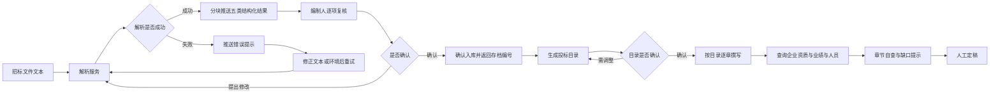
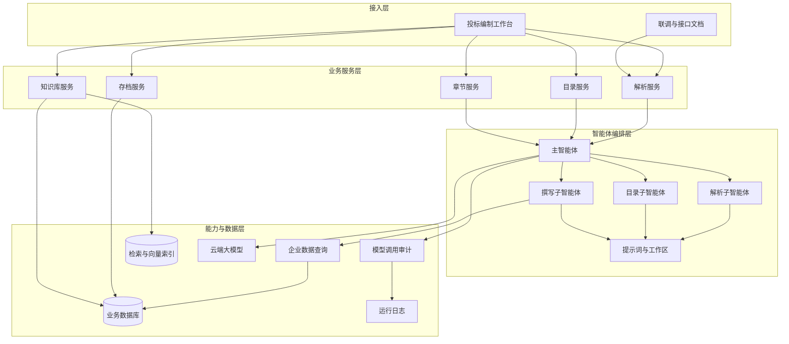
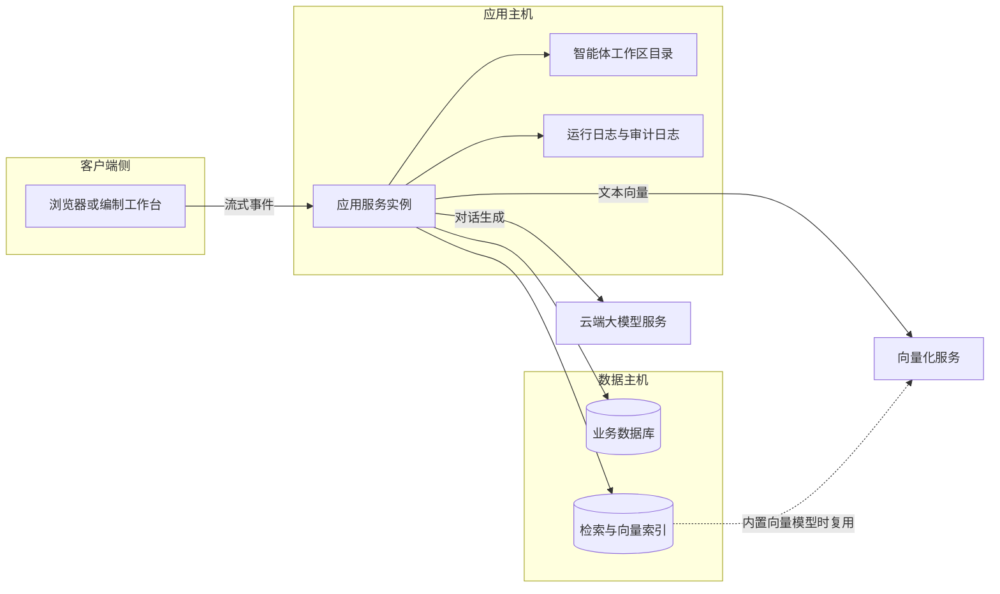
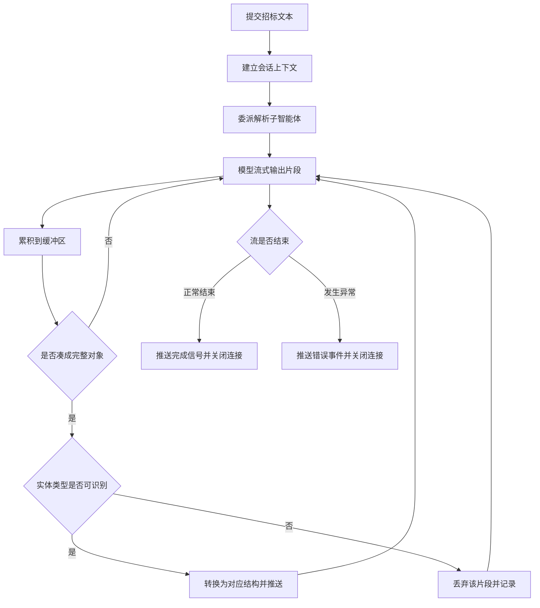
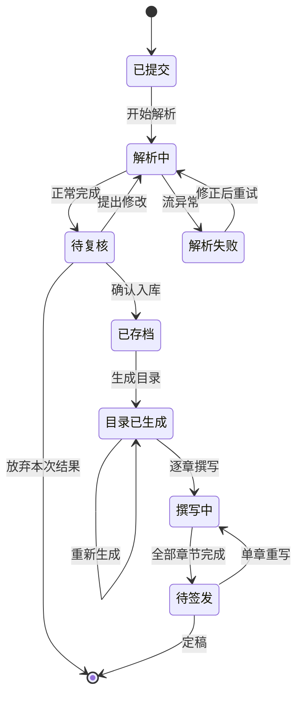
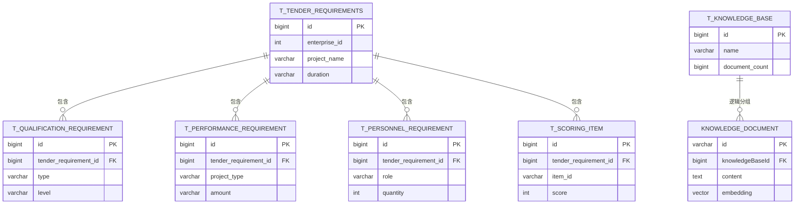
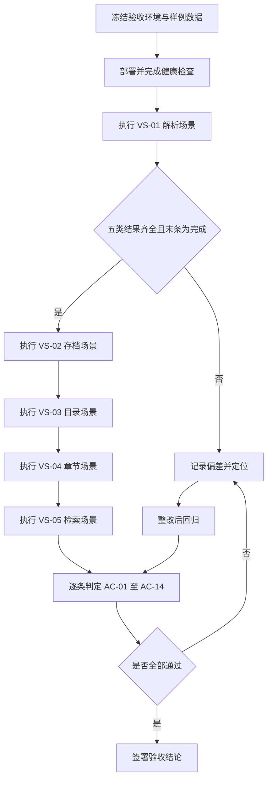
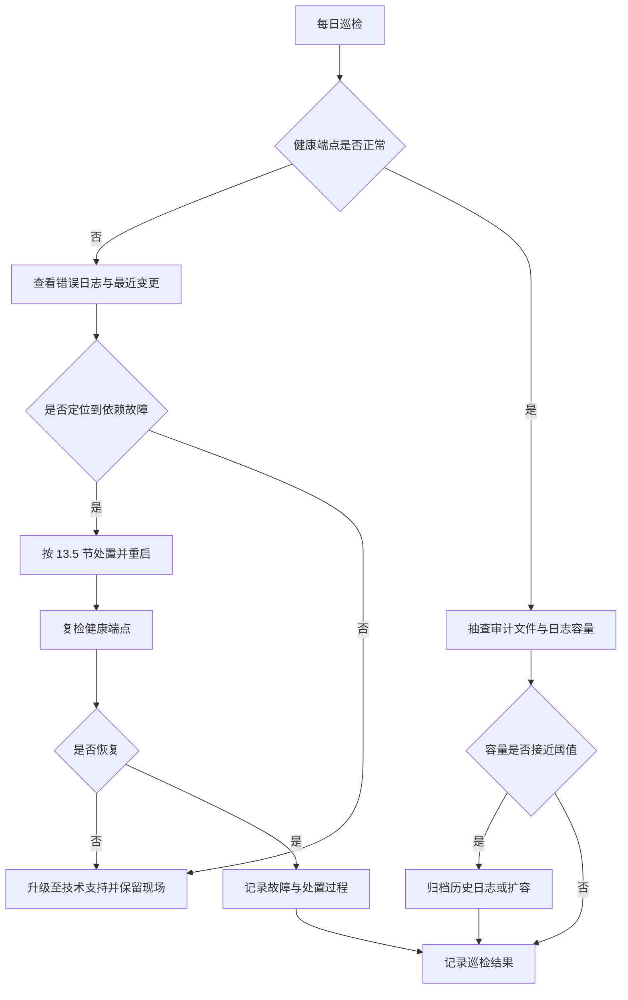

# 投标文件智能编制服务 详细设计（客户评审版）

| 项目 | 内容 |
|---|---|
| 文档名称 | 投标文件智能编制服务 详细设计说明书 |
| 文档版本 | V1.0 |
| 编制日期 | 2026-10-28 |
| 代码基线 | 快照 2026-10-28（非版本库工程，以当日源码树为准） |
| 技术栈 | Java 21、Spring Boot 4.1.1、响应式 Web 框架、智能体编排框架 2.0.4、MySQL、Elasticsearch 9.3.3 |
| 文档状态 | 评审稿（供甲方业务负责人、评审专家、验收人阅读） |
| 适用范围 | 招标文件解析、投标目录生成、章节撰写、知识库检索、企业数据查询全链路 |

## 目录

- [1. 引言](#1-引言)
- [2. 项目概述](#2-项目概述)
- [3. 总体设计](#3-总体设计)
- [4. 功能详细设计](#4-功能详细设计)
- [5. 核心组件与协作](#5-核心组件与协作)
- [6. 关键机制详细设计](#6-关键机制详细设计)
- [7. 数据设计](#7-数据设计)
- [8. 接口设计](#8-接口设计)
- [9. 非功能设计](#9-非功能设计)
- [10. 异常与边界设计](#10-异常与边界设计)
- [11. 测试与验收设计](#11-测试与验收设计)
- [12. 风险与应对](#12-风险与应对)
- [13. 部署与运维](#13-部署与运维)
- [14. 附录](#14-附录)

## 1. 引言

### 1.1 编写目的

本文档面向招标方业务负责人、评审专家与验收人，说明"投标文件智能编制服务"当前版本**做什么、怎么做、做到什么程度、什么情况下做不到**，作为需求确认、方案评审与验收判定的共同依据。

文档回答四类问题：

1. 一段招标文件文本进来，系统输出什么、依据什么规则输出。
2. 输出结果在哪些环节需要人工确认，确认前后数据如何保存。
3. 系统的能力边界、性能假设与已知限制是什么。
4. 验收时如何判定"通过"，异常情况下客户会看到什么提示。

本文档不承担代码交接职责，实现级细节（类、方法、行号）只出现在第 14 章证据索引，供技术复核使用。

### 1.2 设计范围

本版本覆盖"从招标文件文本到投标章节初稿"的主链路，以及支撑链路的检索与数据查询能力。

| 范围类型 | 内容 |
|---|---|
| 覆盖 | 招标文件文本解析与结构化输出、解析结果确认入库、投标目录生成、投标章节撰写、知识库写入、知识库混合检索、企业资质与业绩与人员查询、模型调用审计留痕 |
| 覆盖 | 六个对外接口、五张招标要求数据表、一个知识库元数据表、一个检索索引、日志与健康检查 |
| 不覆盖 | 招标文件的原生格式解析（如扫描件识别、复杂表格还原）、投标文件排版导出与签章、报价计算与商务决策、多租户与账号体系、知识库文档的更新与删除、目录与章节结果的持久化 |
| 不覆盖 | 与企业内部招采平台、电子签章平台、造价系统的对接适配 |
| 边界说明 | 系统以"文本"为输入起点，文本获取与清洗由调用方负责；这是本版本明确的能力前置条件 |

不覆盖项对客户的影响与替代方案统一在第 10.4 节与第 12 章说明，不在此重复。

### 1.3 术语表

| 术语 | 业务含义 | 首次出现时的解释 |
|---|---|---|
| 招标要求 | 从招标文件中提取出的结构化约束集合，含项目概况、资质、业绩、人员、评分点五类 | 系统内部把"读懂招标文件"的结果称为招标要求 |
| 解析 | 把非结构化的招标文件文本转换为结构化要求的过程 | 由解析子智能体完成，结果分块回传 |
| 评分点 | 评标办法中可独立计分的评审条目，含名称、分值、评审标准、建议承载章节 | 目录与章节都以评分点为最小对齐单位 |
| 目录 | 投标文件的章节骨架，每个条目关联一个或多个评分点 | 目录决定后续逐章撰写的顺序 |
| 章节 | 投标文件中一段可独立成稿的内容 | 章节撰写以评分点为写作依据 |
| 智能体 | 具备任务规划与工具调用能力的大模型执行单元 | 本系统由一个主智能体调度三类子智能体 |
| 子智能体 | 承担单一职责的智能体，如解析、目录、撰写 | 子智能体之间不直接通信，由主智能体串联 |
| 知识库 | 按名称分组的文本集合，支持全文与向量混合检索 | 用于沉淀企业资料、历史标书、技术方案 |
| 向量 | 文本在数学模型中的数值表示，用于"意思相近"的检索 | 向量检索弥补关键词检索找不到同义表述的缺陷 |
| 混合检索 | 同时执行关键词检索与向量检索，再融合排序 | 本系统采用倒数排名融合，兼顾精确与语义 |
| 融合排序 | 把两路检索结果按名次折算成分数后合并 | 名次越靠前得分越高，两路都命中则累加 |
| 流式事件 | 服务端在处理过程中逐条推送结果，浏览器可边接收边展示 | 解析结果的回传方式，不必等全部完成 |
| 软删除 | 数据保留在库中，仅以标记位表示"已删除" | 便于追溯，不物理清除 |
| 审计留痕 | 记录每次模型调用的输入、输出、耗用量与耗时 | 用于质量追溯与成本核算 |

### 1.4 参考文档

| 编号 | 名称 | 用途 |
|---|---|---|
| REF-01 | 项目立项与建设方案（甲方提供） | 业务目标与验收口径来源 |
| REF-02 | 招标文件解析字段口径说明（随本文档交付） | 五类结构化字段的业务定义 |
| REF-03 | 知识库检索效果评估方案（随本文档交付） | 检索质量的度量方法 |
| REF-04 | 运维交接清单（第 13 章） | 部署、配置、故障处理依据 |
| REF-05 | 本文档第 14 章证据索引 | 结论与实现位置的对应关系 |

### 1.5 版本记录

| 版本 | 日期 | 修订内容 | 修订人 | 状态 |
|---|---|---|---|---|
| V1.0 | 2026-10-28 | 首次成文，覆盖 14 章与全部对外能力 | 编制组 | 评审稿 |
| V1.0-draft | 2026-10-20 | 内部草稿，仅含功能与数据两章 | 编制组 | 已废止 |

## 2. 项目概述

### 2.1 业务背景与痛点

投标文件编制是典型的"高强度、低复用、强约束"工作：一份标书动辄数百页，编制人需要在有限时间内完成"读招标文件—拆评分点—搭目录—填内容—自查漏项"的循环，且每一个数字都必须能回溯到原文或企业台账。

| 编号 | 现状痛点 | 具体表现 | 业务后果 |
|---|---|---|---|
| P-01 | 招标文件阅读成本高 | 资格条件、评分办法、技术规范分散在数十页中，关键约束靠人工摘录 | 漏读资格条款导致废标风险 |
| P-02 | 评分点与章节脱节 | 目录按模板套用，未逐条对齐评分办法 | 写了的内容不得分，得分点没写 |
| P-03 | 企业资料分散 | 资质、业绩、人员在多个台账中，编制人凭记忆引用 | 引用过期资质或夸大业绩，构成实质风险 |
| P-04 | 复用靠个人经验 | 历史标书散落在个人电脑，检索靠翻目录 | 同类章节重复劳动，质量不稳定 |
| P-05 | 自查缺乏依据 | 成稿后靠通读检查，无结构化漏项清单 | 交付前返工，压缩复核时间 |
| P-06 | 过程不可追溯 | 谁在什么时间改了什么、依据哪段原文，无记录 | 出问题无法定位责任环节 |

### 2.2 建设目标与成功标准

| 编号 | 建设目标 | 成功标准（可判定） | 对应痛点 |
|---|---|---|---|
| G-01 | 把招标文件读成结构化要求 | 一次解析可输出五类结构化结果，每条列表项带原文出处 | P-01 |
| G-02 | 目录与评分点强制对齐 | 目录中每个评分点至少被一个条目承载，缺口显式列出 | P-02 |
| G-03 | 企业数据只来自台账 | 章节中出现的资质、业绩、人员均来自查询结果，查不到即声明缺失 | P-03 |
| G-04 | 沉淀可复用知识资产 | 文本可按知识库分组写入，并支持按语义与关键词混合检索 | P-04 |
| G-05 | 成稿前有结构化自查 | 每章输出前对照评分点自查，未覆盖项形成缺口提示 | P-05 |
| G-06 | 关键环节可追溯 | 解析结果经人工确认才入库；每次模型调用留痕 | P-06 |

目标值的量化口径见第 9 章，验收判定见第 11 章。

### 2.3 角色与典型场景

| 角色 | 职责 | 系统内可做的事 | 关注点 |
|---|---|---|---|
| 投标编制人 | 编制标书主体 | 提交招标文本、复核解析结果、确认入库、生成目录、逐章撰写 | 结果是否可直接改用 |
| 投标复核人 | 复核合规与漏项 | 查看原文出处、比对评分点覆盖、查看缺口提示 | 是否有编造与漏项 |
| 企业资料管理员 | 维护资质业绩人员台账 | 维护企业基础数据、向知识库灌入资料 | 数据是否准确、是否被正确引用 |
| 业务负责人 | 决策与签发 | 查看目录结构、章节摘要、缺口与风险提示 | 整体质量与交付风险 |
| 系统管理员 | 部署与运行保障 | 部署、配置、健康检查、日志排查 | 可用性与故障恢复 |

| 编号 | 典型场景 | 触发条件 | 系统行为 | 人工介入点 |
|---|---|---|---|---|
| S-01 | 新项目首次解析 | 拿到招标文件文本 | 流式输出五类结构化结果 | 逐项复核并提修改意见 |
| S-02 | 解析结果确认 | 编制人认可结果 | 一次性写入主表与四张子表，返回存档编号 | 确认动作本身 |
| S-03 | 目录编制 | 已有存档编号 | 依评分点生成目录，标注缺口 | 确认目录结构 |
| S-04 | 章节撰写 | 目录条目确定 | 按章节标题与评分点撰写初稿 | 定稿与润色 |
| S-05 | 资料沉淀 | 有可复用文本 | 写入指定知识库并生成向量 | 选择知识库名称 |
| S-06 | 资料查找 | 需要历史方案参考 | 关键词与语义混合检索，返回最相关片段 | 判断可用性 |

### 2.4 端到端业务流程



| 步骤 | 输入 | 处理 | 输出 | 失败时客户看到什么 |
|---|---|---|---|---|
| 1 提交文本 | 招标文件纯文本 | 建立本次会话上下文 | 流式连接 | 请求被拒绝或超时提示 |
| 2 结构化解析 | 文本 | 按五类实体逐条抽取 | 分块结构化结果 | 错误事件与原因描述 |
| 3 人工复核 | 结构化结果 | 逐项比对原文出处 | 修改意见 | 无（人工环节） |
| 4 确认入库 | 结构化结果 | 单事务写入五张表 | 存档编号 | 保存失败提示，数据不落库 |
| 5 目录生成 | 存档编号 | 按评分点映射章节 | 目录文本与缺口说明 | 生成失败提示 |
| 6 章节撰写 | 章节标题与评分点 | 检索企业数据并成文 | 章节初稿 | 生成失败提示 |
| 7 定稿 | 章节初稿 | 人工润色与签发 | 投标文件 | 无（人工环节） |

### 2.5 技术选型说明

| 选型项 | 选择 | 理由 | 代价与约束 |
|---|---|---|---|
| 运行语言与框架 | Java 21 与 Spring Boot 4.1.1 | 企业级生态成熟，团队可维护，长期支持 | 版本较新，第三方组件兼容需逐项验证 |
| 服务通信模型 | 响应式 Web 框架 | 解析为长耗时流式任务，响应式可避免线程占用 | 排障链路较传统阻塞模型复杂 |
| 智能体编排 | 智能体编排框架 2.0.4 | 提供子智能体、工具调用、会话状态与事件流能力 | 框架版本迭代快，升级需回归 |
| 结构化数据存储 | MySQL | 招标要求为强结构数据，需事务与自增主键 | 需自行维护建表脚本，无自动迁移 |
| 检索与向量存储 | Elasticsearch 9.3.3 | 同一引擎内完成关键词与向量检索，减少组件数量 | 依赖中文分词插件与向量维度约定 |
| 文本向量化 | 检索引擎内置模型（默认）或云端向量服务 | 默认方案不出内网，降低数据外送风险 | 内置模型维度固定，变更需重建索引 |
| 大模型服务 | 云端对话模型 | 中文长文本理解与生成质量满足要求 | 依赖外部服务可用性与配额 |

选型的取舍结论：本版本优先"组件少、可私有化"，因此把向量能力收敛到检索引擎内部，把结构化数据收敛到单一关系库；代价是检索能力受引擎版本约束，容量扩展以垂直扩容为主。

## 3. 总体设计

### 3.1 逻辑架构

系统按"接入—业务服务—智能体编排—能力与数据"四层组织，业务服务不直接调用大模型，统一经编排层调度，保证解析、目录、撰写三条链路的提示词与工具权限可分别治理。



### 3.2 模块划分与职责

| 模块 | 核心职责 | 对外能力 | 依赖 |
|---|---|---|---|
| 解析服务 | 接收招标文本，驱动流式解析并按模块回传 | 解析 | 编排层、解析子智能体 |
| 存档服务 | 将确认后的结构化结果单事务写入五张表 | 确认入库 | 业务数据库 |
| 目录服务 | 依存档编号生成目录与缺口说明 | 目录生成 | 编排层、目录提示词 |
| 章节服务 | 按章节标题与评分点撰写初稿 | 章节撰写 | 编排层、企业数据查询 |
| 知识库服务 | 文本分组写入、向量化、混合检索与融合排序 | 知识写入、知识检索 | 检索索引、向量化服务 |
| 企业数据服务 | 按资质类型、项目关键词、岗位查询企业台账 | 资质与业绩与人员查询 | 业务数据库 |
| 编排与工作区 | 装配智能体、装配工具、释放工作区声明文件 | 无（内部能力） | 工作区目录 |
| 审计与日志 | 记录每次模型调用的输入输出、耗用量、耗时 | 无（内部能力） | 日志目录 |

模块之间的调用是单向的：接入层只调业务服务，业务服务只调编排层，编排层通过工具回调能力层。这一约束避免业务服务绕过编排直接拼提示词，也避免子智能体越权访问数据库。

### 3.3 部署拓扑

本版本为单体应用加两套数据服务的形态，应用实例无状态化尚未完成（会话状态驻留内存），因此按单实例部署设计，扩容需先改造会话存储。



| 部署单元 | 形态 | 关键要求 | 本版本现状 |
|---|---|---|---|
| 应用服务 | 单进程 | 出网可达模型服务，本地可写工作区与日志 | 单实例，端口固定为 8080 |
| 业务数据库 | 关系库实例 | 字符集支持中文，具备事务能力 | 单实例，建表脚本随代码交付 |
| 检索与向量索引 | 检索引擎实例 | 需中文分词插件，需支持向量字段 | 单节点索引，1 分片 0 副本 |
| 智能体工作区 | 本地目录 | 启动时可写，重启后保留会话与记忆 | 启动时覆盖声明文件，保留运行产物 |
| 日志目录 | 本地目录 | 容量不少于 2 GB，按日归档 | 单文件 50 MB 滚动，保留 30 天 |
| 云端模型服务 | 外部服务 | 网络可达，配额充足 | 由配置指定模型名称 |

### 3.4 技术栈清单

| 层次 | 组件 | 版本 | 用途 |
|---|---|---|---|
| 语言 | Java | 21 | 运行时 |
| 框架 | Spring Boot | 4.1.1 | 应用容器与依赖装配 |
| Web | 响应式 Web 框架 | 随框架 | 流式事件推送与普通请求 |
| 编排 | 智能体编排框架 | 2.0.4 | 智能体、工具、会话、事件 |
| 模型接入 | 云端对话模型扩展 | 2.0.4 | 调用对话模型 |
| 数据访问 | 增强型关系映射框架 | 3.5.17 | 单表增删改查与条件构造 |
| 数据库驱动 | MySQL 驱动 | 26.7.0 | 连接业务库 |
| 检索 | Elasticsearch 客户端 | 9.3.3 | 索引管理、批量写入、双路检索 |
| 接口文档 | OpenAPI 组件 | 3.1.1 | 在线接口说明 |
| 健康检查 | 应用监控组件 | 随框架 | 健康与运行指标端点 |

完整的依赖声明见证据 E-24；构建配置的特殊之处见 13.2 节与 E-22。

### 3.5 关键设计决策与取舍

| 编号 | 决策 | 备选方案 | 选择理由 | 代价 |
|---|---|---|---|---|
| D-01 | 解析结果分块流式回传，而非一次性返回 | 一次性返回整份结构 | 长文本解析耗时数十秒，流式可边看边审 | 客户端需按事件模型处理，弱网下需重连策略 |
| D-02 | 解析结果不自动入库，人工确认后才写库 | 解析即入库 | 避免模型误抽取污染台账 | 多一次人工操作 |
| D-03 | 入库采用单事务写五张表 | 异步分表写入 | 保证主子表一致，失败可整体回滚 | 大批量写入时事务持有时间较长 |
| D-04 | 主体结构按五类实体拆分平级对象 | 单个嵌套大对象 | 单条对象小，解析成功率高，可逐条展示 | 需要客户端按类型聚合 |
| D-05 | 检索在应用侧做融合排序 | 依赖检索引擎商业版融合能力 | 基础版即可用，降低授权成本 | 两路候选需在应用内存中合并 |
| D-06 | 默认使用检索引擎内置向量模型 | 全部走云端向量服务 | 文本不出内网，降低合规风险 | 维度固定为 384，切换模型需重建索引 |
| D-07 | 目录与章节结果只返回文本，不落库 | 结果持久化并可版本对比 | 缩短首版交付周期 | 历史版本不可回溯，需人工另存 |
| D-08 | 会话状态驻留内存 | 外部会话存储 | 减少组件依赖 | 重启丢失会话，无法多实例横向扩展 |

D-07 与 D-08 是明确的阶段性取舍，对客户的影响与替代方案见 10.4 节，不在本版本承诺范围内。

## 4. 功能详细设计

本章逐功能说明：业务入口是什么、处理流程怎么走、遵守哪些业务规则、产出什么、状态如何变化、失败时客户看到什么。每个功能末尾给出业务规则表，规则编号在全文唯一。

### 4.1 招标文件解析

**业务入口**：编制人提交招标文件纯文本，系统建立本次会话并流式返回结构化结果。入口地址为 `POST /tender/parse`，请求体含用户标识与招标文本。

**处理流程**：主智能体接收任务后委派解析子智能体；模型以片段形式持续输出，系统在缓冲区中拼接，每当凑齐一个完整对象就识别实体类型并推送，全部结束后推送完成信号。事件类型与模块取值的约定见 E-01、E-02。



**业务规则**：

| 规则编号 | 触发条件 | 结果 | 异常处理 |
|---|---|---|---|
| BR-4.1-01 | 提交的文本为空或只有空白 | 仍发起解析，通常得到空的完成信号 | 客户端提示"未识别到有效内容"，允许补充文本后重试 |
| BR-4.1-02 | 对象的实体类型不在五类之内 | 丢弃该对象，其他对象照常推送 | 记录一条告警，不向客户抛出 |
| BR-4.1-03 | 单个对象结构损坏无法转换 | 跳过该条，继续处理后续 | 记录片段原文，供技术复核 |
| BR-4.1-04 | 同类实体存在多条 | 逐条推送，顺序与模型输出一致 | 由客户端按类型聚合展示 |
| BR-4.1-05 | 模型服务不可用或流中断 | 推送一条错误事件，随后正常结束流 | 客户端展示错误原因，不重试同一连接 |
| BR-4.1-06 | 解析已完成 | 推送完成信号，连接关闭 | 客户端停止接收，不得继续等待 |
| BR-4.1-07 | 解析结果尚未确认 | 不写任何数据库 | 刷新或关闭页面即丢弃本次结果 |

**输出物**：五类结构化对象，逐条携带原文出处片段，便于复核。

| 模块取值 | 业务含义 | 关键字段 |
|---|---|---|
| `project` | 项目概况 | 项目名称、建设地点、工期、预算或报价上限 |
| `qualification` | 资质要求 | 资质类型、等级、有效期要求、原文出处 |
| `performance` | 业绩要求 | 类似项目类型、数量、金额、时间范围、原文出处 |
| `personnel` | 人员要求 | 岗位、人数、证书或职称要求、原文出处 |
| `scoringItem` | 评分点 | 名称、分值、评审标准、建议承载章节、原文出处 |

**状态变化**：本次解析任务由"已提交"进入"解析中"，结束时进入"待复核"（正常）或"解析失败"（异常）。结果在确认前不落库，因此不存在"已存档"状态。

**异常与提示**：解析阶段的失败不通过请求状态码表达，而是以错误事件承载，文案形如"解析失败：具体原因"（见 E-03）。这意味着**连接本身仍是成功的**，客户端必须识别错误事件，否则会把失败当成空结果。

### 4.2 解析结果确认入库

**业务入口**：编制人复核并修改结构化结果后，提交完整结构请求入库，入口为 `POST /tender/parse/confirm`。

**处理流程**：系统先按各字段的列宽做长度归一，再写入主表并取得存档编号，随后依次写入资质、业绩、人员、评分点四张子表；任一环节失败则整体回滚。写入路径见 E-04、E-06，长度归一规则见 E-05。

**业务规则**：

| 规则编号 | 触发条件 | 结果 | 异常处理 |
|---|---|---|---|
| BR-4.2-01 | 未提供企业标识 | 数据库拒绝写入 | 返回保存失败，需补齐企业标识后重提 |
| BR-4.2-02 | 某字段长度超过列宽 | 超长部分被截断后保存，不报错 | 客户无感知；复核时以原文出处片段为准 |
| BR-4.2-03 | 同一份结果重复提交 | 生成一条新记录，不去重 | 客户端应避免重复点击；重复数据需人工清理 |
| BR-4.2-04 | 任一子表写入失败 | 五张表全部回滚 | 返回保存失败，数据保持入库前状态 |
| BR-4.2-05 | 入库成功 | 返回存档编号（自增整数） | 客户端以此编号发起目录生成 |
| BR-4.2-06 | 请求体缺少必填结构 | 保存失败 | 返回失败提示，不产生部分数据 |

**输出物**：一个整数型存档编号，是后续目录生成与章节撰写的唯一凭据。

**状态变化**：结构化结果由"待复核"进入"已存档"。同一份招标文件多次确认会产生多条存档记录，系统不维护版本关系。

**异常与提示**：失败时返回服务端错误状态与通用错误体，不带业务错误码；客户看到的是"保存失败"，需要技术支持结合日志定位具体字段。

### 4.3 投标目录生成

**业务入口**：编制人凭存档编号发起目录生成，入口为 `POST /tender/catalog`，请求体含用户标识与存档编号。

**处理流程**：系统载入目录编制提示词模板并把存档编号注入其中（见 E-07），主智能体据此调用查询工具取回该编号下的完整要求，再按评分点映射规则组织章节，最后一次性返回目录文本与缺口说明。

**业务规则**：

| 规则编号 | 触发条件 | 结果 | 异常处理 |
|---|---|---|---|
| BR-4.3-01 | 存档编号不存在 | 返回空目录，并在缺口说明中标注"未找到该编号的要求" | 客户核对编号后重试，不产生脏数据 |
| BR-4.3-02 | 招标内容区分商务标与技术标 | 输出两套独立目录 | 同一评分点不得在两套目录中重复出现 |
| BR-4.3-03 | 商务与技术内容混合编排 | 输出一套合并目录，章内分商务响应与技术响应 | 无（正常路径） |
| BR-4.3-04 | 存在评分点 | 每个评分点至少映射到一个目录条目 | 未覆盖的评分点列入缺口说明 |
| BR-4.3-05 | 评分点建议章节为空 | 按评分点名称与评审标准判断归属 | 在内容提示中写明判断依据 |
| BR-4.3-06 | 缺少某类要求（如无业绩要求） | 保留该章节并注明"招标要求未提供，需人工确认" | 同时写入缺口说明 |
| BR-4.3-07 | 目录层级 | 最多三级，一级章节建议 5 至 10 个 | 超出层级的内容并入内容提示 |
| BR-4.3-08 | 生成成功 | 返回目录文本，不写数据库 | 客户需自行另存，系统不留版本 |

**输出物**：目录条目集合，每条含章节编号、章节标题、关联评分点标识、内容要点提示；另附结构判断说明与缺口清单。

| 输出字段 | 业务含义 | 约束 |
|---|---|---|
| 章节编号 | 目录层级位置 | 阿拉伯数字点分，最多三级 |
| 章节标题 | 该章写什么 | 不超过 20 字，不使用"其他"类兜底名 |
| 关联评分点 | 该章支撑哪些得分点 | 原样引用评分点标识，不得重新编号 |
| 内容要点提示 | 撰写指引 | 1 至 2 句，须具体到可指导撰写 |
| 结构判断说明 | 为何合并或分列 | 一句话，说明依据 |
| 缺口说明 | 未覆盖或缺失项 | 无缺口时为空清单，不得省略 |

**状态变化**：本功能不改变任何持久状态；目录仅存在于本次响应中。

**异常与提示**：生成失败返回服务端错误状态与通用错误体；存档编号无效不属于失败，而是以空目录加缺口说明的形式返回，客户需从"缺口"而非"错误"中识别问题。

### 4.4 投标章节撰写

**业务入口**：目录确认后逐章发起撰写，入口为 `POST /tender/chapter`，请求体含用户标识、章节标题、关联评分点标识（逗号分隔）。

**处理流程**：系统把章节标题与评分点标识拼成撰写指令（见 E-08），主智能体委派撰写子智能体；子智能体在企业数据查询工具允许的范围内取证，按"评分点解读—满足情况阐述—支撑材料引用"的结构成文，并在输出前对照评分点自查。

**业务规则**：

| 规则编号 | 触发条件 | 结果 | 异常处理 |
|---|---|---|---|
| BR-4.4-01 | 章节标题为空 | 仍发起撰写，但成文方向不可控 | 客户端应拦截空标题并提示补齐 |
| BR-4.4-02 | 未提供评分点标识 | 按标题撰写，不引用具体评审标准 | 成文与评分办法的对应关系需人工补 |
| BR-4.4-03 | 需要引用企业资质、业绩、人员 | 必须调用查询能力取证 | 不得凭模型记忆填写 |
| BR-4.4-04 | 查询结果为空 | 成文中明确写出"该数据暂未在系统中找到" | 由编制人补录台账后重写该章 |
| BR-4.4-05 | 关键数字（工期、金额、人数） | 必须能追溯到招标原文或查询结果 | 无出处的数字不得出现 |
| BR-4.4-06 | 一次撰写请求 | 建立独立会话，不继承上一次上下文 | 章节之间的一致性需人工统稿 |
| BR-4.4-07 | 撰写成功 | 返回纯文本章节初稿，不写数据库 | 需人工另存与定稿 |
| BR-4.4-08 | 模型服务异常 | 请求失败，无部分结果 | 返回通用错误体，可原样重试 |

**输出物**：章节初稿纯文本，结构为评分点解读、满足情况、支撑材料引用三段式。

**状态变化**：无持久状态变化；章节初稿不进入系统台账。

**异常与提示**：本功能没有单独的缺口提示通道，缺口写在正文中；客户需要人工阅读识别，这是当前版本的一个可用性短板，改进方向见第 12 章 R-06。

### 4.5 知识库写入

**业务入口**：资料管理员把一批文本写入指定名称的知识库，入口为 `POST /knowledge/{knowledgeBaseName}`，请求体为字符串数组。

**处理流程**：校验名称后按名称查找知识库，不存在则自动创建；过滤空白文本并去除首尾空格；若启用了向量化，先整批生成向量，再把文档写入检索索引，最后更新知识库的文档计数。写入路径见 E-09，批量与刷新策略见 E-14。

**业务规则**：

| 规则编号 | 触发条件 | 结果 | 异常处理 |
|---|---|---|---|
| BR-4.5-01 | 知识库名称为空 | 拒绝写入 | 返回保存失败，提示名称必填 |
| BR-4.5-02 | 文本数组为空 | 不写文档，返回知识库编号 | 无（正常路径，可用于预建库） |
| BR-4.5-03 | 数组含空白字符串 | 该条被忽略，其余正常写入 | 无（静默过滤） |
| BR-4.5-04 | 已启用向量化且向量生成失败 | 整批写入失败，不产生半成品 | 返回保存失败，需排查向量服务 |
| BR-4.5-05 | 未启用向量化 | 只写文本，检索时仅走关键词 | 检索召回率下降，需在验收时说明 |
| BR-4.5-06 | 同一文本重复提交 | 每次生成新文档标识，形成重复记录 | 无自动去重，需人工避免 |
| BR-4.5-07 | 写入条数较多 | 按每批 500 条提交，写后立即刷新 | 单批失败则该批整体失败 |
| BR-4.5-08 | 写入成功 | 返回知识库编号，文档计数累加 | 计数为读改写，高并发下可能偏差 |

**输出物**：知识库编号（自增整数），可用于后续检索时按库过滤。

**状态变化**：知识库由"不存在"进入"已创建"，文档计数增加；文档由"未入库"进入"可检索"。本版本不提供文档的更新与删除，写入即长期有效。

**异常与提示**：失败返回服务端错误状态与通用错误体。由于数据库写入与索引写入不在同一事务中，索引已写入而数据库回滚时会出现"检索得到、计数不含"的不一致，影响与处置见第 12 章 R-03。

### 4.6 知识库混合检索

**业务入口**：编制人按关键词或问题检索知识库，入口为 `GET /knowledge/search`，可指定一个或多个知识库名称，不指定则跨全部知识库检索。

**处理流程**：校验查询内容；按名称解析出知识库编号（名称不存在即失败）；生成查询向量；同时执行关键词检索与向量检索，各取候选；在应用侧用倒数排名融合排序并截断到指定条数。融合逻辑见 E-11，排序常数见 E-12。任一依赖失败时的行为按下表规则处理。

**业务规则**：

| 规则编号 | 触发条件 | 结果 | 异常处理 |
|---|---|---|---|
| BR-4.6-01 | 查询内容为空 | 返回参数错误 | 提示"查询内容不能为空" |
| BR-4.6-02 | 指定了不存在的知识库名称 | 整体失败 | 提示"知识库不存在"并列出缺失名称 |
| BR-4.6-03 | 未指定知识库名称 | 跨全部知识库检索 | 结果可能混入其他项目资料 |
| BR-4.6-04 | 条数参数小于等于 0 | 按默认 10 条返回 | 无提示（静默纠正） |
| BR-4.6-05 | 条数参数大于 50 | 按 50 条返回 | 无提示（静默截断） |
| BR-4.6-06 | 查询向量生成失败 | 降级为纯关键词检索 | 记录告警，客户无感知（见 E-10） |
| BR-4.6-07 | 未启用向量化 | 只执行关键词检索 | 语义相近但用词不同的内容可能检索不到 |
| BR-4.6-08 | 索引不存在 | 首次访问时自动创建 | 索引结构按配置的维度建立 |
| BR-4.6-09 | 返回结果 | 按融合分数降序，同分按创建时间倒序 | 分数仅用于排序，不代表相似度百分比 |

**输出物**：命中片段列表，每条含文档标识、文本内容、创建时间、融合得分。

**状态变化**：只读操作，不改变任何状态；索引不存在时会产生"创建索引"这一副作用。

**异常与提示**：检索引擎不可用时返回服务端错误；需要提醒客户的是，**降级是静默的**，客户无法从响应中判断本次结果是否使用了向量检索，验收时应结合日志确认。

### 4.7 企业数据查询

**业务入口**：不对外暴露独立接口，仅由撰写子智能体在成文过程中调用，用于取证企业资质、类似业绩、项目人员。

**处理流程**：按查询条件构造筛选；条件为空则返回该类全部记录；结果直接交给模型作为写作素材。

**业务规则**：

| 规则编号 | 触发条件 | 结果 | 异常处理 |
|---|---|---|---|
| BR-4.7-01 | 按资质类型查询 | 精确匹配资质类型 | 类型为空返回全部资质 |
| BR-4.7-02 | 按项目关键词查询业绩 | 项目名称模糊匹配 | 关键词为空返回全部业绩 |
| BR-4.7-03 | 按岗位查询人员 | 精确匹配岗位 | 岗位为空返回全部人员 |
| BR-4.7-04 | 无匹配记录 | 返回空列表 | 模型须声明"暂未在系统中找到" |
| BR-4.7-05 | 结果条数较多 | 一次性返回全部，不分页 | 数据量大时影响生成耗时 |

**输出物**：资质记录（类型、名称、证书编号、有效期）、业绩记录（项目名称、委托方、合同金额、签约日期）、人员记录（姓名、岗位、职称、从业年限）。

**状态变化**：无。

**异常与提示**：查询异常对客户表现为章节内容缺失或成文失败；由于是内部调用，客户看不到具体错误，需要技术支持从日志定位。

### 4.8 模型调用审计

**业务入口**：无独立入口，随每次模型调用自动触发。

**处理流程**：在一次模型调用开始时记录起始时间，调用过程中累积输入消息、模型思考内容与回复内容，结束时汇总耗用量与耗时，写出一个独立的审计文件（见 E-21）。

**业务规则**：

| 规则编号 | 触发条件 | 结果 | 异常处理 |
|---|---|---|---|
| BR-4.8-01 | 每次模型调用 | 生成一个独立审计文件 | 文件名含毫秒级时间戳，避免覆盖 |
| BR-4.8-02 | 记录内容 | 含时间、模型名、输入消息、思考、回复、耗用量、耗时 | 用于质量追溯与成本核算 |
| BR-4.8-03 | 审计目录不存在 | 启动时自动创建 | 创建失败记录错误日志，不阻断启动 |
| BR-4.8-04 | 审计写入失败 | 不影响主流程 | 记录错误日志，客户请求照常返回 |
| BR-4.8-05 | 审计文件保留 | 随日志目录整体滚动与容量上限管理 | 无按调用维度的独立清理策略 |
| BR-4.8-06 | 审计内容含敏感信息 | 原文与回复被完整落盘 | 需通过目录权限与访问审计控制，见 9.3 节 |

**输出物**：每次调用一个结构化审计文件。

**状态变化**：无业务状态变化，仅产生文件。

**异常与提示**：审计失败对客户不可见；这也意味着**审计不可用时不会阻断业务**，验收时需单独抽查审计文件是否齐全。

## 5. 核心组件与协作

### 5.1 组件职责

| 组件 | 业务定位 | 核心职责 | 不负责什么 |
|---|---|---|---|
| 主智能体 | 调度中枢 | 理解任务、选择子智能体、串联解析到成稿的步骤 | 不亲自做结构化抽取，不直接写库 |
| 解析子智能体 | 招标文件读者 | 通读全文，按五类实体输出结构化对象 | 不做目录设计，不做数据核对 |
| 目录子智能体 | 目录编制者 | 依据评分点生成章节骨架与缺口说明 | 不撰写正文 |
| 撰写子智能体 | 章节作者 | 按评分点成文，引用查询到的企业数据 | 不决定目录结构 |
| 提示词与工作区 | 行为约定载体 | 提供角色说明、调度规则、写作约束，启动时释放到工作区 | 不承载业务数据 |
| 事件转换组件 | 结果整形器 | 把模型输出的片段拼成结构化对象并按模块推送 | 不做业务校验 |
| 存档组件 | 台账写入者 | 单事务写入主表与四张子表，做列宽归一 | 不做重复判定 |
| 知识库组件 | 资料管理员 | 分组写入、向量化、双路检索与融合排序 | 不做文档更新与删除 |
| 检索引擎访问组件 | 索引操作者 | 索引创建、批量写入、关键词与向量检索 | 不感知业务语义 |
| 企业数据组件 | 台账查询者 | 按类型、关键词、岗位查询资质业绩人员 | 不修改台账 |
| 审计组件 | 留痕者 | 每次模型调用落一个审计文件 | 不阻断业务 |

### 5.2 能力清单

| 能力 | 输入 | 输出 | 关键约束 |
|---|---|---|---|
| 结构化抽取 | 招标文本 | 五类结构化对象 | 逐条携带原文出处；无法确定时标注"未明确" |
| 目录编制 | 存档编号 | 目录条目与缺口清单 | 评分点全覆盖；编号不得改写 |
| 章节撰写 | 章节标题与评分点标识 | 章节初稿 | 企业数据必须来自查询 |
| 企业取证 | 资质类型、项目关键词、岗位 | 台账记录 | 只读；查不到即声明缺失 |
| 知识沉淀 | 知识库名称与文本数组 | 知识库编号 | 空白文本过滤；重复不去重 |
| 混合检索 | 查询内容与条数 | 命中片段 | 向量失败静默降级 |

### 5.3 协作时序

```mermaid
sequenceDiagram
    autonumber
    participant C as 编制人
    participant API as 接入层
    participant M as 主智能体
    participant S as 子智能体
    participant T as 数据能力
    participant DB as 存储
    C->>API: 提交招标文本
    API->>M: 建立会话并下发任务
    M->>S: 委派解析
    S-->>M: 流式输出片段
    M-->>API: 结构化事件
    API-->>C: 逐条展示结果
    C->>API: 确认并提交结构化结果
    API->>DB: 单事务写入五张表
    alt 写入成功
        DB-->>API: 存档编号
        API-->>C: 返回编号
        C->>API: 请求生成目录
        API->>M: 携带编号的目录任务
        M->>T: 读取该编号的完整要求
        T-->>M: 要求与评分点
        M-->>C: 目录与缺口说明
        C->>API: 请求撰写某章
        M->>T: 查询资质业绩人员
        T-->>M: 台账记录或空结果
        M-->>C: 章节初稿
    else 写入失败
        DB-->>API: 失败原因
        API-->>C: 保存失败提示，数据不落库
    end
```



| 阶段 | 参与方 | 关键动作 | 失败表现 |
|---|---|---|---|
| 解析 | 主智能体、解析子智能体 | 委派、流式抽取、逐条推送 | 错误事件，连接正常结束 |
| 复核 | 编制人 | 比对原文出处、提出修改 | 无（人工环节） |
| 存档 | 存档组件、数据库 | 归一、写主表、写子表 | 整体回滚，返回失败 |
| 目录 | 主智能体、目录子智能体 | 读取要求、映射评分点、输出缺口 | 空目录加缺口说明 |
| 撰写 | 主智能体、撰写子智能体、企业数据组件 | 取证、成文、自查 | 请求失败或正文声明缺失 |

### 5.4 组件边界与失败隔离

| 隔离点 | 机制 | 效果 | 残留风险 |
|---|---|---|---|
| 单条结构化对象 | 逐条转换，异常即跳过 | 一条坏数据不影响整份解析 | 被跳过条目对客户不可见 |
| 解析整体 | 异常转为错误事件 | 连接不中断，客户端可控 | 客户端若忽略事件会误判为空结果 |
| 存档 | 单事务 | 主子表一致 | 事务时长随条目数增长 |
| 知识写入 | 先向量化后写索引 | 向量失败不产生半成品 | 库与索引不在同一事务 |
| 检索 | 向量失败降级 | 查询仍可用 | 降级静默，质量下降不可见 |
| 审计 | 写入失败仅记日志 | 不影响业务 | 审计可能缺件 |

## 6. 关键机制详细设计

### 6.1 状态流转



| 状态 | 业务含义 | 进入条件 | 可执行动作 | 是否持久化 |
|---|---|---|---|---|
| 已提交 | 文本已收到，尚未开始 | 请求到达 | 取消 | 否 |
| 解析中 | 正在抽取 | 委派成功 | 等待、中断 | 否 |
| 待复核 | 结果已推送完毕 | 正常完成 | 修改、确认、放弃 | 否 |
| 解析失败 | 流异常终止 | 模型或网络异常 | 重试 | 否 |
| 已存档 | 结构化结果已入库 | 确认成功 | 生成目录 | 是 |
| 目录已生成 | 目录文本已返回 | 生成成功 | 重新生成、逐章撰写 | 否 |
| 撰写中 | 正在成文 | 目录确认 | 等待、重写单章 | 否 |
| 待签发 | 章节初稿齐备 | 末章完成 | 定稿、重写 | 否 |

状态机的关键约束：**只有"已存档"是持久状态**。其余状态都依附于一次会话或一次响应，服务重启即丢失；这意味着客户刷新页面后无法从系统恢复上次进度，必须依靠本地留存的目录与章节文本。

### 6.2 并发与顺序

| 场景 | 控制手段 | 保障结果 | 风险 |
|---|---|---|---|
| 解析事件顺序 | 串行拼接与逐条推送 | 事件顺序与模型输出一致 | 单条处理慢会拖慢整条流 |
| 存档写入 | 单事务串行写主子表 | 主子表一致 | 并发提交互不影响，但会产生多条记录 |
| 知识库首次建索引 | 进程内一次性初始化标记 | 避免重复建索引 | 多实例部署时各建各的，可能冲突 |
| 知识库文档计数 | 读当前值后加本次条数 | 单并发下准确 | 并发写入会丢计数 |
| 索引写入 | 每批 500 条，写后刷新 | 写入即可检索 | 大批量写入耗时随条数线性增长 |
| 审计文件 | 每次调用独立文件 | 互不覆盖 | 同一毫秒内两次调用理论上同名 |

结论：本版本仅在单实例、低并发假设下行为确定，多实例部署属未验证区域。

### 6.3 超时与重试

| 环节 | 超时设置 | 是否自动重试 | 依据与说明 |
|---|---|---|---|
| 向量服务连接 | 10 秒 | 否 | 连接阶段快速失败，避免请求堆积 |
| 向量服务请求 | 60 秒（云端）或 120 秒（引擎内置） | 否 | 按单批文本量估算，见 E-09 |
| 模型对话 | 未显式设置，依赖框架默认 | 否 | 长文本生成耗时长，硬超时易误杀〔INFER〕 |
| 数据库操作 | 未显式设置，依赖连接池默认 | 否 | 事务内失败即回滚 |
| 客户端流式接收 | 由客户端决定 | 客户端可重连 | 服务端不保证断点续传 |

重试策略的现状是"**不自动重试，由客户端决定**"。这一选择避免了重复计费与重复入库，但把重试责任交给了调用方。验收时应明确：解析失败后重试会重新消耗模型额度，且不会覆盖上一次的失败记录。

### 6.4 降级与兜底

| 故障 | 降级行为 | 客户可见变化 | 兜底手段 |
|---|---|---|---|
| 查询向量生成失败 | 仅执行关键词检索 | 无提示，语义召回下降 | 日志告警；人工改用同义词重查 |
| 未配置向量服务凭据 | 知识库只存文本 | 写入成功但语义检索不可用 | 部署时校验配置 |
| 检索引擎不可用 | 无降级，直接失败 | 检索报错，写入报错 | 恢复引擎后重试 |
| 模型服务不可用 | 无降级，解析推错误事件 | 解析失败提示 | 切换模型配置后重试 |
| 企业数据查询为空 | 不编造，正文声明缺失 | 章节出现"暂未在系统中找到" | 补录台账后重写该章 |
| 审计写入失败 | 忽略 | 无感知 | 抽查审计文件完整性 |
| 工作区声明文件缺失 | 智能体按默认行为运行 | 行为可能偏离约定 | 启动日志核对释放数量 |

表中最后一行需要特别说明：目录子智能体的行为声明文件未随交付包释放，只有在工作区中已存在该文件时才会按约定工作。对客户的影响是**目录生成的结构稳定性依赖部署时的文件准备**，处置要求见 13.5 节。

### 6.5 幂等与去重

| 操作 | 是否幂等 | 重复执行的后果 | 建议控制 |
|---|---|---|---|
| 解析 | 否 | 重新消耗额度，结果可能不同 | 客户端在结果未返回前禁用重复提交 |
| 确认入库 | 否 | 生成重复存档记录与重复子表 | 前端按钮置灰；入库后用编号跳转 |
| 目录生成 | 是（只读） | 内容可能不同，但不产生数据 | 允许重试 |
| 章节撰写 | 是（只读） | 内容可能不同，但不产生数据 | 允许重试，定稿以人工选择为准 |
| 知识库写入 | 否 | 同一文本产生多条重复文档 | 写入前由资料管理员去重 |
| 企业数据查询 | 是 | 结果一致 | 无 |

系统的幂等能力集中在"读"类操作；"写"类操作全部依赖人工控制，未提供幂等键或去重机制。这是本版本的明确边界，验收场景中不应要求"重复提交只入库一次"。

## 7. 数据设计

### 7.1 数据实体总览

| 实体 | 业务含义 | 存储位置 | 数据量级假设 | 是否可追溯历史 |
|---|---|---|---|---|
| 招标要求 | 一次解析确认后的总纲 | 业务数据库 | 每项目 1 条，年增数百条 | 否（无版本字段） |
| 资质要求 | 该项目要求的资质条目 | 业务数据库 | 每项目 1 至 10 条 | 否 |
| 业绩要求 | 该项目要求的业绩条目 | 业务数据库 | 每项目 0 至 10 条 | 否 |
| 人员要求 | 该项目要求的关键岗位 | 业务数据库 | 每项目 0 至 10 条 | 否 |
| 评分点 | 该项目可计分的评审条目 | 业务数据库 | 每项目 5 至 50 条 | 否 |
| 知识库 | 资料分组与统计 | 业务数据库 | 数十个 | 是（软删除标记） |
| 知识文档 | 知识库内的文本与向量 | 检索引擎索引 | 十万级 | 否（无版本） |

五张招标要求表的结构由随代码交付的建表脚本定义（见 E-16），子表通过招标要求主键关联，未建立数据库外键约束，关联完整性由写入逻辑保证。

### 7.2 招标要求主表字段

| 字段 | 业务含义 | 类型 | 可空 | 约束与说明 |
|---|---|---|---|---|
| 主键 | 存档编号 | 长整数 | 否 | 自增，对外即"存档编号" |
| 企业标识 | 数据归属企业 | 整数 | 否 | 参与索引，缺失将导致保存失败 |
| 项目名称 | 招标项目名称 | 变长字符串 255 | 是 | 超长截断 |
| 建设地点 | 项目实施地点 | 变长字符串 255 | 是 | 超长截断 |
| 工期要求 | 如 180 日历天 | 变长字符串 64 | 是 | 原文未提供时填"未明确" |
| 预算上限 | 金额与币种 | 变长字符串 128 | 是 | 保留原文表述，不做数值化 |

### 7.3 子表字段

| 所属子表 | 字段 | 业务含义 | 类型 | 可空 |
|---|---|---|---|---|
| 资质要求 | 类型 | 如 ISO9001、施工总承包 | 变长字符串 128 | 是 |
| 资质要求 | 等级 | 如 一级、甲级 | 变长字符串 64 | 是 |
| 资质要求 | 有效期要求 | 原文对有效期的约束 | 变长字符串 255 | 是 |
| 资质要求 | 原文出处 | 复核依据 | 变长字符串 512 | 是 |
| 业绩要求 | 项目类型 | 类似项目描述 | 变长字符串 255 | 是 |
| 业绩要求 | 数量 | 如"至少 2 项" | 变长字符串 64 | 是 |
| 业绩要求 | 金额 | 单项或累计下限 | 变长字符串 128 | 是 |
| 业绩要求 | 时间范围 | 如"近三年" | 变长字符串 128 | 是 |
| 业绩要求 | 原文出处 | 复核依据 | 变长字符串 512 | 是 |
| 人员要求 | 岗位 | 如项目经理 | 变长字符串 64 | 是 |
| 人员要求 | 人数 | 需求人数 | 整数 | 是 |
| 人员要求 | 证书要求 | 如一级建造师 | 变长字符串 255 | 是 |
| 人员要求 | 原文出处 | 复核依据 | 变长字符串 512 | 是 |
| 评分点 | 评分点标识 | 与目录对齐的键 | 变长字符串 64 | 是 |
| 评分点 | 名称 | 评分点标题 | 变长字符串 128 | 是 |
| 评分点 | 分值 | 该评分点权重 | 整数 | 是 |
| 评分点 | 评审标准 | 得分条件 | 变长字符串 512 | 是 |
| 评分点 | 建议章节 | 建议承载章节名 | 变长字符串 128 | 是 |
| 评分点 | 原文出处 | 复核依据 | 变长字符串 512 | 是 |

四张子表均含"招标要求主键"与"企业标识"两个关联字段；子表的关联列允许为空，因此历史数据可能存在孤立子表记录，清理需人工执行。

### 7.4 知识库元数据与检索索引

| 对象 | 字段 | 业务含义 | 约束 |
|---|---|---|---|
| 知识库 | 主键 | 知识库编号 | 自增 |
| 知识库 | 名称 | 业务分组标识 | 必填，与删除标记组合唯一 |
| 知识库 | 文档总数 | 统计值 | 读改写维护，非强一致 |
| 知识库 | 向量维度 | 该库使用的维度 | 与索引维度必须一致 |
| 知识库 | 向量化开关 | 是否生成向量 | 默认开启 |
| 知识库 | 创建与更新时间 | 毫秒时间戳 | 必填 |
| 知识库 | 删除标记 | 软删除 | 默认未删除 |
| 知识文档 | 文档标识 | 索引主键 | 写入时生成，全局唯一 |
| 知识文档 | 知识库编号 | 分组过滤键 | 用于按库检索 |
| 知识文档 | 文本内容 | 检索正文 | 中文分词 |
| 知识文档 | 创建时间 | 毫秒时间戳 | 用于同分排序 |
| 知识文档 | 向量 | 语义检索依据 | 维度由配置决定，默认 384 |

知识库名称的唯一性由"名称 + 删除标记"组合保证（见 E-15）。这一设计在只支持"未删除 0 / 已删除 1"两态时，同一名称只能被软删除一次，二次删除会与历史记录冲突；由于本版本未提供删除能力，该约束暂不影响使用。

### 7.5 实体关系



### 7.6 索引与约束

| 对象 | 索引或约束 | 作用 | 缺口 |
|---|---|---|---|
| 招标要求 | 主键 | 唯一标识存档记录 | 无 |
| 招标要求 | 企业标识普通索引 | 按企业筛选 | 无创建时间索引，无法按时间排序 |
| 四类子表 | 招标要求主键普通索引（见 E-17） | 按总纲聚合子表 | 无联合索引，按企业筛选需回表 |
| 评分点 | 评分点标识无索引 | 无 | 按标识查找需全表扫描 |
| 知识库 | 名称与删除标记组合唯一 | 防同名重复 | 仅支持一次软删除 |
| 知识文档 | 文档标识为主键 | 幂等覆盖同一文档 | 无知识库编号的独立索引声明 |
| 全部业务表 | 无外键约束 | 写入灵活 | 孤立数据需人工清理 |

### 7.7 数据生命周期

| 阶段 | 触发 | 处理 | 保留策略 |
|---|---|---|---|
| 产生 | 解析结果确认 | 写入五张表 | 长期保留 |
| 使用 | 目录与章节生成 | 按编号读取 | 不产生副本 |
| 检索写入 | 资料沉淀 | 写索引并刷新 | 长期保留，无过期 |
| 检索读取 | 查询 | 实时查询 | 不缓存 |
| 归档 | 无自动归档 | 依赖数据库备份 | 由运维制度决定 |
| 清理 | 无自动清理 | 未提供删除能力 | 需人工介入数据库 |
| 日志 | 运行期持续 | 按日归档压缩 | 默认保留 30 天，总量 2 GB |

数据生命周期的一个关键事实：**业务数据只增不减**。本版本没有为招标要求、知识库文档提供删除入口，也没有归档策略，长期运行后容量与合规清理都需要人工介入。这是验收时必须明确的范围边界。

## 8. 接口设计

### 8.1 通用约定

| 项目 | 约定 | 对客户的含义 |
|---|---|---|
| 传输与编码 | 请求与响应均为 JSON，UTF-8 | 中文无需额外转码 |
| 身份认证 | 未内置认证与授权 | 必须部署在受控网络内，由网关补齐鉴权 |
| 业务错误码 | 未定义统一错误码 | 失败以状态码加提示文本表达，排障需结合日志 |
| 幂等 | 写操作均不幂等 | 重复提交会产生重复数据 |
| 请求体大小 | 未设置上限 | 超长文本可能触达运行环境限制 |
| 服务端超时 | 未统一设置 | 长耗时解析依赖连接保持与客户端耐心 |

失败提示采用"状态码 + 通用错误体"的形式，不含业务编号。这是本版本的现状，验收不应要求按错误码逐条比对。

### 8.2 招标文件解析

**用途**：提交招标文本，流式获得五类结构化结果。**地址**：`POST /tender/parse`。

| 参数 | 类型 | 必填 | 说明 | 约束 |
|---|---|---|---|---|
| userId | 字符串 | 否 | 用户标识，用于会话归属 | 为空时按空用户处理 |
| tenderText | 字符串 | 是 | 招标文件纯文本 | 未做长度与内容校验 |
| sessionId | 字符串 | 否 | 接口说明中列出 | 当前版本不参与处理 |

**返回结构**：事件流，每条事件为 `module` + `data` 或 `message` 的组合。事件类型与字段见 4.1 节，此处不重复。

| 返回字段 | 含义 | 何时出现 |
|---|---|---|
| module | 事件所属模块 | 每条事件必有 |
| data | 该模块的结构化对象 | 五类数据事件 |
| message | 失败原因 | 仅错误事件 |

**失败提示**：模型不可用或流中断时推送错误事件"解析失败：原因"，不改变连接状态；网络层失败则由客户端表现为连接异常。

```bash
curl -N -X POST http://<应用主机>:8080/tender/parse \
  -H "Content-Type: application/json" \
  -d '{"userId":"<用户标识>","tenderText":"<招标文件正文>"}'
```

```json
{"module":"qualification","data":{"entityType":"qualification","type":"<资质类型>","level":"<等级>","source":"<原文片段>"}}
```

### 8.3 确认解析结果入库

**用途**：把复核后的结构化结果写入台账。**地址**：`POST /tender/parse/confirm`。

| 参数 | 类型 | 必填 | 说明 | 约束 |
|---|---|---|---|---|
| enterpriseId | 整数 | 是 | 企业标识 | 缺失将导致保存失败 |
| projectName 等主表字段 | 字符串 | 否 | 项目概况 | 超长自动截断 |
| qualifications | 对象数组 | 否 | 资质要求清单 | 可为空 |
| performances | 对象数组 | 否 | 业绩要求清单 | 可为空 |
| personnel | 对象数组 | 否 | 人员要求清单 | 可为空 |
| scoringItems | 对象数组 | 否 | 评分点清单 | 可为空 |

**返回结构**：整数型存档编号。**失败提示**：服务端错误状态与通用错误体；数据整体回滚。**幂等性**：不幂等。

### 8.4 投标目录生成

**用途**：依存档编号生成目录。**地址**：`POST /tender/catalog`。

| 参数 | 类型 | 必填 | 说明 | 约束 |
|---|---|---|---|---|
| userId | 字符串 | 否 | 用户标识 | 用于会话归属 |
| tenderRequirementId | 整数 | 是 | 存档编号 | 不存在时返回空目录 |

**返回结构**：目录文本，内容为可解析的目录结构、结构判断说明与缺口清单（字段见 4.3 节）。**失败提示**：生成异常返回服务端错误；编号无效不报错，返回空目录并在缺口说明中标注原因。

### 8.5 投标章节撰写

**用途**：按章节标题与评分点撰写初稿。**地址**：`POST /tender/chapter`。

| 参数 | 类型 | 必填 | 说明 | 约束 |
|---|---|---|---|---|
| userId | 字符串 | 否 | 用户标识 | 用于会话归属 |
| sessionId | 字符串 | 否 | 会话标识 | 当前版本不参与处理 |
| chapterTitle | 字符串 | 是 | 章节标题 | 为空时成文方向不可控 |
| scoringPointIds | 字符串 | 否 | 评分点标识，逗号分隔 | 为空则不引用评审标准 |

**返回结构**：纯文本章节初稿。**失败提示**：服务端错误状态；不返回部分结果。**幂等性**：只读，重复调用只产生新文本。

### 8.6 知识库写入

**用途**：批量写入文本到指定知识库。**地址**：`POST /knowledge/{knowledgeBaseName}`。

| 参数 | 类型 | 必填 | 说明 | 约束 |
|---|---|---|---|---|
| knowledgeBaseName | 路径字符串 | 是 | 知识库名称 | 不存在则自动创建 |
| 请求体 | 字符串数组 | 是 | 待写入文本 | 空白项被忽略，重复项不去重 |

**返回结构**：知识库编号。**失败提示**：名称缺失或向量化失败返回服务端错误，整批不落库。

### 8.7 知识库混合检索

**用途**：按关键词与语义检索知识片段。**地址**：`GET /knowledge/search`。

| 参数 | 类型 | 必填 | 说明 | 约束 |
|---|---|---|---|---|
| knowledgeBaseName | 字符串，可重复 | 否 | 限定知识库 | 任一名称不存在则整体失败 |
| query | 字符串 | 是 | 查询内容 | 空白返回参数错误 |
| topK | 整数 | 否 | 返回条数 | 默认 10，上限 50，非正数按默认 |

**返回结构**：命中数组，每条含文档标识、文本内容、创建时间、融合得分；按得分降序、同分按时间倒序。

```bash
curl -G http://<应用主机>:8080/knowledge/search \
  --data-urlencode "knowledgeBaseName=<知识库名称>" \
  --data-urlencode "query=<查询内容>" \
  --data-urlencode "topK=10"
```

**失败提示**：查询为空返回参数错误并提示"查询内容不能为空"；知识库不存在返回服务端错误并列出缺失名称；检索引擎不可用返回服务端错误。

### 8.8 失败提示汇总

| 场景 | 状态码 | 客户看到的内容 | 建议动作 |
|---|---|---|---|
| 查询内容为空 | 400 | 查询内容不能为空 | 补齐查询词 |
| 知识库名称不存在 | 500 | 知识库不存在及缺失名称 | 核对名称或先写入 |
| 确认入库字段缺失 | 500 | 通用错误体 | 补齐企业标识等必填项 |
| 模型服务不可用 | 200（流内错误事件） | 解析失败与原因 | 检查模型配置后重试 |
| 检索引擎不可用 | 500 | 通用错误体 | 检查引擎状态 |
| 目录编号无效 | 200 | 空目录加缺口说明 | 核对存档编号 |

状态码与文案以当前实现为准；由于没有统一错误码，同一状态码可能对应多种原因，排障时以日志为准，这是第 12 章 R-05 的处置对象。

## 9. 非功能设计

本章给出可判定的目标值与依据。凡标注"未测量"的指标，均需在验收环境中实测后回填，不得以设计值替代实测值。

### 9.1 性能与容量

| 指标 | 目标值 | 依据 | 当前状态 |
|---|---|---|---|
| 解析首条结构化结果 | 不超过 30 秒 | 编制人对"开始有反馈"的容忍度〔INFER〕 | 未测量 |
| 单份 5 万字解析总时长 | 不超过 5 分钟 | 按模型输出速度保守估算〔INFER〕 | 未测量 |
| 目录生成 | 不超过 90 秒 | 单次生成约 2 至 4 千字 | 未测量 |
| 单章撰写 | 不超过 120 秒 | 单章约 1500 至 3000 字 | 未测量 |
| 知识写入 | 1 万条不超过 10 分钟 | 每批 500 条写入，向量化分批 | 未测量 |
| 检索响应 | 95 分位不超过 1 秒 | 双路各取 50 条后在内存融合 | 未测量 |
| 并发解析 | 单实例 5 路 | 受模型配额与内存约束〔INFER〕 | 未验证 |
| 知识文档容量 | 10 万条，向量约 150 MB | 384 维单精度，每条约 1.5 KB | 满足，索引内存建议不低于 8 GB |
| 日志容量 | 总量 2 GB，单文件 50 MB | 日志配置的滚动上限 | 已配置 |

性能结论：本版本没有压测数据，上述目标值需在验收环境实测。容量结论基于算术估算，未考虑索引膨胀与副本开销。

### 9.2 可用性

| 指标 | 目标值 | 依据 | 风险说明 |
|---|---|---|---|
| 月度可用性 | 99%（计划维护除外） | 单实例部署，无冗余 | 应用重启期间完全不可用 |
| 故障恢复时间 | 不超过 30 分钟 | 人工重启加健康检查 | 依赖值守响应速度 |
| 业务数据恢复点 | 不超过 24 小时 | 依赖数据库每日备份 | 备份策略需运维确认 |
| 知识文档恢复点 | 需单独备份检索引擎 | 正文仅存于索引，库中只有元数据 | 索引损坏将导致资料不可恢复 |
| 单点数量 | 应用 1 个、索引 1 个、数据库 1 个 | 当前部署形态，索引为单分片零副本（见 E-13） | 任一单点故障即整体不可用 |
| 降级能力 | 向量检索可降级为关键词检索 | 查询向量生成失败时的既有分支 | 其余依赖无降级 |

### 9.3 安全与权限

| 项目 | 目标 | 依据 | 当前差距 |
|---|---|---|---|
| 传输加密 | 对外仅暴露加密通道 | 招标文本含商业敏感信息 | 应用未强制加密，需前置网关补齐 |
| 身份认证 | 所有请求可追溯到人 | 审计与责任界定 | 未内置认证，需网关或单点登录补齐 |
| 数据隔离 | 按企业隔离数据 | 多企业共用一套台账 | 企业标识仅为字段，查询未强制过滤 |
| 凭据管理 | 凭据不落在交付物中 | 防止泄露扩散 | 配置文件存在明文凭据，必须改为环境变量注入 |
| 敏感信息落盘 | 审计内容最小化 | 审计含招标原文与模型回复 | 当前完整落盘，需目录权限与访问审计 |
| 模型数据外送 | 外送范围可评估 | 合规审查要求 | 招标文本与企业数据会发送至云端模型；仅联网工具被关闭（见 E-19） |
| 执行环境隔离 | 智能体不得触达宿主文件与命令 | 降低越权风险 | 文件读写与命令执行能力未关闭，必须容器化隔离（见 E-18） |

安全结论：本版本的安全能力依赖部署侧补齐，属于**交付前置条件**而非可选优化。验收时应将"网关鉴权、传输加密、容器隔离、凭据外置"四项作为准入条件。

### 9.4 可观测性

| 能力 | 现状 | 目标 | 依据 |
|---|---|---|---|
| 健康检查 | 提供应用监控端点，默认仅健康信息 | 健康端点可被编排平台探活 | 依赖清单已包含监控组件 |
| 运行日志 | 控制台加文件双输出，按大小与日期滚动 | 保留 30 天，总量不超 2 GB | 日志配置 |
| 调用审计 | 每次模型调用一个文件 | 输入输出与耗用量可追溯 | 审计组件 |
| 业务指标 | 无 | 解析成功率、平均耗时、检索命中率 | 未实现，属后续演进项 |
| 链路追踪 | 日志格式预留追踪标识，未接入 | 一次请求跨组件可串联 | 未实现，属后续演进项 |
| 告警 | 无内置 | 关键失败可通知值守 | 需依托外部监控 |

### 9.5 扩展性

| 扩展方向 | 支持程度 | 说明 | 代价 |
|---|---|---|---|
| 新增知识库 | 开箱可用 | 按名称自动创建 | 无 |
| 切换对话模型 | 配置可切换 | 模型名由配置指定 | 需回归提示词效果 |
| 切换向量模型 | 配置可切换 | 提供内置与云端两种 | 维度变化必须重建索引并重灌数据 |
| 增加业务实体类型 | 需版本升级 | 实体类型与分派关系在代码中固定 | 升级加回归 |
| 水平扩容 | 不支持 | 会话状态驻留内存 | 需先改造为外部会话存储 |
| 索引扩容 | 有限支持 | 单分片零副本，可改配置重建 | 重建期间检索不可用 |

## 10. 异常与边界设计

### 10.1 异常分类

| 类别 | 典型场景 | 可恢复性 | 客户感知 |
|---|---|---|---|
| 输入类 | 文本为空、查询为空、编号不存在 | 可恢复 | 明确提示或空结果加缺口说明 |
| 依赖类 | 模型不可用、检索引擎不可用、向量服务不可用 | 可恢复（依赖恢复后重试） | 错误事件或服务端错误 |
| 数据类 | 必填字段缺失、字段超长、子表写入失败 | 部分可恢复 | 保存失败或静默截断 |
| 一致性类 | 索引写入成功而库写入回滚 | 需人工介入 | 无即时感知 |
| 容量类 | 日志目录写满、索引内存不足 | 需运维介入 | 功能逐步失效 |
| 静默类 | 向量降级、审计写失败、计数偏差 | 不自动恢复 | 完全无感知 |

### 10.2 用户可见提示

| 提示 | 触发 | 业务含义 | 建议下一步 |
|---|---|---|---|
| 解析失败：具体原因 | 解析流异常 | 本次未得到完整结果 | 检查模型服务后重试 |
| 未识别到有效内容 | 文本为空或模型未输出对象 | 输入不足以抽取 | 补充文本后重试 |
| 保存失败 | 入库异常 | 数据未写入，保持原状 | 补齐必填项或联系技术支持 |
| 查询内容不能为空 | 检索参数为空 | 请求不完整 | 输入查询词 |
| 知识库不存在：名称列表 | 指定库名未找到 | 名称拼写或未创建 | 核对名称或先写入资料 |
| 该数据暂未在系统中找到 | 企业数据查询为空 | 台账无对应记录 | 补录台账后重写该章 |
| 未找到该编号的要求 | 目录编号无效 | 存档编号不存在 | 核对编号后重试 |

### 10.3 恢复方式

| 故障 | 恢复步骤 | 预计时长 | 数据影响 |
|---|---|---|---|
| 应用进程退出 | 重启应用，检查健康端点 | 5 至 15 分钟 | 进行中的解析与未保存结果丢失 |
| 模型服务不可用 | 切换模型配置并重启 | 15 至 30 分钟 | 期间无法解析与成文 |
| 检索引擎不可用 | 恢复引擎，确认索引存在 | 15 至 60 分钟 | 期间无法写入与检索知识库 |
| 向量服务不可用 | 修复后重写失败批次 | 视批次大小 | 已写入部分保留 |
| 索引维度配置错误 | 修改配置并重建索引，重灌数据 | 数小时 | 重建期间检索不可用，需从源资料重灌 |
| 索引损坏 | 从备份恢复索引 | 数小时 | 无备份则知识文档不可恢复 |
| 数据库故障 | 从备份恢复 | 视备份策略 | 恢复点之后的数据丢失 |

### 10.4 已知边界

| 边界 | 影响 | 替代方案 |
|---|---|---|
| 只接受纯文本输入 | 扫描件、图片、复杂表格无法直接处理 | 由调用方先做文本化与表格转换 |
| 目录与章节结果不落库 | 刷新或重启后无法从系统找回 | 客户端另存，按项目归档到文档库 |
| 会话不跨请求复用 | 多章之间的一致性需人工统稿 | 定稿前统一术语与口径 |
| 无文档更新与删除 | 错误资料写入后无法在系统内更正 | 新建知识库分组隔离，或由运维清理 |
| 无统一错误码 | 排障依赖日志与提示文本 | 运维建立"提示到原因"对照表 |
| 降级静默 | 检索质量下降不可见 | 验收时结合日志抽查是否发生降级 |
| 无自动重试 | 瞬时故障需人工重试 | 客户端提供重试按钮并提示额度消耗 |
| 单实例部署 | 无法水平扩容，重启即中断 | 避开业务高峰做维护窗口 |
| 构建未产出可执行包 | 交付需在集成开发环境打包 | 由交付方提供统一打包流程，见 13.2 节 |

## 11. 测试与验收设计

### 11.1 测试分层

| 层次 | 范围 | 现状 | 交付要求 |
|---|---|---|---|
| 单元测试 | 单个处理规则、边界值 | 未建立 | 后续演进项，优先覆盖长度归一与条数边界 |
| 集成测试 | 真实启动服务并调用接口 | 已有端到端用例，但依赖本地已启动的服务，未纳入自动构建 | 验收前整理为可重复执行的手工清单 |
| 端到端测试 | 解析到成稿全链路 | 仅覆盖解析、确认、目录三段 | 补齐章节撰写与知识库两段 |
| 验收测试 | 按本文档 AC 条目逐条判定 | 待执行 | 由甲乙双方共同执行并签字 |
| 回归测试 | 版本升级后的行为一致性 | 未建立 | 每次升级按 AC 条目回归 |

测试能力的现状必须如实说明：当前版本的验证以**人工执行加端到端抽查**为主，自动化回归尚未形成门禁。这不影响功能可用性，但会延长每次升级的验证周期。

### 11.2 验收场景

| 编号 | 场景 | 前置条件 | 主要步骤 | 通过标准 |
|---|---|---|---|---|
| VS-01 | 标准招标文件解析 | 准备含资质、业绩、人员、评分点的样例文本 | 提交解析并观察事件流 | 五类结果均出现，末条为完成信号 |
| VS-02 | 解析结果存档 | 已有可用结构化结果 | 补企业标识后提交确认 | 返回整数编号，主表新增 1 条，四张子表按提交清单新增对应条数 |
| VS-03 | 目录对齐评分点 | 存档记录含 4 个评分点 | 用编号生成目录 | 4 个评分点均出现在目录中，缺口清单为空 |
| VS-04 | 章节取证合规 | 台账中无某类业绩 | 撰写引用业绩的章节 | 正文声明缺失，不出现具体金额与项目名 |
| VS-05 | 知识沉淀与检索 | 检索引擎与向量服务可用 | 写入唯一标识文本后立即检索 | 能按该标识检索到，且排在前列 |

### 11.3 验收判定标准

| 编号 | 判定标准（可判定） | 关联章节 |
|---|---|---|
| AC-01 | 提交含五类要素的样例文本，事件流中五类模块均至少出现 1 条 | 4.1 |
| AC-02 | 正常解析的最后一条事件为完成信号，且后续不再有事件 | 4.1 |
| AC-03 | 断开模型服务后发起解析，客户端能收到错误事件且连接正常关闭 | 4.1、10.2 |
| AC-04 | 构造必填字段缺失的入库请求，五张表均无新增记录 | 4.2 |
| AC-05 | 入库返回的整数编号可直接用于目录生成，且目录非空 | 4.2、4.3 |
| AC-06 | 样例含 4 个评分点时，目录中 4 个标识全部出现且缺口清单为空 | 4.3 |
| AC-07 | 用不存在的编号生成目录，返回空目录且缺口说明含"未找到该编号" | 4.3、10.2 |
| AC-08 | 清空企业台账后撰写引用资质的章节，正文出现"暂未在系统中找到"且无具体证书编号 | 4.4 |
| AC-09 | 写入一条唯一标识文本后立即检索，该文本出现在结果中 | 4.5、4.6 |
| AC-10 | 停用向量服务后检索仍返回结果，且日志中存在降级记录 | 4.6、6.4 |
| AC-11 | 条数参数为 0 时返回不超过 10 条，为 100 时返回不超过 50 条 | 4.6 |
| AC-12 | 连续发起 10 次模型调用后，审计目录新增不少于 10 个文件且字段齐全 | 4.8 |
| AC-13 | 健康端点返回正常状态，应用重启后再次返回正常 | 13.4 |
| AC-14 | 同一份结构化结果连续提交两次，产生两条独立存档记录（验证"不幂等"这一已知边界） | 6.5 |

AC-14 是对已知边界的确认项，而非缺陷判定；通过标准是"行为与文档描述一致"。

### 11.4 验收流程



## 12. 风险与应对

下表只列对客户可见、可作为验收或上线前置条件的风险。责任方以"交付方""甲方运维""双方"标注，计划以"上线前""上线后 N 周""下一版本"标注。

| 编号 | 风险 | 影响范围 | 应对措施 | 责任方 | 计划 |
|---|---|---|---|---|---|
| R-01 | 配置文件存在明文凭据 | 数据库、模型服务、检索引擎均可能被冒用 | 改为环境变量注入；上线前轮换全部凭据；禁止凭据进入交付物 | 双方 | 上线前 |
| R-02 | 未内置身份认证与传输加密 | 任何可达网络的调用方可读写台账 | 前置网关做认证、授权与加密；限制来源网段 | 甲方运维 | 上线前 |
| R-03 | 数据库与索引不在同一事务 | 索引有余、计数不足；或反过来的不一致 | 增加按知识库的对账任务；失败批次可重放 | 交付方 | 上线后 4 周 |
| R-04 | 知识文档正文仅存于检索引擎 | 索引损坏将导致资料不可恢复 | 为索引配置快照备份并演练恢复 | 甲方运维 | 上线前 |
| R-05 | 无统一错误码与链路追踪 | 排障依赖日志检索，平均定位时间偏长 | 建立"提示到原因"对照表；后续接入链路追踪 | 交付方 | 上线后 4 周 |
| R-06 | 章节缺口只写在正文中 | 漏项识别依赖人工通读 | 下一版本增加结构化缺口清单与覆盖度统计 | 交付方 | 下一版本 |
| R-07 | 单实例部署且会话驻留内存 | 不可水平扩容，重启丢失进行中会话 | 改为外部会话存储后再评估多实例 | 交付方 | 下一版本 |
| R-08 | 智能体保留文件读写与命令执行能力 | 若被诱导可能触达宿主环境 | 容器化隔离、最小权限运行、关闭非必需能力 | 双方 | 上线前 |
| R-09 | 构建流程未产出可执行交付包 | 交付依赖集成开发环境，环境间一致性难保证 | 补齐标准打包流程并固化为流水线 | 交付方 | 上线前 |
| R-10 | 目录子智能体的行为声明文件未随包释放 | 全新环境下目录结构稳定性下降 | 补齐声明文件并纳入启动释放范围 | 交付方 | 上线前 |
| R-11 | 超长字段静默截断 | 原文出处不完整，复核依据缺失 | 入库时给出截断提示；评估扩大列宽 | 交付方 | 下一版本 |
| R-12 | 招标文本与企业数据外送云端模型 | 商业敏感信息离开客户网络 | 完成合规评估；可选私有化模型替代 | 双方 | 上线前 |

风险分级原则：R-01、R-02、R-04、R-08、R-09、R-10 属于上线阻断项，未闭环不建议投入生产；其余为可控项，可在上线后按计划收敛。

## 13. 部署与运维

### 13.1 环境要求

| 项目 | 要求 | 依据 |
|---|---|---|
| 应用主机 | 4 核 8 GB 起，安装 Java 21 | 单体应用加模型流式处理的内存需求 |
| 应用端口 | 默认 8080，可配置 | 见 E-23 |
| 业务数据库 | 关系库实例，字符集支持中文，启用事务 | 五张表与知识库元数据 |
| 检索引擎 | 9.x 版本，内存不低于 8 GB | 向量与全文共用一个索引 |
| 分词插件 | 必须预装中文分词插件 | 索引按中文分词器建立，见 E-25 |
| 网络 | 可达对话模型服务与向量服务；对客户端开放应用端口 | 生成与向量化依赖外部服务 |
| 存储 | 工作区与日志目录可写，日志空间不少于 2 GB | 日志滚动上限与审计文件 |

### 13.2 部署步骤

| 步骤 | 操作 | 校验方式 |
|---|---|---|
| 1 准备数据库 | 执行随代码交付的建表脚本，创建六张表 | 表结构与索引齐全 |
| 2 准备检索引擎 | 安装中文分词插件，确认向量检索可用 | 手工建一个测试索引成功 |
| 3 配置注入 | 以环境变量注入数据库、模型、检索引擎凭据 | 配置项无明文残留 |
| 4 构建制品 | 当前构建配置跳过编译且未配置打包插件（见 E-22），需按交付方提供的标准流程打包 | 产物可独立启动 |
| 5 启动应用 | 指定工作区与日志目录后启动 | 启动日志显示工作区释放数量 |
| 6 校验工作区 | 确认主智能体与三类子智能体的声明文件均已就位 | 目录与子目录文件齐全 |
| 7 健康检查 | 访问监控端点确认状态正常 | 返回正常状态 |
| 8 冒烟验证 | 按 VS-01 至 VS-05 顺序各跑一遍 | 五项均通过 |

第 4 步是本版本的一个现实约束：现有构建配置不产出可执行包，交付方必须补齐打包流程后才能做标准化部署。该项已列入 R-09。

### 13.3 配置项分组

| 分组 | 包含内容 | 变更影响 | 变更方式 |
|---|---|---|---|
| 服务与端口 | 监听端口 | 需同步调整网关与客户端 | 重启生效 |
| 数据源 | 数据库地址、账号、口令 | 连接失败则全部功能不可用 | 重启生效 |
| 检索与索引 | 索引名、节点地址、认证信息 | 索引名变更等同新建空库 | 重启生效 |
| 向量化 | 提供者、维度、端点、模型、凭据 | 维度变更必须重建索引并重灌 | 重启并重建 |
| 智能体 | 工作区路径、模型名、模型凭据 | 模型切换影响全部生成能力 | 重启生效 |
| 审计 | 审计目录 | 影响留痕位置与容量规划 | 重启生效 |

完整的配置项清单见 14.2 节；所有凭据类配置必须以占位符形式在文档与交付物中出现，实际值由部署环境注入。

### 13.4 健康检查

| 检查项 | 方法 | 正常判据 | 异常处置 |
|---|---|---|---|
| 应用存活 | 访问监控端点的健康路径 | 返回正常状态 | 重启应用并查看错误日志 |
| 数据库连通 | 通过健康检查的组件状态判断 | 数据源状态正常 | 检查网络与账号 |
| 检索引擎连通 | 手工查询索引是否存在 | 返回索引信息 | 检查引擎与认证 |
| 模型服务连通 | 发起一次最小解析 | 能收到至少一个事件 | 检查凭据与配额 |

健康端点默认只暴露健康信息，不包含业务指标；这是 9.4 节所述"业务指标缺失"的直接体现。

### 13.5 常见问题处理

| 现象 | 可能原因 | 处置 |
|---|---|---|
| 启动后目录生成结果结构散乱 | 主智能体约定要求委派目录子智能体（见 E-20），但交付包内缺少该子智能体的声明文件 | 补齐声明文件后重启，确认释放数量增加 |
| 解析经常以错误事件结束 | 模型凭据失效、配额耗尽或网络不通 | 核对凭据与配额，检查出网策略 |
| 检索结果只有关键词命中 | 向量服务不可用或未配置凭据，已静默降级 | 检查向量服务与配置，必要时重灌向量 |
| 索引首次写入报维度不一致 | 配置维度与既有索引维度不同 | 统一维度后删除旧索引重建并重灌 |
| 写入知识库返回失败 | 向量化失败或检索引擎不可用 | 查看错误日志定位依赖，修复后重试整批 |
| 入库报必填字段缺失 | 未提供企业标识 | 补齐后重新提交 |
| 日志目录迅速增长 | 审计文件按调用生成且无独立清理 | 调整保留期或归档到外部存储 |

### 13.6 运维流程



## 14. 附录

### 14.1 错误提示总表

| 提示文本 | 出现位置 | 业务含义 | 客户处置 |
|---|---|---|---|
| 解析失败：原因 | 解析事件流 | 本次解析未完成 | 检查模型服务后重试 |
| 未识别到有效内容 | 解析结果为空时的人工判断 | 输入不足以抽取 | 补充招标文本 |
| 保存失败 | 确认入库 | 五张表整体回滚 | 补齐必填项后重提 |
| 查询内容不能为空 | 知识检索 | 参数缺失 | 输入查询词 |
| 知识库不存在：名称 | 知识检索 | 库名未找到 | 核对名称或先写入 |
| 该数据暂未在系统中找到 | 章节正文 | 企业台账无记录 | 补录台账后重写 |
| 未找到该编号的要求 | 目录缺口说明 | 存档编号无效 | 核对编号 |
| 通用错误体 | 各类服务端异常 | 原因需查日志 | 记录时间并联系支持 |

本版本未定义统一错误码，上表即为对外的完整提示口径。

### 14.2 配置项总表

| 配置项 | 作用 | 是否必填 | 敏感级别 | 变更影响 |
|---|---|---|---|---|
| 服务监听端口 | 对外提供服务 | 是 | 低 | 需同步网关 |
| 数据库地址 | 连接业务库 | 是 | 中 | 全部功能不可用 |
| 数据库账号 | 认证 | 是 | 高 | 连接失败 |
| 数据库口令 | 认证 | 是 | 高 | 连接失败 |
| 检索引擎节点地址 | 连接检索服务 | 是 | 中 | 检索与写入失败 |
| 检索引擎认证信息 | 认证 | 否 | 高 | 认证失败 |
| 向量化提供者 | 选择内置或云端 | 是 | 低 | 影响召回效果 |
| 向量维度 | 索引向量长度 | 是 | 低 | 变更需重建索引 |
| 向量服务地址与路径 | 云端向量服务入口 | 条件必填 | 中 | 云端方案不可用 |
| 向量服务凭据 | 云端认证 | 条件必填 | 高 | 降级为关键词检索 |
| 对话模型名称 | 指定生成模型 | 是 | 低 | 输出风格与质量变化 |
| 模型服务凭据 | 云端认证 | 是 | 高 | 全部生成能力不可用 |
| 工作区路径 | 智能体声明与运行产物位置 | 是 | 低 | 行为约定失效 |
| 审计目录 | 调用留痕位置 | 是 | 中 | 留痕缺失 |

表中"条件必填"指仅在选用云端向量方案时需要。所有敏感项在交付文档与示例中一律以占位符呈现。

### 14.3 术语索引

| 术语 | 章节 | 一句话解释 |
|---|---|---|
| 招标要求 | 2.3、4.2、7.1 | 五类结构化约束的集合 |
| 评分点 | 2.3、4.3 | 可独立计分的评审条目 |
| 流式事件 | 4.1、8.2 | 逐条推送结果的传输方式 |
| 融合排序 | 4.6、6.4 | 按名次折算分数后合并两路检索 |

### 14.4 模块与源文件映射

| 业务名 | 模块 | 源文件目录（相对源码根） |
|---|---|---|
| 解析入口与生成入口 | 接入层 | `controller/` |
| 事件整形与存档编排 | 服务层 | `service/` |
| 台账与检索访问 | 数据访问层 | `repo/` |
| 智能体与检索引擎装配 | 配置层 | `config/` |
| 调用留痕 | 中间件层 | `middleware/` |
| 企业数据与台账工具 | 工具层 | `tools/` |
| 建表脚本 | 数据库脚本 | `src/main/db/` |
| 智能体行为约定 | 工作区声明 | `agentscope-workspace/` |
| 目录提示词 | 提示词模板 | `prompts/` |

### 14.5 证据索引

| 编号 | 结论 | 证据锚点 | 章节 |
|---|---|---|---|
| E-01 | 解析以流式事件逐条回传，结束时关闭连接 | 〔FACT｜src/main/java/org/example/controller/TenderController.java#parseTender:76-89｜snapshot:2026-10-28〕 | 4.1 |
| E-02 | 五类实体按判别字段分派为独立结构 | 〔FACT｜src/main/java/org/example/service/TenderParseEventTransformer.java#DISPATCH_MAP:36-42｜snapshot:2026-10-28〕 | 4.1 |
| E-03 | 正常结束推送完成信号，异常转为错误事件 | 〔FACT｜src/main/java/org/example/service/TenderParseEventTransformer.java#toSse:54-74｜snapshot:2026-10-28〕 | 4.1 |
| E-04 | 确认入库在一个事务内完成 | 〔FACT｜src/main/java/org/example/service/TenderRequirementsService.java#save:20-24｜snapshot:2026-10-28〕 | 4.2 |
| E-05 | 入库前按列宽截断超长字段 | 〔FACT｜src/main/java/org/example/repo/TenderRequirementsRepository.java#normalize:176-181｜snapshot:2026-10-28〕 | 4.2 |
| E-06 | 主表写入后顺序写四张子表 | 〔FACT｜src/main/java/org/example/repo/TenderRequirementsRepository.java#save:43-52｜snapshot:2026-10-28〕 | 4.2 |
| E-07 | 目录提示词以存档编号参数化 | 〔FACT｜src/main/java/org/example/prompts/CatalogPromptProvider.java#render:19-21｜snapshot:2026-10-28〕 | 4.3 |
| E-08 | 章节撰写指令由标题与评分点标识拼接 | 〔FACT｜src/main/java/org/example/controller/TenderController.java#generateChapter:120-137｜snapshot:2026-10-28〕 | 4.4 |
| E-09 | 知识写入先整批向量化再写索引 | 〔FACT｜src/main/java/org/example/service/KnowledgeBaseService.java#saveAll:47-98｜snapshot:2026-10-28〕 | 4.5 |
| E-10 | 查询向量失败时降级为关键词检索 | 〔FACT｜src/main/java/org/example/service/KnowledgeBaseService.java#search:126-135｜snapshot:2026-10-28〕 | 4.6 |
| E-11 | 先双路召回再在应用侧融合 | 〔FACT｜src/main/java/org/example/repo/KnowledgeBaseRepository.java#search:82-95｜snapshot:2026-10-28〕 | 4.6 |
| E-12 | 融合按名次折算，常数 60，候选不少于 50 | 〔FACT｜src/main/java/org/example/repo/KnowledgeBaseRepository.java#RRF_RANK_CONSTANT:47｜snapshot:2026-10-28〕 | 4.6 |
| E-13 | 索引为单分片零副本 | 〔FACT｜src/main/java/org/example/repo/KnowledgeBaseRepository.java#createIndex:248-266｜snapshot:2026-10-28〕 | 3.3 |
| E-14 | 批量写入每批 500 条且写后刷新 | 〔FACT｜src/main/java/org/example/repo/KnowledgeBaseRepository.java#BULK_BATCH_SIZE:41｜snapshot:2026-10-28〕 | 4.5 |
| E-15 | 知识库名称与删除标记组合唯一 | 〔FACT｜src/main/db/knowledge_base.sql:13｜snapshot:2026-10-28〕 | 7.4 |
| E-16 | 招标要求由主表加四张子表构成 | 〔FACT｜src/main/db/tender_requirements.sql:1-10｜snapshot:2026-10-28〕 | 7.1 |
| E-17 | 子表按招标要求主键建立普通索引 | 〔FACT｜src/main/db/tender_requirements.sql:22｜snapshot:2026-10-28〕 | 7.6 |
| E-18 | 智能体装配含工具注册与内存会话存储 | 〔FACT｜src/main/java/org/example/config/TenderAgentConfig.java#tenderAgent:46-75｜snapshot:2026-10-28〕 | 3.1 |
| E-19 | 仅联网工具被禁用 | 〔FACT｜src/main/java/org/example/config/TenderAgentConfig.java#disableWebTools:71｜snapshot:2026-10-28〕 | 9.3 |
| E-20 | 主智能体调度约定要求委派目录子智能体 | 〔FACT｜src/main/resources/agentscope-workspace/AGENTS.md:8｜snapshot:2026-10-28〕 | 13.5 |
| E-21 | 每次模型调用写一个独立审计文件 | 〔FACT｜src/main/java/org/example/middleware/ModelCallAuditMiddleware.java#writeJsonLine:183-204｜snapshot:2026-10-28〕 | 4.8 |
| E-22 | 构建跳过编译且未配置启动打包插件 | 〔FACT｜pom.xml#maven-compiler-plugin:108-117｜snapshot:2026-10-28〕 | 13.2 |
| E-23 | 服务端口与数据源在配置中固定 | 〔FACT｜src/main/resources/application.yml#server:1-12｜snapshot:2026-10-28〕 | 13.1 |
| E-24 | 编排与检索组件的版本在依赖中声明 | 〔FACT｜pom.xml#agentscope.version:28｜snapshot:2026-10-28〕 | 3.4 |
| E-25 | 索引使用中文分词器，需预装分词插件 | 〔FACT｜src/main/java/org/example/repo/KnowledgeBaseRepository.java#createIndex:259-261｜snapshot:2026-10-28〕 | 13.1 |

证据说明：全部结论均取自 2026-10-28 源码快照。由于工程不在版本库中，锚点以快照日期为基线；行号在代码变更后会漂移，正式复核时以符号名重新定位。本文档正文不含实现标识，实现位置仅在本表出现，供技术复核使用。

