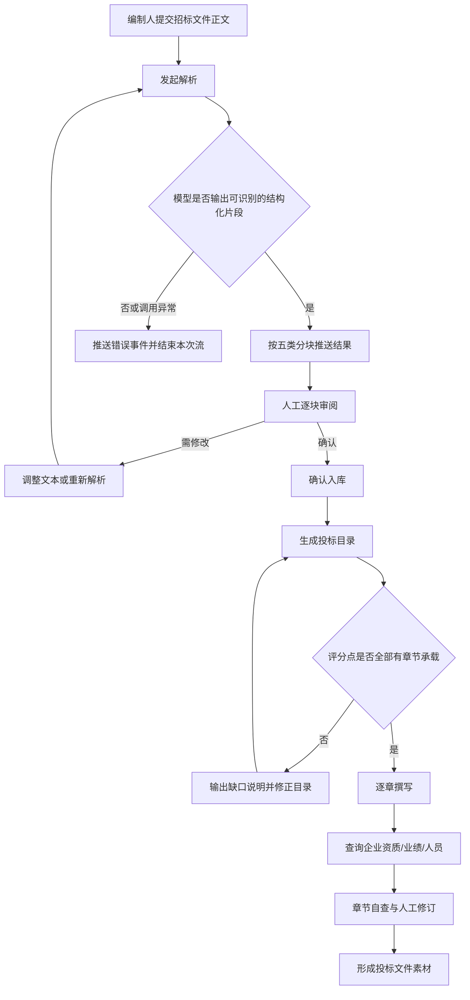
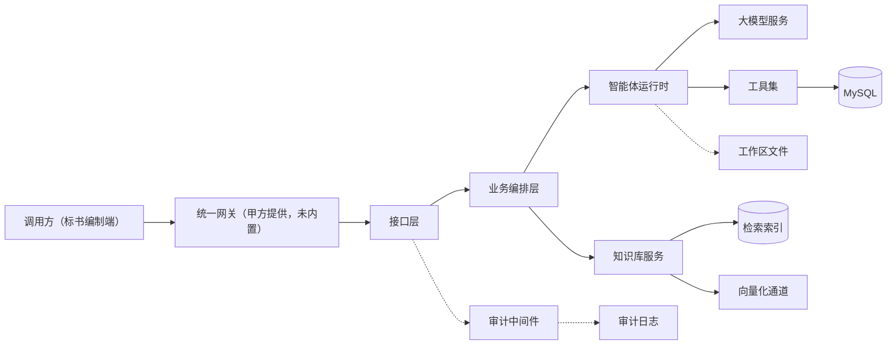
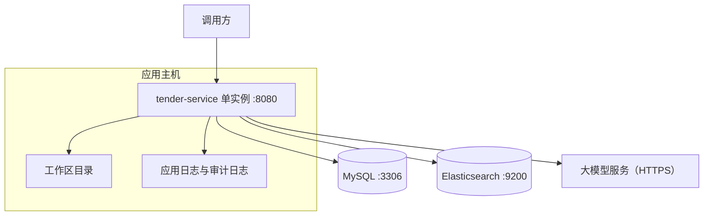
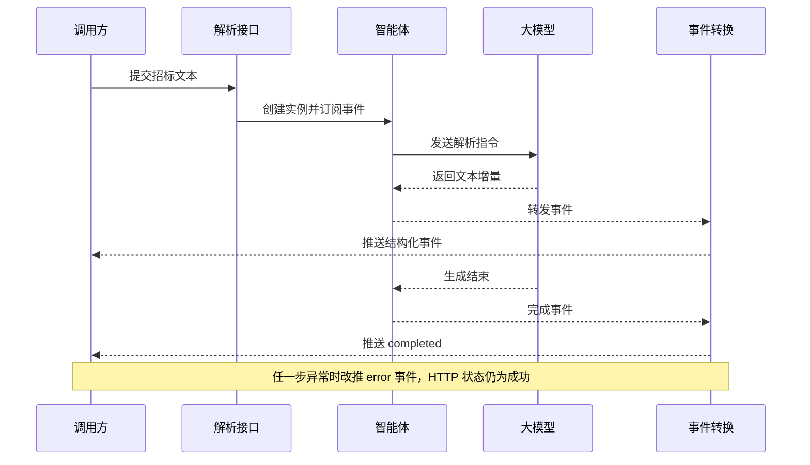
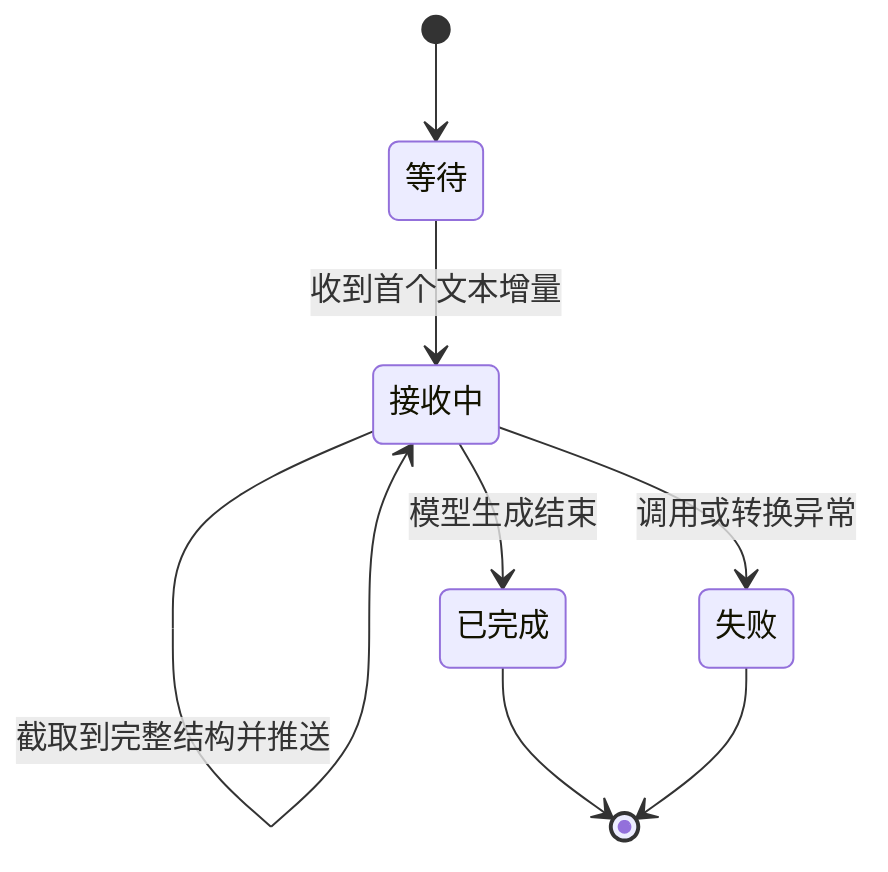
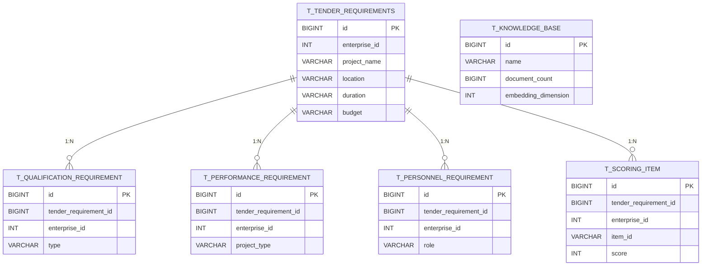

# 投标文件智能编制服务 详细设计（客户评审版）

| 项目 | 内容 |
|---|---|
| 文档名称 | 投标文件智能编制服务 详细设计 |
| 文档版本 | v3.0（客户评审版） |
| 编制日期 | 2026-10-28 |
| 代码基线 | 非 Git 仓库，按 2026-10-28 源码快照核对 |
| 技术栈 | Java 21、Spring Boot 4.1.1（WebFlux）、AgentScope 2.0.4、MyBatis-Plus 3.5.17、MySQL、Elasticsearch 9.x |
| 文档状态 | 评审稿，供业务评审、技术复核与交付验收使用 |
| 读者与叙事 | 业务/验收方；按“业务主线 → 技术保障 → 附录”组织 |

**目录**

| 章 | 标题 | 为谁写 |
|---|---|---|
| [1](#1-文档说明) | 文档说明 | 全部读者，先看范围与读法 |
| [2](#2-项目概述) | 项目概述 | 业务决策人，判断解决什么问题 |
| [3](#3-端到端业务流程) | 端到端业务流程 | 业务与标书编制人员，看谁在什么环节做什么 |
| [4](#4-功能详细设计) | 功能详细设计 | 业务与产品，看每个功能的入口、规则与异常 |
| [5](#5-非功能与验收口径) | 非功能与验收口径 | 验收方，看指标怎么判 |
| [6](#6-测试与验收) | 测试与验收 | 验收方与 QA，看 AC 与现有覆盖 |
| [7](#7-风险与上线前置条件) | 风险与上线前置条件 | 决策人与甲方接口人，看上线还差什么 |
| [8](#8-总体设计) | 总体设计 | 技术评委，看架构、模块与选型 |
| [9](#9-核心组件与协作) | 核心组件与协作 | 技术评委，看组件边界与一次协作 |
| [10](#10-关键机制) | 关键机制 | 技术评委，看状态、降级与幂等结论 |
| [11](#11-数据设计) | 数据设计 | 技术评委与数据管理员，看表、约束与一致性 |
| [12](#12-接口设计) | 接口设计 | 集成方，看参数、返回与失败提示 |
| [13](#13-部署与运维) | 部署与运维 | 甲方运维，看环境、配置与处置 |
| [14](#14-附录) | 附录 | 复核人，看提示总表、术语与证据索引 |

## 1. 文档说明

### 1.1 目的与读者

本文回答三个问题：这套系统在投标业务中承担什么环节、每个环节输入什么得到什么、交付时凭什么判定合格。它不替代产品需求文档，也不承担操作方法手册的职责；需要按步骤操作时，以第 13 章和随包运维说明为准。

本文的技术判断与代码同源：结论来自 2026-10-28 的源码快照，证据锚点集中放在第 14 章，正文只给结论与章节交叉引用，便于业务读者连续阅读。

### 1.2 按角色阅读路径

| 读者 | 建议阅读顺序 | 关注点 |
|---|---|---|
| 业务决策人 | 2 → 3 → 7 | 解决什么问题、上线还缺什么 |
| 标书编制人员 | 3 → 4 → 6 | 每一步怎么用、结果怎样算合格 |
| 技术评委 | 8 → 9 → 10 → 11 → 12 | 架构是否成立、边界是否说清 |
| 甲方运维 | 13 → 12.8 → 7.3 | 环境要求、配置项、故障处置、甲方动作 |
| 验收方 | 5 → 6 → 7.3 → 14.1 | 指标口径、AC 判定、提示语对照 |

### 1.3 范围声明

**本文覆盖**：招标文件解析、解析结果确认入库、投标目录生成、投标章节撰写、企业数据查询工具、知识库写入与检索、模型调用审计、数据库与检索索引设计、部署与运维要点、验收口径与风险。

**本文不覆盖**：前端页面与交互实现；招标文件上传、OCR 与格式转换；投标文件排版导出；合同、法务与报价审批流程；模型训练与微调；计费与结算；等保测评与渗透测试报告；旧版接口的兼容性承诺。上述内容如需纳入交付，应单独立项或在合同中另行约定。

### 1.4 术语与口径

| 术语 | 本文含义 |
|---|---|
| 招标文件 | 采购方发布的招标公告、须知、评分办法、技术规范等文本，本系统以纯文本作为输入 |
| 解析 | 调用大模型从招标文件中抽取项目概况、资质、业绩、人员、评分点五类结构 |
| 评分点 | 评标办法中可计分的条目，包含名称、分值、评审标准与建议承载章节 |
| 目录 | 投标文件的章节骨架，要求每个评分点至少有一个章节承载 |
| 章节 | 依据目录条目与评分点撰写的正文内容 |
| 知识库 | 存放历史标书、制度、案例等文本的检索库，支持全文与向量混合检索 |
| 企业数据 | 企业资质、类似业绩、人员证书三类事实数据，只允许通过查询工具获取 |
| 事件流 | 服务端按条推送的解析进度与结果，客户端逐条消费，不是一次性返回 |
| 确认入库 | 人工审阅解析结果后，将其写入业务数据库的动作；未确认不得入库 |
| 降级 | 向量能力不可用时退回纯全文检索，或解析失败时以错误事件结束本次请求 |

### 1.5 基线、规模与状态

| 项 | 值 |
|---|---|
| 代码基线 | 非 Git 仓库，snapshot:2026-10-28 |
| 主代码规模 | 48 个 Java 源文件，2 个控制器，6 个 HTTP 接口 |
| 测试规模 | 1 个测试类，3 个测试方法 |
| 数据对象 | 6 张 MySQL 表、1 个 Elasticsearch 索引 |
| 工作区资源 | 1 个主 Agent 约定文件、2 个子 Agent 定义、1 个目录提示词模板 |
| 当前结论 | 主要功能链路在开发环境可演示；目录编目与打包形态存在阻断项，不具备直接生产发布条件，见第 7 章 |

## 2. 项目概述

### 2.1 业务痛点

| 痛点 | 现状表现 | 对交付的影响 |
|---|---|---|
| 招标文件厚、阅读慢 | 一份标书动辄上百页，资格条件、评分办法分散在多个章节 | 人工初读耗时长，关键条款容易漏读 |
| 评分点与章节脱节 | 编写时按经验分章，事后才发现某个评分点无章节响应 | 返工多，废标与失分风险上升 |
| 企业资质、业绩、人员分散 | 数据散落在表格、证照扫描件和个人记忆中 | 引用不一致，存在编造与过期数据风险 |
| 历史标书难以复用 | 过往成果以文件形式存放，检索靠文件名 | 同类项目重复劳动，知识沉淀不足 |

### 2.2 建设目标

| 目标 | 衡量方式 | 本期状态 |
|---|---|---|
| 把招标文件转成可复核的结构化要求 | 五类结构均有输出，且每条要求带原文出处 | 已实现，完整性依赖模型与样例，见 6.2 |
| 让每个评分点都有章节承载 | 目录输出中评分点编号可逐一对应 | 已实现生成能力，覆盖校验靠提示词与人工 |
| 企业数据只从系统取，不靠记忆 | 章节中的企业事实可追溯到查询工具结果 | 工具与约定已具备，缺少强制校验 |
| 形成可检索的历史知识库 | 写入后可按语义与关键词召回 | 已实现，依赖 Elasticsearch 与分词插件 |

### 2.3 角色与职责

| 角色 | 在系统中的动作 | 不承担的责任 |
|---|---|---|
| 投标负责人 | 发起解析、审阅结果、决定是否入库、确认目录 | 不直接修改数据库 |
| 标书编制人员 | 逐章生成与修订、补齐企业材料 | 不负责模型与基础设施 |
| 企业数据管理员 | 在外部系统维护资质、业绩、人员，本系统中只读查询 | 不参与标书正文撰写 |
| 技术运维 | 部署、配置、监控、故障处置 | 不改变业务规则 |
| 评审与验收方 | 按 AC 抽样验证、签署验收结论 | 不介入日常编制 |

### 2.4 典型场景

**场景一：新项目首次解析。** 编制人粘贴招标文件正文，系统流式返回项目概况、资质、业绩、人员、评分点五类结果；编制人逐块核对原文出处，修改不准确字段后确认入库。

**场景二：按评分办法编目录。** 编制人选择已入库的招标要求，系统生成含商务标、技术标判断的目录；若某评分点没有承载章节，输出缺口说明，编制人据此调整后重新生成。

**场景三：逐章成稿。** 编制人对目录中的章节逐个发起撰写，系统结合评分点与企业数据生成正文；涉及资质、业绩、人员时，只允许引用查询结果，查不到就写“暂未找到”。

**场景四：历史知识复用。** 编制人把企业制度、优秀标书片段写入知识库，撰写时按关键词或语义检索，召回相关段落作为参考。

### 2.5 能力边界

| 能力 | 状态 | 说明 |
|---|---|---|
| 招标文本解析 | 已具备 | 纯文本输入；不处理扫描件、图片与复杂表格 |
| 解析结果入库 | 已具备 | 单次确认写入，重复提交会产生重复记录，见 7.1 |
| 目录生成 | 部分具备 | 生成能力可用；子 Agent 定义缺失，打包形态下模板读取受限，见 7.1 |
| 章节撰写 | 已具备 | 逐章生成，不自动拼装成完整标书 |
| 企业数据查询 | 已具备 | 三类查询工具，只读 |
| 知识库 | 部分具备 | 写入与混合检索可用；未接入章节撰写，且无更新、删除与重建接口 |
| 招标要求查询 | 部分具备 | 仅支持按编号查询，无列表与条件检索接口 |
| 权限与多租户 | 未具备 | 无登录、无角色、无企业隔离，依赖甲方网关 |
| 投标文件导出 | 未具备 | 不生成 Word/PDF，不处理排版 |

## 3. 端到端业务流程

### 3.1 主流程



主流程有三个硬约束：解析结果未经人工确认不得入库；目录未覆盖全部评分点不得进入成稿；企业数据未从查询工具取得不得写入正文。三条约束在当前实现中的落实强度不同，业务规则见 4.6。

### 3.2 角色、环节、系统反馈与输出物

| 环节 | 参与角色 | 系统动作 | 系统反馈 | 输出物 |
|---|---|---|---|---|
| 提交招标文件 | 标书编制人员 | 接收正文，启动解析 | 流式推送解析进度 | 五类结构化结果 |
| 审阅解析结果 | 投标负责人 | 按模块展示，保留原文出处 | 逐条显示字段与出处片段 | 审阅意见、修订后的结果 |
| 确认入库 | 投标负责人 | 写入主表与四张子表 | 返回入库记录编号 | 可复用的招标要求记录 |
| 生成目录 | 标书编制人员 | 读取招标要求，调用模型编目 | 返回目录文本与缺口说明 | 章节骨架、评分点映射 |
| 撰写章节 | 标书编制人员 | 结合章节与评分点生成正文 | 返回章节文本 | 章节初稿 |
| 企业数据核验 | 企业数据管理员 | 查询资质、业绩、人员 | 返回数据库中的事实数据 | 可引用的企业材料 |
| 知识沉淀 | 标书编制人员 | 写入知识库并建索引 | 返回知识库编号 | 可检索的历史文本 |

### 3.3 流程控制点与人工确认

| 控制点 | 时点 | 通过标准 | 责任人 |
|---|---|---|---|
| 解析结果分块核对 | 解析完成后 | 五类结果均可查看，且能定位原文出处 | 标书编制人员 |
| 入库确认 | 入库前 | 逐块确认字段无误，企业标识已补齐 | 投标负责人 |
| 目录覆盖确认 | 目录生成后 | 每个评分点至少对应一个章节，缺口已解释 | 投标负责人 |
| 企业数据核验 | 章节成稿前 | 资质、业绩、人员均来自查询结果 | 企业数据管理员 |
| 成稿复核 | 章节生成后 | 关键数字可追溯，评分点逐条响应 | 标书编制人员 |

### 3.4 中断与异常

| 现象 | 系统行为 | 业务处置 |
|---|---|---|
| 模型服务不可用或密钥失效 | 推送一条错误事件，随后结束本次流 | 保留已收到的结果，修复配置后重新解析 |
| 模型输出夹杂说明文字 | 只提取成对花括号内的完整对象，其余忽略 | 核对是否缺少某类结果，必要时重试 |
| 输出片段不是合法结构 | 跳过该片段并记录日志，不中断整条流 | 检查该模块是否缺失，人工补录 |
| 长时间无新事件 | 连接保持，客户端可能一直等待 | 设置客户端超时，超时后重新发起 |
| 入库时字段超长 | 按列宽截断后写入，不报错 | 核对截断是否符合原意，必要时人工修正 |
| 入库缺少企业标识 | 数据库拒绝写入，接口报错 | 由调用方补齐企业标识后重试，见 12.3 |

## 4. 功能详细设计

本章按“入口 → 处理 → 规则 → 输出 → 异常提示”描述六个业务可见功能。技术实现位置在第 8 至 13 章，业务规则在第 4.6 节统一收口。

### 4.1 招标文件解析

| 项 | 说明 |
|---|---|
| 入口 | `POST /tender/parse`，请求体含可选的用户标识与必填的招标文件正文 |
| 处理 | 组装运行上下文 → 生成“请解析以下招标文件”的指令 → 每次请求新建一个智能体实例 → 订阅模型事件 → 累积文本增量 → 按花括号配对截取完整结构 → 按实体类型分派为五类 → 逐条推送给客户端 |
| 规则 | 只识别五类实体：项目概况、资质、业绩、人员、评分点；实体的判别字段缺失或取值未知时静默丢弃；单个片段不合法时跳过并记日志；模型结束时推送完成信号 |
| 输出 | 事件流，每条为“模块名 + 数据”；模块取值为 project、qualification、performance、personnel、scoringItem、error、completed |
| 异常提示 | 调用异常时推送一条 error 事件后正常结束流；客户端看到的是“解析失败：具体原因”，不会收到 HTTP 错误状态 |

业务上需要特别注意三点。第一，解析不是一次返回，而是边生成边推送，客户端必须逐条消费并在收到 completed 后停止接收。第二，服务端不会校验正文是否为空，空文本也会发起一次模型调用，费用与等待时间照常发生。第三，模型若把结果包在说明文字中，只有成对花括号内的内容会被提取，花括号外的文字既不会展示也不会清理，长文本下会拖慢后续片段处理。

### 4.2 解析结果确认入库

| 项 | 说明 |
|---|---|
| 入口 | `POST /tender/parse/confirm`，请求体为完整的招标结构化要求，包含项目概况、四类子清单与企业标识 |
| 处理 | 开启事务 → 写入主表并取得自增编号 → 依次写入资质、业绩、人员、评分点四张子表 → 各子表回填主表编号与企业标识 → 提交事务 |
| 规则 | 字段超长时按列宽截断而不是报错；主表与子表要么全部成功、要么全部回滚；不校验必填字段，也不做重复提交识别 |
| 输出 | 入库记录的自增编号 |
| 异常提示 | 企业标识缺失、数据库不可用或字段类型不符时返回服务端错误；调用方看到的是通用错误页，需结合日志定位 |

入库是“确认后写入”的唯一入口，解析与入库完全解耦，因此重复点击确认会产生多条重复记录。字段截断规则见 11.4。企业标识由调用方补齐，解析输出本身不产生该字段，这是当前链路上最容易导致入库失败的一点，已列入风险清单。

### 4.3 投标目录生成

| 项 | 说明 |
|---|---|
| 入口 | `POST /tender/catalog`，请求体含用户标识与已入库的招标要求编号 |
| 处理 | 启动时把目录提示词模板读入内存 → 把模板中的编号占位符替换为请求编号 → 新建智能体 → 让智能体通过查询工具读取该编号的招标要求 → 返回模型生成的目录文本 |
| 规则 | 模板要求先判断商务标与技术标是否分列；每个评分点至少映射一个章节；评分点编号原样引用；数据缺失时输出缺口说明而不是编造；除纯 JSON 外不输出解释文字 |
| 输出 | 一段文本，按约定应为含目录、结构判断说明与缺口说明的 JSON；服务端不解析、不校验、不落库 |
| 异常提示 | 编号为空时模型可能收到字符串 null 并返回数据未找到；模板在打包形态下读取失败会导致服务启动失败；主 Agent 约定中要求委派的目录子 Agent 未随包提供 |

目录结果的正确性目前主要靠提示词与人工复核，服务端没有“评分点是否全覆盖”的自动判定。若模型返回的不是合法 JSON，接口仍会以成功状态返回文本，客户端需要自行识别。

### 4.4 投标章节撰写

| 项 | 说明 |
|---|---|
| 入口 | `POST /tender/chapter`，请求体含用户标识、会话标识、章节标题与关联评分点编号集合 |
| 处理 | 新建智能体 → 按“撰写章节某标题，对应评分点某集合”的固定句式发起调用 → 返回模型文本 |
| 规则 | 章节结构约定为“评分点解读 → 满足情况阐述 → 支撑材料引用”；涉及企业数据必须调用查询工具；查不到时写“暂未找到”；关键数字需可追溯 |
| 输出 | 章节正文文本，不落库、不拼装 |
| 异常提示 | 标题或评分点为空时仍会发起调用，结果质量不可控；请求中的会话标识当前未参与上下文构建，每次调用都是新会话 |

当前章节撰写只使用提示词与企业数据查询工具，不会自动检索知识库；需要引用历史材料时，由编制人先在知识库检索，再把结果粘贴到章节要求中。每次章节撰写相互独立，系统不保存上一章内容，也不自动检查全文章节之间是否重复或矛盾。跨章一致性需要编制人在客户端侧维护。

### 4.5 知识库写入与检索

| 项 | 说明 |
|---|---|
| 入口 | 写入 `POST /knowledge/{knowledgeBaseName}`，请求体为字符串数组；检索 `GET /knowledge/search`，参数为知识库名称集合、查询内容与返回条数 |
| 处理 | 写入时先取或建知识库元数据 → 过滤空白文本 → 按批生成向量 → 以随机标识批量写入检索索引 → 刷新后更新文档计数；检索时分别执行全文与向量召回 → 应用侧融合排序 → 截断返回 |
| 规则 | 空白文本忽略；指定名称的知识库不存在时报错；返回条数默认 10、最大 50；查询向量失败时降级为纯全文检索；写入时向量失败则整批失败 |
| 输出 | 写入返回知识库编号，不返回单条文档编号；检索返回编号、内容、创建时间与融合得分 |
| 异常提示 | 查询内容为空返回参数错误；知识库不存在或检索服务不可用返回服务端错误；未安装中文分词插件时索引创建失败，知识库整体不可用 |

查询侧允许降级，写入侧在启用向量时不允许降级；未启用向量时统一不写向量。业务含义是“检索可以退化为关键词，同一知识库内的向量状态必须一致”，避免出现一半有向量、一半没有向量的混合数据。

### 4.6 业务规则与强制程度

| 编号 | 业务规则 | 落地方式 | 强制程度 |
|---|---|---|---|
| BR-01 | 解析结果未经人工确认不得入库 | 解析与入库是两个独立接口 | 强制（接口隔离） |
| BR-02 | 每条资质、业绩、人员、评分点应带原文出处 | 提示词要求填写 source 字段 | 提示词约束，未强制校验 |
| BR-03 | 无法从原文确定的内容标注“未明确（原文未提供）” | 提示词与子 Agent 约定 | 提示词约束 |
| BR-04 | 不得编造资质、业绩、人员与评分点 | 提示词与子 Agent 约定 | 提示词约束，无服务端拦截 |
| BR-05 | 企业数据只能来自查询工具 | 子 Agent 工具白名单与主 Agent 约定 | 工具层约束，正文无自动核验 |
| BR-06 | 每个评分点至少有一个章节承载 | 目录提示词要求并输出缺口 | 提示词约束，无自动判定 |
| BR-07 | 评分点编号原样引用，不重新编号 | 目录提示词明确要求 | 提示词约束 |
| BR-08 | 章节需逐条响应评分点 | 章节提示词规定三段式结构 | 提示词约束 |
| BR-09 | 超长字段截断而不阻断入库 | 入库前按列宽截断 | 强制（代码） |
| BR-10 | 主表与四张子表同事务写入 | 单事务包裹五次写入 | 强制（事务） |
| BR-11 | 查询返回条数不超过 50 | 服务端截断 | 强制（代码） |
| BR-12 | 向量不可用时检索退化为全文 | 查询向量异常被捕获 | 强制（代码） |
| BR-13 | 知识库向量维度必须与索引一致 | 配置项与索引映射共用同一维度 | 强制（建索引时），变更需重建 |
| BR-14 | 模型调用需留审计记录 | 每次调用写一个审计文件 | 强制（中间件），保留策略未定义 |

## 5. 非功能与验收口径

### 5.1 指标与验收判定

下表中的目标值均为验收目标，不是当前实测值。验收时在与生产同规格的环境实测；未达标按对应 AC 判定不通过。

| 编号 | 指标 | 目标值 | 依据 | 验收判定 |
|---|---|---|---|---|
| NFR-01 | 解析首个结果到达时间 | ≤ 30 秒 | 代码未设总超时，按同类模型服务首包经验推断〔INFER〕 | 验收时实测；超过 30 秒按 AC-01 判定不通过 |
| NFR-02 | 2 万字招标文件解析完成时间 | ≤ 180 秒 | 代码未设总超时，按模型逐段生成经验推断〔INFER〕 | 验收时实测；超过 180 秒按 AC-01 判定不通过 |
| NFR-03 | 五类结构化结果完整率 | 样例一、二五类齐全；样例三正确输出缺口 | 代码按五类分派，完整性取决于模型〔INFER〕 | 验收时逐份核对；缺任一类或缺口未说明按 AC-02 判定不通过 |
| NFR-04 | 确认入库成功率 | 合法请求 100% | 单事务写入，字段超长会截断 | 验收时提交 20 次；失败一次按 AC-04 判定不通过 |
| NFR-05 | 目录生成时长 | ≤ 120 秒 | 单次模型调用，按长文本生成经验推断〔INFER〕 | 验收时实测；超过 120 秒按 AC-06 判定不通过 |
| NFR-06 | 单章撰写时长 | ≤ 90 秒 | 单次模型调用，按章节长度经验推断〔INFER〕 | 验收时实测；超过 90 秒按 AC-07 判定不通过 |
| NFR-07 | 知识库写入吞吐 | 1000 条 ≤ 5 分钟 | 批量 500 条、每批等待刷新 | 验收时实测；超过 5 分钟按 AC-08 判定不通过 |
| NFR-08 | 检索响应时间 | 前 10 条 P95 ≤ 2 秒 | 两路召回各取 50 条后本地融合〔INFER〕 | 验收时压测；超过 2 秒按 AC-08 判定不通过 |
| NFR-09 | 并发解析能力 | 单实例 5 路并发无相互阻塞 | 每请求独立智能体，共享工作区与模型配额〔INFER〕 | 验收时并发实测；出现串行等待或错误按 AC-12 判定不通过 |
| NFR-10 | 试运行期可用性 | 月度 ≥ 99% | 无高可用部署，单实例运行〔INFER〕 | 以试运行月报为准；低于 99% 按 AC-12 判定不通过 |
| NFR-11 | 入库数据一致性 | 主表与子表 100% 对应 | 单库单事务 | 验收时按编号抽查；出现孤儿记录按 AC-04 判定不通过 |
| NFR-12 | 知识库双写一致性 | 写入成功后均可检索到 | 先写检索索引再更新元数据 | 验收时写入后立即检索；缺失按 AC-08 判定不通过 |

### 5.2 容量与限制

| 项 | 当前值 | 说明 |
|---|---|---|
| 请求体大小 | 未显式配置 | 受 WebFlux 默认内存缓冲上限约束，超长正文可能被拒绝〔INFER〕推断依据为框架默认值 |
| 解析文本缓冲 | 无上限 | 服务端持续累积模型输出，异常长输出会占用内存 |
| 检索返回条数 | 默认 10，最大 50 | 超过 50 按 50 处理，不报错 |
| 批量写入条数 | 500 条/批 | 超过自动分批 |
| 向量批量条数 | 100 条/批 | DashScope 通道进一步限制为 10 条/批 |
| 连接与请求超时 | 连接 10 秒；请求 60 或 120 秒 | 向量服务两套通道超时不同 |
| 索引分片 | 1 主分片、0 副本 | 单节点可用，不支持节点故障切换 |
| 接口限流 | 未实现 | 依赖甲方网关或人工控制并发 |

### 5.3 指标口径说明

本章所有时延与吞吐数字都是验收目标。测量方法统一为：在验收环境部署与生产同规格的单实例，使用约定的 3 份样例招标文件与 1000 条知识库文本，记录服务端时间戳与客户端收到时间。任何一项没有实测数据时，不得在验收报告中写“满足”，只能写“未验证”，并按对应 AC 判定不通过。环境规格、样例清单与压测脚本由双方在验收前 5 个工作日确认。

### 5.4 安全与合规口径

| 项 | 当前现状 | 验收要求与后果 |
|---|---|---|
| 身份认证 | 接口无登录与令牌校验 | 必须由甲方网关统一鉴权；未接入不得上线（7.2 第 5 项） |
| 传输加密 | 应用本身不配置证书 | 由反向代理提供传输层加密；缺失不得上线（7.2 第 5 项） |
| 凭据存放 | 数据库口令与模型密钥写在配置文件中 | 上线前必须改为环境变量或密钥管理；未改按 7.3 清单不予放行 |
| 审计日志 | 每次模型调用落一个文件，含提示词与返回全文 | 留存期、脱敏与访问权限须书面确认；未确认不得处理真实项目数据 |
| 接口文档 | 接口文档与调试页默认开启 | 生产环境须关闭或加访问控制；未处理不得上线（7.2 第 5 项） |
| 数据隔离 | 无企业维度隔离 | 多企业共用部署时须由网关或独立实例隔离；未隔离不得上线 |
| 操作审计 | 只记录模型调用，不记录操作人 | 关键操作须由网关访问日志补齐，否则按 7.3 清单补齐 |

## 6. 测试与验收

### 6.1 验收方式与环境

| 项 | 约定 |
|---|---|
| 验收环境 | 与生产同规格的单实例，独立数据库、检索服务与模型账号，不与开发环境共用 |
| 验收样例 | 3 份脱敏样例招标文件（真实文件或双方确认的构造样例）：一份商务技术合编、一份商务技术分列、一份评分点缺失 |
| 数据准备 | 至少 1 家企业、10 条资质、10 条业绩、10 名人员、1000 条知识库文本 |
| 证据形式 | 接口返回原文、服务端日志时间戳、数据库抽查记录、检索结果截图 |
| 判定方式 | 每条 AC 独立判定，全部通过才算验收通过；任一条不通过则进入整改复验 |
| 复验规则 | 整改后只复验不通过项与受影响项，复验次数不超过两轮 |

### 6.2 验收标准

| 编号 | 验收项 | 通过判据 | 验证方法 | 不通过后果 |
|---|---|---|---|---|
| AC-01 | 解析接口连通与协议 | 返回成功状态与事件流类型；首个事件在 30 秒内到达 | 用样例一调用解析接口，记录首包时间 | 解析功能不计入验收，整体验收暂停 |
| AC-02 | 五类结果完整性 | 样例一、二均出现项目概况、资质、业绩、人员、评分点并以完成信号收尾；样例三输出可读缺口说明 | 逐条统计事件模块名，人工核对内容与缺口 | 解析准确率判定不通过，需调整提示词后复验 |
| AC-03 | 异常可控 | 使用失效模型密钥调用时，收到一条错误事件并在 180 秒内结束，连接不悬挂 | 故障注入 | 可用性判定不通过，按合同约定整改 |
| AC-04 | 入库原子性 | 连续 20 次合法请求均返回记录编号；每次主表 1 条、四张子表条数与入参一致；人为制造子表错误时全部回滚 | 逐次提交后查库比对 | 数据验收不通过，已入库数据需清理 |
| AC-05 | 超长字段处理 | 单字段 600 字时写入成功，库内长度为列宽上限，接口不报错 | 构造超长样例提交 | 数据写入判定不通过 |
| AC-06 | 目录覆盖评分点 | 每个评分点编号至少出现一次；缺口说明非空且可读；单次生成不超过 120 秒 | 与样例评分点清单逐项比对并计时 | 目录质量判定不通过，需重新生成 |
| AC-07 | 章节内容合规 | 两个评分点均被响应；企业事实可追溯到查询结果，查不到时写明“暂未找到”；单章生成不超过 90 秒 | 抽查 3 个章节，交叉核对数据库并计时 | 内容合规判定不通过，相关章节不得交付 |
| AC-08 | 知识库写入与检索 | 写入 1000 条不超过 5 分钟；关键词与语义各查 5 次，P95 不超过 2 秒且目标文本均在前 10 条 | 写入后立即检索，记录耗时与排名 | 知识库功能判定不通过 |
| AC-09 | 向量失败降级 | 关闭向量能力后检索仍返回全文结果，接口不报错 | 切换向量提供方或注入失败 | 可用性判定不通过 |
| AC-10 | 参数边界 | 查询内容为空返回参数错误；返回条数传 0 按 10 条、传 100 按 50 条 | 边界值调用 | 接口验收不通过 |
| AC-11 | 交付物可构建启动 | 干净环境执行标准构建命令产出可运行包，启动后健康检查通过 | 从零构建并启动 | 不具备上线条件，整体验收不通过 |
| AC-12 | 试运行可用性 | 连续 30 天试运行，月度可用性不低于 99%，5 路并发无相互阻塞 | 监控月报与并发压测 | 按合同服务条款处理，限期整改 |

### 6.3 已知边界确认项

以下条目是双方需要确认的已知边界，不作为 AC 判定项，也不得计入 AC 通过率。

| 编号 | 边界事实 | 影响 | 确认方式 |
|---|---|---|---|
| BC-01 | 会话状态保存在进程内存，重启即丢失 | 不支持多实例共享会话，扩容后会话不连续 | 甲方确认单实例运行或接受会话丢失 |
| BC-02 | 接口本身无身份认证与权限控制 | 必须依赖甲方网关鉴权，内部网络也需访问控制 | 甲方确认网关方案与责任边界 |
| BC-03 | 模型调用审计含提示词与返回全文 | 可能包含招标原文与企业敏感数据 | 甲方书面确认留存期、访问权限与脱敏要求 |
| BC-04 | 主 Agent 约定中的目录子 Agent 未随包提供 | 主 Agent 无法按约定委派编目，目录质量不可控 | 乙方补齐后重新确认，或甲方接受主 Agent 直接生成 |
| BC-05 | 目录模板以文件路径方式读取 | 仅在展开目录形态可用，打包形态启动失败 | 乙方修复后重新确认；修复前不得以打包形态交付 |
| BC-06 | 数据库无外键，删除靠应用层级联 | 直接改库可能产生孤儿数据 | 甲方确认禁止绕过应用直接删改 |
| BC-07 | 向量维度变更需删除并重建索引 | 变更期间知识库不可用，历史数据需重灌 | 甲方确认变更窗口与数据重灌责任 |

### 6.4 现有测试覆盖与缺口

统计口径：以下数量按 2026-10-28 源码树中的测试文件与测试方法统计，不含构建产物中的历史报告。

| 对象 | 数量 | 说明 |
|---|---|---|
| 测试类 | 1 个 | 仅一个控制器集成测试类 |
| 测试方法 | 3 个 | 分别覆盖解析、确认入库、目录生成 |
| 覆盖的接口 | 3 个 | 解析、确认入库、目录；章节与知识库无测试 |
| 自动化断言 | 弱 | 主要断言“有返回”“最后一个事件是完成或错误”，不断言字段内容 |
| 运行前提 | 外部依赖 | 测试连接本机 8080，需要服务已启动、数据库与模型均可用 |
| 构建产物中的报告 | 6 项通过 | 报告对应的测试类不在当前源码树，不能作为本轮覆盖证据 |

缺口有三类。其一，解析事件转换、字段截断、融合排序等核心逻辑没有单元测试，回归只能靠端到端抽样。其二，知识库写入与检索没有自动化用例，索引与分词问题只能在部署后暴露。其三，测试依赖真实模型，结果不稳定且产生费用，不适合作为每次提交的门禁。上述缺口已列入风险 R-11，验收时以 6.2 的人工与脚本组合验证兜底。

## 7. 风险与上线前置条件

### 7.1 风险清单

| 编号 | 风险 | 影响 | 应对措施 | 责任方 | 计划 |
|---|---|---|---|---|---|
| R-01 | 数据库口令与模型密钥以明文写在配置文件中 | 凭据泄露后可被滥用，产生费用与数据风险 | 迁至环境变量或密钥管理，交付前轮换全部凭据 | 双方 | 上线前 T-10 |
| R-02 | 构建配置跳过编译且未声明可执行包插件 | 标准流水线无法产出可运行包，交付物不成立 | 移除跳过编译配置，补充打包插件，建立从零构建验证 | 乙方 | 上线前 T-10 |
| R-03 | 目录模板以文件路径读取，打包后不可用 | 打包形态启动失败或目录功能不可用 | 改为流式读取模板；增加打包形态冒烟 | 乙方 | 上线前 T-7 |
| R-04 | 解析结果不含企业标识，而数据库要求必填 | 确认入库直接失败，主链路中断 | 明确企业标识来源，接口层补默认值与校验 | 双方 | 上线前 T-7 |
| R-05 | 接口无鉴权、无限流 | 未授权调用、模型费用失控、数据越权 | 接入甲方网关鉴权与配额，按调用方限流 | 双方 | 上线前 T-5 |
| R-06 | 审计日志保存提示词与返回全文 | 招标原文、企业数据与个人信息外泄 | 明确留存期与访问权限，敏感字段脱敏，日志加密存储 | 双方 | 上线前 T-5 |
| R-07 | 确认入库无幂等控制 | 重复提交产生重复记录，统计与引用失真 | 增加业务幂等键或提交前去重，前端防重复点击 | 乙方 | 上线前 T-3 |
| R-08 | 会话状态仅存内存 | 重启丢会话，多实例部署不可用 | 本期限定单实例；扩容前替换为共享状态存储 | 乙方 | 上线前声明，扩容前完成 |
| R-09 | 目录子 Agent 定义缺失 | 主 Agent 无法按约定委派，目录结构失控 | 补齐子 Agent 定义并纳入启动自检 | 乙方 | 上线前 T-7 |
| R-10 | 检索索引依赖中文分词插件与固定维度 | 插件缺失时索引创建失败；维度不一致时写入失败 | 部署前校验插件；提供重建索引与重灌脚本 | 甲方环境、乙方脚本 | 上线前 T-7 |
| R-11 | 自动化回归不足，测试依赖真实模型 | 变更后回归靠手工，缺陷发现晚 | 补核心逻辑单元测试与接口契约测试，模型调用打桩 | 乙方 | 上线前 T-3 |
| R-12 | 解析文本缓冲无上限，说明文字不清理 | 超长输出下内存增长、解析变慢 | 设置缓冲上限与超长截断，清理非结构前缀 | 乙方 | 上线前 T-7 |
| R-13 | 知识库未接入章节撰写链路 | 历史材料需人工搬运，知识沉淀价值受限 | 增加检索工具并纳入章节子 Agent 工具白名单 | 乙方 | 上线后 30 天内 |

### 7.2 上线前置条件

以下条件全部闭环，才可提交上线评审；任一项未闭环，发布结论为“不具备上线条件”。

1. 标准构建可在干净环境产出可运行包，并完成启动冒烟。
2. 目录生成链路在打包形态下可用，目录子 Agent 定义随包提供。
3. 企业标识的来源与默认规则经甲方确认，确认入库连续 20 次无失败。
4. 全部明文凭据完成迁移与轮换，配置文件中不再出现真实值。
5. 网关鉴权、限流与传输加密已接入并通过越权测试。
6. 审计日志的留存期、脱敏规则与访问权限已书面确认。
7. 第 6.2 节 12 条 AC 全部通过，未通过项有书面整改与复验记录。

### 7.3 上线前甲方准备清单

| 事项 | 对应风险 | 完成判据 | 最晚时间 |
|---|---|---|---|
| 提供模型服务账号与调用配额 | R-01、R-05 | 独立账号、密钥经密钥管理下发、配额书面确认 | 上线前 10 个工作日 |
| 提供数据库实例与最小权限账号 | R-01、R-04 | 连接信息可用、备份策略生效、企业标识规则确认 | 上线前 10 个工作日 |
| 提供检索服务实例并安装中文分词插件 | R-10 | 插件列表可见、索引可创建、维度与配置一致 | 上线前 7 个工作日 |
| 提供部署环境、域名与统一网关 | R-05 | 网关鉴权与限流生效、传输加密可用 | 上线前 7 个工作日 |
| 确认审计日志留存与脱敏要求 | R-06 | 书面口径、保留期、访问权限与责任人明确 | 上线前 5 个工作日 |
| 确认企业数据来源与授权范围 | R-04、R-07 | 数据责任人、更新机制、企业标识映射表确认 | 上线前 5 个工作日 |
| 提供验收样例与评分点基准 | R-11 | 3 份脱敏样例及人工标注的评分点清单交付 | 上线前 3 个工作日 |
| 确认变更窗口与回滚责任人 | R-02 | 窗口时间、回滚步骤、双方联系人书面确认 | 上线前 1 个工作日 |

## 8. 总体设计

### 8.1 逻辑架构



系统采用“薄接口层 + 编排层 + 智能体运行时”的三段结构。接口层只做参数接收与流式返回；编排层负责解析事件转换、入库事务、目录与章节的提示词组装；智能体运行时负责模型调用、工具注册与工作区加载。知识库是独立旁路，不参与解析主链路，当前也未接入章节撰写，检索失败不会阻断标书生成。

### 8.2 模块划分

| 模块 | 职责 | 主要输入 | 主要输出 | 当前约束 |
|---|---|---|---|---|
| 接口层 | 暴露解析、入库、目录、章节、知识库六类接口 | HTTP 请求 | 事件流或文本或编号 | 无鉴权、无统一异常处理 |
| 业务编排 | 组装上下文、转换解析事件、执行入库事务、释放工作区 | 请求与智能体事件 | 结构化事件、入库编号 | 解析与入库解耦，无会话状态 |
| 智能体运行时 | 按请求创建智能体，装配模型、工具、工作区与审计 | 提示词与运行上下文 | 模型事件流 | 每次新建实例，状态存内存 |
| 工具集 | 招标要求读写删、企业资质业绩人员查询 | 工具参数 | 结构化对象 | 删除为物理删除，无权限校验 |
| 业务数据持久化 | 主表与四张子表的读写、字段截断、级联删除 | 结构化要求 | 数据库记录 | 无外键、无迁移工具 |
| 知识库 | 元数据管理、批量写入、双路召回与融合 | 文本数组、查询语句 | 知识库编号、命中列表 | 无更新删除接口，索引维度固定 |
| 审计与配置 | 模型调用审计、配置绑定、启动时释放工作区 | 调用上下文 | 审计文件、运行配置 | 审计无保留期，配置含明文凭据 |

### 8.3 部署拓扑



当前是单实例部署：应用主机承担接口、智能体运行时与工作区文件，业务数据在 MySQL，检索数据在 Elasticsearch，模型能力通过外部服务获得。没有应用层集群、没有共享会话存储、没有检索副本，因此任一外部依赖不可用都会直接影响对应功能。

### 8.4 技术选型

| 层次 | 选型 | 版本 | 选择理由 | 使用约束 |
|---|---|---|---|---|
| 运行框架 | Spring Boot WebFlux | 4.1.1 | 原生支持流式返回，适合逐条推送解析结果 | 响应式链路中不可混入阻塞调用 |
| 语言 | Java | 21 | 与框架版本匹配，长期支持 | 构建配置需与语言版本一致 |
| 智能体框架 | AgentScope | 2.0.4 | 提供智能体、工具、工作区与事件模型 | 版本升级需回归事件协议 |
| 业务数据库 | MySQL + MyBatis-Plus | 3.5.17 | 结构化要求与子表关系清晰，开发成本低 | 无外键、无迁移工具 |
| 检索 | Elasticsearch 官方客户端 | 9.3.3 | 同时支持全文与向量检索 | 需中文分词插件，RRF 在应用侧实现 |
| 接口文档 | springdoc | 3.1.1 | 自动生成接口说明，便于联调 | 生产需关闭或加访问控制 |

### 8.5 关键设计决策

| 编号 | 决策 | 理由 | 代价 |
|---|---|---|---|
| D-01 | 解析采用事件流而非一次性返回 | 长文本生成耗时长，分块可见能提前发现偏差 | 客户端必须处理流式协议与中断 |
| D-02 | 解析与入库分为两个接口 | 保证“人工确认后才落库”的业务约束 | 调用方需暂存解析结果并补齐企业标识 |
| D-03 | 融合排序放在应用侧 | 避免依赖检索商业许可能力，降低授权成本 | 每次查询多一次内存计算与两路召回 |
| D-04 | 智能体按请求创建、用完关闭 | 避免共享构建器带来的状态泄漏 | 每次请求有初始化开销，会话不连续 |
| D-05 | 业务数据与检索数据分库存储 | 各取所长：事务与检索分离 | 跨库一致性无事务保障，失败需补偿 |

## 9. 核心组件与协作

本章为技术保障摘要，实现细节见第 11–13 章。

### 9.1 组件职责与失败模式

| 组件 | 一行职责 | 一个失败模式 |
|---|---|---|
| 接口层 | 接收请求并选择流式或单值返回 | 无统一异常处理，业务异常直接变成服务端错误 |
| 解析事件转换 | 把模型文本增量切成结构化事件 | 非结构前缀长期滞留缓冲，长文本下变慢 |
| 智能体运行时 | 按请求创建实例并装配模型、工具与工作区 | 工作区共享，同一用户并发会话可能交错 |
| 工具集 | 提供招标要求读写与企业数据查询能力 | 删除工具为物理删除且无权限校验 |
| 入库服务 | 单事务写入主表与四张子表 | 企业标识缺失时整笔失败 |
| 知识库服务 | 编排向量化、写入与检索降级 | 向量服务故障时写入侧不降级，整批失败 |
| 检索访问 | 执行全文与向量召回并融合 | 索引或分词插件缺失时查询直接报错 |
| 审计中间件 | 记录每次模型调用的输入输出与耗时 | 审计文件含全文，无保留期与脱敏 |

### 9.2 一次解析请求的协作



## 10. 关键机制

### 10.1 解析事件状态



状态只有四个：等待、接收中、已完成、失败。该状态模型由事件流语义归纳〔INFER〕，代码中只有“完成”与“错误”两类终止事件，等待与接收中为调用方可观察的阶段。完成信号不保证五类结果齐全；未知类型或非法片段被丢弃时，状态仍是接收中。失败一定以一条错误事件收尾，但不会回滚已经推送给客户端的结果。

### 10.2 降级矩阵

| 场景 | 触发条件 | 系统行为 | 用户可见结果 |
|---|---|---|---|
| 查询向量失败 | 向量服务超时或报错 | 捕获异常，仅执行全文召回 | 仍有检索结果，相关度可能下降 |
| 未启用向量 | 向量配置为空或提供方不可用 | 写入不生成向量，检索只走全文召回 | 检索可用，无语义召回 |
| 写入向量失败 | 入库时向量服务报错 | 整批写入失败并回滚元数据 | 写入报错，需修复后重试 |
| 检索服务不可用 | 连接失败或索引创建失败 | 不降级，直接抛错 | 检索返回服务端错误 |
| 模型调用异常 | 密钥失效、超时、限流 | 推送错误事件并结束流 | 本次解析失败，可重试 |
| 片段非法或类型未知 | 结构不合法、判别字段缺失 | 跳过或丢弃该片段 | 对应模块缺失，无显式提示 |
| 目录模板缺失 | 打包后无法按路径读取 | 启动阶段失败 | 服务不可用，需修复交付形态 |

### 10.3 幂等与并发结论

| 操作 | 幂等结论 | 并发与隔离 |
|---|---|---|
| 解析 | 非幂等，每次调用重新生成并计费 | 每请求独立智能体；工作区共享 |
| 确认入库 | 非幂等，重复提交产生重复记录 | 单库事务，主键自增，无业务唯一键 |
| 目录生成 | 非幂等，同一输入也可能产生不同文本 | 无并发控制，结果不落库 |
| 章节撰写 | 非幂等，每次调用独立上下文 | 会话标识未参与上下文，章节之间不共享 |
| 知识库写入 | 每次生成新文档标识，重复写产生重复 | 元数据取或建存在并发竞争 |
| 知识库检索 | 幂等只读 | 无锁，依赖检索服务自身一致性 |

## 11. 数据设计

### 11.1 关系模型



图中的一对多关系是逻辑关系，数据库没有建外键；删除主表记录时由应用层依次删除子表，绕过应用直接删库会留下孤儿记录。

### 11.2 表与约束

| 表 | 用途 | 关键字段 | 约束与索引 |
|---|---|---|---|
| 招标要求主表 | 保存项目概况 | 企业标识、项目名称、地点、工期、预算 | 主键自增；企业标识非空且有普通索引 |
| 资质要求表 | 保存资质类型、等级与有效期要求 | 主表编号、企业标识、类型、等级、有效期、出处 | 主表编号普通索引；无外键 |
| 业绩要求表 | 保存类似项目业绩门槛 | 主表编号、企业标识、项目类型、数量、金额、时间范围、出处 | 主表编号普通索引；无外键 |
| 人员要求表 | 保存关键岗位与证书要求 | 主表编号、企业标识、岗位、人数、证书、出处 | 主表编号普通索引；人数为整数 |
| 评分点表 | 保存评分点与建议章节 | 主表编号、企业标识、评分点编号、名称、分值、标准、建议章节、出处 | 主表编号普通索引；分值为整数 |
| 知识库元数据表 | 保存知识库名称、文档数与向量信息 | 名称、文档数、向量维度、是否启用向量、创建与更新时间、软删除标记 | 名称与删除标记联合唯一；主键自增 |

### 11.3 知识库双存储

知识库的元数据在 MySQL，文档正文与向量在检索索引。两边通过知识库编号关联，但写入不在同一事务中。

| 存储 | 内容 | 关键字段 | 说明 |
|---|---|---|---|
| MySQL 元数据 | 知识库名称、描述、文档数、向量维度、提供方、软删除 | 名称、文档数、维度 | 文档计数为累加值，失败时可能与实际条数不一致 |
| 检索索引 | 文档正文、知识库编号、创建时间、向量 | 文档标识、知识库编号、正文、向量 | 正文使用中文分词；向量维度建索引时固定 |

| 索引字段 | 类型 | 作用 | 约束 |
|---|---|---|---|
| 文档标识 | 关键字 | 唯一标识与融合去重 | 由业务侧生成 |
| 知识库编号 | 长整数 | 按库过滤 | 与元数据主键对应 |
| 正文 | 全文 | 关键词召回 | 写入与查询使用不同中文分词粒度 |
| 创建时间 | 日期（毫秒） | 同分时排序 | 以毫秒时间戳写入 |
| 向量 | 稠密向量 | 语义召回 | 维度与配置一致，余弦相似度 |

### 11.4 字段截断

| 表 | 字段与列宽 | 截断行为 |
|---|---|---|
| 招标要求主表 | 项目名称 255、地点 255、工期 64、预算 128 | 超长保留前 N 个字符，不报错 |
| 资质要求表 | 类型 128、等级 64、有效期 255、出处 512 | 同上 |
| 业绩要求表 | 项目类型 255、数量 64、金额 128、时间范围 128、出处 512 | 同上 |
| 人员要求表 | 岗位 64、证书 255、出处 512 | 同上；人数为整数，不截断 |
| 评分点表 | 评分点编号 64、名称 128、标准 512、建议章节 128、出处 512 | 同上 |

截断是“保证写入成功”的兜底，不是数据质量措施。原文出处被截断后可能丢失定位信息，验收时需抽查是否仍可回溯。

### 11.5 生命周期与一致性

| 场景 | 当前行为 | 后果 |
|---|---|---|
| 确认入库 | 单事务写五张表 | 五表一致；重复提交产生重复记录 |
| 删除招标要求 | 应用层先删四张子表再删主表 | 应用内一致；直接改库会产生孤儿记录 |
| 知识库删除 | 有软删除字段但无删除接口 | 数据实际不会删除，同一名称再次创建受联合唯一约束影响 |
| 知识库写入 | 先写检索索引，再更新元数据计数 | 元数据更新失败时索引已写入，形成偏差 |
| 索引重建 | 无自动重建，需人工删除索引并重灌 | 维度或分词调整期间知识库不可用 |
| 审计日志 | 每次模型调用一个文件 | 无自动清理，长期运行占满磁盘 |

## 12. 接口设计

### 12.1 接口总览

| 方法 | 路径 | 用途 | 返回 | 鉴权 |
|---|---|---|---|---|
| POST | `/tender/parse` | 解析招标文件 | 事件流 | 无，依赖网关 |
| POST | `/tender/parse/confirm` | 确认解析结果并入库 | 记录编号 | 无，依赖网关 |
| POST | `/tender/catalog` | 生成投标目录 | 目录文本 | 无，依赖网关 |
| POST | `/tender/chapter` | 撰写投标章节 | 章节文本 | 无，依赖网关 |
| POST | `/knowledge/{knowledgeBaseName}` | 批量写入知识库 | 知识库编号 | 无，依赖网关 |
| GET | `/knowledge/search` | 混合检索知识库 | 命中列表 | 无，依赖网关 |

### 12.2 解析接口

| 参数 | 类型 | 必填 | 说明 | 约束 |
|---|---|---|---|---|
| userId | 字符串 | 否 | 用户标识，用于工作区隔离 | 为空时不保证工作区隔离 |
| tenderText | 字符串 | 是 | 招标文件正文 | 服务端未校验非空与长度 |

| 返回事件模块 | data 关键字段 |
|---|---|
| project | 项目名称、地点、工期、预算 |
| qualification | 资质类型、等级、有效期要求、原文出处 |
| performance | 项目类型、数量、金额、时间范围、原文出处 |
| personnel | 岗位、人数、证书要求、原文出处 |
| scoringItem | 名称、分值、评审标准、建议章节、原文出处 |
| error | 错误描述，无 data |
| completed | 无 data，表示本次流结束 |

```bash
curl -N -X POST http://localhost:8080/tender/parse \
  -H 'Content-Type: application/json' \
  -d '{"userId":"<用户标识>","tenderText":"<招标文件正文>"}'
```

失败提示：模型异常时仍返回成功状态，最后一条事件为 error；客户端不得以 HTTP 状态判断成败，应以事件模块为准。没有心跳事件，长时间无输出时由客户端超时控制。

### 12.3 确认入库接口

| 参数 | 类型 | 必填 | 说明 | 约束 |
|---|---|---|---|---|
| id | 整数 | 否 | 记录编号 | 由数据库自增生成，建议不传 |
| enterpriseId | 整数 | 是 | 企业标识 | 数据库非空；解析结果不产生该字段 |
| projectName | 字符串 | 否 | 项目名称 | 最长 255 字符，超长截断 |
| location | 字符串 | 否 | 建设地点 | 最长 255 字符 |
| duration | 字符串 | 否 | 工期要求 | 最长 64 字符 |
| budget | 字符串 | 否 | 预算或报价上限 | 最长 128 字符 |
| qualifications | 数组 | 否 | 资质要求清单 | 元素字段按列宽截断 |
| performances | 数组 | 否 | 业绩要求清单 | 元素字段按列宽截断 |
| personnel | 数组 | 否 | 人员要求清单 | 人数为整数 |
| scoringItems | 数组 | 否 | 评分点清单 | 分值为整数 |

返回：一个整数，即入库后的记录编号。

```bash
curl -X POST http://localhost:8080/tender/parse/confirm \
  -H 'Content-Type: application/json' \
  -d '{"enterpriseId":1001,"projectName":"<项目名称>","qualifications":[],"performances":[],"personnel":[],"scoringItems":[]}'
```

失败提示：企业标识缺失或数据库不可用时返回服务端错误，没有字段级提示；重复提交不会报错，只会新增记录。

### 12.4 目录生成接口

| 参数 | 类型 | 必填 | 说明 | 约束 |
|---|---|---|---|---|
| userId | 字符串 | 否 | 用户标识 | 用于工作区隔离 |
| tenderRequirementId | 整数 | 是 | 已入库的招标要求编号 | 为空时模型收到字符串 null |

返回：模型生成的文本。按提示词约定，应为含 `catalog` 或 `business_catalog`、`technical_catalog`、`structure_decision`、`gaps` 的 JSON；服务端不校验结构。

```bash
curl -X POST http://localhost:8080/tender/catalog \
  -H 'Content-Type: application/json' \
  -d '{"userId":"<用户标识>","tenderRequirementId":1001}'
```

失败提示：编号不存在时模型应返回数据未找到的缺口结构，接口本身仍返回成功；模板不可读时服务无法启动。

### 12.5 章节撰写接口

| 参数 | 类型 | 必填 | 说明 | 约束 |
|---|---|---|---|---|
| userId | 字符串 | 否 | 用户标识 | 用于工作区隔离 |
| sessionId | 字符串 | 否 | 会话标识 | 当前未参与上下文构建 |
| chapterTitle | 字符串 | 是 | 章节标题 | 为空时仍会发起调用 |
| scoringPointIds | 字符串 | 否 | 关联评分点编号，逗号分隔 | 原样拼入提示词，不校验存在性 |

返回：章节正文文本。

```bash
curl -X POST http://localhost:8080/tender/chapter \
  -H 'Content-Type: application/json' \
  -d '{"userId":"<用户标识>","sessionId":"<会话标识>","chapterTitle":"施工组织设计","scoringPointIds":"S1,S2"}'
```

失败提示：模型异常返回服务端错误；标题或评分点为空时不报错，但内容质量无法保证。

### 12.6 知识库写入接口

| 参数 | 位置 | 类型 | 必填 | 说明 |
|---|---|---|---|---|
| knowledgeBaseName | 路径 | 字符串 | 是 | 知识库名称，不存在时自动创建 |
| 请求体 | 正文 | 字符串数组 | 是 | 待写入文本，空白项被忽略 |

返回：知识库编号。注意返回的不是单条文档编号，写入后无法从响应定位具体文档。

```bash
curl -X POST http://localhost:8080/knowledge/<知识库名称> \
  -H 'Content-Type: application/json' \
  -d '["<文本一>","<文本二>"]'
```

失败提示：名称为空返回服务端错误；向量服务失败时整批写入失败，已写入索引的部分不会自动回滚；检索服务索引创建失败时写入直接报错。

### 12.7 知识库检索接口

| 参数 | 位置 | 类型 | 必填 | 说明 |
|---|---|---|---|---|
| knowledgeBaseName | 查询 | 字符串，可重复 | 否 | 限定知识库；不传则跨全部知识库 |
| query | 查询 | 字符串 | 是 | 查询内容，空白返回参数错误 |
| topK | 查询 | 整数 | 否 | 默认 10，最大 50，小于等于 0 按 10 处理 |

| 返回字段 | 类型 | 说明 |
|---|---|---|
| id | 字符串 | 文档标识 |
| content | 字符串 | 命中的正文 |
| createdAt | 整数 | 创建时间，毫秒时间戳 |
| score | 小数 | 融合得分，越大越相关 |

```bash
curl -G http://localhost:8080/knowledge/search \
  --data-urlencode 'knowledgeBaseName=<知识库名称>' \
  --data-urlencode 'query=<查询内容>' \
  --data-urlencode 'topK=10'
```

失败提示：查询内容为空返回参数错误；知识库不存在或检索服务不可用返回服务端错误；向量失败不影响返回，只降低召回效果。

### 12.8 错误口径

项目未定义统一错误码。对外表现为“HTTP 状态 + 业务消息 + 异常类型”，其中只有查询内容为空做了显式参数校验，其余业务校验缺失。

| 状态或事件 | 触发条件 | 调用方处置 |
|---|---|---|
| 400 | 检索查询内容为空 | 修正参数后重试 |
| 500 | 知识库不存在、检索服务异常、入库失败、模型异常 | 记录请求标识，联系运维查日志 |
| 事件流内 error | 解析过程中模型或转换异常 | 保留已收结果，修复后重试 |
| 200 且空结果 | 知识库为空或条件过窄 | 调整查询或先写入数据 |

完整的提示语与处理建议见 14.1；配置项见 13.3。

## 13. 部署与运维

### 13.1 环境要求

| 项 | 要求 | 说明 |
|---|---|---|
| 操作系统 | Linux x86_64 | 生产建议独立应用主机 |
| 运行时 | JDK 21 | 与构建配置一致 |
| 构建工具 | Maven 3.9 或以上 | 需可访问依赖仓库 |
| 业务数据库 | MySQL 8.x | 字符集 utf8mb4，独立库与最小权限账号 |
| 检索服务 | Elasticsearch 9.x | 必须安装中文分词插件，单节点起步 |
| 模型服务 | DashScope 兼容的对话模型账号 | 需公网或专线可达，配额满足并发要求 |
| 端口 | 应用 8080、数据库 3306、检索 9200 | 以甲方实际分配为准 |
| 磁盘 | 应用与日志分区可写 | 审计日志按调用量增长，需预留空间 |

仓库未包含容器镜像、编排文件与流水线定义，部署以“主机 + 进程”方式描述；如需容器化，由甲方平台按本文环境要求制作镜像。

### 13.2 部署步骤

1. 初始化数据库：依次执行招标要求建表脚本与知识库建表脚本，确认 6 张表存在。
2. 准备检索服务：安装并启用中文分词插件，确认服务可访问、可分片分配。
3. 配置凭据：通过环境变量或密钥管理注入数据库口令、模型密钥与检索服务凭据，配置文件中只保留占位符。
4. 构建交付物：先按第 7 章前置条件修复构建配置，再执行标准构建，确认产出可运行包与依赖完整。
5. 启动应用：以独立用户运行可运行包，指定工作目录与日志目录，确认端口监听。
6. 启动自检：日志应出现工作区资源释放记录、检索向量通道初始化记录与健康端点暴露记录；访问健康检查确认状态正常。
7. 冒烟验证：按“解析 → 确认入库 → 目录 → 章节 → 知识库写入 → 知识库检索”顺序各调用一次，记录结果。
8. 交付观察：首周每日检查错误日志、审计日志容量与检索索引健康度。

### 13.3 配置项

| 配置键 | 用途 | 示例或默认 | 必填 | 敏感 |
|---|---|---|---|---|
| server.port | HTTP 端口 | 8080 | 是 | 否 |
| spring.datasource.url | 数据库连接串 | jdbc:mysql://<主机>:3306/<库名> | 是 | 否 |
| spring.datasource.username | 数据库账号 | <账号> | 是 | 否 |
| spring.datasource.password | 数据库口令 | <由环境变量注入> | 是 | 是 |
| agentscope.workspace-path | 智能体工作区目录 | .agentscope/workspace | 是 | 否 |
| agentscope.model | 对话模型名称 | <模型名> | 是 | 否 |
| agentscope.api-key | 模型服务密钥 | <由环境变量注入> | 是 | 是 |
| llm.log-path | 模型调用审计目录 | ./logs/llm | 是 | 否 |
| knowledge-base.index-name | 检索索引名 | knowledge_base | 是 | 否 |
| knowledge-base.es.uris | 检索服务地址 | <协议://主机:端口> | 是 | 否 |
| knowledge-base.es.username | 检索服务账号 | <按需填写> | 否 | 否 |
| knowledge-base.es.password | 检索服务口令 | <按需填写> | 否 | 是 |
| knowledge-base.es.api-key | 检索服务密钥 | <按需填写> | 否 | 是 |
| knowledge-base.embedding.provider | 向量提供方 | es 或 dashscope | 是 | 否 |
| knowledge-base.embedding.dimension | 向量维度 | 384（内置）或 1024（外部） | 是 | 否 |
| knowledge-base.embedding.batch-size | 单批向量条数 | 100 | 否 | 否 |

### 13.4 健康检查与日志

| 项 | 现状 | 运维建议 |
|---|---|---|
| 健康检查 | 暴露应用健康端点，默认返回应用状态 | 纳入甲方监控，按 30 秒间隔探测；依赖探针按需扩展 |
| 接口文档 | 接口文档与调试页默认开启 | 生产关闭或限制来源地址 |
| 应用日志 | 按 50MB 滚动，保留 30 天，总量上限 2GB | 保留默认值，按磁盘调整 |
| 错误日志 | 单独文件归档，阈值以上才写入 | 作为告警来源，配置关键字告警 |
| 审计日志 | 每次模型调用一个文件，含输入输出全文 | 单独分区、加密存储、设保留期 |
| 链路定位 | 日志格式预留链路标识位，业务代码未写入 | 依赖网关请求标识与时间对齐排查 |

### 13.5 常见问题处置

| 现象 | 判断依据 | 处置 |
|---|---|---|
| 启动即失败，提示模板读取异常 | 日志出现目录模板相关异常 | 确认交付形态；修复模板读取方式后重启 |
| 解析立即返回错误事件 | 错误描述含鉴权失败、限流或超时 | 检查模型密钥、配额与网络，修复后重试 |
| 确认入库返回服务端错误 | 日志提示企业标识为空或字段类型不符 | 补齐企业标识，核对字段类型后重试 |
| 知识库写入报索引创建失败 | 日志提示分词器或索引异常 | 安装中文分词插件，删除半成品索引后重建 |
| 检索返回服务端错误 | 日志提示检索服务连接失败或索引不存在 | 恢复检索服务，确认索引名与权限 |
| 检索结果为空但已写入 | 索引未刷新、分词不匹配或库名过滤错误 | 等待刷新，放宽查询词，核对知识库名称 |
| 同一项目出现多条相同记录 | 确认接口被重复调用 | 清理重复数据，前端增加防重复提交 |
| 审计日志占满磁盘 | 目录文件数持续增长 | 清理历史文件，设置保留期与容量告警 |

### 13.6 备份与回滚

| 对象 | 备份方式 | 频率 | 恢复要点 |
|---|---|---|---|
| 业务数据库 | 逻辑备份 | 每日全量，关键操作前追加 | 恢复后核对主表与子表条数 |
| 检索索引 | 未配置快照 | 不适用 | 需按原始文本重灌，重灌期间检索不可用 |
| 配置文件 | 文件备份或密钥管理版本 | 每次变更 | 只恢复占位符版本，真实凭据单独管理 |
| 应用版本 | 保留上一个可运行包 | 每次发布 | 当前构建不可产出可运行包，回滚包需提前准备 |

## 14. 附录

### 14.1 提示与错误总表

| 提示或事件 | 触发条件 | 用户可见文案 | 处理建议 |
|---|---|---|---|
| 解析错误事件 | 模型调用或事件转换异常 | 解析失败：具体原因 | 保留已收结果，修复后重试 |
| 查询内容为空 | 接口层或服务层校验 | query 不能为空（接口层）/ 查询内容不能为空（服务层） | 输入查询内容 |
| 知识库名称为空 | 写入时名称为空白 | 知识库名称不能为空 | 补齐名称 |
| 知识库不存在 | 指定名称均未命中 | 知识库不存在：名称列表 | 核对名称或先写入 |
| 检索失败 | 检索服务连接或查询异常 | 查询 Elasticsearch 失败 | 联系运维检查服务与索引 |
| 写入失败 | 检索服务写入异常 | 写入 Elasticsearch 失败 | 检查服务状态后重试 |
| 部分写入失败 | 批量写入存在失败项 | 部分文档写入 Elasticsearch 失败：明细 | 按明细清理后重写 |
| 索引访问失败 | 索引不存在且创建失败 | 访问 Elasticsearch 索引失败：索引名 | 检查插件与权限 |
| 检索地址为空 | 未配置任何检索节点 | knowledge-base.es.uris 不能为空 | 补齐检索服务地址 |
| 向量不可用 | 未配置密钥或服务未返回向量 | 未配置向量服务或未返回查询向量 | 检索自动降级；写入需修复 |

### 14.2 术语与源文件索引

| 业务名 | 系统模块 | 源文件 | 说明 |
|---|---|---|---|
| 解析入口 | 接口层 | `src/main/java/org/example/controller/TenderController.java` | 解析、入库、目录、章节四个接口 |
| 知识库入口 | 接口层 | `src/main/java/org/example/controller/KnowledgeBaseController.java` | 写入与检索两个接口 |
| 事件转换 | 业务编排 | `src/main/java/org/example/service/TenderParseEventTransformer.java` | 文本增量转结构化事件 |
| 运行上下文 | 业务编排 | `src/main/java/org/example/service/RuntimeContextBuilder.java` | 生成用户与会话标识 |
| 入库事务 | 业务编排 | `src/main/java/org/example/service/TenderRequirementsService.java` | 单事务保存 |
| 工作区释放 | 启动 | `src/main/java/org/example/service/WorkspaceInitializer.java` | 启动时复制声明文件 |
| 智能体装配 | 运行时 | `src/main/java/org/example/config/TenderAgentConfig.java` | 模型、工具、工作区、审计 |
| 招标工具 | 工具集 | `src/main/java/org/example/tools/TenderTools.java` | 招标要求读写删 |
| 企业数据工具 | 工具集 | `src/main/java/org/example/tools/EnterpriseDataTools.java` | 资质、业绩、人员查询 |
| 招标持久化 | 数据访问 | `../../src/main/java/org/example/knowledge/repo` | 五表写入与级联删除 |
| 知识库编排 | 业务编排 | `src/main/java/org/example/service/KnowledgeBaseService.java` | 写入、检索、降级 |
| 检索访问 | 数据访问 | `../../src/main/java/org/example/knowledge/repo` | 索引、批量写入、融合 |
| 向量通道 | 外部客户端 | `src/main/java/org/example/client/EsInferenceEmbeddingClient.java` | 检索服务内置向量 |
| 备选向量通道 | 外部客户端 | `src/main/java/org/example/client/DashScopeEmbeddingClient.java` | 外部向量服务 |
| 审计中间件 | 运行时 | `src/main/java/org/example/middleware/ModelCallAuditMiddleware.java` | 记录模型调用 |
| 目录提示词 | 提示词 | `src/main/resources/prompts/catalog-generation.md` | 编目规则与输出结构 |
| 主 Agent 约定 | 工作区 | `src/main/resources/agentscope-workspace/AGENTS.md` | 调度与数据约束 |
| 解析子 Agent | 工作区 | `src/main/resources/agentscope-workspace/subagents/tender-parser.md` | 解析职责与输出格式 |
| 章节子 Agent | 工作区 | `src/main/resources/agentscope-workspace/subagents/chapter-writer.md` | 章节职责与企业数据约束 |

### 14.3 证据索引

| 编号 | 结论 | 锚点 | 章节 |
|---|---|---|---|
| E-01 | 对外共 6 个接口，分布在 2 个控制器 | 〔FACT｜src/main/java/org/example/controller/TenderController.java:26-29；src/main/java/org/example/controller/KnowledgeBaseController.java:23-26｜snapshot:2026-10-28〕 | 12.1 |
| E-02 | 解析接口接收正文并以事件流返回 | 〔FACT｜src/main/java/org/example/controller/TenderController.java#parseTender:76-89｜snapshot:2026-10-28〕 | 4.1 |
| E-03 | 解析接口文档声明事件模块与完成、错误信号 | 〔FACT｜src/main/java/org/example/controller/TenderController.java:49-75｜snapshot:2026-10-28〕 | 12.2 |
| E-04 | 确认入库接口独立存在 | 〔FACT｜src/main/java/org/example/controller/TenderController.java#confirmTender:94-99｜snapshot:2026-10-28〕 | 4.2 |
| E-05 | 目录接口按编号渲染模板后单次调用 | 〔FACT｜src/main/java/org/example/controller/TenderController.java#generateCatalog:101-116｜snapshot:2026-10-28〕 | 4.3 |
| E-06 | 章节接口按标题与评分点拼提示词 | 〔FACT｜src/main/java/org/example/controller/TenderController.java#generateChapter:118-137｜snapshot:2026-10-28〕 | 4.4 |
| E-07 | 目录模板以文件路径方式读取 | 〔FACT｜src/main/java/org/example/prompts/CatalogPromptProvider.java#CatalogPromptProvider:15-17｜snapshot:2026-10-28〕 | 7.1 |
| E-08 | 模板仅替换编号占位符，不校验结果 | 〔FACT｜src/main/java/org/example/prompts/CatalogPromptProvider.java#render:19-21｜snapshot:2026-10-28〕 | 12.4 |
| E-09 | 入库服务以事务包裹保存 | 〔FACT｜src/main/java/org/example/service/TenderRequirementsService.java#save:20-24｜snapshot:2026-10-28〕 | 11.5 |
| E-10 | 入库依次写主表与四张子表 | 〔FACT｜src/main/java/org/example/repo/TenderRequirementsRepository.java#save:43-52｜snapshot:2026-10-28〕 | 4.2 |
| E-11 | 各字段按列宽常量截断 | 〔FACT｜src/main/java/org/example/repo/TenderRequirementsRepository.java:150-174｜snapshot:2026-10-28〕 | 11.4 |
| E-12 | 招标要求主表含企业标识且非空 | 〔FACT｜src/main/db/tender_requirements.sql:1-10｜snapshot:2026-10-28〕 | 11.2 |
| E-13 | 四张子表以主表编号关联且无外键 | 〔FACT｜src/main/db/tender_requirements.sql:13-65｜snapshot:2026-10-28〕 | 11.2 |
| E-14 | 知识库名称与删除标记联合唯一 | 〔FACT｜src/main/db/knowledge_base.sql:1-14｜snapshot:2026-10-28〕 | 11.2 |
| E-15 | 解析按五类实体分派 | 〔FACT｜src/main/java/org/example/service/TenderParseEventTransformer.java:36-42｜snapshot:2026-10-28〕 | 4.1 |
| E-16 | 事件流只处理文本增量与结束事件 | 〔FACT｜src/main/java/org/example/service/TenderParseEventTransformer.java#toSse:54-74｜snapshot:2026-10-28〕 | 10.1 |
| E-17 | 完整结构按字符串感知的花括号配对截取 | 〔FACT｜src/main/java/org/example/service/TenderParseEventTransformer.java#takeFirstCompleteJson:111-151｜snapshot:2026-10-28〕 | 10.2 |
| E-18 | 非法片段被跳过并记日志 | 〔FACT｜src/main/java/org/example/service/TenderParseEventTransformer.java#extractRequirements:76-95｜snapshot:2026-10-28〕 | 4.1 |
| E-19 | 异常时推送错误事件并结束流 | 〔FACT｜src/main/java/org/example/service/TenderParseEventTransformer.java:69-72｜snapshot:2026-10-28〕 | 3.4 |
| E-20 | 智能体构建器按请求创建 | 〔FACT｜src/main/java/org/example/config/TenderAgentConfig.java:46-48｜snapshot:2026-10-28〕 | 8.5 |
| E-21 | 智能体装配模型、工具、工作区与审计 | 〔FACT｜src/main/java/org/example/config/TenderAgentConfig.java:58-73｜snapshot:2026-10-28〕 | 9.1 |
| E-22 | 会话状态使用内存存储 | 〔FACT｜src/main/java/org/example/config/TenderAgentConfig.java:33-37｜snapshot:2026-10-28〕 | 7.1 |
| E-23 | 联网工具被显式关闭 | 〔FACT｜src/main/java/org/example/config/TenderAgentConfig.java#disableWebTools:71｜snapshot:2026-10-28〕 | 8.2 |
| E-24 | 系统提示词要求遵循工作区约定 | 〔FACT｜src/main/java/org/example/config/TenderAgentConfig.java:59-60｜snapshot:2026-10-28〕 | 8.2 |
| E-25 | 启动时释放工作区声明文件 | 〔FACT｜src/main/java/org/example/service/WorkspaceInitializer.java#init:35-58｜snapshot:2026-10-28〕 | 13.2 |
| E-26 | 只覆盖主约定与子 Agent 文件 | 〔FACT｜src/main/java/org/example/service/WorkspaceInitializer.java#shouldOverwrite:76-79｜snapshot:2026-10-28〕 | 8.2 |
| E-27 | 会话标识按当前毫秒生成 | 〔FACT｜src/main/java/org/example/service/RuntimeContextBuilder.java#build:10-15｜snapshot:2026-10-28〕 | 10.3 |
| E-28 | 每次模型调用记录输入输出与耗时 | 〔FACT｜src/main/java/org/example/middleware/ModelCallAuditMiddleware.java#onModelCall:67-115｜snapshot:2026-10-28〕 | 5.4 |
| E-29 | 每次调用生成一个审计文件 | 〔FACT｜src/main/java/org/example/middleware/ModelCallAuditMiddleware.java#writeJsonLine:183-204｜snapshot:2026-10-28〕 | 13.4 |
| E-30 | 审计内容含提示词、思考与返回全文 | 〔FACT｜src/main/java/org/example/middleware/ModelCallAuditMiddleware.java:209-218｜snapshot:2026-10-28〕 | 7.1 |
| E-31 | 招标工具提供保存、查询、删除 | 〔FACT｜src/main/java/org/example/tools/TenderTools.java:17-39｜snapshot:2026-10-28〕 | 8.2 |
| E-32 | 企业工具提供资质、业绩、人员查询 | 〔FACT｜src/main/java/org/example/tools/EnterpriseDataTools.java:22-44｜snapshot:2026-10-28〕 | 4.4 |
| E-33 | 检索客户端支持密钥与账号两种认证 | 〔FACT｜src/main/java/org/example/config/ElasticsearchConfig.java:45-56｜snapshot:2026-10-28〕 | 8.4 |
| E-34 | 候选下限 50、融合常数 60、批量 500 | 〔FACT｜src/main/java/org/example/repo/KnowledgeBaseRepository.java:40-47｜snapshot:2026-10-28〕 | 5.2 |
| E-35 | 检索执行全文与向量两路召回 | 〔FACT｜src/main/java/org/example/repo/KnowledgeBaseRepository.java#search:82-95｜snapshot:2026-10-28〕 | 4.5 |
| E-36 | 应用侧按排名倒数求和融合 | 〔FACT｜src/main/java/org/example/repo/KnowledgeBaseRepository.java#fuse:162-175｜snapshot:2026-10-28〕 | 4.5 |
| E-37 | 批量写入后立即刷新 | 〔FACT｜src/main/java/org/example/repo/KnowledgeBaseRepository.java#bulkIndex:192-216｜snapshot:2026-10-28〕 | 5.2 |
| E-38 | 索引为 1 分片 0 副本并使用中文分词 | 〔FACT｜src/main/java/org/example/repo/KnowledgeBaseRepository.java#createIndex:248-273｜snapshot:2026-10-28〕 | 11.3 |
| E-39 | 写入先取建元数据再批量写索引 | 〔FACT｜src/main/java/org/example/service/KnowledgeBaseService.java#saveAll:47-98｜snapshot:2026-10-28〕 | 4.5 |
| E-40 | 检索在向量异常时降级为全文 | 〔FACT｜src/main/java/org/example/service/KnowledgeBaseService.java#search:100-136｜snapshot:2026-10-28〕 | 10.2 |
| E-41 | 返回条数上限为 50 | 〔FACT｜src/main/java/org/example/service/KnowledgeBaseService.java:124｜snapshot:2026-10-28〕 | 12.7 |
| E-42 | 向量维度与索引映射共用配置 | 〔FACT｜src/main/java/org/example/config/KnowledgeBaseProperties.java:71-76｜snapshot:2026-10-28〕 | 11.3 |
| E-43 | 外部向量通道批量为 10、请求超时 60 秒 | 〔FACT｜src/main/java/org/example/client/DashScopeEmbeddingClient.java:32-39；src/main/java/org/example/client/DashScopeEmbeddingClient.java:97-99｜snapshot:2026-10-28〕 | 5.2 |
| E-44 | 内置向量通道请求超时 120 秒 | 〔FACT｜src/main/java/org/example/client/EsInferenceEmbeddingClient.java:32-34；src/main/java/org/example/client/EsInferenceEmbeddingClient.java:96-98｜snapshot:2026-10-28〕 | 5.2 |
| E-45 | 构建跳过编译 | 〔FACT｜pom.xml:108-117｜snapshot:2026-10-28〕 | 7.1 |
| E-46 | 构建插件仅声明编译插件 | 〔FACT｜pom.xml:106-118｜snapshot:2026-10-28〕 | 7.1 |
| E-47 | 编译目标为 Java 21 | 〔FACT｜pom.xml:22-23｜snapshot:2026-10-28〕 | 13.1 |
| E-48 | 框架与检索客户端版本 | 〔FACT｜pom.xml:12-17；pom.xml:83-92｜snapshot:2026-10-28〕 | 8.4 |
| E-49 | 主 Agent 约定声明三个子 Agent | 〔FACT｜src/main/resources/agentscope-workspace/AGENTS.md:5-9｜snapshot:2026-10-28〕 | 7.1 |
| E-50 | 主 Agent 约定要求确认后才入库 | 〔FACT｜src/main/resources/agentscope-workspace/AGENTS.md:15｜snapshot:2026-10-28〕 | 4.6 |
| E-51 | 解析子 Agent 要求按五类平级对象输出 | 〔FACT｜src/main/resources/agentscope-workspace/subagents/tender-parser.md:32-40｜snapshot:2026-10-28〕 | 4.1 |
| E-52 | 解析子 Agent 要求出处与不编造 | 〔FACT｜src/main/resources/agentscope-workspace/subagents/tender-parser.md:52-58｜snapshot:2026-10-28〕 | 4.6 |
| E-53 | 章节子 Agent 限定查询工具 | 〔FACT｜src/main/resources/agentscope-workspace/subagents/chapter-writer.md:5-8｜snapshot:2026-10-28〕 | 4.6 |
| E-54 | 章节子 Agent 要求企业数据可追溯 | 〔FACT｜src/main/resources/agentscope-workspace/subagents/chapter-writer.md:19-27｜snapshot:2026-10-28〕 | 4.6 |
| E-55 | 目录提示词通过工具读取招标要求 | 〔FACT｜src/main/resources/prompts/catalog-generation.md:13-17｜snapshot:2026-10-28〕 | 4.3 |
| E-56 | 目录提示词要求输出缺口而非编造 | 〔FACT｜src/main/resources/prompts/catalog-generation.md:53-59｜snapshot:2026-10-28〕 | 4.3 |
| E-57 | 当前测试类含 3 个测试方法 | 〔FACT｜src/test/java/org/example/controller/TenderParseIntegrationTest.java:58-164｜snapshot:2026-10-28〕 | 6.4 |
| E-58 | 测试连接本机 8080，不自启服务 | 〔FACT｜src/test/java/org/example/controller/TenderParseIntegrationTest.java:50-55｜snapshot:2026-10-28〕 | 6.4 |
| E-59 | 解析请求体未加必填校验 | 〔FACT｜src/main/java/org/example/model/req/TenderRequest.java:10-15｜snapshot:2026-10-28〕 | 4.1 |
| E-60 | 章节请求含会话标识但未参与上下文 | 〔FACT｜src/main/java/org/example/model/req/ChapterRequest.java:14-21｜snapshot:2026-10-28〕 | 4.4 |
| E-61 | 应用日志按 50MB、30 天、2GB 滚动 | 〔FACT｜src/main/resources/logback.xml:18-20｜snapshot:2026-10-28〕 | 13.4 |
| E-62 | 引入接口文档组件 | 〔FACT｜pom.xml:76-80｜snapshot:2026-10-28〕 | 5.4 |
| E-63 | 模型与工作区配置项 | 〔FACT｜src/main/resources/application.yml:20-23｜snapshot:2026-10-28〕 | 13.3 |
| E-64 | 数据库连接配置项 | 〔FACT｜src/main/resources/application.yml:8-12｜snapshot:2026-10-28〕 | 13.3 |
| E-65 | 知识库与向量配置项 | 〔FACT｜src/main/resources/application.yml:27-49｜snapshot:2026-10-28〕 | 13.3 |
| E-66 | 向量提供方默认为检索服务内置 | 〔FACT｜src/main/java/org/example/config/KnowledgeBaseProperties.java:48-49｜snapshot:2026-10-28〕 | 8.4 |
| E-67 | 检索查询内容为空返回参数错误 | 〔FACT｜src/main/java/org/example/controller/KnowledgeBaseController.java:81-83｜snapshot:2026-10-28〕 | 12.7 |
| E-68 | 知识库写入路径参数为名称 | 〔FACT｜src/main/java/org/example/controller/KnowledgeBaseController.java#save:49-56｜snapshot:2026-10-28〕 | 12.6 |
| E-69 | 知识库检索参数为名称集合、查询与条数 | 〔FACT｜src/main/java/org/example/controller/KnowledgeBaseController.java#search:72-87｜snapshot:2026-10-28〕 | 12.7 |

### 14.4 复核说明

本文所有证据锚点均按 2026-10-28 源码快照核对，行号只在该快照内有效；源码变更后应以符号名重新定位。仓库不是 Git 仓库，无法提供提交哈希，因此统一使用日期快照作为基线。正文不出现证据编号，技术评委可按本节编号回溯到具体文件与行号；业务读者无需阅读本节即可完成评审。

复核时建议优先检查三类结论：构建与打包是否已修复、目录生成链路在打包形态下是否可用、企业标识来源是否已确认。这三类结论直接决定第 7.2 节的上线前置条件是否闭环。
