# tender-service 详细设计（内部评审版）

> 本文面向内部评审：保留类名、方法名、配置键与行号，结论直接给判断与阻断项。所有事实均可回到 `snapshot:2026-10-28` 的文件行；推断一律标 `〔INFER〕` 并给出验证方式；问题一律标 `〔OBSERVE〕` 并进入第 11 章的 P0/P1/P2 清单。

| 项目 | 内容 |
|---|---|
| 文档名 | tender-service 详细设计（内部评审版） |
| 文档编号 | LLD-TENDER-PROJECT-DEV |
| 版本 | v3.0 |
| 日期 | 2026-10-28 |
| 代码基线 | 非 Git 仓库；工作区文件快照 `snapshot:2026-10-28`，关键文件附 sha256 前 12 位 |
| 技术栈 | Java 21、Spring Boot 4.1.1、Spring 7.0.9、WebFlux（Reactor Netty）、AgentScope 2.0.4、MyBatis-Plus 3.5.17、MySQL 8.x、Elasticsearch 9.3.3、springdoc-openapi 3.1.1 |
| 文档状态 | 待评审（内部）；含发布准入结论，结论为“不可发布” |
| 目标受众 | 架构师 / 开发 / QA / SRE |
| 落点 | `docs/tender-demo/详细设计-tender-service-project-dev.md` |
| 校验命令 | `python3 .opencode/skills/code-to-doc-generator/scripts/validate_doc.py docs/tender-demo/详细设计-tender-service-project-dev.md --root . --profile lld --audience dev` |

## 目录

| 章 | 标题 | 本章回答什么 |
|---|---|---|
| 1 | [文档说明](#1-文档说明) | 谁读、证据怎么标、结论是什么、基线在哪 |
| 2 | [模块概述](#2-模块概述) | 系统定位、职责边界、上下游、技术栈 |
| 3 | [总体设计](#3-总体设计) | 逻辑架构、部署拓扑、关键决策与 trade-off |
| 4 | [功能详细设计](#4-功能详细设计) | 七个功能逐条：入口、流程、规则、异常 |
| 5 | [核心组件与协作](#5-核心组件与协作) | 组件职责、能力清单、协作时序 |
| 6 | [关键机制](#6-关键机制) | 状态机、事务、超时、降级、幂等、审计 |
| 7 | [数据设计](#7-数据设计) | 表、字段、索引、DDL、ER、生命周期 |
| 8 | [接口设计](#8-接口设计) | 六个接口的参数、返回、错误、幂等、超时 |
| 9 | [非功能设计](#9-非功能设计) | 性能容量、可用性、安全、可观测性、扩展性 |
| 10 | [异常处理策略](#10-异常处理策略) | 异常分类、吞异常点、日志告警、恢复 |
| 11 | [实现约束与已知问题](#11-实现约束与已知问题) | P0/P1/P2 清单与发布准入结论 |
| 12 | [测试要点](#12-测试要点) | 现有测试有效性、覆盖缺口、用例矩阵、门禁 |
| 13 | [部署与运行](#13-部署与运行) | 构建现状、环境依赖、启动、健康检查、排障 |
| 14 | [附录](#14-附录) | 错误码、配置项、证据索引、术语 |

## 1. 文档说明

### 1.1 读者与用途

| 读者 | 优先章节 | 用法 |
|---|---|---|
| 架构师 | 2、3、6、9、11 | 判断边界是否合理、trade-off 是否可接受、是否需要返工设计 |
| 开发（接手人） | 4、5、7、8、10 | 按调用链改代码：入口在哪个 Controller、事务边界在哪、异常会落到谁 |
| QA | 4、8、11、12 | 按接口与异常路径设计用例；用第 12 章的缺口清单决定回归范围 |
| SRE | 9、11、13、14 | 部署前核对环境依赖、健康检查口径、故障排查命令 |

本文不承担需求叙述（见 PRD）与选型论证（见 HLD）职责；`project` 范围下第 9 章只写“本系统当前的非功能事实与假设”，不写验收话术。

### 1.2 证据规则

| 标记 | 语法 | 含义 | 本文用法 |
|---|---|---|---|
| FACT | `〔FACT｜路径#符号:起-止｜snapshot:2026-10-28〕` | 可直接在代码、配置、DDL、日志中定位 | 每个关键结论至少 1 条；同一锚点全篇不超过 4 次 |
| INFER | `〔INFER〕` | 基于框架默认行为或运行经验的推断 | 必附“依据”与“验证方式” |
| OBSERVE | `〔OBSERVE｜类型｜严重度｜状态〕` | 缺陷、债务、缺口、异味、风险、性能 | 逐条进第 11 章，带优先级与阻断判断 |

三条硬约束：

1. 行号只在 `snapshot:2026-10-28` 下成立；文件改动后以符号名为准重新定位。
2. 推断不得写成事实；例如“Hikari 默认连接池 10”标 `〔INFER〕`，因为项目未显式配置。
3. 不复制任何真实密钥值；只声明“该位置存在明文凭据”并给迁移动作。

### 1.3 结论摘要

| 编号 | 结论 | 证据 |
|---|---|---|
| C-01 | 构建链路不可用：编译插件被 `<skip>true</skip>` 跳过，且未声明 `spring-boot-maven-plugin`，无法从源码产出可执行 jar；`target/classes` 只能由 IDE 产出 | 〔FACT｜pom.xml#maven-compiler-plugin:108-118｜snapshot:2026-10-28〕 |
| C-02 | 配置文件存在 3 处明文凭据（LLM API Key、MySQL 口令、ES 口令占位），且随源码分发 | 〔FACT｜src/main/resources/application.yml#api-key:23｜snapshot:2026-10-28〕 |
| C-03 | 目录生成链路在生产形态下双重失效：classpath 工作区缺少 `catalog-builder.md`，提示词模板用 `Resource.getFile()` 读取（jar 内不可用） | 〔FACT｜src/main/java/org/example/prompts/CatalogPromptProvider.java#CatalogPromptProvider:15-17｜snapshot:2026-10-28〕 |
| C-04 | Agent 具备 shell 与文件系统能力、且全部 HTTP 接口无鉴权，构成远程命令执行面 | 〔FACT｜src/main/java/org/example/config/TenderAgentConfig.java#tenderAgent:69-73｜snapshot:2026-10-28〕 |
| C-05 | `/tender/parse/confirm` 在 Reactor Netty 事件循环线程上执行阻塞 JDBC（`Mono.fromCallable` 未指定调度器），并发下会拖死 IO 线程 | 〔FACT｜src/main/java/org/example/controller/TenderController.java#confirmTender:96-99｜snapshot:2026-10-28〕 |
| C-06 | 无全局异常处理器：业务校验失败（如知识库不存在）统一变成 HTTP 500，客户端无法区分“参数错”和“服务错” | 〔FACT｜src/main/java/org/example/service/KnowledgeBaseService.java#search:111-120｜snapshot:2026-10-28〕 |
| C-07 | 解析事件转换对不完整 JSON 与反序列化失败一律静默跳过，流仍以 `completed` 正常结束，客户端无法判断数据是否完整 | 〔FACT｜src/main/java/org/example/service/TenderParseEventTransformer.java#extractRequirements:90-92｜snapshot:2026-10-28〕 |
| C-08 | 知识库读路径有降级（embedding 失败退 BM25），写路径无降级、无幂等、无跨存储补偿；默认 `provider=es` 依赖 ES 付费 license | 〔FACT｜src/main/java/org/example/service/KnowledgeBaseService.java#search:126-133｜snapshot:2026-10-28〕 |
| C-09 | 测试资产不足且不可执行：唯一测试类缺少 `@SpringBootTest`，却调用真实 `http://localhost:8080`，Maven 构建又跳过编译，等于没有自动化门禁 | 〔FACT｜src/test/java/org/example/controller/TenderParseIntegrationTest.java#TenderParseIntegrationTest:43｜snapshot:2026-10-28〕 |
| C-10 | 运行时可用：Java 21.0.12 + Spring Boot 4.1.1 实测 2.84s 启动、Netty 监听 8080，说明“代码能跑”，但不等于“可发布” | 〔FACT｜logs/tender-service.log:183-191｜snapshot:2026-10-28〕 |

**一句话判断**：功能骨架已闭环（解析 → 确认入库 → 编目 → 撰写 → 知识库检索），但构建、安全、错误契约、测试门禁四条底线均未达标，当前版本**不可发布**。

### 1.4 评审范围与代码基线

| 维度 | 覆盖 | 不覆盖 | 理由 |
|---|---|---|---|
| 代码 | `src/main/java` 全部 48 个 Java 文件、`src/main/db` 2 个脚本、`pom.xml`、`application.yml`、`logback.xml` | — | 全量静态走查 |
| 资源 | `agentscope-workspace/`、`prompts/catalog-generation.md` | 运行时 `.agentscope/workspace/**` 的会话内容 | 会话内容属个人数据，只取文件名与时间 |
| 运行产物 | `logs/tender-service.log`、`logs/tender-service-error.log`、`logs/llm/*.json`、`target/surefire-reports` | — | 作为运行时事实来源 |
| 业务 | 解析、入库、编目、撰写、知识库 | 用户体系、招投标合规审查、PDF/Word 排版导出 | 代码中不存在 |
| 外部系统 | MySQL、Elasticsearch、DashScope | 阿里云账号与计费、ES 集群运维 | 无访问凭证与集群权限 |

基线文件指纹（sha256 前 12 位，用于判断文档是否过期）：

| 文件 | 行数 | sha256 前缀 | 说明 |
|---|---|---|---|
| `pom.xml` | 131 | `b9f1a3f930e5` | 依赖与构建插件 |
| `src/main/resources/application.yml` | 49 | `3d2c7b0bc959` | 全部运行配置 |
| `src/main/java/org/example/controller/TenderController.java` | 138 | `697b48d197a6` | 四个招标接口 |
| `src/main/java/org/example/service/TenderParseEventTransformer.java` | 152 | `37b7cfa40a0a` | SSE 事件转换核心 |
| `../../src/main/java/org/example/knowledge/repo` | 274 | `dc83f4fbd221` | ES 读写与 RRF 融合 |

### 1.5 参数卡

| 项 | 取值 | 说明 |
|---|---|---|
| 类型 | `lld` 详细设计 | 方法级：分支、异常、并发 |
| 范围 | `project` 项目级 | 含业务背景、非功能、验收口径、风险、附录 |
| 受众 | `dev` | 保留包名/类名/行号，问题口径为缺陷清单 + 发布准入 |
| 章节 | 用户指定的 14 章 | 与 `composition-matrix.md` 的 `lld × project` 并集一致，未新增孤儿章节 |
| 落点 | 本文路径 | 与客户版 `详细设计-tender-service-project-business.md` 并存，不合并 |

### 1.6 与既有文档的一致性

| 既有文档 | 本次核对结论 | 处理 |
|---|---|---|
| `docs/tender-demo/详细设计-tender-service.md`（v2.0） | 结构、表清单、构建阻断结论与代码一致；其 I-编号体系与本文 P0/P1/P2 不通用 | 不修改；本文以 P 编号重新编排，交叉点在第 11 章注明 |
| `docs/tender-demo/详细设计-tender-service-v1.md` | 描述的是旧版接口（`POST /knowledge`）与旧分词方案（`cjk_bigram`），已落后于代码 | 不修改；以本文第 8 章、7.9 节为准 |
| `docs/knowledge-base.md` | 与代码一致（IK 插件、应用侧 RRF、ES license 限制） | 引用为运行约束来源 |

> 说明：本文不写入其他文档未覆盖的“未来设计”，第 11 章的修复建议均对应到具体文件与方法。

## 2. 模块概述

### 2.1 系统定位

tender-service 是投标业务的**后端编排服务**：接收招标文件纯文本，调度大模型与专职子 Agent 完成结构化解析、投标目录生成、章节撰写，并把结构化要求写入 MySQL、把知识文档写入 Elasticsearch 并提供混合检索。

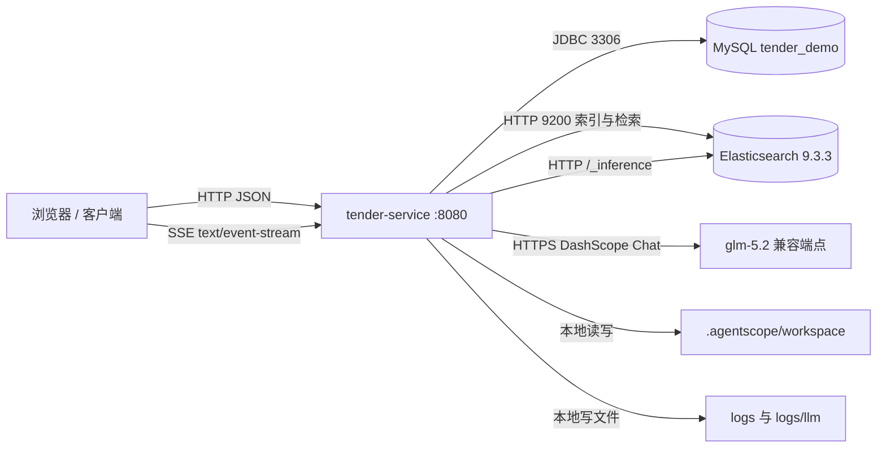

上图四条外部依赖均可从配置与代码定位：端口 8080 〔FACT｜src/main/resources/application.yml:1-2｜snapshot:2026-10-28〕，MySQL 数据源 〔FACT｜src/main/resources/application.yml:8-12｜snapshot:2026-10-28〕，ES 节点 〔FACT｜src/main/resources/application.yml:29-35｜snapshot:2026-10-28〕，Agent 工作区 〔FACT｜src/main/resources/application.yml:20-22｜snapshot:2026-10-28〕。

### 2.2 职责边界

| 属于本服务 | 不属于本服务 | 证据 |
|---|---|---|
| 招标文本 → 结构化要求（流式） | 招标文件上传、PDF/Word 解析、OCR | 入参为纯文本 `tenderText` 〔FACT｜src/main/java/org/example/model/req/TenderRequest.java#TenderRequest:10-16｜snapshot:2026-10-28〕 |
| 人工确认后落库（主表 + 4 张子表） | 审批流、版本管理、变更留痕 | 仅 `save` 一条写路径 〔FACT｜src/main/java/org/example/service/TenderRequirementsService.java#save:20-24｜snapshot:2026-10-28〕 |
| 投标目录与章节文本生成 | 标书排版、页码、签章、导出 | 接口直接返回字符串，无落库 |
| 知识文档写入与检索 | 文档切分策略编排、权限隔离 | 入参为 `List<String>` |
| 模型调用审计（本地文件） | 审计集中存储、合规留存策略 | 写本地 json 文件 |
| 企业资质/业绩/人员查询工具 | 企业主数据维护 | 只有读接口，无写接口 |

### 2.3 上下游

| 方向 | 对端 | 协议/形态 | 关键约束 | 证据 |
|---|---|---|---|---|
| 上游 | 前端/调用方 | HTTP JSON + SSE | 无鉴权、无租户头、无幂等键 | 〔FACT｜src/main/java/org/example/controller/TenderController.java#parseTender:76-89｜snapshot:2026-10-28〕 |
| 下游 | DashScope 兼容 Chat 端点 | HTTPS，OpenAI 风格 | 模型名来自配置，无能力探测 | 〔FACT｜src/main/java/org/example/config/TenderAgentConfig.java#tenderAgent:61-64｜snapshot:2026-10-28〕 |
| 下游 | MySQL | JDBC + MyBatis-Plus | 无外键、无乐观锁列 | 〔FACT｜src/main/db/tender_requirements.sql#t_tender_requirements:1-10｜snapshot:2026-10-28〕 |
| 下游 | Elasticsearch | REST 9200 | 依赖 IK 插件与 inference license | 〔FACT｜src/main/java/org/example/repo/KnowledgeBaseRepository.java#createIndex:259-261｜snapshot:2026-10-28〕 |
| 下游 | 本地文件系统 | 工作区 + 日志 | 相对路径依赖启动目录 | 〔FACT｜src/main/java/org/example/service/WorkspaceInitializer.java#init:35-58｜snapshot:2026-10-28〕 |

### 2.4 技术栈与版本

| 组件 | 版本/来源 | 用途 | 证据 |
|---|---|---|---|
| Java | 21（编译 source/target） | 语言级别，使用 record 与 switch 表达式 | 〔FACT｜pom.xml#maven.compiler.source:21-24｜snapshot:2026-10-28〕 |
| Spring Boot | 4.1.1（运行时实测 Spring 7.0.9） | 容器、WebFlux、Actuator | 〔FACT｜logs/tender-service.log:184｜snapshot:2026-10-28〕 |
| WebFlux | starter | 响应式 HTTP + SSE | 〔FACT｜pom.xml#spring-boot-starter-webflux:33-36｜snapshot:2026-10-28〕 |
| AgentScope | 2.0.4（harness + dashscope 扩展） | Agent 运行时、工具调用、子 Agent | 〔FACT｜pom.xml#agentscope.version:28｜snapshot:2026-10-28〕 |
| MyBatis-Plus | 3.5.17（boot4 starter） | ORM 与 BaseMapper | 〔FACT｜pom.xml#mybatis-plus-spring-boot4-starter:44-48｜snapshot:2026-10-28〕 |
| MySQL Driver | 26.7.0（runtime） | JDBC 驱动 | 〔FACT｜pom.xml#mysql-connector-j:50-55｜snapshot:2026-10-28〕 |
| Elasticsearch Client | 9.3.3（java + rest5） | 索引、Bulk、检索 | 〔FACT｜pom.xml#elasticsearch-java:83-92｜snapshot:2026-10-28〕 |
| springdoc | 3.1.1 webflux-ui | OpenAPI 与 Swagger UI | 〔FACT｜pom.xml#springdoc-openapi-starter-webflux-ui:76-80｜snapshot:2026-10-28〕 |
| Lombok | 由 Boot 父 POM 管理 | `@Data`、`@Slf4j` | 〔FACT｜pom.xml#lombok:57-61｜snapshot:2026-10-28〕 |
| Jackson | 2.x 与 3.x 并存 | 序列化与注解 | 〔FACT｜src/main/java/org/example/middleware/ModelCallAuditMiddleware.java#MAPPER:45-47｜snapshot:2026-10-28〕 |

Jackson 双版本是事实而非选择：`TenderParseEventTransformer` 与知识库模型用 `com.fasterxml.jackson.*`，`ModelCallAuditMiddleware` 与 `EsInferenceEmbeddingClient` 用 `tools.jackson.*`〔INFER〕依据是两处 import 同时存在，验证方式为“检查 Spring Boot 4 的 HTTP 编解码器实际使用哪个 `ObjectMapper`，并确认 `com.fasterxml.jackson.annotation` 注解在 Jackson 3 下仍被识别”。

### 2.5 模块清单

| 编号 | 模块 | 关键类 | 对外可见性 | 证据 |
|---|---|---|---|---|
| M-01 | 招标解析入口 | `TenderController#parseTender` | HTTP `POST /tender/parse`（SSE） | 〔FACT｜src/main/java/org/example/controller/TenderController.java#parseTender:76-89｜snapshot:2026-10-28〕 |
| M-02 | 解析事件转换 | `TenderParseEventTransformer` | 内部 | 〔FACT｜src/main/java/org/example/service/TenderParseEventTransformer.java#toSse:54-74｜snapshot:2026-10-28〕 |
| M-03 | 要求持久化 | `TenderRequirementsService`、`TenderRequirementsRepository` | HTTP `POST /tender/parse/confirm` | 〔FACT｜src/main/java/org/example/repo/TenderRequirementsRepository.java#save:43-52｜snapshot:2026-10-28〕 |
| M-04 | 编目与撰写 | `CatalogPromptProvider`、`TenderController#generateCatalog`、`#generateChapter` | HTTP `POST /tender/catalog`、`POST /tender/chapter` | 〔FACT｜src/main/java/org/example/prompts/CatalogPromptProvider.java#render:19-21｜snapshot:2026-10-28〕 |
| M-05 | Agent 运行时 | `TenderAgentConfig`、`RuntimeContextBuilder`、`WorkspaceInitializer`、两个 Tools 类 | 内部 | 〔FACT｜src/main/java/org/example/config/TenderAgentConfig.java#tenderAgent:58-74｜snapshot:2026-10-28〕 |
| M-06 | 知识库 | `KnowledgeBaseController`、`KnowledgeBaseService`、`KnowledgeBaseRepository`、两个 Embedding 客户端 | HTTP `POST /knowledge/{name}`、`GET /knowledge/search` | 〔FACT｜src/main/java/org/example/controller/KnowledgeBaseController.java#search:72-87｜snapshot:2026-10-28〕 |
| M-07 | 审计与可观测 | `ModelCallAuditMiddleware`、`logback.xml`、Actuator | `/actuator/health` | 〔FACT｜src/main/resources/logback.xml#ROLLING_FILE:34-46｜snapshot:2026-10-28〕 |

模块依赖方向是单向的：`controller → service → repo/client`，`config` 反向注入 `service` 与 `tools`，不存在 service 回调 controller 的路径〔INFER〕依据是 import 关系，验证方式为静态扫描 `org.example.controller` 在 service/repo 包的引用（当前为 0）。

## 3. 总体设计

### 3.1 逻辑架构

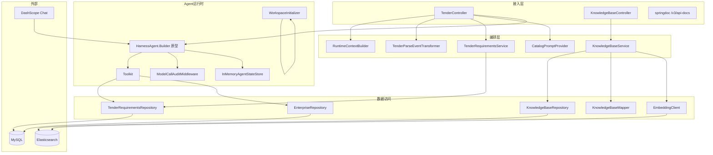

### 3.2 包结构与分层职责

| 包 | 类数 | 职责 | 允许依赖 | 证据 |
|---|---|---|---|---|
| `org.example.controller` | 2 | HTTP 入参绑定、SSE 流组装、状态码 | service、model | 〔FACT｜src/main/java/org/example/controller/TenderController.java#TenderController:26-47｜snapshot:2026-10-28〕 |
| `org.example.service` | 5 | 业务规则、事件转换、上下文、工作区初始化 | repo、client、config、model | 〔FACT｜src/main/java/org/example/service/KnowledgeBaseService.java#saveAll:47-98｜snapshot:2026-10-28〕 |
| `org.example.repo` | 3 | 表聚合、ES 读写、检索融合 | mapper、client、model | 〔FACT｜src/main/java/org/example/repo/KnowledgeBaseRepository.java#search:82-95｜snapshot:2026-10-28〕 |
| `org.example.mapper` | 9 | MyBatis-Plus `BaseMapper`，无自定义 SQL | — | 〔FACT｜src/main/java/org/example/mapper/KnowledgeBaseMapper.java#KnowledgeBaseMapper:7-9｜snapshot:2026-10-28〕 |
| `org.example.client` | 4 | 向量化（ES inference / DashScope） | config | 〔FACT｜src/main/java/org/example/client/EsInferenceEmbeddingClient.java#request:84-139｜snapshot:2026-10-28〕 |
| `org.example.config` | 3 | Bean 装配、配置绑定 | 全部 | 〔FACT｜src/main/java/org/example/config/ElasticsearchConfig.java#elasticsearchTransport:31-59｜snapshot:2026-10-28〕 |
| `org.example.tools` | 2 | 暴露给 LLM 的工具方法 | repo、model | 〔FACT｜src/main/java/org/example/tools/TenderTools.java#TenderTools:17-39｜snapshot:2026-10-28〕 |
| `org.example.model` | 12 | 实体、请求、响应、枚举 | — | 〔FACT｜src/main/java/org/example/model/resp/ParseModule.java#ParseModule:15-21｜snapshot:2026-10-28〕 |
| `org.example.prompts` | 1 | 提示词模板加载与占位符替换 | — | 〔FACT｜src/main/java/org/example/prompts/CatalogPromptProvider.java#render:19-21｜snapshot:2026-10-28〕 |

### 3.3 部署拓扑

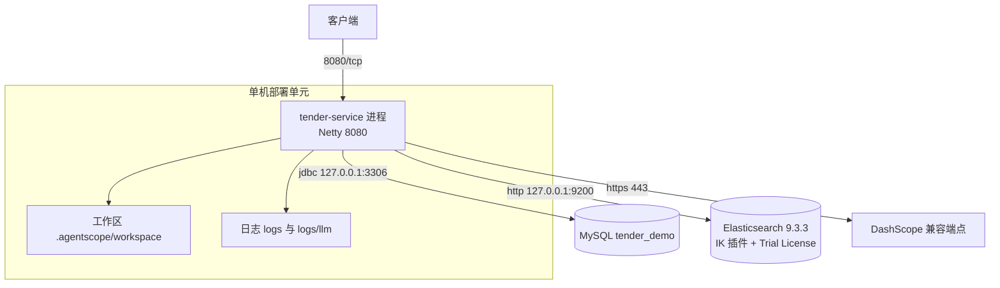

部署形态是“单进程 + 两个外部存储”，没有网关、没有副本、没有配置中心。三项事实支撑：无容器化文件（仓库根目录只有 `pom.xml` 与 `src/`）〔INFER〕依据是文件清单快照，验证方式为 `find . -maxdepth 2 -name 'Dockerfile' -o -name '*.yaml'`；日志与工作区均为相对路径〔FACT｜src/main/resources/logback.xml:14-15｜snapshot:2026-10-28〕；数据源与 ES 均指向本机环回地址〔FACT｜src/main/resources/application.yml:9-11｜snapshot:2026-10-28〕。

### 3.4 运行时装配

| Bean | 作用域 | 生命周期风险 | 证据 |
|---|---|---|---|
| `HarnessAgent.Builder` | prototype | 每次注入新实例，避免共享 hooks 泄漏；代价是每请求重建工具集 | 〔FACT｜src/main/java/org/example/config/TenderAgentConfig.java#tenderAgent:46-48｜snapshot:2026-10-28〕 |
| `AgentStateStore` | singleton | 全进程共享内存，会话无上限增长 | 〔FACT｜src/main/java/org/example/config/TenderAgentConfig.java#agentStateStore:33-37｜snapshot:2026-10-28〕 |
| `ElasticsearchTransport` | singleton，`destroyMethod=close` | 连接池随上下文关闭 | 〔FACT｜src/main/java/org/example/config/ElasticsearchConfig.java#elasticsearchTransport:31-32｜snapshot:2026-10-28〕 |
| `ElasticsearchClient` | singleton | 线程安全 | 〔FACT｜src/main/java/org/example/config/ElasticsearchConfig.java#elasticsearchClient:61-64｜snapshot:2026-10-28〕 |
| `EmbeddingClient` 实现 | 按 `provider` 条件装配，二选一 | 配错 provider 会导致启动即失败或运行期 401 | 〔FACT｜src/main/java/org/example/client/EsInferenceEmbeddingClient.java#EsInferenceEmbeddingClient:23-26｜snapshot:2026-10-28〕 |
| `CatalogPromptProvider` | singleton，构造期读文件 | 资源不在文件系统时启动失败 | 〔FACT｜src/main/java/org/example/prompts/CatalogPromptProvider.java#CatalogPromptProvider:15-17｜snapshot:2026-10-28〕 |

两个 `EmbeddingClient` 的条件互斥由 `@ConditionalOnProperty` 保证：ES 实现 `matchIfMissing=true`，DashScope 实现要求显式 `dashscope`〔FACT｜src/main/java/org/example/client/DashScopeEmbeddingClient.java#DashScopeEmbeddingClient:27-30｜snapshot:2026-10-28〕。

### 3.5 关键设计决策与 trade-off

| 编号 | 决策 | 备选方案 | 取舍（得到/失去） | 证据 |
|---|---|---|---|---|
| D-01 | 解析结果用 SSE 流式推送 | WebSocket、轮询任务 | 得到：单向推送、HTTP 兼容、断线即结束；失去：无双向控制、无重连补偿 | 〔FACT｜src/main/java/org/example/controller/TenderController.java#parseTender:49-75｜snapshot:2026-10-28〕 |
| D-02 | RRF 在 Java 侧融合，不用 ES 原生 RRF | ES 8.14+ 的 `rank` 组合检索 | 得到：Basic License 可用；失去：两倍网络往返、候选集固定 50 | 〔FACT｜src/main/java/org/example/repo/KnowledgeBaseRepository.java#RRF_RANK_CONSTANT:46-47｜snapshot:2026-10-28〕 |
| D-03 | 让模型直接吐 JSON，应用侧按大括号配对切分 | function calling / 结构化输出 | 得到：不依赖模型能力、可流式；失去：无 schema 校验、失败静默 | 〔FACT｜src/main/java/org/example/service/TenderParseEventTransformer.java#takeFirstCompleteJson:111-151｜snapshot:2026-10-28〕 |
| D-04 | 每请求 `builder::build` 新建 Agent | 单例 Agent + 会话隔离 | 得到：隔离 hooks 与工具状态；失去：构建开销、无法复用连接上下文 | 〔FACT｜src/main/java/org/example/controller/TenderController.java#parseTender:84-88｜snapshot:2026-10-28〕 |
| D-05 | 会话状态放内存 | Redis / JDBC 状态存储 | 得到：零外部依赖；失去：重启即丢、无法水平扩展、无 TTL | 〔FACT｜src/main/java/org/example/config/TenderAgentConfig.java#agentStateStore:34-36｜snapshot:2026-10-28〕 |
| D-06 | MySQL 存元数据、ES 存文档正文 | 全 MySQL、全 ES | 得到：检索能力与事务能力各取所长；失去：跨存储一致性无保障 | 〔FACT｜src/main/java/org/example/service/KnowledgeBaseService.java#saveAll:88-93｜snapshot:2026-10-28〕 |
| D-07 | 默认用 ES 内置 384 维 embedding | DashScope 1024 维 | 得到：不出网、无额外费用；失去：依赖 Platinum/Trial license | 〔FACT｜src/main/resources/application.yml:37-43｜snapshot:2026-10-28〕 |
| D-08 | 无物理外键，级联由应用层完成 | 数据库外键 + ON DELETE CASCADE | 得到：写入灵活、易分库；失去：孤儿数据、删除需应用保证 | 〔FACT｜src/main/db/tender_requirements.sql:8-9｜snapshot:2026-10-28〕 |
| D-09 | 超长字段截断而不报错 | 校验拒绝、报错给调用方 | 得到：写入成功率高；失去：静默丢字、审计困难 | 〔FACT｜src/main/java/org/example/repo/TenderRequirementsRepository.java#truncate:213-218｜snapshot:2026-10-28〕 |
| D-10 | 模型调用审计写本地 JSON 文件 | SLF4J 结构化日志、远端审计 | 得到：字段完整、便于人工比对；失去：无轮转、无集中检索、含敏感内容 | 〔FACT｜src/main/java/org/example/middleware/ModelCallAuditMiddleware.java#writeJsonLine:183-204｜snapshot:2026-10-28〕 |
| D-11 | 启动时覆盖式释放工作区声明文件 | 只读 classpath、外置目录挂载 | 得到：改 prompt 重启即生效；失去：运行期人工修改被覆盖 | 〔FACT｜src/main/java/org/example/service/WorkspaceInitializer.java#shouldOverwrite:76-79｜snapshot:2026-10-28〕 |
| D-12 | 不引入认证与网关 | OAuth2 / API Key 网关 | 得到：联调快；失去：任何可达网络的人都能消耗模型额度并触达工具 | 〔FACT｜src/main/java/org/example/controller/KnowledgeBaseController.java#KnowledgeBaseController:23-32｜snapshot:2026-10-28〕 |

trade-off 结论：D-01/D-02/D-03 属于合理取舍（有明确约束与收益）；D-05/D-09/D-12 属于**未完成的设计**——收益是“先跑通”，但没有补偿措施，直接构成第 11 章的 P0/P1。

### 3.6 请求生命周期

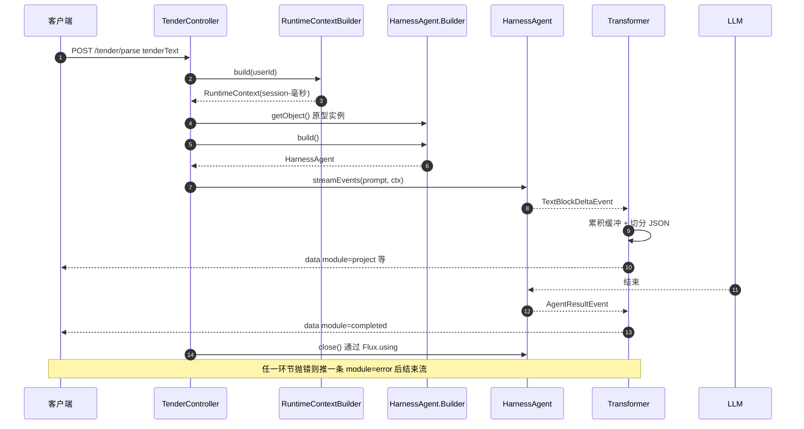

## 4. 功能详细设计

功能编号与第 2 章模块一一对应：F-01 解析、F-02 事件转换、F-03 确认入库、F-04 目录生成、F-05 章节撰写、F-06 知识库写入、F-07 知识库检索、F-08 企业数据工具。

### 4.1 F-01 招标文件解析

| 项 | 内容 | 证据 |
|---|---|---|
| 入口 | `POST /tender/parse`，`TenderController#parseTender` | 〔FACT｜src/main/java/org/example/controller/TenderController.java#parseTender:76-77｜snapshot:2026-10-28〕 |
| 请求体 | `TenderRequest{userId?, tenderText}`，无 `@Valid`、无 `@NotBlank` | 〔FACT｜src/main/java/org/example/model/req/TenderRequest.java#TenderRequest:10-16｜snapshot:2026-10-28〕 |
| 返回 | `Flux<TenderParseEvent<?>>`；Accept 为 `text/event-stream` 时按 SSE 输出，否则按 JSON 流输出 | 〔FACT｜src/main/java/org/example/controller/TenderController.java#parseTender:77-77｜snapshot:2026-10-28〕 |
| 上下文 | `RuntimeContext.userId=request.userId`，`sessionId="session-"+currentTimeMillis()` | 〔FACT｜src/main/java/org/example/service/RuntimeContextBuilder.java#build:10-15｜snapshot:2026-10-28〕 |
| 提示词 | `"请解析以下招标文件，提取结构化要求：\n" + tenderText` 单条 UserMessage | 〔FACT｜src/main/java/org/example/controller/TenderController.java#parseTender:79-80｜snapshot:2026-10-28〕 |
| 资源释放 | `Flux.using` 第三参 `HarnessAgent::close`，正常/异常/取消均关闭 | 〔FACT｜src/main/java/org/example/controller/TenderController.java#parseTender:84-88｜snapshot:2026-10-28〕 |

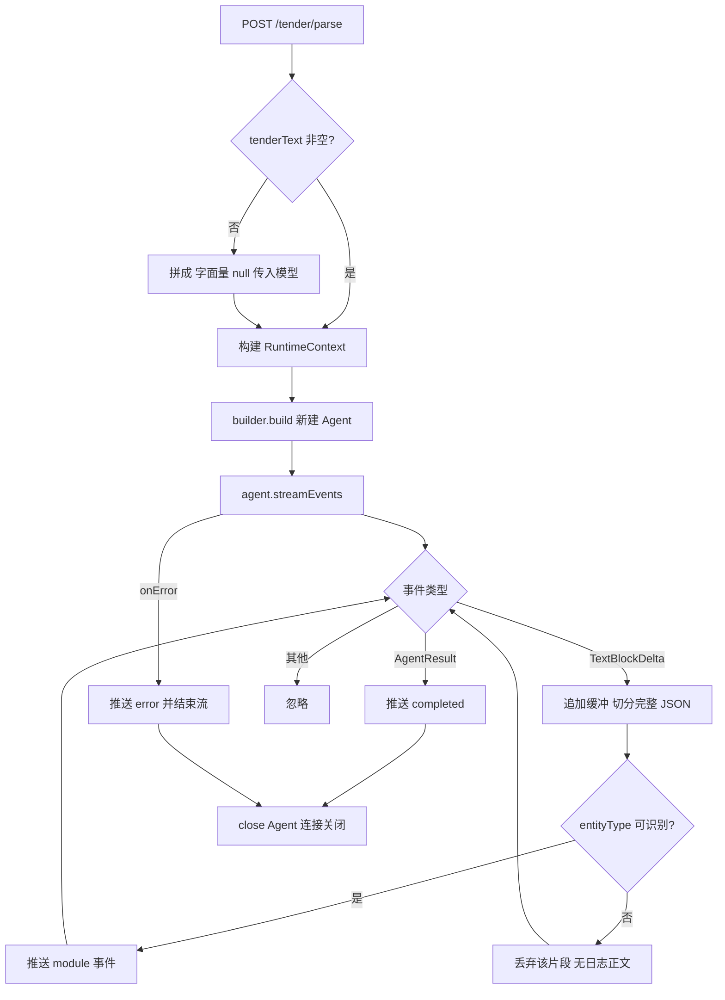

规则：

| 编号 | 规则 | 现状 | 证据 |
|---|---|---|---|
| R-01 | 每次请求新建 Agent，不复用 | 已实现 | 〔FACT｜src/main/java/org/example/controller/TenderController.java#parseTender:82-85｜snapshot:2026-10-28〕 |
| R-02 | 请求中的 `sessionId` 不被使用 | 解析请求根本没有该字段；`RuntimeContext` 自造 | 〔FACT｜src/main/java/org/example/model/req/TenderRequest.java#TenderRequest:11-15｜snapshot:2026-10-28〕 |
| R-03 | 工具集固定为 TenderTools + EnterpriseDataTools | 已实现，含写库与删除工具 | 〔FACT｜src/main/java/org/example/config/TenderAgentConfig.java#tenderAgent:54-56｜snapshot:2026-10-28〕 |
| R-04 | 系统提示词为固定一句话，行为约束依赖工作区 `AGENTS.md` | 已实现 | 〔FACT｜src/main/java/org/example/config/TenderAgentConfig.java#tenderAgent:60-60｜snapshot:2026-10-28〕 |
| R-05 | 无超时、无心跳、无背压策略 | 未实现 | 〔FACT｜src/main/java/org/example/controller/TenderController.java#parseTender:86-86｜snapshot:2026-10-28〕 |

输出事件契约（与 Controller 的 OpenAPI 描述一致）：

| module | data 类型 | 触发条件 | 是否可多条 |
|---|---|---|---|
| `project` | `TenderRequirements` | `entityType=tenderRequirements` | 否（按契约唯一，代码不强制） |
| `qualification` | `QualificationRequirement` | `entityType=qualification` | 是 |
| `performance` | `PerformanceRequirement` | `entityType=performance` | 是 |
| `personnel` | `PersonnelRequirement` | `entityType=personnel` | 是 |
| `scoringItem` | `ScoringItem` | `entityType=scoringItem` | 是 |
| `error` | 无 | 流内异常 | 否 |
| `completed` | 无 | `AgentResultEvent` | 否 |

异常路径：

| 异常源 | 客户端可见 | 服务端记录 | 证据 |
|---|---|---|---|
| 模型侧网络/配额错误 | `module=error` + message | `log.error("解析招标文件流式处理失败")` | 〔FACT｜src/main/java/org/example/service/TenderParseEventTransformer.java#toSse:69-72｜snapshot:2026-10-28〕 |
| 模型输出非法 JSON | 无提示，静默跳过 | `log.warn("跳过无法解析的结构化片段")` | 〔FACT｜src/main/java/org/example/service/TenderParseEventTransformer.java#extractRequirements:90-92｜snapshot:2026-10-28〕 |
| 模型输出未闭合 JSON | 无提示，直接 `completed` | 无日志 | 〔FACT｜src/main/java/org/example/service/TenderParseEventTransformer.java#takeFirstCompleteJson:150-150｜snapshot:2026-10-28〕 |
| 客户端提前断开 | 连接关闭 | `Flux.using` 触发 `close` | 〔INFER〕依据是 Reactor `using` 的 cancel 语义，验证方式为断连后检查模型侧是否收到 cancel 与审计文件是否生成 |

### 4.2 F-02 事件转换与 JSON 切分

核心是一个字符串感知的大括号配对扫描器，逐字符维护 `depth / inString / escaped` 三态，凑齐一个对象就从缓冲前部删除并返回原文。

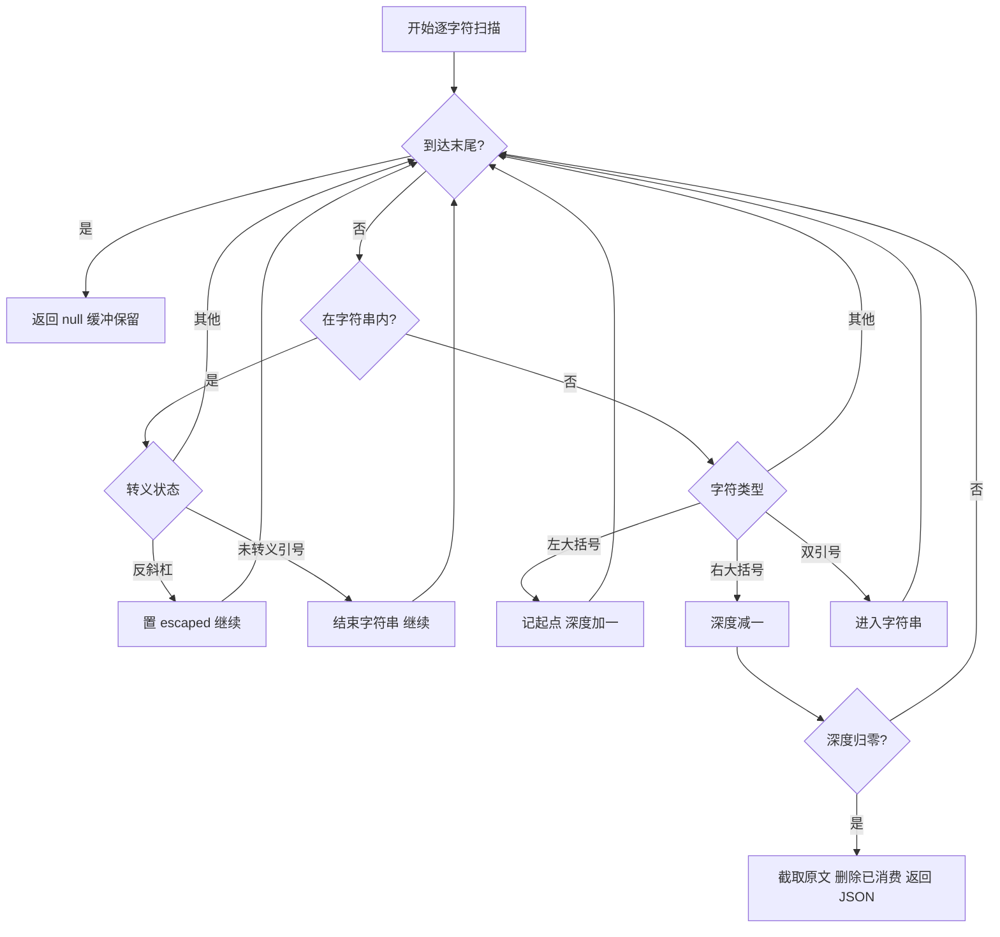

规则与边界：

| 编号 | 场景 | 行为 | 后果 | 证据 |
|---|---|---|---|---|
| S-01 | 一次 delta 内含多个对象 | `while` 循环逐个取出，全部推送 | 正确 | 〔FACT｜src/main/java/org/example/service/TenderParseEventTransformer.java#extractRequirements:78-79｜snapshot:2026-10-28〕 |
| S-02 | 字符串内容含 `{` `}` 或转义引号 | 三态机跳过字符串内部 | 正确 | 〔FACT｜src/main/java/org/example/service/TenderParseEventTransformer.java#takeFirstCompleteJson:118-127｜snapshot:2026-10-28〕 |
| S-03 | 对象未闭合 | 保留在缓冲，流结束后丢弃 | 数据缺失且无告警 | 〔FACT｜src/main/java/org/example/service/TenderParseEventTransformer.java#takeFirstCompleteJson:148-150｜snapshot:2026-10-28〕 |
| S-04 | 非法 JSON（尾逗号、中文引号） | 反序列化抛异常被 `catch` 吞掉 | 该条数据丢失，仅 warn 日志 | 〔FACT｜src/main/java/org/example/service/TenderParseEventTransformer.java#extractRequirements:89-92｜snapshot:2026-10-28〕 |
| S-05 | `entityType` 缺失或拼错 | `dispatch` 返回 null，静默丢弃 | 无任何日志 | 〔FACT｜src/main/java/org/example/service/TenderParseEventTransformer.java#dispatch:101-104｜snapshot:2026-10-28〕 |
| S-06 | 模型输出 JSON 数组 | 数组内每个对象被独立取出，元数组合法性不校验 | 兼容但可能混入非预期对象 | 〔INFER〕依据是扫描器只认大括号，验证方式为构造 `[{"entityType":...}]` 输入做单测 |
| S-07 | 模型在 JSON 前后输出解释文字 | 解释文字留在缓冲，直到下一个对象前被 `delete` | 文字被丢弃，不报错 | 〔INFER〕依据是 `buffer.delete(start, i+1)` 只删对象区间，验证方式同上 |

〔OBSERVE｜缺陷｜中｜已确认〕S-03/S-04/S-05 三条静默路径叠加，使“解析成功但数据不全”成为不可观测状态；修复方向见 P1-02（第 11 章）。

### 4.3 F-03 确认解析结果入库

| 项 | 内容 | 证据 |
|---|---|---|
| 入口 | `POST /tender/parse/confirm`，`TenderController#confirmTender` | 〔FACT｜src/main/java/org/example/controller/TenderController.java#confirmTender:96-97｜snapshot:2026-10-28〕 |
| 请求体 | 完整 `TenderRequirements`（含 4 个子表 List） | 〔FACT｜src/main/java/org/example/model/require/TenderRequirements.java#TenderRequirements:42-57｜snapshot:2026-10-28〕 |
| 返回 | `Mono<Long>`，主表自增 id | 〔FACT｜src/main/java/org/example/controller/TenderController.java#confirmTender:98-98｜snapshot:2026-10-28〕 |
| 事务 | `TenderRequirementsService#save` 标 `@Transactional` | 〔FACT｜src/main/java/org/example/service/TenderRequirementsService.java#save:20-22｜snapshot:2026-10-28〕 |
| 执行线程 | `Mono.fromCallable` 未指定 `subscribeOn`，跟随订阅线程（Netty 事件循环） | 〔FACT｜src/main/java/org/example/controller/TenderController.java#confirmTender:98-98｜snapshot:2026-10-28〕 |
| 幂等 | 无幂等键、无去重查询，重复提交重复插入 | 〔FACT｜src/main/java/org/example/repo/TenderRequirementsRepository.java#save:43-46｜snapshot:2026-10-28〕 |

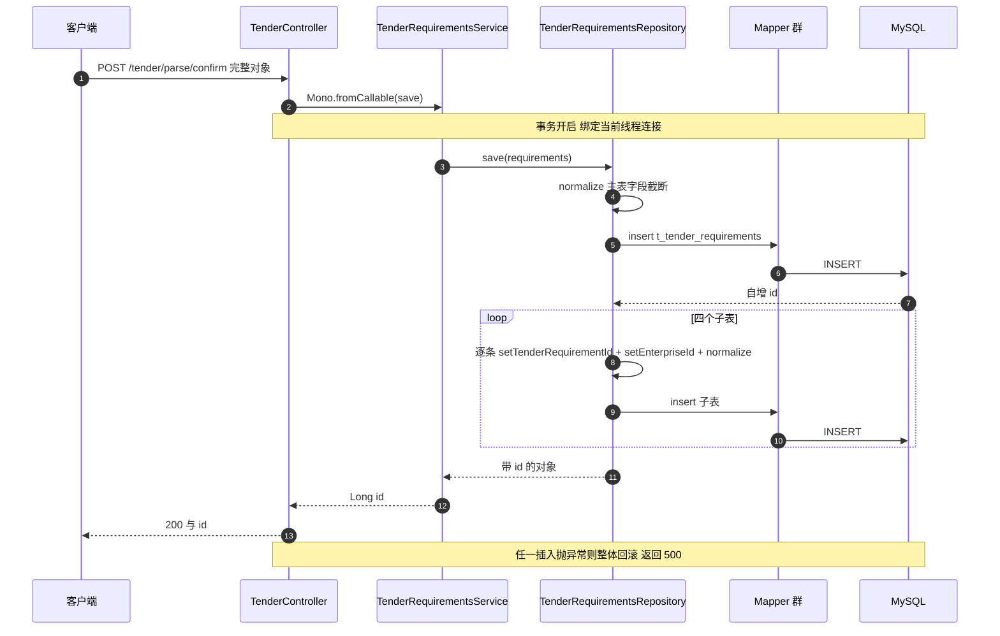

写入顺序与表映射：

| 顺序 | 方法 | 表 | 关联键 | 证据 |
|---|---|---|---|---|
| 1 | `tenderRequirementsMapper.insert` | `t_tender_requirements` | 自增 id | 〔FACT｜src/main/java/org/example/repo/TenderRequirementsRepository.java#save:45-46｜snapshot:2026-10-28〕 |
| 2 | `saveQualifications` | `t_qualification_requirement` | `tender_requirement_id` | 〔FACT｜src/main/java/org/example/repo/TenderRequirementsRepository.java#saveQualifications:80-90｜snapshot:2026-10-28〕 |
| 3 | `savePerformances` | `t_performance_requirement` | 同上 | 〔FACT｜src/main/java/org/example/repo/TenderRequirementsRepository.java#savePerformances:92-102｜snapshot:2026-10-28〕 |
| 4 | `savePersonnel` | `t_personnel_requirement` | 同上 | 〔FACT｜src/main/java/org/example/repo/TenderRequirementsRepository.java#savePersonnel:104-114｜snapshot:2026-10-28〕 |
| 5 | `saveScoringItems` | `t_scoring_item` | 同上 | 〔FACT｜src/main/java/org/example/repo/TenderRequirementsRepository.java#saveScoringItems:116-126｜snapshot:2026-10-28〕 |

字段截断规则（应用层按字符截断，与 DDL 列长对齐）：

| 实体 | 字段 | 上限 | DDL 列定义 | 证据 |
|---|---|---|---|---|
| TenderRequirements | projectName | 255 | `VARCHAR(255)` | 〔FACT｜src/main/java/org/example/repo/TenderRequirementsRepository.java#normalize:176-178｜snapshot:2026-10-28〕 |
| TenderRequirements | location | 255 | `VARCHAR(255)` | 〔FACT｜src/main/db/tender_requirements.sql:5-5｜snapshot:2026-10-28〕 |
| TenderRequirements | duration | 64 | `VARCHAR(64)` | 〔FACT｜src/main/java/org/example/repo/TenderRequirementsRepository.java#TR_DURATION_MAX:152-152｜snapshot:2026-10-28〕 |
| TenderRequirements | budget | 128 | `VARCHAR(128)` | 〔FACT｜src/main/java/org/example/repo/TenderRequirementsRepository.java#TR_BUDGET_MAX:153-153｜snapshot:2026-10-28〕 |
| QualificationRequirement | type/level/valid/source | 128/64/255/512 | 对应列一致 | 〔FACT｜src/main/java/org/example/repo/TenderRequirementsRepository.java#QUAL_SOURCE_MAX:155-158｜snapshot:2026-10-28〕 |
| PerformanceRequirement | projectType/quantity/amount/timeRange/source | 255/64/128/128/512 | 对应列一致 | 〔FACT｜src/main/java/org/example/repo/TenderRequirementsRepository.java#PERF_SOURCE_MAX:160-164｜snapshot:2026-10-28〕 |
| PersonnelRequirement | role/certificate/source | 64/255/512 | 对应列一致 | 〔FACT｜src/main/java/org/example/repo/TenderRequirementsRepository.java#PERSONNEL_SOURCE_MAX:166-168｜snapshot:2026-10-28〕 |
| ScoringItem | itemId/name/criterion/chapter/source | 64/128/512/128/512 | 对应列一致 | 〔FACT｜src/main/java/org/example/repo/TenderRequirementsRepository.java#SCORING_SOURCE_MAX:170-174｜snapshot:2026-10-28〕 |

规则与限制：

| 编号 | 规则 | 现状 | 影响 |
|---|---|---|---|
| R-06 | `enterpriseId` 必填（DDL `NOT NULL`）但请求体无校验 | 缺失时由数据库报错，整单回滚 | 客户端拿到 500，无法定位是哪个字段 |
| R-07 | 子表记录会覆盖 `tenderRequirementId` 与 `enterpriseId` | 已实现，客户端传入值被忽略 | 行为正确但不透明，接口文档未写 |
| R-08 | 无最大值保护：子表 List 长度无上限 | 单条请求可写 N 条，逐条 insert | 大报文下会产生 N 次往返，事务时长线性增长 |
| R-09 | 无重复提交防护 | 每次调用都新增主表记录 | 前端重试即产生脏数据 |
| R-10 | 截断按 UTF-16 char 计，非按字节 | `String.substring` | 生僻字（代理对）可能被截半〔INFER〕依据是 `substring` 语义，验证方式为用 emoji 构造 128 字符字段观察落库值 |

异常路径：

| 异常 | 触发条件 | 表现 | 恢复方式 |
|---|---|---|---|
| `DataIntegrityViolationException` | `enterpriseId` 为 null | 500，事务回滚 | 调用方补字段重试 |
| `DuplicateKeyException` | 无唯一键约束，理论不触发 | — | — |
| 连接池耗尽 | 事件循环被阻塞导致请求堆积 | 30s 后超时 500 | 需重启或扩容，见 P0-06 |
| 序列化失败 | 请求体字段类型不匹配 | 400（Spring 默认） | 修正报文 |

### 4.4 F-04 投标目录生成

| 项 | 内容 | 证据 |
|---|---|---|
| 入口 | `POST /tender/catalog`，`TenderController#generateCatalog` | 〔FACT｜src/main/java/org/example/controller/TenderController.java#generateCatalog:103-104｜snapshot:2026-10-28〕 |
| 请求体 | `CatalogRequest{userId?, tenderRequirementId?}` | 〔FACT｜src/main/java/org/example/model/req/CatalogRequest.java#CatalogRequest:10-16｜snapshot:2026-10-28〕 |
| 提示词 | `CatalogPromptProvider.render(id)` 把模板中 `{{id}}` 替换为 id | 〔FACT｜src/main/java/org/example/prompts/CatalogPromptProvider.java#render:19-21｜snapshot:2026-10-28〕 |
| 模板加载 | 构造期 `Files.readString(resource.getFile().toPath())` | 〔FACT｜src/main/java/org/example/prompts/CatalogPromptProvider.java#CatalogPromptProvider:15-17｜snapshot:2026-10-28〕 |
| 返回 | `Mono<String>`，模型原始文本 | 〔FACT｜src/main/java/org/example/controller/TenderController.java#generateCatalog:111-115｜snapshot:2026-10-28〕 |
| 落库 | 无 | 见 P2-05 |

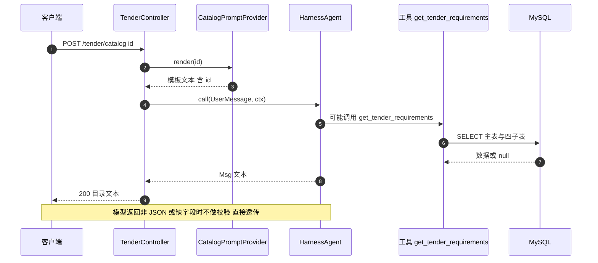

模板契约（`prompts/catalog-generation.md`）：

| 输入/输出 | 字段 | 约束 | 证据 |
|---|---|---|---|
| 占位符 | `{{id}}` | 仅替换一次，未替换则保留原样 | 〔FACT｜src/main/java/org/example/prompts/CatalogPromptProvider.java#render:20-20｜snapshot:2026-10-28〕 |
| 输出 | `catalog[]` 或 `business_catalog[]`+`technical_catalog[]` | 二选一 | 〔FACT｜src/main/resources/prompts/catalog-generation.md:69-84｜snapshot:2026-10-28〕 |
| 输出 | `structure_decision` | 必填 | 同上 |
| 输出 | `gaps[]` | 必填，可为空数组 | 同上 |
| 条目 | `chapter_no`、`title`、`scoring_item_ids`、`content_hint` | 四级必填 | 〔FACT｜src/main/resources/prompts/catalog-generation.md:70-77｜snapshot:2026-10-28〕 |

失败模式：

| 失败 | 直接原因 | 用户可见 | 严重度 |
|---|---|---|---|
| 子 Agent 不存在 | `AGENTS.md` 要求委派 `catalog-builder`，但 classpath 工作区只有 2 个子 Agent | 目录内容退化为主 Agent 自撰，格式不可控 | 高 |
| jar 内启动失败 | `getFile()` 无法解析 jar 内资源 | 应用启动即失败 | 高 |
| 模型输出带解释文字 | 无 JSON 抽取与校验 | 前端 parse 失败 | 中 |
| id 为 null | 无参数校验，`{{id}}` 被替换为字符串 `null` | 工具查询 `null`，返回空目录与 gaps | 中 |

### 4.5 F-05 章节撰写

| 项 | 内容 | 证据 |
|---|---|---|
| 入口 | `POST /tender/chapter`，`TenderController#generateChapter` | 〔FACT｜src/main/java/org/example/controller/TenderController.java#generateChapter:120-121｜snapshot:2026-10-28〕 |
| 请求体 | `ChapterRequest{userId?, sessionId?, chapterTitle?, scoringPointIds?}` | 〔FACT｜src/main/java/org/example/model/req/ChapterRequest.java#ChapterRequest:10-22｜snapshot:2026-10-28〕 |
| 提示词 | `String.format("撰写章节“%s”，对应评分点：%s", title, ids)` | 〔FACT｜src/main/java/org/example/controller/TenderController.java#generateChapter:129-132｜snapshot:2026-10-28〕 |
| 数据来源 | 不查库，评分点内容完全依赖模型调用工具补全 | 〔INFER〕依据是方法体内无 repository 调用，验证方式为静态确认无 `Repository` 依赖注入 |
| 会话 | `sessionId` 字段被忽略，仍用毫秒自造 | 〔FACT｜src/main/java/org/example/service/RuntimeContextBuilder.java#build:12-14｜snapshot:2026-10-28〕 |
| 落库 | 无，章节文本直接返回 | 见 P2-05 |

规则与风险：

| 编号 | 规则/风险 | 说明 |
|---|---|---|
| R-11 | `chapterTitle` 与 `scoringPointIds` 未转义、未校验 | 用户可控文本直接进入提示词，构成提示词注入入口 |
| R-12 | 同一章节重复调用会重复消耗模型额度 | 无缓存、无结果持久化 |
| R-13 | 章节与评分点的关联仅存在于提示词文本 | 无法审计“哪一章覆盖了哪个评分点” |
| R-14 | 模型可能调用 `delete_tender_requirements` 等工具 | 提示词未禁止删除，工具集未裁剪 |

### 4.6 F-06 知识库写入

| 项 | 内容 | 证据 |
|---|---|---|
| 入口 | `POST /knowledge/{knowledgeBaseName}`，body 为 `List<String>` | 〔FACT｜src/main/java/org/example/controller/KnowledgeBaseController.java#save:49-56｜snapshot:2026-10-28〕 |
| 调度 | `Mono.fromCallable(...).subscribeOn(Schedulers.boundedElastic())` | 〔FACT｜src/main/java/org/example/controller/KnowledgeBaseController.java#save:54-55｜snapshot:2026-10-28〕 |
| 返回 | 知识库自增 id | 同上 |
| 事务 | `KnowledgeBaseService#saveAll` 标 `@Transactional`，事务内含 ES 写入 | 〔FACT｜src/main/java/org/example/service/KnowledgeBaseService.java#saveAll:47-48｜snapshot:2026-10-28〕 |
| 幂等 | 无；重复提交产生新 UUID 文档 | 〔FACT｜src/main/java/org/example/service/KnowledgeBaseService.java#saveAll:76-79｜snapshot:2026-10-28〕 |

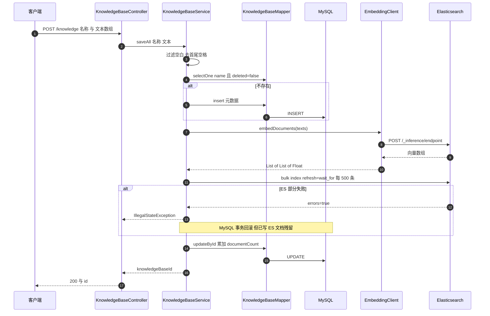

步骤与分支：

| 编号 | 步骤 | 关键判断 | 证据 |
|---|---|---|---|
| S-10 | 名称校验 | `hasText` 为空抛 `IllegalArgumentException` | 〔FACT｜src/main/java/org/example/service/KnowledgeBaseService.java#saveAll:49-51｜snapshot:2026-10-28〕 |
| S-11 | 空数组早退 | 仅建库并返回 id | 〔FACT｜src/main/java/org/example/service/KnowledgeBaseService.java#saveAll:52-55｜snapshot:2026-10-28〕 |
| S-12 | 文本清洗 | `filter(hasText).map(trim)` | 〔FACT｜src/main/java/org/example/service/KnowledgeBaseService.java#saveAll:57-60｜snapshot:2026-10-28〕 |
| S-13 | 向量化 | 仅当 `embeddingClient.isEnabled()`；失败直接抛出，无降级 | 〔FACT｜src/main/java/org/example/service/KnowledgeBaseService.java#saveAll:69-72｜snapshot:2026-10-28〕 |
| S-14 | 文档构造 | UUID 作 ES `_id`，写入 `knowledgeBaseId` 与 `createdAt` | 〔FACT｜src/main/java/org/example/service/KnowledgeBaseService.java#saveAll:74-86｜snapshot:2026-10-28〕 |
| S-15 | 索引写入 | 每 500 条一个 bulk，`Refresh.WaitFor` | 〔FACT｜src/main/java/org/example/repo/KnowledgeBaseRepository.java#BULK_BATCH_SIZE:40-41｜snapshot:2026-10-28〕 |
| S-16 | 计数更新 | 读旧值加本次条数再 `updateById` | 〔FACT｜src/main/java/org/example/service/KnowledgeBaseService.java#saveAll:90-93｜snapshot:2026-10-28〕 |
| S-17 | 元数据落库 | 首次建库写 `embeddingEnabled`、`embeddingDimension`、`embeddingModel` | 〔FACT｜src/main/java/org/example/service/KnowledgeBaseService.java#getOrCreateKnowledgeBase:149-158｜snapshot:2026-10-28〕 |

### 4.7 F-07 知识库检索

| 项 | 内容 | 证据 |
|---|---|---|
| 入口 | `GET /knowledge/search` | 〔FACT｜src/main/java/org/example/controller/KnowledgeBaseController.java#search:72-79｜snapshot:2026-10-28〕 |
| 参数 | `knowledgeBaseName`（可重复，可选）、`query`（必填）、`topK`（默认 10） | 同上 |
| 校验 | `query` 空白返回 400；名称不存在抛 `IllegalArgumentException`（500） | 〔FACT｜src/main/java/org/example/controller/KnowledgeBaseController.java#search:81-83｜snapshot:2026-10-28〕 |
| 上限 | `topK<=0` 取 10，超过 50 截到 50 | 〔FACT｜src/main/java/org/example/service/KnowledgeBaseService.java#MAX_TOP_K:124-124｜snapshot:2026-10-28〕 |
| 降级 | 查询向量失败仅 warn，随后走纯 BM25 | 〔FACT｜src/main/java/org/example/service/KnowledgeBaseService.java#search:126-133｜snapshot:2026-10-28〕 |

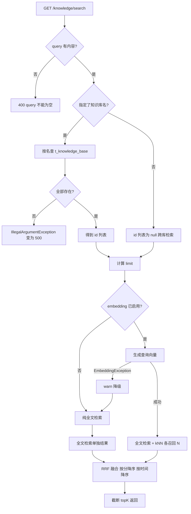

召回与融合参数：

| 参数 | 值 | 含义 | 证据 |
|---|---|---|---|
| `MIN_CANDIDATE_SIZE` | 50 | 每路最少召回条数 | 〔FACT｜src/main/java/org/example/repo/KnowledgeBaseRepository.java#MIN_CANDIDATE_SIZE:43-44｜snapshot:2026-10-28〕 |
| `candidateSize` | `max(50, topK)` | 实际每路 size | 〔FACT｜src/main/java/org/example/repo/KnowledgeBaseRepository.java#search:88-88｜snapshot:2026-10-28〕 |
| `numCandidates` | `max(size*2, 100)` | kNN 候选池 | 〔FACT｜src/main/java/org/example/repo/KnowledgeBaseRepository.java#vectorSearch:126-126｜snapshot:2026-10-28〕 |
| `RRF_RANK_CONSTANT` | 60 | 融合平滑常数 | 〔FACT｜src/main/java/org/example/repo/KnowledgeBaseRepository.java#RRF_RANK_CONSTANT:47-47｜snapshot:2026-10-28〕 |
| 单路得分 | `1 / (60 + rank)`，rank 从 1 起 | RRF 标准式 | 〔FACT｜src/main/java/org/example/repo/KnowledgeBaseRepository.java#accumulate:180-180｜snapshot:2026-10-28〕 |
| 排序 | 分数降序，再按 `createdAt` 降序 | 同分时新文档优先 | 〔FACT｜src/main/java/org/example/repo/KnowledgeBaseRepository.java#fuse:169-174｜snapshot:2026-10-28〕 |

结果结构：

| 字段 | 类型 | 说明 | 来源 |
|---|---|---|---|
| `id` | String | ES `_id`（写入时 UUID） | `hit.id()` |
| `content` | String | `_source.content`，已排除 `embedding` | `KnowledgeDocument#content` |
| `createdAt` | Long | epoch 毫秒 | `_source.createdAt` |
| `score` | Double | RRF 分，非 ES `_score` | 融合阶段覆盖 |

注意：返回的 `score` 被融合逻辑**覆盖**为 RRF 分，原始 BM25/kNN 分数不对外暴露〔FACT｜src/main/java/org/example/repo/KnowledgeBaseRepository.java#accumulate:183-188｜snapshot:2026-10-28〕。

### 4.8 F-08 企业数据与要求查询工具

| 工具名 | 参数 | 返回 | 读写 | 风险 | 证据 |
|---|---|---|---|---|---|
| `query_qualifications` | `type`（可空） | `List<Qualification>` | 读 | 空参返回全表 | 〔FACT｜src/main/java/org/example/tools/EnterpriseDataTools.java#queryQualifications:22-28｜snapshot:2026-10-28〕 |
| `query_performances` | `keyword`（可空） | `List<ProjectPerformance>` | 读 | `like` 无转义，`%` 全表 | 〔FACT｜src/main/java/org/example/repo/EnterpriseRepository.java#findPerformances:39-45｜snapshot:2026-10-28〕 |
| `query_personnel` | `role`（可空） | `List<Personnel>` | 读 | 返回姓名等个人信息 | 〔FACT｜src/main/java/org/example/tools/EnterpriseDataTools.java#queryPersonnel:38-44｜snapshot:2026-10-28〕 |
| `save_tender_requirements` | 完整对象 | 带 id 的对象 | 写 | 模型可绕过人工确认直接落库 | 〔FACT｜src/main/java/org/example/tools/TenderTools.java#saveTenderRequirements:17-23｜snapshot:2026-10-28〕 |
| `get_tender_requirements` / `delete_tender_requirements` | `id` | 对象或 null / void | 读 / 删 | 无租户隔离；破坏性操作直接暴露给模型 | 〔FACT｜src/main/java/org/example/tools/TenderTools.java#deleteTenderRequirements:33-39｜snapshot:2026-10-28〕 |

工具调用约束只有提示词层的“未经用户确认不得落库”〔FACT｜src/main/resources/agentscope-workspace/AGENTS.md:15-15｜snapshot:2026-10-28〕，代码层没有任何拦截，因此该约束属于**建议而非控制**〔OBSERVE｜风险｜高｜已确认〕。

## 5. 核心组件与协作

### 5.1 组件职责

| 组件 | 单/多例 | 职责 | 失败时表现 | 证据 |
|---|---|---|---|---|
| `TenderController` | singleton | 四个招标接口，组装 Flux/Mono | 500 或半截 SSE | 〔FACT｜src/main/java/org/example/controller/TenderController.java#TenderController:29-47｜snapshot:2026-10-28〕 |
| `KnowledgeBaseController` | singleton | 两个知识库接口，切到 boundedElastic | 500（含 ES 异常） | 〔FACT｜src/main/java/org/example/controller/KnowledgeBaseController.java#KnowledgeBaseController:26-32｜snapshot:2026-10-28〕 |
| `TenderParseEventTransformer` | singleton，无状态 | 累积、切分、分派、包装事件 | 静默丢数据 | 〔FACT｜src/main/java/org/example/service/TenderParseEventTransformer.java#toSse:54-74｜snapshot:2026-10-28〕 |
| `RuntimeContextBuilder` | singleton | 造 `RuntimeContext` | 会话不可续 | 〔FACT｜src/main/java/org/example/service/RuntimeContextBuilder.java#build:10-15｜snapshot:2026-10-28〕 |
| `TenderRequirementsService` | singleton | 事务边界 | 500 并回滚 | 〔FACT｜src/main/java/org/example/service/TenderRequirementsService.java#save:20-24｜snapshot:2026-10-28〕 |
| `TenderRequirementsRepository` | singleton | 主表+子表聚合、截断 | 500 并回滚 | 〔FACT｜src/main/java/org/example/repo/TenderRequirementsRepository.java#save:43-52｜snapshot:2026-10-28〕 |
| `KnowledgeBaseService` | singleton | 建库、向量化、计数、检索编排 | 写失败 500；读降级 | 〔FACT｜src/main/java/org/example/service/KnowledgeBaseService.java#search:100-136｜snapshot:2026-10-28〕 |
| `KnowledgeBaseRepository` | singleton + `AtomicBoolean` | ES 索引生命周期、bulk、双路检索、RRF | 首次访问失败后每次重试 | 〔FACT｜src/main/java/org/example/repo/KnowledgeBaseRepository.java#indexReady:52-52｜snapshot:2026-10-28〕 |
| `CatalogPromptProvider` | singleton | 读模板、替换 id | 启动失败 | 〔FACT｜src/main/java/org/example/prompts/CatalogPromptProvider.java#CatalogPromptProvider:13-17｜snapshot:2026-10-28〕 |
| `WorkspaceInitializer` | singleton | `@PostConstruct` 释放工作区文件 | 启动失败（IOException 抛出） | 〔FACT｜src/main/java/org/example/service/WorkspaceInitializer.java#init:35-37｜snapshot:2026-10-28〕 |
| `ModelCallAuditMiddleware` | singleton | 截获模型调用，落审计文件 | 只记 error 日志，主流程继续 | 〔FACT｜src/main/java/org/example/middleware/ModelCallAuditMiddleware.java#writeJsonLine:200-203｜snapshot:2026-10-28〕 |
| `ElasticsearchConfig` | configuration | 构造 transport 与 client，处理两种鉴权 | uris 为空直接抛错 | 〔FACT｜src/main/java/org/example/config/ElasticsearchConfig.java#elasticsearchTransport:39-41｜snapshot:2026-10-28〕 |

### 5.2 能力矩阵

| 能力 | Controller | Transformer | Service | Repository | Client | Tools |
|---|---|---|---|---|---|---|
| 入参校验 | 弱（仅 query） | 无 | 弱（仅空值） | 无 | 无 | 无 |
| 事务控制 | 无 | 无 | 有（2 处） | 无 | 无 | 无 |
| 重试 | 无 | 无 | 无 | 无 | 无 | 无 |
| 降级 | 无 | 无 | 有（检索） | 无 | 无 | 无 |
| 指标埋点 | 无 | 无 | 无 | 无 | 无 | 无 |
| 审计 | 无 | 无 | 部分日志 | 无 | 无 | 无 |
| 幂等 | 无 | 无 | 无 | 无 | 无 | 无 |

“重试/幂等/指标”三列全空是本次评审的统一结论，直接对应第 6 章与第 11 章的 P1 条目，不必逐类重复标注。

### 5.3 目录生成协作（含缺失子 Agent 的分支）

| 步骤 | 参与方 | 期望行为 | 文件缺失时的实际行为 |
|---|---|---|---|
| 1 | 主 Agent | 读 `AGENTS.md` 获取调度规则 | 相同 |
| 2 | 主 Agent → tender-parser | 委派解析，拿回结构化要求 | 相同（该文件存在） |
| 3 | 主 Agent → catalog-builder | 委派编目，返回 catalog JSON | 子 Agent 未注册，主 Agent 自行编造或直接报错 |
| 4 | 主 Agent → chapter-writer | 逐章委派撰写 | 相同（该文件存在） |
| 5 | 主 Agent → 客户端 | 汇总目录与章节文本 | 输出结构不可控，无法回归 |

### 5.4 组件契约

| 契约 | 提供方 | 消费方 | 约定 | 违背后果 |
|---|---|---|---|---|
| `toSse(Flux<AgentEvent>)` | Transformer | Controller | 输出事件流，错误转为 error 事件 | 违背则 SSE 直接断开 |
| `save(TenderRequirements)` | Service | Controller | 返回带 id 对象，异常向上抛 | 违背则返回 id 为 null |
| `search(ids, query, vector, k)` | Repository | Service | 返回已融合排序结果 | 违背则分页语义错乱 |
| `isEnabled()` | EmbeddingClient | Service | 决定是否生成向量 | 恒 true 会导致写路径无降级 |
| `render(Long)` | PromptProvider | Controller | 纯字符串替换 | 违背则模板注入 |

## 6. 关键机制

### 6.1 解析会话状态机

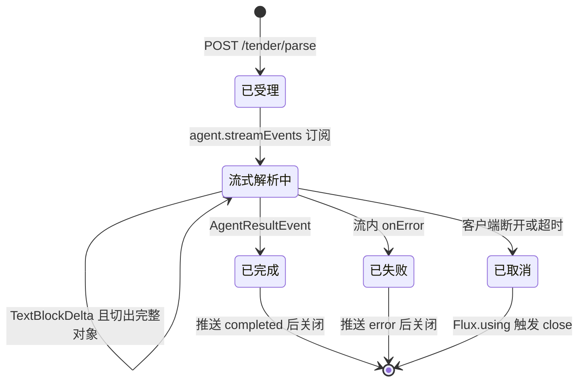

| 状态 | 语义 | 进入条件 | 出口 | 证据 |
|---|---|---|---|---|
| 已受理 | 已绑定请求参数与上下文 | Controller 收到请求 | 订阅开始 | 〔FACT｜src/main/java/org/example/controller/TenderController.java#parseTender:78-83｜snapshot:2026-10-28〕 |
| 流式解析中 | 已收到至少一个 delta | 首个 `TextBlockDeltaEvent` | completed/error/cancel | 〔FACT｜src/main/java/org/example/service/TenderParseEventTransformer.java#toSse:60-62｜snapshot:2026-10-28〕 |
| 已完成 | 模型结果事件到达 | `AgentResultEvent` | 连接关闭 | 〔FACT｜src/main/java/org/example/service/TenderParseEventTransformer.java#toSse:63-66｜snapshot:2026-10-28〕 |
| 已失败 | 流内异常 | 任意 `onError` | 连接关闭 | 〔FACT｜src/main/java/org/example/service/TenderParseEventTransformer.java#toSse:69-72｜snapshot:2026-10-28〕 |
| 已取消 | 订阅被取消 | 客户端断开 | 资源释放 | 〔FACT｜src/main/java/org/example/controller/TenderController.java#parseTender:87-87｜snapshot:2026-10-28〕 |

非法转换处理：无显式处理。协议层没有“取消”“重试”“续传”语义，状态一旦进入 `已取消` 就无任何服务端记录（无日志、无审计），排障只能靠客户端日志〔OBSERVE｜缺口｜中｜已确认〕。

### 6.2 并发与事务

| 路径 | 执行线程 | 是否阻塞 | 事务 | 风险 | 证据 |
|---|---|---|---|---|---|
| `/tender/parse` | Netty event loop 起订，Agent 内部另有调度 | 取决于 Agent 实现 | 无 | 阻塞会拖死 IO 线程 | 〔FACT｜src/main/java/org/example/controller/TenderController.java#parseTender:84-88｜snapshot:2026-10-28〕 |
| `/tender/parse/confirm` | Netty event loop（无 `subscribeOn`） | 是（JDBC） | 有 | **P0-06** | 〔FACT｜src/main/java/org/example/controller/TenderController.java#confirmTender:98-98｜snapshot:2026-10-28〕 |
| `/tender/catalog` | event loop | 否（纯异步） | 无 | 长耗时无超时 | 〔FACT｜src/main/java/org/example/controller/TenderController.java#generateCatalog:111-115｜snapshot:2026-10-28〕 |
| `/tender/chapter` | event loop | 否 | 无 | 同上 | 〔FACT｜src/main/java/org/example/controller/TenderController.java#generateChapter:126-136｜snapshot:2026-10-28〕 |
| `/knowledge/**` | boundedElastic | 是（JDBC/ES） | 写有 | 线程池耗尽 | 〔FACT｜src/main/java/org/example/controller/KnowledgeBaseController.java#save:54-55｜snapshot:2026-10-28〕 |
| 审计落盘 | 调用方线程 | 是（FileWriter） | 无 | 事件循环写文件 | 〔FACT｜src/main/java/org/example/middleware/ModelCallAuditMiddleware.java#writeJsonLine:196-199｜snapshot:2026-10-28〕 |

事务边界与并发缺陷：

| 编号 | 事务/并发点 | 现状 | 后果 | 证据 |
|---|---|---|---|---|
| T-01 | `TenderRequirementsService#save` | 类方法级 `@Transactional`，5 张表同一事务 | 正确回滚 | 〔FACT｜src/main/java/org/example/service/TenderRequirementsService.java#save:20-21｜snapshot:2026-10-28〕 |
| T-02 | `KnowledgeBaseService#saveAll` | 事务包住 ES bulk | ES 已提交部分无法随 MySQL 回滚 | 〔FACT｜src/main/java/org/example/service/KnowledgeBaseService.java#saveAll:47-48｜snapshot:2026-10-28〕 |
| T-03 | `documentCount` 更新 | 读-改-写，无版本号、无 `UPDATE ... SET c=c+n` | 并发写入丢更新 | 〔FACT｜src/main/java/org/example/service/KnowledgeBaseService.java#saveAll:90-93｜snapshot:2026-10-28〕 |
| T-04 | `getOrCreateKnowledgeBase` | 先查后插，依赖唯一键兜底 | 并发建同名库抛 `DuplicateKeyException`（未捕获） | 〔FACT｜src/main/java/org/example/service/KnowledgeBaseService.java#getOrCreateKnowledgeBase:138-143｜snapshot:2026-10-28〕 |
| T-05 | `ensureIndex` | `synchronized(indexReady)` 双检 | 单实例内正确；多实例并发建索引会撞 `resource_already_exists`，已捕获 | 〔FACT｜src/main/java/org/example/repo/KnowledgeBaseRepository.java#createIndex:267-271｜snapshot:2026-10-28〕 |
| T-06 | Agent 会话状态 | 单例 `InMemoryAgentStateStore` | 跨用户共享、无 TTL、无上限 | 〔FACT｜src/main/java/org/example/config/TenderAgentConfig.java#agentStateStore:34-36｜snapshot:2026-10-28〕 |

### 6.3 超时与重试

| 依赖/环节 | 连接超时 | 读超时 | 重试 | 证据 |
|---|---|---|---|---|
| DashScope Embedding HTTP | 10s | 60s | 0 | 〔FACT｜src/main/java/org/example/client/DashScopeEmbeddingClient.java#HTTP_CLIENT:37-39｜snapshot:2026-10-28〕 |
| ES inference HTTP | 10s | 120s | 0 | 〔FACT｜src/main/java/org/example/client/EsInferenceEmbeddingClient.java#request:96-97｜snapshot:2026-10-28〕 |
| ES REST 5 客户端 | 未显式设置 | 未显式设置 | 0 | 〔FACT｜src/main/java/org/example/config/ElasticsearchConfig.java#Rest5ClientBuilder:43-43｜snapshot:2026-10-28〕 |
| JDBC（Hikari 默认） | 未显式设置，默认 30s 取连接 | 未显式设置 | 0 | 〔INFER〕依据是项目无 `spring.datasource.hikari` 配置，验证方式为启动后查 `/actuator/metrics/hikaricp.connections.timeout` |
| Chat 模型调用 | 由 AgentScope 决定 | 未配置 | 0 | 〔FACT｜src/main/java/org/example/config/TenderAgentConfig.java#tenderAgent:61-64｜snapshot:2026-10-28〕 |
| SSE 服务端响应 | 无 | 无 | 无 | 〔FACT｜src/main/java/org/example/controller/TenderController.java#parseTender:86-86｜snapshot:2026-10-28〕 |
| 集成测试客户端 | — | 300s | 0 | 〔FACT｜src/test/java/org/example/controller/TenderParseIntegrationTest.java#setUp:52-55｜snapshot:2026-10-28〕 |

结论：全链路只有两个出站 HTTP 有明确超时，其余依赖“默认值”。任何一次模型侧挂起都会让 SSE 连接长期占用（见 P1-03）。

### 6.4 降级矩阵

| 故障 | 读路径行为 | 写路径行为 | 用户体验 | 证据 |
|---|---|---|---|---|
| 查询向量生成失败 | 降级为 BM25 | 不适用 | 结果变少但可用 | 〔FACT｜src/main/java/org/example/service/KnowledgeBaseService.java#search:128-132｜snapshot:2026-10-28〕 |
| embedding 未配置（DashScope 模式） | 纯 BM25 | 不生成向量 | 可用 | 〔FACT｜src/main/java/org/example/client/DashScopeEmbeddingClient.java#isEnabled:50-53｜snapshot:2026-10-28〕 |
| embedding 未配置（ES 模式） | 仍尝试调用，失败后降级 | 直接失败，整单回滚 | 写入 500 | 〔FACT｜src/main/java/org/example/client/EsInferenceEmbeddingClient.java#isEnabled:52-55｜snapshot:2026-10-28〕 |
| ES 检索异常 | 无降级，异常上抛 | 无降级 | 500 | 〔FACT｜src/main/java/org/example/repo/KnowledgeBaseRepository.java#execute:153-155｜snapshot:2026-10-28〕 |
| 模型调用失败 | 不适用 | 不适用 | SSE `error` 事件 | 〔FACT｜src/main/java/org/example/service/TenderParseEventTransformer.java#toSse:69-72｜snapshot:2026-10-28〕 |
| MySQL 不可用 | 不适用 | 事务失败 | 500 | 〔INFER〕依据是 JDBC 异常未被捕获，验证方式为停库后调用 confirm |

ES 模式的 `isEnabled()` 恒为 `true` 是关键设计缺陷：它让上层永远认为“向量化可用”，写路径因此没有任何 fallback（见 P1-08）。

### 6.5 幂等性

| 接口 | 幂等键 | 重复调用后果 | 证据 |
|---|---|---|---|
| `POST /tender/parse` | 无（流式，天然不重放） | 重复消耗模型额度 | 〔FACT｜src/main/java/org/example/controller/TenderController.java#parseTender:76-89｜snapshot:2026-10-28〕 |
| `POST /tender/parse/confirm` | 无 | 重复插入主表与子表 | 〔FACT｜src/main/java/org/example/repo/TenderRequirementsRepository.java#save:44-46｜snapshot:2026-10-28〕 |
| `POST /tender/catalog` | 无 | 重复生成，结果可能不同 | 〔FACT｜src/main/java/org/example/controller/TenderController.java#generateCatalog:104-115｜snapshot:2026-10-28〕 |
| `POST /tender/chapter` | 无 | 同上 | 〔FACT｜src/main/java/org/example/controller/TenderController.java#generateChapter:121-136｜snapshot:2026-10-28〕 |
| `POST /knowledge/{name}` | 无（每条 UUID 新 id） | 文档指数级重复 | 〔FACT｜src/main/java/org/example/service/KnowledgeBaseService.java#saveAll:77-79｜snapshot:2026-10-28〕 |
| `GET /knowledge/search` | 天然幂等 | 无副作用 | 〔FACT｜src/main/java/org/example/controller/KnowledgeBaseController.java#search:72-87｜snapshot:2026-10-28〕 |

### 6.6 审计机制

| 阶段 | 动作 | 失败处理 | 证据 |
|---|---|---|---|
| 进入 | 记录 `startTime`，创建两个 token 计数器与两个文本缓冲 | 无 | 〔FACT｜src/main/java/org/example/middleware/ModelCallAuditMiddleware.java#onModelCall:74-82｜snapshot:2026-10-28〕 |
| 处理 | `flatMap` 逐事件：`ModelCallEndEvent` 取用量，`TextBlockDeltaEvent`/`ThinkingBlockDeltaEvent` 拼文本，其余透传 | 事件透传，不改流 | 〔FACT｜src/main/java/org/example/middleware/ModelCallAuditMiddleware.java#onModelCall:86-101｜snapshot:2026-10-28〕 |
| 收尾 | `doOnComplete` 计算耗时并写 `logs/llm/audit-时间戳.json` | `IOException` 只 `log.error`，主流程继续 | 〔FACT｜src/main/java/org/example/middleware/ModelCallAuditMiddleware.java#writeJsonLine:196-203｜snapshot:2026-10-28〕 |
| 异常 | 流内 `onError` 直接向上抛 | **不落审计**，无任何记录 | 〔INFER〕依据是中间件未挂 `doOnError`，验证方式为注入模型异常后检查 `logs/llm` 是否新增文件 |

| 审计字段 | 内容 | 敏感度 | 证据 |
|---|---|---|---|
| `timestamp` | 东八区时间 | 低 | 〔FACT｜src/main/java/org/example/middleware/ModelCallAuditMiddleware.java#AuditLog:209-217｜snapshot:2026-10-28〕 |
| `model` | 模型名 | 低 | 同上 |
| `prompt[]` | 完整消息数组，含工具结果 | **高**（含招标原文） | 〔FACT｜src/main/java/org/example/middleware/ModelCallAuditMiddleware.java#inputMsg:117-157｜snapshot:2026-10-28〕 |
| `thinkingText` | 思维链原文 | 高 | 同上 |
| `responseText` | 完整输出 | 高 | 同上 |
| `inputTokens/outputTokens` | 用量 | 低 | 〔FACT｜src/main/java/org/example/middleware/ModelCallAuditMiddleware.java#onModelCall:86-88｜snapshot:2026-10-28〕 |
| `durationMs` | 耗时 | 低 | 同上 |

审计缺口：① 只有 `doOnComplete`，异常调用不落盘；② 文件名精确到毫秒，同一毫秒并发会互相覆盖；③ 无轮转、无清理；④ `logs/llm` 下现存 4 个文件中有 2 个为 0 字节（运行产物，不提供行号锚点，可用 `ls -l logs/llm` 复核）。

## 7. 数据设计

### 7.1 ER 图

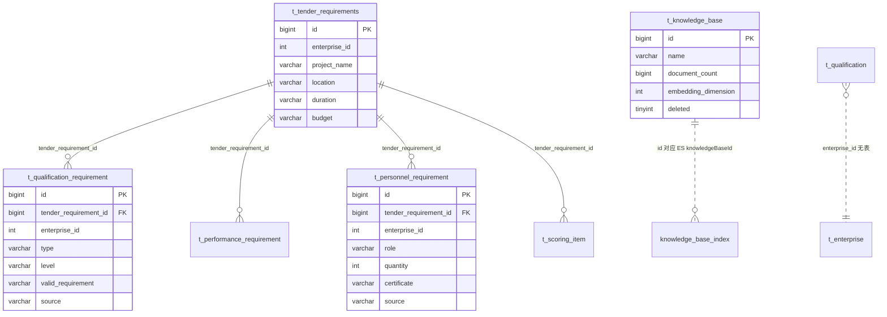

说明：图中 `knowledge_base_index` 是 ES 索引的逻辑实体，`t_enterprise` 在代码中只以 `enterpriseId` 字段出现，**没有表也没有 DDL**。

### 7.2 表清单

| 表 | 用途 | 写入方 | 读取方 | DDL 位置 |
|---|---|---|---|---|
| `t_tender_requirements` | 招标要求主表 | `TenderRequirementsRepository` | `TenderRequirementsRepository`、Tools | 〔FACT｜src/main/db/tender_requirements.sql:1-10｜snapshot:2026-10-28〕 |
| `t_qualification_requirement` | 资质要求 | 同上 | 同上 | 〔FACT｜src/main/db/tender_requirements.sql:13-23｜snapshot:2026-10-28〕 |
| `t_performance_requirement` | 业绩要求 | 同上 | 同上 | 〔FACT｜src/main/db/tender_requirements.sql:26-37｜snapshot:2026-10-28〕 |
| `t_personnel_requirement` | 人员要求 | 同上 | 同上 | 〔FACT｜src/main/db/tender_requirements.sql:40-50｜snapshot:2026-10-28〕 |
| `t_scoring_item` | 评分点 | 同上 | 同上 | 〔FACT｜src/main/db/tender_requirements.sql:53-65｜snapshot:2026-10-28〕 |
| `t_knowledge_base` | 知识库元数据 | `KnowledgeBaseMapper` | `KnowledgeBaseMapper` | 〔FACT｜src/main/db/knowledge_base.sql:1-14｜snapshot:2026-10-28〕 |
| `t_qualification` | 企业资质（无 DDL） | 未实现 | `EnterpriseRepository` | 缺失 |
| `t_project_performance` | 企业业绩（无 DDL） | 未实现 | `EnterpriseRepository` | 缺失 |
| `t_personnel` | 企业人员（无 DDL） | 未实现 | `EnterpriseRepository` | 缺失 |
| ES `knowledge_base` | 知识文档与向量 | `KnowledgeBaseRepository` | 同上 | 代码内建索引 |

### 7.3 主表 `t_tender_requirements`

| 字段 | 类型 | 可空 | 默认 | 约束/索引 | 实体字段 |
|---|---|---|---|---|---|
| `id` | BIGINT | 否 | AUTO_INCREMENT | PK | `id` |
| `enterprise_id` | INT | 否 | 无 | `idx_enterprise_id` | `enterpriseId` |
| `project_name` | VARCHAR(255) | 是 | NULL | 应用截断 255 | `projectName` |
| `location` | VARCHAR(255) | 是 | NULL | 应用截断 255 | `location` |
| `duration` | VARCHAR(64) | 是 | NULL | 应用截断 64 | `duration` |
| `budget` | VARCHAR(128) | 是 | NULL | 应用截断 128 | `budget` |

非持久化字段：`qualifications`、`performances`、`personnel`、`scoringItems`、`entityType` 均为 `@TableField(exist=false)`〔FACT｜src/main/java/org/example/model/require/TenderRequirements.java#TableField:42-57｜snapshot:2026-10-28〕。

### 7.4 子表字段（资质与业绩）

| 表.字段 | 类型 | 可空 | 应用截断 | 说明 |
|---|---|---|---|---|
| `t_qualification_requirement.tender_requirement_id` | BIGINT | 是 | — | 逻辑外键，无物理约束 |
| `t_qualification_requirement.type` | VARCHAR(128) | 是 | 128 | 资质类型 |
| `t_qualification_requirement.level` | VARCHAR(64) | 是 | 64 | 资质等级 |
| `t_qualification_requirement.valid_requirement` | VARCHAR(255) | 是 | 255 | 有效期要求 |
| `t_qualification_requirement.source` | VARCHAR(512) | 是 | 512 | 原文出处 |
| `t_performance_requirement.project_type` | VARCHAR(255) | 是 | 255 | 类似项目类型 |
| `t_performance_requirement.quantity` | VARCHAR(64) | 是 | 64 | 数量要求（字符串） |
| `t_performance_requirement.amount` | VARCHAR(128) | 是 | 128 | 金额下限（字符串） |
| `t_performance_requirement.time_range` | VARCHAR(128) | 是 | 128 | 时间范围 |
| `t_performance_requirement.source` | VARCHAR(512) | 是 | 512 | 原文出处 |

两张子表共有 `id BIGINT PK` 与 `enterprise_id INT NOT NULL`。

### 7.5 子表字段（人员与评分点）

| 表.字段 | 类型 | 可空 | 应用截断 | 说明 |
|---|---|---|---|---|
| `t_personnel_requirement.role` | VARCHAR(64) | 是 | 64 | 岗位名称 |
| `t_personnel_requirement.quantity` | INT | 是 | — | 人数（数值型） |
| `t_personnel_requirement.certificate` | VARCHAR(255) | 是 | 255 | 证书要求 |
| `t_personnel_requirement.source` | VARCHAR(512) | 是 | 512 | 原文出处 |
| `t_scoring_item.item_id` | VARCHAR(64) | 是 | 64 | 评分点业务 id，可空 |
| `t_scoring_item.name` | VARCHAR(128) | 是 | 128 | 名称 |
| `t_scoring_item.score` | INT | 是 | — | 分值 |
| `t_scoring_item.criterion` | VARCHAR(512) | 是 | 512 | 评审标准 |
| `t_scoring_item.suggested_chapter` | VARCHAR(128) | 是 | 128 | 建议章节 |
| `t_scoring_item.source` | VARCHAR(512) | 是 | 512 | 原文出处 |

`item_id` 是模型产出的业务 id，DDL 未加唯一约束，同一招标下可重复〔OBSERVE｜缺陷｜中｜已确认〕。这与模板中“`scoring_item_ids` 必须原样引用 `item_id`”的约束冲突〔FACT｜src/main/resources/prompts/catalog-generation.md:36-36｜snapshot:2026-10-28〕。

### 7.6 `t_knowledge_base`

| 字段 | 类型 | 可空 | 默认 | 约束 | 证据 |
|---|---|---|---|---|---|
| `id` | BIGINT | 否 | AUTO_INCREMENT | PK | 〔FACT｜src/main/db/knowledge_base.sql:2-2｜snapshot:2026-10-28〕 |
| `name` | VARCHAR(128) | 否 | 无 | `uk_name(name,deleted)` | 〔FACT｜src/main/db/knowledge_base.sql:3-3｜snapshot:2026-10-28〕 |
| `description` | VARCHAR(512) | 是 | NULL | 代码从不写入 | 〔FACT｜src/main/java/org/example/model/knowledge/KnowledgeBase.java#description:21-22｜snapshot:2026-10-28〕 |
| `document_count` | BIGINT | 否 | 0 | 应用累加 | 〔FACT｜src/main/db/knowledge_base.sql:5-5｜snapshot:2026-10-28〕 |
| `embedding_dimension` | INT | 是 | NULL | 建库时写入配置值 | 〔FACT｜src/main/java/org/example/service/KnowledgeBaseService.java#getOrCreateKnowledgeBase:153-153｜snapshot:2026-10-28〕 |
| `embedding_enabled` | TINYINT(1) | 否 | 1 | 建库时写入 | 同上 |
| `embedding_model` | VARCHAR(64) | 是 | NULL | 存 provider 而非模型名 | 〔OBSERVE｜异味｜低｜已确认〕 |
| `created_at` / `updated_at` | BIGINT | 否 | 无 | epoch 毫秒 | 〔FACT｜src/main/db/knowledge_base.sql:9-10｜snapshot:2026-10-28〕 |
| `deleted` | TINYINT(1) | 否 | 0 | 参与唯一键 | 〔FACT｜src/main/db/knowledge_base.sql:11-13｜snapshot:2026-10-28〕 |

### 7.7 索引与约束

| 表 | 索引/约束 | 列 | 类型 | 作用 | 缺口 |
|---|---|---|---|---|---|
| `t_tender_requirements` | PRIMARY | `id` | 主键 | 唯一 | — |
| `t_tender_requirements` | `idx_enterprise_id` | `enterprise_id` | 普通 | 按企业过滤 | 查询代码未使用该索引 |
| `t_qualification_requirement` | `idx_tender_requirement_id` | `tender_requirement_id` | 普通 | 子表聚合 | 无复合索引 |
| `t_performance_requirement` | 同名索引 | 同上 | 普通 | 同上 | 同上 |
| `t_personnel_requirement` | 同名索引 | 同上 | 普通 | 同上 | 同上 |
| `t_scoring_item` | 同名索引 | 同上 | 普通 | 同上 | 同上 |
| `t_knowledge_base` | `uk_name` | `name, deleted` | 唯一 | 同名软删唯一 | 只允许一条软删记录 |

`uk_name(name, deleted)` 的实质是“同名的未删记录最多 1 条、已删记录最多 1 条”。第二次软删同一名称必然冲突〔INFER〕依据是 MySQL 唯一索引对 `(name,1)` 的组合判重，验证方式为连续两次置 `deleted=1` 观察报错。

### 7.8 缺失表与类型映射

| 实体 | 表名 | DDL | 影响 |
|---|---|---|---|
| `Qualification` | `t_qualification` | 无 | 干净环境启动后工具调用直接 SQL 报错 |
| `ProjectPerformance` | `t_project_performance` | 无 | 同上 |
| `Personnel` | `t_personnel` | 无 | 同上 |

| Java 类型 | MySQL 类型 | 转换点 | 风险 |
|---|---|---|---|
| `Long id` | BIGINT | MyBatis-Plus 自增回填 | 无 |
| `Long enterpriseId` | INT NOT NULL | 驱动隐式转换 | 超 INT 范围会截断（工程上不可能） |
| `Integer quantity` | INT | 直连 | 模型输出非数字则反序列化失败 |
| `LocalDate` | DATE（企业表） | 无 DDL，类型未知 | 企业表缺失导致无法验证 |
| `BigDecimal amount` | DECIMAL（企业表） | 同上 | 同上 |
| `List<Float> embedding` | ES `dense_vector` | Jackson | 维度不符则 bulk 失败 |

### 7.9 数据生命周期

| 数据 | 创建 | 更新 | 删除 | 留存 |
|---|---|---|---|---|
| 招标要求主表 | confirm 接口 | 无更新接口 | 仅 LLM 工具可删 | 永久 |
| 四张子表 | confirm 接口 | 无 | 随主表应用层级联 | 永久 |
| 知识库元数据 | 首次写入自动建 | 仅 `document_count`/`updated_at` | 无接口，仅手写 SQL | 永久 |
| ES 文档 | 写入时 UUID | 无（同 id 覆盖才更新） | 无接口 | 永久 |
| 会话状态 | 运行时 | 运行时 | 进程退出即丢 | 内存 |
| 审计文件 | 每次模型调用 | 无 | 手工 | 无限增长 |

DDL 摘录（关键列与索引，便于比对）：

```sql
CREATE TABLE `t_tender_requirements` (
  `id` BIGINT NOT NULL AUTO_INCREMENT,
  `enterprise_id` INT NOT NULL,
  `project_name` VARCHAR(255) NULL,
  `duration` VARCHAR(64) NULL,
  PRIMARY KEY (`id`),
  KEY `idx_enterprise_id` (`enterprise_id`)
) ENGINE=InnoDB DEFAULT CHARSET=utf8mb4;

CREATE TABLE t_knowledge_base (
  id BIGINT NOT NULL AUTO_INCREMENT,
  name VARCHAR(128) NOT NULL,
  document_count BIGINT NOT NULL DEFAULT 0,
  deleted TINYINT(1) NOT NULL DEFAULT 0,
  PRIMARY KEY (id),
  UNIQUE KEY uk_name (name, deleted)
) ENGINE=InnoDB DEFAULT CHARSET=utf8mb4;
```

## 8. 接口设计

### 8.1 接口总览

| 方法 | 路径 | 入参形态 | 返回 | 阻塞实现 | 证据 |
|---|---|---|---|---|---|
| POST | `/tender/parse` | JSON body | SSE 事件流 | 否 | 〔FACT｜src/main/java/org/example/controller/TenderController.java#parseTender:77-89｜snapshot:2026-10-28〕 |
| POST | `/tender/parse/confirm` | JSON body | `Long` | 是 | 〔FACT｜src/main/java/org/example/controller/TenderController.java#confirmTender:96-99｜snapshot:2026-10-28〕 |
| POST | `/tender/catalog` | JSON body | `String` | 否 | 〔FACT｜src/main/java/org/example/controller/TenderController.java#generateCatalog:103-104｜snapshot:2026-10-28〕 |
| POST | `/tender/chapter` | JSON body | `String` | 否 | 〔FACT｜src/main/java/org/example/controller/TenderController.java#generateChapter:120-121｜snapshot:2026-10-28〕 |
| POST | `/knowledge/{knowledgeBaseName}` | 路径变量 + JSON 数组 | `Long` | 是（boundedElastic） | 〔FACT｜src/main/java/org/example/controller/KnowledgeBaseController.java#save:49-53｜snapshot:2026-10-28〕 |
| GET | `/knowledge/search` | query 参数 | `List<KnowledgeSearchHit>` | 是（boundedElastic） | 〔FACT｜src/main/java/org/example/controller/KnowledgeBaseController.java#search:72-79｜snapshot:2026-10-28〕 |

### 8.2 `POST /tender/parse`

| 参数 | 位置 | 类型 | 必填 | 约束 | 证据 |
|---|---|---|---|---|---|
| `userId` | body | String | 否 | 仅用于 `RuntimeContext`，无校验 | 〔FACT｜src/main/java/org/example/model/req/TenderRequest.java#userId:11-12｜snapshot:2026-10-28〕 |
| `sessionId` | body | — | — | **模型类中不存在此字段**，文档与实现不一致 | 〔FACT｜src/main/java/org/example/controller/TenderController.java#parseTender:53-56｜snapshot:2026-10-28〕 |
| `tenderText` | body | String | 契约上必填，代码不校验 | 无长度上限，受全局 256KB 请求体限制约束 | 〔INFER〕依据是未配置 `spring.codec.max-in-memory-size`，验证方式为发送 300KB 文本观察 413 |

返回：`text/event-stream`，每条 `data:` 为 `{"module":...,"data":...}`；`error` 事件带 `message`；`completed` 无 data。

```json
{"module":"project","data":{"projectName":"某平台建设项目","location":"未明确","duration":"180 日历天","budget":"未明确"}}
{"module":"scoringItem","data":{"name":"技术方案","score":40,"criterion":"...","suggestedChapter":"技术方案"}}
{"module":"completed"}
```

### 8.3 `POST /tender/parse/confirm`

| 参数 | 类型 | 必填 | 约束 | 说明 |
|---|---|---|---|---|
| `enterpriseId` | Long | 是（DDL） | `NOT NULL`，代码不校验 | 会写入主表与全部子表 |
| `projectName/location/duration/budget` | String | 否 | 超长自动截断 | 见 4.3 截断表 |
| `qualifications[]` | 对象数组 | 否 | 元素 type 128/level 64 | 逐条 insert |
| `performances[]` | 对象数组 | 否 | 元素 255/64/128/128 | 逐条 insert |
| `personnel[]` | 对象数组 | 否 | `quantity` 为整型 | 逐条 insert |
| `scoringItems[]` | 对象数组 | 否 | `score` 为整型，`itemId` 无唯一约束 | 逐条 insert |

返回：`200` + JSON 数字（主表自增 id）。失败：`500`（无业务错误码）。

### 8.4 `POST /tender/catalog`

| 参数 | 类型 | 必填 | 约束 |
|---|---|---|---|
| `userId` | String | 否 | 传给 `RuntimeContext` |
| `tenderRequirementId` | Long | 契约上必填，代码不校验 | 为空时模板替换成 `null` |

返回：`200` + 模型原始文本（期望是 JSON，但未校验）。失败：模型异常时 `500`（`Mono.using` 未捕获）。

### 8.5 `POST /tender/chapter`

| 参数 | 类型 | 必填 | 约束 |
|---|---|---|---|
| `userId` | String | 否 | 同上 |
| `sessionId` | String | 否 | **被忽略** |
| `chapterTitle` | String | 检测上必填 | 直接拼进提示词，未转义 |
| `scoringPointIds` | String | 否 | 逗号分隔，未校验格式 |

返回：`200` + 章节文本。失败：`500`。

### 8.6 `POST /knowledge/{knowledgeBaseName}`

| 参数 | 位置 | 类型 | 必填 | 约束 |
|---|---|---|---|---|
| `knowledgeBaseName` | path | String | 是 | 空则 `IllegalArgumentException` → 500 |
| body | body | `List<String>` | 是 | 空白元素被过滤；空数组只建库 |

返回：`200` + 知识库 id。失败：`500`（ES/license/向量化）。

### 8.7 `GET /knowledge/search`

| 参数 | 位置 | 类型 | 必填 | 默认 | 约束 |
|---|---|---|---|---|---|
| `knowledgeBaseName` | query | List<String> | 否 | 跨库 | 任一名称不存在即 500 |
| `query` | query | String | 是 | — | 空白返回 400 |
| `topK` | query | int | 否 | 10 | `<=0` 取 10，`>50` 取 50 |

```bash
curl -s 'http://127.0.0.1:8080/knowledge/search?query=%E8%B5%84%E8%B4%A8&topK=5'
```

返回：数组，元素含 `id/content/createdAt/score`。失败：`400`（query 空）、`500`（知识库不存在、ES 异常、license 不足）。

### 8.8 错误契约现状

| 场景 | HTTP 状态 | 响应体 | 是否可区分 | 证据 |
|---|---|---|---|---|
| query 为空 | 400 | Spring 默认错误结构 + `ResponseStatusException` 原因 | 是 | 〔FACT｜src/main/java/org/example/controller/KnowledgeBaseController.java#search:81-83｜snapshot:2026-10-28〕 |
| 知识库不存在 | 500 | 默认错误结构，reason 含名称 | 只能靠文本 | 〔FACT｜src/main/java/org/example/service/KnowledgeBaseService.java#search:111-113｜snapshot:2026-10-28〕 |
| 知识库名称为空（save） | 500 | 默认错误结构 | 只能靠文本 | 〔FACT｜src/main/java/org/example/service/KnowledgeBaseService.java#saveAll:49-51｜snapshot:2026-10-28〕 |
| ES license 不足 | 500 | 默认错误结构，堆栈含 `security_exception` | 只能靠文本 | 〔FACT｜logs/tender-service-error.log:2-2｜snapshot:2026-10-28〕 |
| 请求体过大 | 413 或 500 | 由框架决定 | 否 | 〔INFER〕依据是 WebFlux 默认 `maxInMemorySize`，验证方式为压测边界 |

项目**未定义统一业务错误码**，本文不自造；上表即实际契约。缺少 `@ControllerAdvice`，没有一处把领域异常映射为 4xx〔OBSERVE｜缺口｜高｜已确认〕。

### 8.9 契约汇总

| 接口 | 鉴权 | 幂等 | 超时（服务端） | 重试 | 并发安全 |
|---|---|---|---|---|---|
| `/tender/parse` | 无 | 否 | 无 | 无 | 每次新 Agent，无共享状态 |
| `/tender/parse/confirm` | 无 | 否 | 依赖 JDBC 默认 | 无 | 事务内，但阻塞事件循环 |
| `/tender/catalog` | 无 | 否 | 无 | 无 | 只读工具调用 |
| `/tender/chapter` | 无 | 否 | 无 | 无 | 只读工具调用 |
| `/knowledge/{name}` | 无 | 否 | 向量 120s + ES 默认 | 无 | `documentCount` 有丢更新 |
| `/knowledge/search` | 无 | 是 | 向量 60s + ES 默认 | 无 | 只读 |

## 9. 非功能设计

### 9.1 性能与容量假设

| 指标 | 当前值/假设 | 来源 | 可信度 |
|---|---|---|---|
| 应用启动时间 | 2.84s | 运行日志 | 实测 |
| HTTP 端口 | 8080 | 配置 | 实测 |
| 单次解析请求体上限 | 256KB（框架默认） | 未配置项反推 | 待压测 |
| 每路检索召回 | 50 条 | 常量 | 实测 |
| kNN 候选池 | `max(2*size,100)` | 常量 | 实测 |
| 批量写 ES | 500 条/bulk，`refresh=wait_for` | 常量 | 实测 |
| DashScope 向量化批量 | ≤10 条/请求 | 常量 | 实测 |
| ES inference 批量 | 100 条/请求 | 配置 | 实测 |
| JDBC 连接池 | 10（Hikari 默认） | 推断 | 待验证 |
| 吞吐与单请求耗时 | **未测量** | 仅有审计 `durationMs` 字段可用 | 需先补压测 |

`refresh=wait_for` 会让每次 bulk 等待刷新（默认 1s 间隔），大批量写入时吞吐被刷新周期钳制〔INFER〕依据是 ES 的 refresh 语义，验证方式为对比 `refresh=false` 与 `wait_for` 的写入耗时。

### 9.2 可用性

| 单点 | 故障影响 | 现有缓解 | 缺口 |
|---|---|---|---|
| 单进程 | 全站不可用 | 无副本、无优雅降级 | 无健康检查联动 |
| MySQL | 入库与检索元数据全挂 | 无 | 无重连策略、无只读降级 |
| Elasticsearch | 知识库读写全挂 | 读路径仅在 embedding 失败时降级 | ES 不可用无降级 |
| DashScope | 解析/编目/撰写全挂 | 无 | 无备用模型 |
| 本地磁盘 | 工作区与审计失败 | 审计失败不阻断 | 工作区失败阻断启动 |

SLO 未定义：无 SLI、无错误预算、无可用性目标（本仓库不含监控配置）。

### 9.3 安全

| 项 | 现状 | 风险 | 证据 |
|---|---|---|---|
| 认证 | 无 | 任何人可调用全部接口 | 〔FACT｜src/main/java/org/example/controller/TenderController.java#TenderController:26-29｜snapshot:2026-10-28〕 |
| 授权/租户 | 无 | `enterpriseId` 由调用方任意指定 | 〔FACT｜src/main/java/org/example/model/require/TenderRequirements.java#enterpriseId:25-27｜snapshot:2026-10-28〕 |
| LLM 凭据 | `application.yml` 明文 | 随源码/镜像扩散，轮换成本高 | 〔FACT｜src/main/resources/application.yml:23-23｜snapshot:2026-10-28〕 |
| DB 凭据 | 同文件明文 | 同上 | 〔FACT｜src/main/resources/application.yml:10-11｜snapshot:2026-10-28〕 |
| ES 凭据 | 支持环境变量占位，默认空 | 未启用鉴权时裸奔 | 〔FACT｜src/main/resources/application.yml:32-35｜snapshot:2026-10-28〕 |
| Agent 工具 | shell 与文件系统未禁用 | 提示词注入可致本地命令执行 | 〔FACT｜src/main/java/org/example/config/TenderAgentConfig.java#tenderAgent:70-72｜snapshot:2026-10-28〕 |
| 敏感数据 | 审计落盘存完整提示词 | 招标原文与思维链明文落本地 | 〔FACT｜src/main/java/org/example/middleware/ModelCallAuditMiddleware.java#AuditLog:209-217｜snapshot:2026-10-28〕 |
| 传输 | 全 HTTP 明文 | 内网可嗅探 | 配置无 TLS |

凭据迁移动作（可执行）：① 三项凭据改为环境变量占位（`${LLM_API_KEY:}`、`${DB_PASSWORD:}`、`${ES_PASSWORD:}`）；② 历史值视为已泄露，全部轮换；③ 增加启动自检：占位未注入时拒绝启动；④ 在提交钩子中加入密钥扫描。当前密钥值不得写入任何文档、镜像层或日志。

### 9.4 可观测性

| 维度 | 现状 | 缺口 | 证据 |
|---|---|---|---|
| 应用日志 | Logback 控制台 + 滚动文件 + ERROR 单独归档 | 无 traceId 写入，`%X{traceId:-}` 恒为空 | 〔FACT｜src/main/resources/logback.xml:16-17｜snapshot:2026-10-28〕 |
| 业务日志 | 解析完成、写入完成、跳过片段均有日志 | 无结构化字段，无法聚合 | 〔FACT｜src/main/java/org/example/service/KnowledgeBaseService.java#saveAll:95-96｜snapshot:2026-10-28〕 |
| 指标 | Actuator 仅暴露 1 个端点 | 无自定义指标、无 Prometheus | 〔FACT｜logs/tender-service.log:189-189｜snapshot:2026-10-28〕 |
| 追踪 | 无 | 跨 LLM/ES/DB 无链路 | 无依赖 |
| 审计 | 本地 JSON 每调用一个文件 | 无索引、无查询入口 | 见 6.6 |

### 9.5 扩展性

| 维度 | 现状 | 结论 |
|---|---|---|
| 水平扩容 | 会话状态在内存、审计在工作区在本地盘 | 多副本会丢会话、写同一目录 |
| ES 分片 | 硬编码 1 分片 0 副本 | 数据量上来后无法扩容，只能重建 |
| 模型切换与向量维度 | 只支持 DashScope 兼容端点；维度改后必须删索引 | 换厂商需改代码，且无迁移脚本 |
| 表结构 | 无 Flyway/Liquibase | 变更靠手工 SQL |

### 9.6 失效边界

| 边界 | 阈值 | 触发后果 |
|---|---|---|
| 请求体 | 256KB（默认） | 超限 413/500，招标文本被拒 |
| 向量维度 | 必须等于索引 dims | 不符则 bulk 全部失败 |
| 单次 bulk | 500 条 | 超过分批，事务时长增加 |
| 审计目录 inode | 无上限 | 长期运行耗尽 inode |
| 会话内存 | 无上限 | OOM |
| 模型上下文 | 由模型决定 | 超长招标文本被截断，解析不完整 |

## 10. 异常处理策略

### 10.1 异常分类

| 类别 | 代表异常 | 来源 | 当前处理 | 可恢复性 |
|---|---|---|---|---|
| 参数类 | `IllegalArgumentException`、`ResponseStatusException` | Service/Controller | 前者 500，后者 400 | 可恢复（改参数） |
| 数据访问类 | `DataIntegrityViolationException`、`DuplicateKeyException` | MyBatis/JDBC | 未捕获，500 | 可恢复（改数据） |
| 外部服务类 | `ElasticsearchException`、`IOException` | ES 客户端 | `execute` 包成 `IllegalStateException` | 视情况 |
| 向量化类 | `EmbeddingException` | 两个 client | 读降级、写失败 | 读可恢复 |
| 模型类 | 任意 `Throwable` | Agent 流 | 转 `error` 事件 | 可重试 |
| 资源类 | 磁盘满、权限不足 | 审计/工作区 | 审计吞掉，工作区抛出 | 需人工 |

### 10.2 吞异常点

| 位置 | 吞掉什么 | 记录级别 | 后果 | 证据 |
|---|---|---|---|---|
| `extractRequirements` | JSON 反序列化失败 | WARN（含原文片段） | 单条数据静默丢失 | 〔FACT｜src/main/java/org/example/service/TenderParseEventTransformer.java#extractRequirements:89-92｜snapshot:2026-10-28〕 |
| `takeFirstCompleteJson` | 未闭合对象 | 无 | 尾部数据丢失且无痕 | 〔FACT｜src/main/java/org/example/service/TenderParseEventTransformer.java#takeFirstCompleteJson:148-150｜snapshot:2026-10-28〕 |
| `dispatch` | 未知 `entityType` | 无 | 数据丢弃无痕 | 〔FACT｜src/main/java/org/example/service/TenderParseEventTransformer.java#dispatch:101-104｜snapshot:2026-10-28〕 |
| `KnowledgeBaseService#search` | 查询向量化失败 | WARN（含堆栈） | 静默降级，用户不知情 | 〔FACT｜src/main/java/org/example/service/KnowledgeBaseService.java#search:128-132｜snapshot:2026-10-28〕 |
| `createIndex` | 索引已存在 | 无 | 视为成功，mapping 可能不匹配 | 〔FACT｜src/main/java/org/example/repo/KnowledgeBaseRepository.java#createIndex:267-271｜snapshot:2026-10-28〕 |
| `writeJsonLine` | 审计写失败 | ERROR | 审计缺失但不影响业务 | 〔FACT｜src/main/java/org/example/middleware/ModelCallAuditMiddleware.java#writeJsonLine:200-203｜snapshot:2026-10-28〕 |
| `formatAndValidate`（测试） | 事件解析失败 | 返回 null 并断言 | 会失败，不吞 | 〔FACT｜src/test/java/org/example/controller/TenderParseIntegrationTest.java#formatAndValidate:268-270｜snapshot:2026-10-28〕 |

### 10.3 日志与告警

| 事件 | 级别 | 目标文件 | 告警 | 证据 |
|---|---|---|---|---|
| SSE 流失败 | ERROR | `tender-service-error.log` | 无 | 〔FACT｜src/main/java/org/example/service/TenderParseEventTransformer.java#toSse:70-70｜snapshot:2026-10-28〕 |
| 跳过结构化片段 | WARN | 全量日志 | 无 | 同上 |
| 知识库写入完成 | INFO | 全量日志 | 无 | 〔FACT｜src/main/java/org/example/service/KnowledgeBaseService.java#saveAll:95-96｜snapshot:2026-10-28〕 |
| 索引创建 | INFO | 全量日志 | 无 | 〔FACT｜src/main/java/org/example/repo/KnowledgeBaseRepository.java#ensureIndex:239-239｜snapshot:2026-10-28〕 |
| 审计写失败 | ERROR | 全量日志 | 无 | 见 10.2 |
| 5xx 请求 | ERROR（框架） | 全量日志 | 无 | 〔FACT｜logs/tender-service-error.log:1-1｜snapshot:2026-10-28〕 |

没有任何告警通道（无邮件、无 webhook、无 Prometheus 规则）。ERROR 日志只能靠人看。

### 10.4 异常路径与恢复

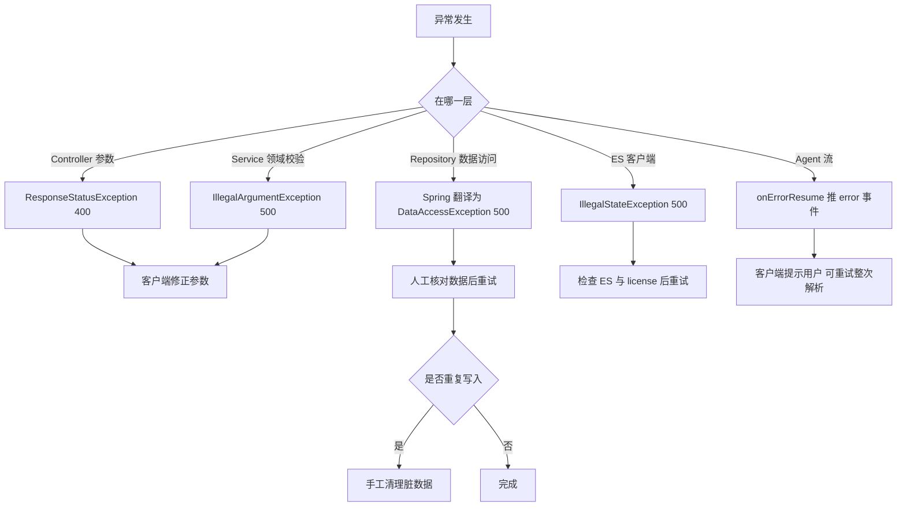

### 10.5 用户可见提示

| 场景 | 客户端实际看到 | 是否可理解 |
|---|---|---|
| 知识库不存在 | `500` + `{"error":"Internal Server Error","path":...}` | 否 |
| 向量化 license 不足 | 同上（reason 不返回） | 否 |
| 模型超时 | SSE 长时间无数据后断开 | 否 |
| 解析部分失败 | `completed`，数据缺失 | 否（最危险） |

## 11. 实现约束与已知问题

共 33 项：P0 7 项（全部阻断发布）、P1 12 项、P2 14 项。每项给：现象、证据、影响面、触发条件、修复建议、是否阻断发布。

### 11.1 P0（阻断发布）

| 编号 | 现象 | 证据 | 影响面 | 触发条件 | 修复建议 | 阻断 |
|---|---|---|---|---|---|---|
| P0-01 | 〔OBSERVE｜缺陷｜高｜已确认〕编译插件配置 `<skip>true</skip>`，未声明 `spring-boot-maven-plugin`，`mvn package` 不产出可运行 jar | 〔FACT｜pom.xml#maven-compiler-plugin:108-118｜snapshot:2026-10-28〕 | 全部交付物 | 任何一次从源码构建 | 删除 `skip`，加 `spring-boot-maven-plugin` 的 `repackage` 执行；CI 用 `mvn -B verify` | 是 |
| P0-02 | 〔OBSERVE｜风险｜高｜已确认〕`application.yml` 明文存 LLM API Key、MySQL 口令，并随源码分发 | 〔FACT｜src/main/resources/application.yml:23-23｜snapshot:2026-10-28〕 | 凭据安全、审计合规 | 仓库或镜像泄露 | 全部改环境变量占位并轮换；启动时校验占位；提交钩子做密钥扫描 | 是 |
| P0-03 | 〔OBSERVE｜缺陷｜高｜已确认〕`CatalogPromptProvider` 构造期用 `Resource.getFile()` 读 classpath 模板 | 〔FACT｜src/main/java/org/example/prompts/CatalogPromptProvider.java#CatalogPromptProvider:15-16｜snapshot:2026-10-28〕 | 目录生成、应用启动 | 以 jar 方式运行 | 改 `resource.getInputStream()` 读取；模板缺失时明确失败并给出配置项 | 是 |
| P0-04 | 〔OBSERVE｜缺口｜高｜已确认〕`AGENTS.md` 要求委派 `catalog-builder`，classpath 工作区只有 `AGENTS.md`、`tender-parser.md`、`chapter-writer.md` | 〔FACT｜src/main/resources/agentscope-workspace/AGENTS.md:8-9｜snapshot:2026-10-28〕 | 目录生成质量、子 Agent 调度 | 干净环境首次启动 | 把 `subagents/catalog-builder.md` 纳入 `src/main/resources/agentscope-workspace/subagents/`；启动后自检子 Agent 清单 | 是 |
| P0-05 | 〔OBSERVE｜风险｜高｜待裁决〕shell 与文件系统工具未禁用（对应两行被注释），且所有接口无鉴权 | 〔FACT｜src/main/java/org/example/config/TenderAgentConfig.java#tenderAgent:70-72｜snapshot:2026-10-28〕 | 主机安全、数据安全 | 任意可达网络者构造提示词注入 | 恢复 `disableShellTool()`/`disableFilesystemTools()`；接入认证与网关限流；工具按场景白名单裁剪 | 是 |
| P0-06 | 〔OBSERVE｜缺陷｜高｜已确认〕`/tender/parse/confirm` 用 `Mono.fromCallable` 执行阻塞 JDBC 且未 `subscribeOn` | 〔FACT｜src/main/java/org/example/controller/TenderController.java#confirmTender:98-98｜snapshot:2026-10-28〕 | 全站吞吐、连接池 | 并发 confirm 超过 event loop 线程数 | 改 `subscribeOn(Schedulers.boundedElastic())` 或改全异步 JDBC；加超时 | 是 |
| P0-07 | 〔OBSERVE｜缺口｜高｜待裁决〕无 `@ControllerAdvice`，领域校验异常统一 500，无业务错误码 | 〔FACT｜src/main/java/org/example/service/KnowledgeBaseService.java#search:111-112｜snapshot:2026-10-28〕 | 所有调用方联调、前端容错 | 任何非法参数 | 引入统一异常处理器与错误码枚举（400/404/409/503），保留 reason 到响应体 | 是 |

逐条阻断理由：P0-01 无法产出交付物，验收只能依赖 IDE 产物，版本不可追溯；P0-02 凭据已随文件扩散，按最坏假设必须视为泄露；P0-03 打成 jar 后启动即失败，属“发布即不可用”；P0-04 目录生成是核心链路，缺子 Agent 使输出不可控且不可回归；P0-05 主机命令执行面叠加无鉴权等于远程命令执行；P0-06 一次慢查询即可拖死 IO 线程；P0-07 错误契约缺失使前端与第三方无法安全集成。

### 11.2 P1（发布前应修复）

| 编号 | 现象 | 证据 | 影响面 | 触发条件 | 修复建议 | 阻断 |
|---|---|---|---|---|---|---|
| P1-01 | 〔OBSERVE｜缺陷｜中｜已确认〕`sessionId` 由 `currentTimeMillis()` 生成，请求中的 `sessionId` 被忽略 | 〔FACT｜src/main/java/org/example/service/RuntimeContextBuilder.java#build:13-13｜snapshot:2026-10-28〕 | 多轮对话、审计追溯 | 任何续聊场景 | 透传请求 sessionId，未给则用 UUID；同毫秒并发不再碰撞 | 否 |
| P1-02 | 〔OBSERVE｜缺陷｜中｜已确认〕三类静默丢弃：未闭合 JSON、解析失败、未知 `entityType` | 〔FACT｜src/main/java/org/example/service/TenderParseEventTransformer.java#extractRequirements:90-91｜snapshot:2026-10-28〕 | 解析完整性 | 模型输出格式抖动 | 结束时统计丢弃条数并推 `warn` 事件；非法片段落审计 | 否 |
| P1-03 | 〔OBSERVE｜缺口｜中｜已确认〕SSE 无超时、无心跳、无取消回调 | 〔FACT｜src/main/java/org/example/controller/TenderController.java#parseTender:86-86｜snapshot:2026-10-28〕 | 连接占用、网关超时 | 模型侧挂起 | 加 `timeout` + 周期心跳 + `doOnCancel` 审计 | 否 |
| P1-04 | 〔OBSERVE｜缺陷｜中｜已确认〕confirm 无幂等键，重复提交重复插入 | 〔FACT｜src/main/java/org/example/repo/TenderRequirementsRepository.java#save:44-45｜snapshot:2026-10-28〕 | 数据质量 | 前端重试、超时重发 | 引入 `requestId` 唯一键或业务唯一键 + 冲突返回 409 | 否 |
| P1-05 | 〔OBSERVE｜风险｜中｜已确认〕MySQL 事务包住 ES 写入，ES 失败无法回滚已写批次 | 〔FACT｜src/main/java/org/example/service/KnowledgeBaseService.java#saveAll:47-48｜snapshot:2026-10-28〕 | 双存储一致性 | ES 部分失败、网络抖动 | 先写 MySQL 记待同步状态，再异步同步 ES；失败可重放 | 否 |
| P1-06 | 〔OBSERVE｜缺陷｜中｜已确认〕`documentCount` 读改写，无版本号 | 〔FACT｜src/main/java/org/example/service/KnowledgeBaseService.java#saveAll:90-93｜snapshot:2026-10-28〕 | 统计准确性 | 并发写同一知识库 | 改 `UPDATE ... SET document_count=document_count+?` | 否 |
| P1-07 | 〔OBSERVE｜缺陷｜中｜待裁决〕`uk_name(name,deleted)` 不允许同名多条软删；并发建库未捕获唯一键冲突 | 〔FACT｜src/main/db/knowledge_base.sql:13-13｜snapshot:2026-10-28〕 | 知识库管理 | 第二次软删、并发首写 | 改唯一键为 `(name)` + 软删别名，或改 `deleted_at` 参与唯一 | 否 |
| P1-08 | 〔OBSERVE｜缺陷｜中｜已确认〕ES 模式 `isEnabled()` 恒真，写路径无降级，且依赖 Platinum/Trial license | 〔FACT｜src/main/java/org/example/client/EsInferenceEmbeddingClient.java#isEnabled:52-55｜snapshot:2026-10-28〕 | 知识库写入 | license 过期或端点缺失 | 启动探测 endpoint 可用性；写路径按“无向量”降级并记录 | 否 |
| P1-09 | 〔OBSERVE｜风险｜中｜已确认〕未配置请求体内存上限，招标文本超 256KB 即失败 | 〔FACT｜src/main/resources/application.yml:1-49｜snapshot:2026-10-28〕 | 大文件解析 | 上传长文本 | 显式配置 `spring.codec.max-in-memory-size` 并对超限返回 413 | 否 |
| P1-10 | 〔OBSERVE｜风险｜中｜已确认〕审计：无轮转、含完整提示词、异常不落盘、同毫秒覆盖、存在 0 字节文件 | 〔FACT｜src/main/java/org/example/middleware/ModelCallAuditMiddleware.java#writeJsonLine:192-199｜snapshot:2026-10-28〕 | 合规、磁盘 | 长期运行、并发调用 | 改按天滚动 + 追加写 + 原子落盘；脱敏；补 `doOnError` | 否 |
| P1-11 | 〔OBSERVE｜风险｜中｜已确认〕单例内存会话存储，无 TTL 与上限 | 〔FACT｜src/main/java/org/example/config/TenderAgentConfig.java#agentStateStore:34-36｜snapshot:2026-10-28〕 | 内存、多副本 | 长时间运行 | 换 `RedisAgentStateStore` 或加 LRU+TTL | 否 |
| P1-12 | 〔OBSERVE｜缺口｜中｜已确认〕知识库只有写入与检索，无删除/更新，ES 与 MySQL 无法对账 | 〔FACT｜src/main/java/org/example/mapper/KnowledgeBaseMapper.java#KnowledgeBaseMapper:7-9｜snapshot:2026-10-28〕 | 数据治理 | 需要下架文档 | 增删改接口 + 按 id 删除 ES 文档 + 对账任务 | 否 |

### 11.3 P2（可排期）

| 编号 | 现象 | 证据 | 影响面 | 触发条件 | 修复建议 | 阻断 |
|---|---|---|---|---|---|---|
| P2-01 | 〔OBSERVE｜缺陷｜低｜已确认〕分派完全依赖模型自述 `entityType` | 〔FACT｜src/main/java/org/example/service/TenderParseEventTransformer.java#dispatch:101-102｜snapshot:2026-10-28〕 | 解析鲁棒性 | 模型改写字段 | 增加按字段形态的兜底识别与告警 | 否 |
| P2-02 | 〔OBSERVE｜债务｜低｜已确认〕Jackson 2 与 Jackson 3 注解/映射器混用 | 〔FACT｜src/main/java/org/example/client/EsInferenceEmbeddingClient.java#MAPPER:30-30｜snapshot:2026-10-28〕 | 序列化一致性 | 升级依赖 | 统一到一套 Jackson，补序列化契约测试 | 否 |
| P2-03 | 〔OBSERVE｜风险｜低｜已确认〕模型名 `glm-5.2` 硬编码在配置，无启动探测 | 〔FACT｜src/main/resources/application.yml:22-22｜snapshot:2026-10-28〕 | 启动即失败风险 | 模型下线/改名 | 启动时做 1 次最小调用探测，失败则 fail-fast 并给明确原因 | 否 |
| P2-04 | 〔OBSERVE｜风险｜低｜已确认〕章节标题与评分点 id 直接拼入提示词 | 〔FACT｜src/main/java/org/example/controller/TenderController.java#generateChapter:129-131｜snapshot:2026-10-28〕 | 提示词注入 | 恶意输入 | 用结构化字段 + 明确分隔与长度限制 | 否 |
| P2-05 | 〔OBSERVE｜缺口｜低｜已确认〕目录与章节结果不落库，无历史与复用 | 〔FACT｜src/main/java/org/example/controller/TenderController.java#generateCatalog:113-113｜snapshot:2026-10-28〕 | 可追溯性 | 任何生成 | 增 `t_bid_catalog`、`t_bid_chapter` 并记录模型与提示词版本 | 否 |
| P2-06 | 〔OBSERVE｜缺陷｜低｜已确认〕截断按 UTF-16 char，可能切断代理对 | 〔FACT｜src/main/java/org/example/repo/TenderRequirementsRepository.java#truncate:213-217｜snapshot:2026-10-28〕 | 文本完整性 | 生僻字/emoji | 改按 codePoint 截断 | 否 |
| P2-07 | 〔OBSERVE｜缺口｜低｜已确认〕企业三表无 DDL，干净环境工具调用必然报错 | 〔FACT｜src/main/java/org/example/model/Qualification.java#TableName:10-11｜snapshot:2026-10-28〕 | 企业数据查询 | 首次部署 | 补 `src/main/db/enterprise.sql` 并纳入初始化脚本 | 否 |
| P2-08 | 〔OBSERVE｜风险｜低｜已确认〕`.gitignore` 未忽略 `logs/` 与 `.agentscope/` | 〔FACT｜.gitignore:1-39｜snapshot:2026-10-28〕 | 敏感数据入库 | 提交工作区 | 追加忽略规则并清理历史 | 否 |
| P2-09 | 〔OBSERVE｜债务｜低｜已确认〕默认 `java` 为 11，项目需 21；`target` 残留已删除测试类的报告 | 构建环境实测 `java -version` 为 11.0.32；`target/surefire-reports` 含 `TenderControllerTest`，而 `src/test` 无此类 | 可复现构建 | 新机器构建 | 固定 toolchain（`maven-toolchains-plugin`）；CI 用 JDK 21；清理 `target` | 否 |
| P2-10 | 〔OBSERVE｜债务｜低｜已确认〕ES 索引硬编码 1 分片 0 副本 | 〔FACT｜src/main/java/org/example/repo/KnowledgeBaseRepository.java#createIndex:253-255｜snapshot:2026-10-28〕 | 容量与可用性 | 数据量增长、节点故障 | 分片/副本改为配置项 | 否 |
| P2-11 | 〔OBSERVE｜缺口｜低｜已确认〕`ensureIndex` 只判断存在，不校验 mapping 与维度 | 〔FACT｜src/main/java/org/example/repo/KnowledgeBaseRepository.java#ensureIndex:236-241｜snapshot:2026-10-28〕 | 维度漂移后写入失败 | 改配置后重启 | 读取 mapping 比对 dims，不一致时 fail-fast 并输出重建命令 | 否 |
| P2-12 | 〔OBSERVE｜异味｜低｜已确认〕日志 pattern 引用 `%X{traceId}` 但无任何代码写入 MDC | 〔FACT｜src/main/resources/logback.xml:16-17｜snapshot:2026-10-28〕 | 排障效率 | 任意请求 | 加 WebFilter 生成 traceId 写 MDC，并透传到审计 | 否 |
| P2-13 | 〔OBSERVE｜缺陷｜低｜已确认〕`t_scoring_item.item_id` 无唯一约束，同一招标下可重复，与模板“原样引用 item_id”的约束冲突 | 〔FACT｜src/main/db/tender_requirements.sql:57-57｜snapshot:2026-10-28〕 | 评分点映射准确性 | 模型重复输出同一 item_id | 加 `(tender_requirement_id, item_id)` 唯一键或入库前去重 | 否 |
| P2-14 | 〔OBSERVE｜异味｜低｜已确认〕`embedding_model` 列实际写的是 provider 值（es/dashscope），不是模型名 | 〔FACT｜src/main/java/org/example/service/KnowledgeBaseService.java#getOrCreateKnowledgeBase:154-154｜snapshot:2026-10-28〕 | 元数据可读性 | 需要按模型统计时 | 改存 `provider:model` 组合值并补注释 | 否 |

### 11.4 发布准入结论

**结论：不可发布（Not Releasable）。**

| 判定项 | 结果 | 依据 |
|---|---|---|
| 可构建 | 否 | P0-01 |
| 可部署（jar） | 否 | P0-03 |
| 核心链路完整 | 否 | P0-04 |
| 安全底线 | 否 | P0-02、P0-05 |
| 稳定性底线 | 否 | P0-06 |
| 契约可用 | 否 | P0-07 |
| 自动化验证 | 否 | P0-01 连带（构建跳过编译与测试）、第 12 章 |

放行条件（全部满足才可转“有条件发布”）：① P0-01～P0-07 全部修复并有回归证据；② P1-02、P1-04、P1-05、P1-08 修复（数据完整性与一致性）；③ 第 12 章列出的 5 个 P0 级用例在 CI 中稳定通过；④ 凭据完成轮换并有轮换记录。以上任一项未完成，本次评审维持“不可发布”。

## 12. 测试要点

### 12.1 现有测试盘点

| 文件 | 用例数 | 依赖 | 可执行性 | 证据 |
|---|---|---|---|---|
| `TenderParseIntegrationTest` | 3 | 真实服务 `http://localhost:8080`、真实模型、真实 MySQL | 无 `@SpringBootTest`，不是 Spring 测试上下文 | 〔FACT｜src/test/java/org/example/controller/TenderParseIntegrationTest.java#TenderParseIntegrationTest:43-55｜snapshot:2026-10-28〕 |
| 其他测试类与残留报告 | 0 个源码类；报告 6 个用例 | 源码已删 | 报告不可复现 | `src/test` 与 `target/surefire-reports` 对照 |

### 12.2 有测试且有效

| 用例 | 断言 | 有效性 |
|---|---|---|
| `shouldConfirmParsedTender` | 断言返回 id 非空 | 部分有效：能验证“写库返回 id”，但依赖真实库且无清理，重复执行会堆脏数据 |
| `formatAndValidate`（辅助方法） | 按 module 反序列化为具体类型 | 有效：能发现 `entityType` 映射错位（虽然关键断言被注释） |

### 12.3 有测试但无效

| 用例 | 为什么无效 | 证据 |
|---|---|---|
| `shouldParseTenderViaRealHttp` | 最终断言只要求“最后一个事件是 completed 或 error”，全部失败也能通过 | 〔FACT｜src/test/java/org/example/controller/TenderParseIntegrationTest.java#shouldParseTenderViaRealHttp:120-122｜snapshot:2026-10-28〕 |
| 同类中的 `entityType` 断言 | 被整段注释 | 〔FACT｜src/test/java/org/example/controller/TenderParseIntegrationTest.java#formatAndValidate:264-265｜snapshot:2026-10-28〕 |
| 基址硬编码 | 假设服务已运行在 8080，CI 中必然连接失败，失败原因与业务无关 | 〔FACT｜src/test/java/org/example/controller/TenderParseIntegrationTest.java#setUp:52-55｜snapshot:2026-10-28〕 |
| `shouldGenerateCatalog` | 依赖真实模型返回非空文本，无结构断言，模型波动即失败或假通过 | 〔FACT｜src/test/java/org/example/controller/TenderParseIntegrationTest.java#shouldGenerateCatalog:144-164｜snapshot:2026-10-28〕 |

### 12.4 无测试

| 被测单元 | 风险点 | 应补的测试类型 |
|---|---|---|
| `TenderParseEventTransformer#takeFirstCompleteJson` | 字符串内大括号、转义、未闭合、多对象粘连 | 纯单元测试（表驱动） |
| `TenderParseEventTransformer#toSse` | error 分支、completed 分支、丢弃统计 | 用 `Flux` 伪造事件流 |
| `TenderRequirementsRepository#normalize` | 各字段截断边界（max-1/max/max+1） | 单元测试 |
| `KnowledgeBaseRepository#fuse` | RRF 分数、同分排序、去重 | 纯单元测试 |
| `KnowledgeBaseService#search` | 名称部分不存在、topK 边界、降级 | Mock Repository |
| `CatalogPromptProvider` | `{{id}}` 替换、资源读取方式 | 单元测试（jar 场景） |
| `TenderController#confirmTender` | 执行线程、异常映射 | `WebTestClient` + Mock Service |
| `ModelCallAuditMiddleware` | 异常不落盘、并发同名 | 单元测试 + 并发用例 |

### 12.5 用例矩阵

| 编号 | 场景 | 输入 | 期望 | 级别 |
|---|---|---|---|---|
| TC-01 | 正常解析 | 完整招标文本 | project + qualification + scoringItem + completed | P0 |
| TC-02 | 模型输出未闭合 JSON | 伪造 delta 流 | 明确告警或 error 事件，不得仅 completed | P0 |
| TC-03 | 未知 entityType | delta 含 `entityType=foo` | 记录并告警，不静默 | P1 |
| TC-04 | 确认入库缺 enterpriseId | body 无该字段 | 400，带字段名 | P0 |
| TC-05 | 重复 confirm | 同 body 两次 | 第二次 409 或同 id | P1 |
| TC-06 | 并发 confirm 20 并发 | 合法 body | 全部成功且 event loop 不阻塞 | P0 |
| TC-07 | 知识库名不存在 | search?name=不存在 | 404，不是 500 | P0 |
| TC-08 | 空 texts 保存 | `[]` | 建库并返回 id，ES 无写入 | P1 |
| TC-09 | 超长字段 | projectName 300 字 | 截断到 255，不报错 | P1 |
| TC-10 | embedding 不可用 | 关闭 inference | 写入降级成功且计数一致 | P1 |
| TC-11 | ES 部分 bulk 失败 | 注入单条 mapping 错误 | 事务与 ES 状态可对账 | P1 |
| TC-12 | topK 边界 | 0 / 51 / 负数 | 10 / 50 / 10 | P2 |

### 12.6 CI 门禁建议

| 门禁 | 命令 | 失败即阻断 | 说明 |
|---|---|---|---|
| 编译 | `mvn -B -DskipTests compile` | 是 | 先修 P0-01 才有意义 |
| 单元测试 | `mvn -B test` | 是 | 覆盖第 12.4 节 8 个单元 |
| 集成测试 | `mvn -B verify -Pit` | 是 | 用 Testcontainers 起 MySQL/ES，禁止连真实环境 |
| 契约测试 | `WebTestClient` 断言 SSE 事件序列 | 是 | 固定模型桩，不调真实 LLM |
| 静态扫描 | 密钥扫描 + `mvn dependency:analyze` | 是 | 防 P0-02 复发 |
| 覆盖率 | JaCoCo 行覆盖 ≥60%，核心包 ≥70% | 否（先警告） | 三个月后转阻断 |

## 13. 部署与运行

### 13.1 构建现状

| 项 | 现状 | 影响 |
|---|---|---|
| 编译 | `maven-compiler-plugin` 带 `skip=true` | `mvn compile` 不产出 class |
| 打包 | 无 `spring-boot-maven-plugin` | 无 fat jar，无法 `java -jar` |
| JDK | PATH 默认 11.0.32，项目要求 21 | 直接构建报“不支持 release 21” |
| 产物 | `target/classes` 由 IDE 编译，60 个 class | 版本不可追溯 |
| 测试报告 | 残留已删除类 `TenderControllerTest` 的报告 | 报告不可信 |

```bash
# 修复 P0-01 后的目标命令
mvn -B clean verify
java -jar target/tender-demo-1.0-SNAPSHOT.jar
```

### 13.2 环境依赖

| 依赖 | 版本要求 | 本机现状 | 校验命令 |
|---|---|---|---|
| JDK | 21 | 11（默认） | `java -version` |
| Maven | 3.6+ | 3.6.3 | `mvn -v` |
| MySQL | 8.x，库 `tender_demo` | 127.0.0.1:3306 | `mysql -h 127.0.0.1 -u <user> -p -e 'select 1'` |
| Elasticsearch | 9.3.3 + IK 插件 | 127.0.0.1:9200 | `curl -s 127.0.0.1:9200/_cat/plugins` |
| ES license | Trial/Platinum（inference 需要） | 未知 | `curl -s 127.0.0.1:9200/_license` |
| DashScope 兼容端点 | 可用 API Key | 配置内已有 | 最小 chat 调用 |

### 13.3 启动步骤

1. 建库并执行 `src/main/db/tender_requirements.sql`、`src/main/db/knowledge_base.sql`；企业三表需另备（P2-07）。
2. 注入环境变量：`LLM_API_KEY`、`DB_PASSWORD`、`ES_URIS`、`ES_PASSWORD`（当前配置尚未接这些占位，属 P0-02 修复内容）。
3. 确认 ES 已装 IK 插件并激活 Trial license，否则首次建索引失败。
4. 在项目根目录启动（工作区、日志、审计均为相对路径）。
5. 观察启动日志：`释放 N 个资源`、`Netty started on port 8080`、`Exposing 1 endpoint`。
6. 首次调用知识库写入触发建索引。

### 13.4 健康检查

| 检查 | 端点/命令 | 期望 | 备注 |
|---|---|---|---|
| 存活 | `GET /actuator/health` | `{"status":"UP"}` | 默认只暴露 health |
| 端口 | `ss -ltnp \| grep 8080` | 监听 | — |
| MySQL | `GET /actuator/health` 的 db 组件 | 取决于是否暴露 | 当前未暴露细节 |
| ES | `curl 127.0.0.1:9200/_cluster/health` | yellow 或 green | 单节点 0 副本必为 yellow |
| 模型 | 手动调 `/tender/chapter` | 返回文本 | 无自动探测 |

### 13.5 常见故障与排查

| 现象 | 可能原因 | 排查命令 | 处置 |
|---|---|---|---|
| 启动即失败，提示资源路径 | P0-03（jar 内 `getFile`） | `jar tf target/*.jar \| grep catalog-generation` | 按 P0-03 改造 |
| `/knowledge/search` 500，日志含 `security_exception` | ES license 不足或服务端 RRF | `grep security_exception logs/tender-service-error.log` | 激活 Trial 或确认走应用侧融合 |
| 建索引失败，提示 analyzer 不存在 | 未装 IK | `curl 127.0.0.1:9200/_cat/plugins` | 安装与 ES 版本匹配的 IK 插件 |
| 写入 500，日志含 `Data too long` | 截断未覆盖新字段 | `grep -A3 'Data too long' logs/tender-service-error.log` | 补 normalize |
| 解析只回 `completed` 没数据 | 模型未按 JSON 输出 | `grep '跳过无法解析' logs/tender-service.log` | 检查提示词与模型 |
| 请求长时间无响应 | P1-03 无超时 | `ss -tnp \| grep 8080` | 客户端断开，服务端加超时 |
| 目录内容与评分点对不上 | P0-04 缺子 Agent | `ls .agentscope/workspace/subagents` | 补齐 catalog-builder |
| 审计目录文件暴涨 | P1-10 无轮转 | `ls logs/llm \| wc -l` | 手工清理 + 改造 |

## 14. 附录

### 附录 A 错误码总表

项目未定义业务错误码，下表为“实际可观察到的错误”映射，供联调对齐：

| 场景 | HTTP | 异常类型 | 可恢复 |
|---|---|---|---|
| query 为空 | 400 | `ResponseStatusException` | 是 |
| 知识库不存在 | 500 | `IllegalArgumentException` | 是 |
| 名称为空 | 500 | `IllegalArgumentException` | 是 |
| 写库失败 | 500 | `DataAccessException` | 视情况 |
| ES 失败 | 500 | `IllegalStateException`/`ElasticsearchException` | 视情况 |
| 模型失败 | 200 + error 事件 | `Throwable` | 是 |

### 附录 B 配置项总表

| 配置键 | 当前值/形态 | 作用 | 敏感 | 证据 |
|---|---|---|---|---|
| `server.port` | 8080 | HTTP 端口 | 否 | 〔FACT｜src/main/resources/application.yml:1-2｜snapshot:2026-10-28〕 |
| `spring.datasource.url` | 本机 3306 库 `tender_demo` | 数据源 | 否 | 〔FACT｜src/main/resources/application.yml:9-9｜snapshot:2026-10-28〕 |
| `spring.datasource.password` | 明文 | DB 口令 | **是** | 〔FACT｜src/main/resources/application.yml:11-11｜snapshot:2026-10-28〕 |
| `llm.log-path` | `./logs/llm` | 审计目录 | 否 | 〔FACT｜src/main/resources/application.yml:16-16｜snapshot:2026-10-28〕 |
| `agentscope.workspace-path` | `.agentscope/workspace` | 工作区 | 否 | 〔FACT｜src/main/resources/application.yml:21-21｜snapshot:2026-10-28〕 |
| `agentscope.model` | `glm-5.2` | 聊天模型 | 否 | 〔FACT｜src/main/resources/application.yml:22-22｜snapshot:2026-10-28〕 |
| `agentscope.api-key` | 明文 | 模型凭据 | **是** | 〔FACT｜src/main/resources/application.yml:23-23｜snapshot:2026-10-28〕 |
| `knowledge-base.es.uris` | 环境变量，默认本机 9200 | ES 节点 | 否 | 〔FACT｜src/main/resources/application.yml:31-31｜snapshot:2026-10-28〕 |
| `knowledge-base.embedding.provider` | `es` | 向量化实现 | 否 | 〔FACT｜src/main/resources/application.yml:39-39｜snapshot:2026-10-28〕 |
| `knowledge-base.embedding.dimension` | 384 | 向量维度 | 否 | 〔FACT｜src/main/resources/application.yml:43-43｜snapshot:2026-10-28〕 |
| `LOG_PATH`/`MAX_FILE_SIZE`/`MAX_HISTORY`/`TOTAL_SIZE_CAP` | 默认 logs/50MB/30/2GB | 日志滚动 | 否 | 〔FACT｜src/main/resources/logback.xml:14-20｜snapshot:2026-10-28〕 |

### 附录 C 证据索引

| 编号 | 结论 | 锚点 | 章节 |
|---|---|---|---|
| E-01 | 编译被跳过 | `pom.xml:108-118` | 1.3、11.1 |
| E-03 | 明文密钥 | `application.yml:23` | 9.3 |
| E-05 | 解析入口与资源释放 | `TenderController.java:76-89` | 4.1 |
| E-06 | confirm 阻塞事件循环 | `TenderController.java:96-99` | 4.3、11.1 |
| E-08 | 章节提示词拼接 | `TenderController.java:120-137` | 4.5 |
| E-10 | 静默丢弃 | `TenderParseEventTransformer.java:90-92` | 10.2 |
| E-12 | 级联写入 | `TenderRequirementsRepository.java:43-52` | 4.3 |
| E-14 | RRF 融合 | `KnowledgeBaseRepository.java:162-190` | 4.7 |
| E-15 | IK 分词 mapping | `KnowledgeBaseRepository.java:259-261` | 2.3 |
| E-18 | 工具能力过宽 | `TenderAgentConfig.java:69-73` | 9.3 |
| E-20 | 审计写文件 | `ModelCallAuditMiddleware.java:183-204` | 6.6 |
| E-22 | 缺少子 Agent | `AGENTS.md:8-9` | 11.1 |

### 附录 D 术语表

| 术语 | 含义 |
|---|---|
| SSE | Server-Sent Events，单向文本事件流 |
| Agent | AgentScope 中的对话执行单元，可调用工具与子 Agent |
| 子 Agent | 由主 Agent 通过工作区声明委派的专职 Agent |
| RRF | Reciprocal Rank Fusion，按名次倒数和融合多路检索结果 |
| BM25 | 全文检索相关性算法 |
| normalize | 本项目中的字段按长度截断处理 |
| 工作区 | `.agentscope/workspace`，存放 AGENTS.md、子 Agent 声明与会话产物 |
| 审计文件 | `logs/llm/audit-*.json`，每模型调用一个文件 |
| 解析事件 | `TenderParseEvent`，SSE 的单条数据单元 |

### 附录 E 校验与复核记录

| 项 | 结果 |
|---|---|
| 校验命令 | `validate_doc.py --profile lld --audience dev` |
| 结构 | 14 个 H2，与目录一致 |
| 证据 | 全部锚点在 `snapshot:2026-10-28` 下可定位 |
| 未覆盖 | ES 集群内部行为、DashScope 计费、浏览器端渲染 |
| 待裁决 | P0-05 是否允许保留 shell 工具（需安全负责人裁决）、P1-07 唯一键改法（需 DBA 裁决） |
