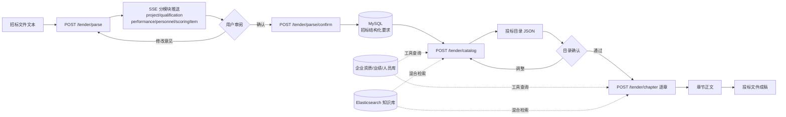
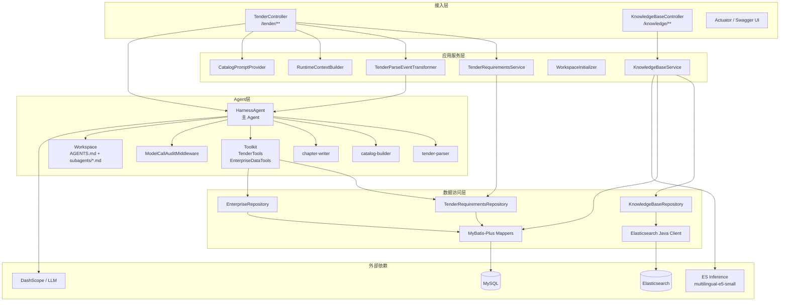
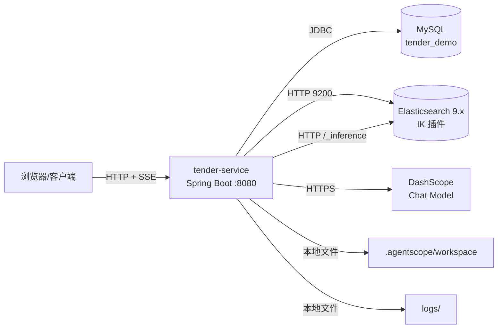
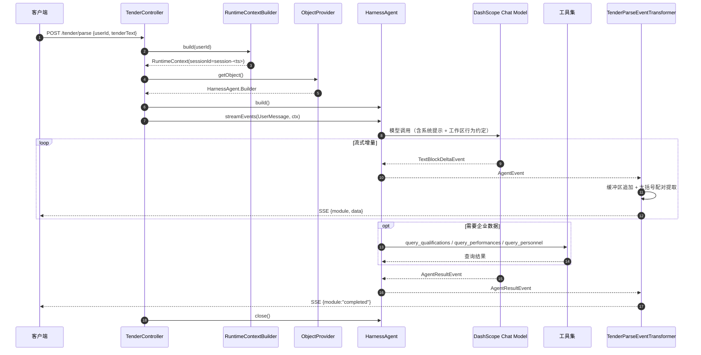
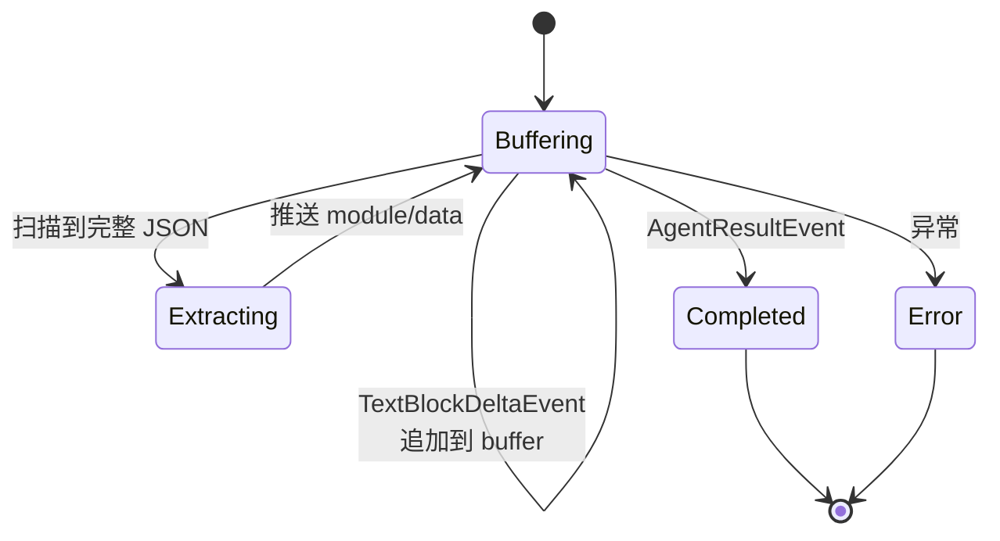
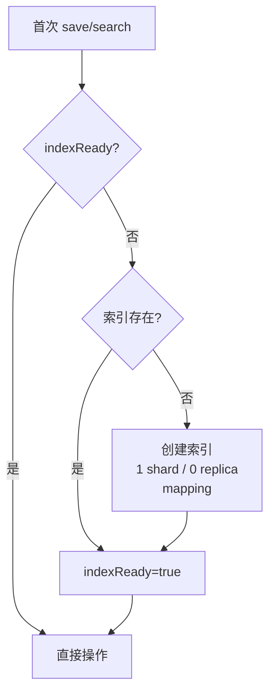
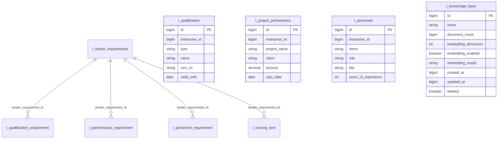

# 投标文件智能生成服务 详细设计文档

| 项目 | 内容 |
|---|---|
| 项目名称 | tender-demo / tender-service |
| 文档名称 | 详细设计文档 |
| 文档版本 | v1.0 |
| 编写日期 | 2026-10-28 |
| 代码基线 | 当前工作区源码快照（非 Git 仓库） |
| 技术栈 | Java 21、Spring Boot 4.1.1、WebFlux、AgentScope 2.0.4、MyBatis-Plus 3.5.17、MySQL、Elasticsearch 9.3.3 |
| 文档状态 | 以“当前实现”为准，同时标注设计建议与已知问题 |

> 说明：本文档描述代码中已经落地的实现，并在第 12 章集中列出与目标设计不一致、或需要补强的地方。凡标注“建议”“待改进”的内容，均不代表当前代码已经实现。

---

## 目录

1. [引言](#1-引言)
2. [项目概述](#2-项目概述)
3. [总体设计](#3-总体设计)
4. [功能详细设计](#4-功能详细设计)
5. [Agent 详细设计](#5-agent-详细设计)
6. [关键机制详细设计](#6-关键机制详细设计)
7. [数据设计](#7-数据设计)
8. [接口设计](#8-接口设计)
9. [非功能设计](#9-非功能设计)
10. [异常与边界设计](#10-异常与边界设计)
11. [测试设计](#11-测试设计)
12. [已知问题与改进建议](#12-已知问题与改进建议)
13. [部署与运维](#13-部署与运维)
14. [附录](#14-附录)

### LLD 模板章节映射

本文按“项目级详细设计”组织，覆盖 LLD 模板要求的全部要素，映射如下：

| LLD 模板章节 | 本文对应章节 |
|---|---|
| 1. 模块概述（位置、职责边界） | 第 2 章、第 3 章 |
| 2. 接口设计（参数、输出、错误码） | 第 8 章 |
| 3. 数据结构（类图、字段约束、枚举） | 第 7 章、14.2 节 |
| 4. 核心流程（流程图、异常路径、事务） | 第 4 章、第 5 章、第 6 章 |
| 5. 状态机 | 6.1 节、6.7 节 |
| 6. 异常处理策略 | 第 10 章 |
| 7. 性能与限制 | 9.1 节、9.3 节、第 12 章 |

---

## 1. 引言

### 1.1 编写目的

本文档说明投标文件智能生成服务的总体架构、功能流程、Agent 协作机制、数据模型、接口协议、关键算法、非功能设计与部署运维方式，为后续开发、联调、测试、上线和演进提供统一依据。

### 1.2 设计范围

覆盖以下能力：

1. 招标文件文本的流式解析与结构化提取。
2. 解析结果的人工确认与数据库入库。
3. 投标文件目录生成。
4. 投标章节内容撰写。
5. 基于 Elasticsearch 的知识库写入与“全文 + 向量”混合检索。
6. Agent 运行时、工具、提示词、工作区与调用审计。
7. 相关数据模型、接口、配置、日志和部署方案。

不在本期范围内：

- 招标文件 PDF/Word 的上传、OCR、版式解析。
- 投标文件的 Word/PDF 排版导出。
- 用户体系、权限体系、租户隔离的完整实现。
- 电子签章、投标文件加密、标书递交等外部业务系统集成。

### 1.3 目标读者

| 读者 | 关注内容 |
|---|---|
| 后端开发 | 模块划分、类职责、接口、关键算法、异常处理 |
| 前端/客户端开发 | HTTP 接口、SSE 事件协议、字段含义 |
| 测试 | 功能边界、异常场景、验收标准 |
| 运维 | 依赖组件、配置项、部署与排障 |
| 架构/评审 | 技术选型、数据一致性、安全与扩展性 |

### 1.4 术语与缩写

| 术语 | 说明 |
|---|---|
| 招标文件 | 采购方发布的招标公告、投标人须知、评分办法、技术规范等文本 |
| TenderRequirements | 招标文件结构化要求总纲，包含项目概况及资质、业绩、人员、评分点四类子项 |
| 评分点 | 评标办法中的评分条目，包含名称、分值、评审标准、建议承载章节 |
| Agent | 具备模型推理、工具调用、上下文记忆能力的智能体 |
| 子 Agent | 由主 Agent 按工作区声明调度的专职 Agent，如 tender-parser、catalog-builder、chapter-writer |
| HarnessAgent | AgentScope 提供的 Agent 运行时封装 |
| 工作区（Workspace） | Agent 的行为约定、子 Agent 声明、记忆与会话文件所在目录 |
| SSE | Server-Sent Events，服务端单向流式推送协议 |
| Embedding | 将文本转换为稠密向量的过程 |
| kNN | Elasticsearch 的近似最近邻向量检索 |
| BM25 | Elasticsearch 的全文相关性打分算法 |
| RRF | Reciprocal Rank Fusion，倒数排名融合算法 |
| IK | Elasticsearch 中文分词插件 |

### 1.5 参考资料

| 资料 | 路径/说明 |
|---|---|
| 项目构建文件 | `pom.xml` |
| 应用配置 | `src/main/resources/application.yml` |
| Agent 行为约定 | `src/main/resources/agentscope-workspace/AGENTS.md` |
| 解析子 Agent 定义 | `src/main/resources/agentscope-workspace/subagents/tender-parser.md` |
| 章节子 Agent 定义 | `src/main/resources/agentscope-workspace/subagents/chapter-writer.md` |
| 目录生成提示词 | `src/main/resources/prompts/catalog-generation.md` |
| 招标结构化表 DDL | `src/main/db/tender_requirements.sql` |
| 知识库元数据表 DDL | `src/main/db/knowledge_base.sql` |
| 知识库历史设计记录 | `docs/knowledge-base.md`（含历史版本接口示例，当前接口以本文第 8 章为准） |

### 1.6 证据与标注约定

本文以代码为真相源。关键事实用 `〔FACT｜文件:行号〕` 标注；无法直接从代码验证、依赖框架行为或架构经验推断的内容用 `〔INFER〕` 标注。

| 关键事实 | 证据 |
|---|---|
| 技术栈与依赖版本 | `〔FACT｜pom.xml:12-99〕` |
| Agent、Toolkit、StateStore、工作区装配 | `〔FACT｜src/main/java/org/example/config/TenderAgentConfig.java:46-75〕` |
| 解析接口与 Agent 调用 | `〔FACT｜src/main/java/org/example/controller/TenderController.java:76-89〕` |
| SSE 事件转换与 JSON 提取 | `〔FACT｜src/main/java/org/example/service/TenderParseEventTransformer.java:54-151〕` |
| 确认入库与主表/子表写入 | `〔FACT｜src/main/java/org/example/controller/TenderController.java:94-99；src/main/java/org/example/repo/TenderRequirementsRepository.java:43-52〕` |
| 目录/章节生成 | `〔FACT｜src/main/java/org/example/controller/TenderController.java:101-137；src/main/java/org/example/prompts/CatalogPromptProvider.java:15-17〕` |
| 知识库写入与检索 | `〔FACT｜src/main/java/org/example/service/KnowledgeBaseService.java:47-136；src/main/java/org/example/repo/KnowledgeBaseRepository.java:82-273〕` |
| 工作区资源释放 | `〔FACT｜src/main/java/org/example/service/WorkspaceInitializer.java:35-79〕` |
| 模型调用审计 | `〔FACT｜src/main/java/org/example/middleware/ModelCallAuditMiddleware.java:68-203〕` |
| 应用配置项 | `〔FACT｜src/main/resources/application.yml:20-49〕` |
| Maven 编译跳过 | `〔FACT｜pom.xml:115〕` |
| 现有集成测试入口 | `〔FACT｜src/test/java/org/example/controller/TenderParseIntegrationTest.java:43-56〕` |

---

## 2. 项目概述

### 2.1 背景

投标文件编制需要从招标文件中提取大量约束信息，包括项目概况、资质门槛、业绩要求、人员配置、评分办法等，再据此组织目录并逐章撰写。传统方式依赖人工阅读和整理，存在遗漏评分点、前后不一致、企业数据引用不准确等问题。

本项目以 AgentScope 为智能体运行时，将“解析—确认—编目—撰写”拆分为多个专职 Agent，并通过工具访问企业资质、业绩、人员数据，形成可追溯、可人工确认的投标文件生成流程；同时提供独立知识库，支持招标文档的全文与语义混合检索。

### 2.2 建设目标

| 目标 | 说明 |
|---|---|
| 结构化解析 | 将非结构化招标文本解析为统一的 `TenderRequirements` 模型 |
| 过程可见 | 解析过程通过 SSE 实时推送，前端可分模块展示 |
| 人工可控 | 解析结果必须经用户确认后才落库，避免模型幻觉直接入库 |
| 评分点全覆盖 | 目录生成必须保证每个评分点至少映射到一个章节 |
| 数据可追溯 | 资质、业绩、人员、关键数字必须来自原文或企业数据库 |
| 检索增强 | 知识库支持中文全文检索与向量检索融合排序 |
| 调用可审计 | 每次模型调用记录提示词、响应、Token 用量与耗时 |

### 2.3 业务范围

| 范围 | 内容 |
|---|---|
| 输入 | 招标文件纯文本、招标要求 ID、章节标题与评分点 ID、知识库文本 |
| 处理 | LLM 解析、结构化事件推送、目录生成、章节撰写、向量化与检索 |
| 输出 | SSE 结构化事件流、入库主键、目录 JSON 文本、章节正文、检索命中列表 |
| 数据 | MySQL 存招标要求与知识库元数据；Elasticsearch 存知识库文档与向量 |
| 人工环节 | 解析结果审阅与确认、目录确认、章节审阅 |

### 2.4 角色与用例

| 角色 | 用例 | 入口 |
|---|---|---|
| 投标业务人员 | 提交招标文本，查看解析进度与结果 | `POST /tender/parse` |
| 投标业务人员 | 确认解析结果并入库 | `POST /tender/parse/confirm` |
| 投标业务人员 | 基于招标要求生成目录 | `POST /tender/catalog` |
| 投标业务人员 | 按章节与评分点撰写内容 | `POST /tender/chapter` |
| 知识库维护人员 | 批量写入知识库文本 | `POST /knowledge/{knowledgeBaseName}` |
| 知识库使用人员 | 跨库或指定库混合检索 | `GET /knowledge/search` |
| 运维人员 | 健康检查、日志排查、索引重建 | Actuator、日志文件、ES API |

### 2.5 端到端业务流程



---

## 3. 总体设计

### 3.1 技术选型

| 层次 | 技术/组件 | 版本 | 选型理由 |
|---|---|---|---|
| 语言 | Java | 21 | 使用 record、switch 表达式、虚拟线程友好 |
| 基础框架 | Spring Boot | 4.1.1 | 统一依赖管理、自动装配、Actuator |
| Web | Spring WebFlux | Boot 内置 | 原生支持 `Flux`/`Mono`，适合 SSE 与流式模型输出 |
| 智能体运行时 | AgentScope Harness | 2.0.4 | 提供 Agent、工具、工作区、子 Agent、中间件能力 |
| 模型接入 | agentscope-extensions-model-dashscope | 2.0.4 | DashScope 兼容模型调用 |
| ORM | MyBatis-Plus | 3.5.17 | 轻量 CRUD、Lambda 条件构造器 |
| 数据库 | MySQL | 8.x（建议） | 存结构化招标要求与知识库元数据 |
| 搜索引擎 | Elasticsearch | 9.3.3 客户端 | BM25 + dense_vector kNN + filter |
| 中文分词 | IK Analyzer | 9.2.3（服务端插件） | 改善投标领域中文分词效果 |
| 接口文档 | springdoc-openapi | 3.1.1 | 自动生成 OpenAPI 与 Swagger UI |
| 日志 | Logback + SLF4J | Boot 内置 | 控制台、滚动文件、ERROR 单独归档 |
| 构建 | Maven | 3.9+（建议） | 标准依赖管理 |

> 证据：依赖与版本见 `〔FACT｜pom.xml:12-99〕`；其中 Maven 编译插件当前配置了 `skip=true`，见 `〔FACT｜pom.xml:115〕`。

### 3.2 逻辑架构



> 证据：Agent 装配见 `〔FACT｜src/main/java/org/example/config/TenderAgentConfig.java:46-75〕`；控制器与服务的依赖关系见 `〔FACT｜src/main/java/org/example/controller/TenderController.java:29-137〕` 与 `〔FACT｜src/main/java/org/example/controller/KnowledgeBaseController.java:26-87〕`。

### 3.3 代码分层与包结构

| 包/目录 | 职责 | 主要类 |
|---|---|---|
| `org.example` | 启动入口 | `TenderServiceApplication` |
| `org.example.controller` | HTTP 接入、参数校验、响应封装 | `TenderController`、`KnowledgeBaseController` |
| `org.example.service` | 业务编排、事件转换、上下文构建、工作区初始化 | `TenderRequirementsService`、`TenderParseEventTransformer`、`RuntimeContextBuilder`、`KnowledgeBaseService`、`WorkspaceInitializer` |
| `org.example.config` | 配置类与配置属性绑定 | `TenderAgentConfig`、`ElasticsearchConfig`、`KnowledgeBaseProperties` |
| `org.example.client` | 向量化客户端抽象与实现 | `EmbeddingClient`、`EsInferenceEmbeddingClient`、`DashScopeEmbeddingClient` |
| `org.example.repo` | 聚合仓储与外部存储访问 | `TenderRequirementsRepository`、`EnterpriseRepository`、`KnowledgeBaseRepository` |
| `org.example.mapper` | MyBatis-Plus Mapper | `TenderRequirementsMapper`、`ScoringItemMapper` 等 8 个 |
| `org.example.model` | 请求、响应、数据库实体 | `TenderRequest`、`TenderParseEvent`、`TenderRequirements` 等 |
| `org.example.model.require` | 招标解析领域模型 | `TenderModel` 及其 5 个子类 |
| `org.example.model.knowledge` | 知识库模型 | `KnowledgeBase`、`KnowledgeDocument`、`KnowledgeSearchHit` |
| `org.example.tools` | 暴露给 Agent 的工具 | `TenderTools`、`EnterpriseDataTools` |
| `org.example.middleware` | 模型调用审计 | `ModelCallAuditMiddleware` |
| `org.example.prompts` | 提示词加载与渲染 | `CatalogPromptProvider` |
| `src/main/resources/agentscope-workspace` | Agent 行为约定与子 Agent 声明 | `AGENTS.md`、`subagents/*.md` |
| `src/main/resources/prompts` | 业务提示词模板 | `catalog-generation.md` |
| `src/main/db` | 数据库建表脚本 | `tender_requirements.sql`、`knowledge_base.sql` |

### 3.4 部署拓扑



### 3.5 关键设计决策

| 编号 | 决策 | 理由 | 代价/约束 |
|---|---|---|---|
| D1 | 使用 WebFlux + SSE 而非 WebSocket | 解析是服务端单向推送，SSE 协议简单、易穿透代理、客户端实现成本低 | 不支持客户端向同一连接发送消息；需要处理代理超时 |
| D2 | 用 AgentScope Harness + 工作区 Markdown 定义 Agent 行为 | 行为约束可版本化、可热更新，提示词与 Java 代码解耦 | 工作区文件需随制品发布；运行时文件与源码文件需区分 |
| D3 | `HarnessAgent.Builder` 声明为 prototype，每次请求新建 | 避免共享 Builder 的 hooks/middleware 状态污染，保证请求隔离 | 每次请求有构建开销；会话状态依赖 StateStore |
| D4 | 结构化要求存 MySQL，知识库文档存 Elasticsearch | 前者需要事务、关联查询；后者需要全文与向量检索 | 两套存储，跨库一致性需额外设计 |
| D5 | RRF 融合放在应用侧而非 ES 原生 | ES 原生 RRF 需要商业 License，Basic License 不可用 | 需要两次检索并在 Java 侧合并，网络与内存开销增加 |
| D6 | 所有知识库共用一个 ES 索引，用 `knowledgeBaseId` 过滤 | 避免多索引管理复杂度，支持跨库检索 | 索引 mapping/维度变更影响所有库；大库之间隔离有限 |
| D7 | 用 `entityType` 判别字段分派异构 JSON | 模型可逐个输出平级对象，前端可逐条消费 | 依赖模型严格遵守判别字段；未知字段可能导致反序列化失败 |
| D8 | `EmbeddingClient` 抽象 + 条件装配 | 可在 ES 内置模型与 DashScope 之间切换 | 两套实现的维度、批大小、鉴权方式不同，配置需同步 |
| D9 | 中间件记录每次模型调用 | 满足审计、排障、成本分析需求 | 日志含完整提示词与响应，需脱敏与保留策略 |
| D10 | 入库前按列长度截断字段 | 避免 LLM 输出超长导致 MySQL 写入失败 | 截断会丢失信息，需在业务上提示 |

---

## 4. 功能详细设计

### 4.1 功能清单

| 编号 | 功能 | 入口 | 当前状态 |
|---|---|---|---|
| F-01 | 招标文件流式解析 | `POST /tender/parse` | 已实现 |
| F-02 | 解析结果确认入库 | `POST /tender/parse/confirm` | 已实现 |
| F-03 | 投标目录生成 | `POST /tender/catalog` | 已实现 |
| F-04 | 投标章节撰写 | `POST /tender/chapter` | 已实现 |
| F-05 | 知识库批量写入 | `POST /knowledge/{knowledgeBaseName}` | 已实现 |
| F-06 | 知识库混合检索 | `GET /knowledge/search` | 已实现 |
| F-07 | 模型调用审计 | 中间件 | 已实现 |
| F-08 | Agent 工作区初始化 | 启动时 | 已实现 |
| F-09 | 解析结果修改后重新解析 | 客户端再次调用 F-01 | 由客户端编排，服务端无专用接口 |
| F-10 | 目录/章节持久化 | 无 | 未实现 |

### 4.2 招标文件流式解析（F-01）

#### 4.2.1 功能描述

接收招标文件纯文本，交由主 Agent 调度 `tender-parser` 子 Agent 解析，服务端将模型输出的增量文本实时转换为结构化 SSE 事件。客户端按 `module` 分模块展示，用户在界面上审阅、修改，确认后再调用入库接口。

#### 4.2.2 输入与输出

| 项 | 内容 |
|---|---|
| 请求方法 | `POST` |
| 路径 | `/tender/parse` |
| Content-Type | `application/json` |
| Accept | `text/event-stream` |
| 请求体 | `TenderRequest { userId, tenderText }` |
| 响应 | `Flux<TenderParseEvent<?>>`，SSE 流 |
| 结束信号 | `{"module":"completed"}` |
| 异常信号 | `{"module":"error","message":"..."}` |

#### 4.2.3 处理流程

1. `TenderController.parseTender` 接收请求。
2. `RuntimeContextBuilder.build(userId)` 构造 `RuntimeContext`，当前实现生成 `session-<当前毫秒>`。
3. 通过 `ObjectProvider<HarnessAgent.Builder>` 获取 prototype Builder，并 `build()` 出本次请求专属 Agent。
4. 将 `tenderText` 拼入用户消息：`"请解析以下招标文件，提取结构化要求：\n" + tenderText`。
5. 调用 `agent.streamEvents(prompt, ctx)` 获取 `Flux<AgentEvent>`。
6. `TenderParseEventTransformer.toSse` 将事件流转换为 `Flux<TenderParseEvent<?>>`：
   - `TextBlockDeltaEvent`：追加到缓冲区，提取完整 JSON 对象并按 `entityType` 分派；
   - `AgentResultEvent`：推送 `completed`；
   - 其他事件：忽略；
   - 异常：记录日志并推送 `error`，随后结束流。
7. `Flux.using` 在流终止、取消或异常时调用 `HarnessAgent::close` 释放资源。

> 证据：`〔FACT｜src/main/java/org/example/controller/TenderController.java:76-89〕`、`〔FACT｜src/main/java/org/example/service/TenderParseEventTransformer.java:54-74〕`。

#### 4.2.4 时序图



#### 4.2.5 事件协议

| module | 承载模型 | data 关键字段 | 说明 |
|---|---|---|---|
| `project` | `TenderRequirements` | projectName、location、duration、budget | 项目概况，通常一条 |
| `qualification` | `QualificationRequirement` | type、level、validRequirement、source | 资质要求，可多条 |
| `performance` | `PerformanceRequirement` | projectType、quantity、amount、timeRange、source | 业绩要求，可多条 |
| `personnel` | `PersonnelRequirement` | role、quantity、certificate、source | 人员要求，可多条 |
| `scoringItem` | `ScoringItem` | itemId、name、score、criterion、suggestedChapter、source | 评分点，可多条 |
| `error` | 无 | message | 解析失败 |
| `completed` | 无 | 无 | 流结束 |

#### 4.2.6 业务规则

1. **判别字段**：模型输出的每个平级 JSON 对象必须包含 `entityType`，取值与模型映射如下：

   | entityType | 模型类 | 推送 module |
   |---|---|---|
   | `tenderRequirements` | `TenderRequirements` | `project` |
   | `qualification` | `QualificationRequirement` | `qualification` |
   | `performance` | `PerformanceRequirement` | `performance` |
   | `personnel` | `PersonnelRequirement` | `personnel` |
   | `scoringItem` | `ScoringItem` | `scoringItem` |

2. **禁止自动入库**：解析阶段只推送结果，不调用 `save_tender_requirements`。入库必须由用户确认后走 `POST /tender/parse/confirm`。
3. **原文出处**：资质、业绩、人员、评分点必须填写 `source`，便于人工复核。
4. **缺失数据处理**：原文未提供的信息标注“未明确（原文未提供）”，不得猜测；模型不得编造资质、金额、评分项。
5. **顺序**：`concatMap` 保证事件按模型输出顺序推送，避免结构化对象乱序。
6. **幂等性**：解析接口无副作用，同一文本可重复调用；会话 ID 每次不同。

#### 4.2.7 异常处理

| 场景 | 当前行为 |
|---|---|
| 模型调用异常 | `onErrorResume` 捕获，推送 `{"module":"error","message":"解析失败：..."}` 后结束 |
| JSON 片段不完整 | 留在缓冲区，等待后续增量；流结束时未闭合片段被静默丢弃 |
| JSON 解析失败 | `log.warn` 跳过该片段，继续处理后续片段 |
| `entityType` 未知 | 忽略该对象，不推送 |
| 客户端断开 | Reactor 取消订阅，`Flux.using` 触发 `close()` |
| `tenderText` 为空 | 当前无参数校验，仍会调用模型 |

#### 4.2.8 设计约束与已知问题

- 当前 `RuntimeContextBuilder` 忽略请求中的 `sessionId`（`TenderRequest` 也没有该字段），每次生成新会话，无法跨 HTTP 请求延续上下文。
- `TenderParseEventTransformer` 使用原生 Jackson 2 `ObjectMapper`，默认 `FAIL_ON_UNKNOWN_PROPERTIES=true`；模型若输出模型类中不存在的字段，整个片段会被跳过。建议配置忽略未知字段或使用 DTO。
- 大括号提取算法对“正文中包含未闭合 `{`”较敏感，可能阻塞后续合法 JSON；建议限制模型只输出 JSON，或在提取前剥离 Markdown 代码围栏。
- 未设置 SSE 心跳与最大时长，长模型调用可能被网关/代理断开。
- 项目同时使用 Jackson 2（`com.fasterxml.jackson`，SSE 转换、测试）与 Jackson 3（`tools.jackson`，审计、DashScope 客户端），两套 API 的配置需分别维护，建议统一。
- `/tender/parse` 未显式声明 `produces = text/event-stream`；客户端未发送 `Accept: text/event-stream` 时，WebFlux 可能按 JSON 流返回，而非 SSE。建议在映射上固定媒体类型。

### 4.3 解析结果确认入库（F-02）

#### 4.3.1 功能描述

接收前端确认后的 `TenderRequirements`（含四类子项列表），在一个事务内写入主表与四张子表，返回主表自增 ID。

#### 4.3.2 处理流程

1. `TenderController.confirmTender` 接收请求体。
2. `Mono.fromCallable(() -> requirementService.save(requirements))` 包装阻塞调用。
3. `TenderRequirementsService.save` 标注 `@Transactional`。
4. `TenderRequirementsRepository.save`：
   - 对主表字段做长度截断；
   - 插入 `t_tender_requirements`，获得自增 ID；
   - 依次插入资质、业绩、人员、评分点四张子表，子项统一回填 `tenderRequirementId` 与 `enterpriseId`；
   - 子项字段同样做长度截断。
5. 返回主表 ID。

> 证据：`〔FACT｜src/main/java/org/example/controller/TenderController.java:94-99〕`、`〔FACT｜src/main/java/org/example/service/TenderRequirementsService.java:20-24〕`、`〔FACT｜src/main/java/org/example/repo/TenderRequirementsRepository.java:43-52〕`。

#### 4.3.3 入库规则

| 规则 | 说明 |
|---|---|
| 主表必填 | `enterprise_id` 在 DDL 中为 `NOT NULL`，请求体必须提供，否则插入失败 |
| 子表关联 | 子项 `tender_requirement_id` 由服务端覆盖为本次主表 ID |
| 企业归属 | 子项 `enterprise_id` 由服务端覆盖为主表 `enterpriseId` |
| 空列表 | 子表列表为空或 `null` 时跳过插入 |
| 无更新 | 当前只支持新增，不支持按 ID 更新已有记录 |
| 事务边界 | 仅 `/parse/confirm` 路径有事务；Agent 直接调用 `save_tender_requirements` 时没有事务 |

#### 4.3.4 字段归一化

`TenderRequirementsRepository` 在写入前按 DDL 列宽截断，避免 `Data too long for column`。截断规则见 6.4 节。

### 4.4 投标目录生成（F-03）

#### 4.4.1 功能描述

根据招标要求 ID 生成可逐章撰写的投标目录。目录条目需要与评分点一一对应，并给出结构判断、缺口说明。

#### 4.4.2 处理流程

1. `TenderController.generateCatalog` 接收 `CatalogRequest { userId, tenderRequirementId }`。
2. `RuntimeContextBuilder.build(userId)` 构造上下文。
3. `CatalogPromptProvider.render(tenderRequirementId)` 读取 `classpath:prompts/catalog-generation.md`，替换 `{{id}}`。
4. 新建 Agent，调用 `agent.call(new UserMessage(prompt), ctx)`。
5. 模型按提示词调用 `get_tender_requirements` 工具读取结构化要求，生成目录 JSON。
6. 返回 `Msg::getTextContent`，即目录文本。

> 证据：`〔FACT｜src/main/java/org/example/controller/TenderController.java:101-116〕`、`〔FACT｜src/main/java/org/example/prompts/CatalogPromptProvider.java:15-21〕`。

#### 4.4.3 目录输出契约

单套目录：

```json
{
  "catalog": [
    {
      "chapter_no": "1",
      "title": "项目概况",
      "scoring_item_ids": ["S1"],
      "content_hint": "介绍项目名称、地点、工期与预算，对应评分点 S1。"
    }
  ],
  "structure_decision": "合并目录：评分办法未区分商务与技术",
  "gaps": []
}
```

商务/技术分列时输出 `business_catalog` 与 `technical_catalog` 两个数组，不再输出 `catalog`。

#### 4.4.4 目录规则摘要

| 规则 | 说明 |
|---|---|
| 评分点映射 | 每个评分点至少映射一个目录条目；`scoring_item_ids` 原样引用 `t_scoring_item.item_id` |
| 建议章节 | 优先使用评分点的 `suggested_chapter` 作为标题 |
| 多对多 | 一个条目可承载多个评分点；一个评分点也可拆到多个条目 |
| 必需章节 | 项目概况、资格证明、类似业绩、项目人员配置、商务响应、技术方案、报价（按招标内容裁剪） |
| 层级 | 阿拉伯数字点分，最多三级，一级章节建议 5–10 个 |
| 内容提示 | `content_hint` 必须具体到可指导撰写，禁止“详见招标文件” |
| 缺口 | 数据缺失写入 `gaps`，不得虚构 |
| 输出纯度 | 除 JSON 外不输出解释性文字 |

#### 4.4.5 已知问题

- 提示词要求模型调用 `get_tender_requirements`，但该工具注册在主 Agent；`catalog-builder` 子 Agent 的 `tools` 声明只有 `read_file`、`grep_files`，两者能力不一致。
- `CatalogPromptProvider` 使用 `resource.getFile()` 读取模板，打成 JAR 部署时会因无法解析 `jar:` 内文件而启动失败。建议改为 `getInputStream()`。
- 主 Agent 的 `AGENTS.md` 要求“委派 catalog-builder”，但 `/tender/catalog` 直接把目录提示词交给主 Agent，是否真正走子 Agent 取决于模型调度，存在不确定性。
- `tender-parser.md` 的 `scoringItem` 输出示例没有要求 `itemId`，而目录生成要求 `scoring_item_ids` 原样引用 `t_scoring_item.item_id`。若解析阶段不产出该字段，目录只能得到 `[null]`，需要补齐解析提示词或允许按名称映射。

### 4.5 投标章节撰写（F-04）

#### 4.5.1 功能描述

根据章节标题与关联评分点 ID 撰写章节正文。章节需覆盖评分点要求，企业数据必须通过工具查询，不得编造。

#### 4.5.2 处理流程

1. `TenderController.generateChapter` 接收 `ChapterRequest { userId, sessionId, chapterTitle, scoringPointIds }`。
2. 构造上下文（当前实现同样忽略请求中的 `sessionId`）。
3. 新建 Agent，构造用户消息：`撰写章节“<chapterTitle>”，对应评分点：<scoringPointIds>`。
4. 调用 `agent.call(...)`，返回章节文本。
5. 模型可调用 `query_qualifications`、`query_performances`、`query_personnel` 查询企业数据。

#### 4.5.3 撰写约束

| 约束 | 说明 |
|---|---|
| 结构 | 评分点解读 → 满足情况阐述 → 支撑材料引用 |
| 数据来源 | 企业资质、业绩、人员必须来自工具查询结果 |
| 空结果 | 工具返回空时写明“该数据暂未在系统中找到”，不得推测 |
| 关键数字 | 工期、金额、人数必须能在原文或工具结果中找到出处 |
| 自查 | 覆盖评分点、数据可追溯、无编造 |

#### 4.5.4 已知问题

- `scoringPointIds` 只是逗号分隔字符串，服务端未校验、未查询评分点详情，模型可能拿不到评分标准。
- `chapterTitle`、`scoringPointIds` 为空时没有 400 校验。
- 章节结果未持久化，客户端需自行保存。

### 4.6 知识库批量写入（F-05）

#### 4.6.1 功能描述

将一组文本写入指定名称的知识库；知识库不存在时自动创建元数据记录，写入时同步生成向量。

#### 4.6.2 处理流程

1. `KnowledgeBaseController.save` 接收路径参数 `knowledgeBaseName` 与请求体 `List<String>`。
2. `Mono.fromCallable(...).subscribeOn(Schedulers.boundedElastic())` 将阻塞逻辑移出事件循环。
3. `KnowledgeBaseService.saveAll`：
   - 校验知识库名称非空；
   - 过滤空白文本并 `trim`；
   - 查询 `t_knowledge_base`，不存在则插入；
   - `EmbeddingClient.isEnabled()` 为真时批量生成文档向量；
   - 为每条文本生成 UUID，组装 `KnowledgeDocument`；
   - `KnowledgeBaseRepository.saveAll` 按 500 条一批 Bulk 写入 ES，`Refresh.WaitFor`；
   - 更新知识库 `document_count` 与 `updated_at`；
   - 返回知识库主键 ID。
4. 方法标注 `@Transactional`。

> 证据：`〔FACT｜src/main/java/org/example/controller/KnowledgeBaseController.java:49-56〕`、`〔FACT｜src/main/java/org/example/service/KnowledgeBaseService.java:47-98〕`、`〔FACT｜src/main/java/org/example/repo/KnowledgeBaseRepository.java:62-72〕`。

#### 4.6.3 写入规则

| 规则 | 说明 |
|---|---|
| 空文本 | 过滤，不写入 |
| 空列表 | 只创建/返回知识库，不增加文档 |
| 文档 ID | UUID，作为 ES `_id`，重复写入同一 ID 幂等 |
| 向量 | 未启用向量化时 `embedding` 为 `null` |
| 刷新 | 每批 `Refresh.WaitFor`，保证写入后立即可查 |
| 计数 | `documentCount` 为读改写，非原子 |

### 4.7 知识库混合检索（F-06）

#### 4.7.1 功能描述

同时执行 BM25 全文检索与 kNN 向量检索，在应用侧用 RRF 融合排序，返回最相关的文档。

#### 4.7.2 处理流程

1. `KnowledgeBaseController.search` 校验 `query` 非空。
2. `KnowledgeBaseService.search`：
   - 若传入 `knowledgeBaseNames`，查询 `t_knowledge_base` 得到 ID 列表；名称不存在则抛异常；
   - `topK` 缺省 10，范围限制为 1–50；
   - 若向量化可用，生成查询向量；失败则记录警告并降级；
   - 调用 `KnowledgeBaseRepository.search`。
3. Repository：
   - 候选数 `candidateSize = max(50, topK)`；
   - 全文检索：`match(content, query)`，可选 `terms(knowledgeBaseId)` 过滤；
   - 向量检索：`knn(embedding, queryVector, k=candidateSize, numCandidates=max(size*2,100))`，可选 filter；
   - RRF 融合：`score = Σ 1/(60 + rank)`；
   - 按分数降序、创建时间降序排序，截取 `topK`。

> 证据：`〔FACT｜src/main/java/org/example/controller/KnowledgeBaseController.java:72-87〕`、`〔FACT｜src/main/java/org/example/service/KnowledgeBaseService.java:100-136〕`、`〔FACT｜src/main/java/org/example/repo/KnowledgeBaseRepository.java:82-190〕`。

#### 4.7.3 降级策略

| 场景 | 行为 |
|---|---|
| 未配置向量化 | 仅全文检索 |
| 查询向量生成失败 | 捕获 `EmbeddingException`，仅全文检索 |
| ES 不可达 | 抛出 `IllegalStateException`，接口 500 |
| 索引不存在 | 首次访问自动创建 |

---

## 5. Agent 详细设计

### 5.1 Agent 运行时构建

`TenderAgentConfig` 负责构建主 Agent：

```java
HarnessAgent.builder()
    .name("TenderAssistant")
    .sysPrompt("你是一个投标服务助手。请严格遵循工作区中的行为约定和调度规则。")
    .model(DashScopeChatModel.builder()
        .apiKey(apiKey)
        .modelName(model)
        .build())
    .toolkit(toolkit)
    .stateStore(stateStore)
    .workspace(workspacePath)
    .middleware(modelCallAuditMiddleware)
    .disableWebTools();
```

| 配置项 | 当前值/行为 | 说明 |
|---|---|---|
| name | `TenderAssistant` | Agent 名称 |
| sysPrompt | 简短角色描述 | 具体行为由工作区 `AGENTS.md` 约束 |
| model | `agentscope.model`，当前 `glm-5.2` | 通过 `DashScopeChatModel` 调用，需确认端点支持该模型 |
| toolkit | `TenderTools` + `EnterpriseDataTools` | 主 Agent 可直接调用 6 个业务工具 |
| stateStore | `InMemoryAgentStateStore` | 进程内存储，重启丢失，不支持多实例共享 |
| workspace | `agentscope.workspace-path` | 默认 `.agentscope/workspace` |
| middleware | `ModelCallAuditMiddleware` | 审计每次模型调用 |
| 工具开关 | 禁用 Web 工具 | 未显式禁用 Shell 与文件系统工具（相关调用被注释） |
| Bean 作用域 | `prototype` | 每个请求注入新的 Builder，避免状态共享 |

> 证据：`〔FACT｜src/main/java/org/example/config/TenderAgentConfig.java:33-75〕`。

> 设计要点：`ObjectProvider<HarnessAgent.Builder>` 每次 `getObject()` 获取新 Builder，`Flux.using` / `Mono.using` 在流结束后关闭 Agent。这样可避免并发请求共享 Agent 的 hooks/middleware 集合。

### 5.2 主 Agent 职责与调度规则

主 Agent 是调度中枢，不直接执行解析或撰写。工作区 `AGENTS.md` 约定：

| 规则 | 内容 |
|---|---|
| 可用子 Agent | `tender-parser`、`catalog-builder`、`chapter-writer` |
| 解析优先 | 收到招标文件第一步永远委派 `tender-parser` |
| 解析结果为准 | 后续决策以 `TenderRequirements` 为依据，不完整则让解析 Agent 补全 |
| 人工确认 | 解析结果分块呈现，确认后才调用 `save_tender_requirements` |
| 目录生成 | 拿到完整解析结果后委派 `catalog-builder`，不匹配则修正 |
| 逐章撰写 | 目录确认后逐章委派 `chapter-writer` |
| 章节自查 | 每章完成后对照评分点检查覆盖情况，不覆盖则退回重写 |
| 禁止编造 | 企业数据必须通过工具查询；关键数字必须有出处；空结果如实告知 |

### 5.3 子 Agent 规格

| 子 Agent | 定义文件 | 工具 | 最大步数 | 职责 |
|---|---|---|---|---|
| `tender-parser` | `subagents/tender-parser.md` | `read_file`、`grep_files` | 6 | 解析招标文件，输出平级 JSON 对象 |
| `catalog-builder` | `subagents/catalog-builder.md` | `read_file`、`grep_files` | 5 | 生成目录骨架，映射评分点，输出缺口 |
| `chapter-writer` | `subagents/chapter-writer.md` | `read_file`、`grep_files`、`query_qualifications`、`query_performances`、`query_personnel` | 8 | 按章节与评分点撰写正文 |

`tender-parser` 输出格式（每个对象独立、平级）：

```json
{ "entityType": "tenderRequirements", "projectName": "项目名称", "location": "建设地点", "duration": "工期要求", "budget": "预算/报价上限" }
{ "entityType": "qualification", "type": "资质类型", "level": "资质等级", "validRequirement": "有效期要求", "source": "原文出处片段" }
{ "entityType": "performance", "projectType": "类似项目类型", "quantity": "数量要求", "amount": "金额下限", "timeRange": "业绩时间范围", "source": "原文出处片段" }
{ "entityType": "personnel", "role": "岗位名称", "quantity": 2, "certificate": "证书/职称要求", "source": "原文出处片段" }
{ "entityType": "scoringItem", "name": "评分点名称", "score": 20, "criterion": "评审标准", "suggestedChapter": "建议承载章节", "source": "原文出处片段" }
```

> 注意：上述 `scoringItem` 示例与 `tender-parser.md` 一致，确实未包含 `itemId`；但 `ScoringItem` 实体和目录映射都依赖 `itemId`。这是当前解析提示词与目录规则之间的缺口，建议在解析输出中补充 `itemId`（可用 `S1`、`S2` 等稳定编号），或在目录生成时按名称/序号回填。

### 5.4 工具清单

| 工具名 | 所属类 | 参数 | 返回 | 副作用 |
|---|---|---|---|---|
| `save_tender_requirements` | `TenderTools` | `requirements: TenderRequirements` | 带自增 ID 的完整对象 | 写入主表 + 四张子表 |
| `get_tender_requirements` | `TenderTools` | `id: Long` | `TenderRequirements` 或 `null` | 无 |
| `delete_tender_requirements` | `TenderTools` | `id: Long` | `void` | 级联删除主表与子表 |
| `query_qualifications` | `EnterpriseDataTools` | `type: String`（可空） | `List<Qualification>` | 无 |
| `query_performances` | `EnterpriseDataTools` | `keyword: String`（可空） | `List<ProjectPerformance>` | 无 |
| `query_personnel` | `EnterpriseDataTools` | `role: String`（可空） | `List<Personnel>` | 无 |

工具设计约束：

1. 工具参数为空字符串时，仓储层返回全量数据；这对 Agent 友好，但可能返回大量记录。
2. 查询工具当前**没有企业 ID 参数**，`EnterpriseRepository` 也未按 `enterpriseId` 过滤，存在跨企业数据泄露风险。
3. `save_tender_requirements` 直接调用 Repository，未包事务；子表写入失败可能留下主表脏数据。
4. `delete_tender_requirements` 为硬删除，无软删除与操作审计。

### 5.5 提示词设计

| 提示词 | 位置 | 作用 | 渲染方式 |
|---|---|---|---|
| 主 Agent 系统提示 | `TenderAgentConfig` | 设定角色，要求遵循工作区约定 | 固定字符串 |
| 主 Agent 行为约定 | `AGENTS.md` | 调度规则、输出约束 | 工作区文件 |
| 解析子 Agent | `subagents/tender-parser.md` | 解析范围、JSON 格式、入库纪律 | 工作区文件 |
| 目录子 Agent | `subagents/catalog-builder.md` | 目录骨架、评分点映射 | 工作区文件（**未随源码发布**） |
| 章节子 Agent | `subagents/chapter-writer.md` | 章节结构、企业数据约束 | 工作区文件 |
| 目录生成模板 | `prompts/catalog-generation.md` | 目录结构、规则、输出格式 | `{{id}}` 占位符替换 |

提示词设计原则：

- **角色边界清晰**：主 Agent 只调度，解析/编目/撰写各自独立。
- **输出可解析**：解析与目录都要求纯 JSON，便于服务端或前端消费。
- **反幻觉**：明确要求原文出处、缺失标注、禁止编造。
- **可维护**：行为约定放在 Markdown，修改后重启即可生效（开发期）。

### 5.6 会话与状态

| 项 | 当前实现 | 影响 |
|---|---|---|
| `AgentStateStore` | `InMemoryAgentStateStore` | 重启丢失；多实例不共享 |
| `sessionId` 生成 | `session-<System.currentTimeMillis()>` | 每次请求新会话；同一毫秒并发可能碰撞 |
| 请求中的 `sessionId` | `ChapterRequest` 有字段但未使用；`TenderRequest` 无字段 | 无法延续多轮对话 |
| 工作区记忆 | `.agentscope/workspace/<userId>/MEMORY.md` | 按用户持久化，但依赖本地磁盘 |
| 会话文件 | `.agentscope/workspace/.../sessions/` | 与实例绑定，水平扩展需共享存储 |

建议：引入 Redis 版 StateStore；由客户端传入稳定的 `sessionId`；服务端校验并复用；多实例部署时将会话与工作区放到共享存储。

### 5.7 模型调用审计中间件

`ModelCallAuditMiddleware` 实现 `MiddlewareBase.onModelCall`：

1. 记录开始时间。
2. 调用 `next.apply(input)` 继续模型调用链。
3. 在 `flatMap` 中捕获：
   - `ModelCallEndEvent`：输入/输出 Token 数；
   - `TextBlockDeltaEvent`：拼接响应文本；
   - `ThinkingBlockDeltaEvent`：拼接思考文本。
4. `doOnComplete` 时写入一个 JSON 文件到 `llm.log-path`，文件名为 `audit-yyyy-MM-dd_HH-mm-ss-SSS.json`。
5. 审计内容包含：时间戳（东八区）、模型名、消息列表、思考文本、响应文本、Token 用量、耗时。
6. 写入失败只记录错误日志，不中断主流程。

审计日志示例结构：

```json
{
  "timestamp": "2026-10-28T10:15:30.123+08:00",
  "model": "glm-5.2",
  "prompt": [
    {"role": "SYSTEM", "content": "..."},
    {"role": "USER", "content": "..."},
    {"role": "TOOL", "toolName": "get_tender_requirements", "content": "..."}
  ],
  "thinkingText": "...",
  "responseText": "...",
  "inputTokens": 1234,
  "outputTokens": 567,
  "durationMs": 8901
}
```

已知问题：

- 同步文件写入发生在 Reactor 线程，可能阻塞事件循环。
- `FileWriter` 使用平台默认字符集，跨环境可能出现中文乱码；建议显式 UTF-8。
- 同一毫秒内多个模型调用可能生成同名文件，存在覆盖风险。
- 审计文件含完整提示词与响应，可能包含招标文件敏感信息；需脱敏、访问控制与保留策略。

### 5.8 防幻觉与数据约束

| 约束 | 落地位置 |
|---|---|
| 解析结果必须带 `source` | `tender-parser.md`、`TenderModel` 子类字段 |
| 缺失信息标注“未明确（原文未提供）” | 解析提示词、目录提示词 |
| 企业数据必须工具查询 | `chapter-writer.md`、`AGENTS.md` |
| 空结果如实告知 | `AGENTS.md`、`chapter-writer.md` |
| 未确认不入库 | `AGENTS.md`、`tender-parser.md` |
| 评分点必须全覆盖 | `catalog-generation.md` 自查清单 |
| 目录/章节输出前自查 | 各子 Agent 的“自查”章节 |

需要说明的是，这些约束目前主要依赖提示词与模型自觉，服务端没有强校验。例如入库接口不会检查 `source` 是否为空，也不会检查评分点覆盖率。建议在服务端增加结构化校验与规则引擎。

---

## 6. 关键机制详细设计

### 6.1 SSE 事件转换机制

`TenderParseEventTransformer` 是解析链路的核心，负责把 Agent 的通用事件流转换为业务可消费的结构化事件流。



关键实现点：

| 点 | 说明 |
|---|---|
| 每订阅独立缓冲 | `Flux.defer` 内创建 `StringBuilder`，避免多订阅共享 |
| 顺序保证 | `concatMap` 保证事件按序处理，避免并发写 buffer |
| 增量拼接 | 只处理 `TextBlockDeltaEvent`，忽略思考块等其他事件 |
| 完成信号 | 收到 `AgentResultEvent` 推送 `completed` |
| 错误兜底 | `onErrorResume` 推送 `error`，保证客户端能收到终止信号 |
| 资源释放 | Controller 使用 `Flux.using`，终止/取消时关闭 Agent |

### 6.2 JSON 提取算法

`takeFirstCompleteJson(StringBuilder)` 使用“字符串感知的大括号配对”从缓冲区头部提取第一个完整 JSON 对象：

```text
depth = 0, start = -1, inString = false, escaped = false
for i in 0..buffer.length-1:
    c = buffer[i]
    if inString:
        if escaped: escaped = false
        else if c == '\\': escaped = true
        else if c == '"': inString = false
        continue
    switch c:
        case '"': inString = true
        case '{':
            if depth == 0: start = i
            depth++
        case '}':
            depth--
            if depth == 0 && start >= 0:
                json = buffer[start..i]
                buffer.delete(start, i+1)
                return json
return null
```

> 证据：`〔FACT｜src/main/java/org/example/service/TenderParseEventTransformer.java:111-151〕`。

算法特性：

| 特性 | 说明 |
|---|---|
| 字符串感知 | 引号内的 `{}` 不计入深度，避免 JSON 字符串值破坏配对 |
| 转义处理 | 支持 `\"`、`\\` 等转义 |
| 前缀容忍 | JSON 前的说明文字会被忽略，直到遇到第一个 `{` |
| 多对象 | 循环调用可一次提取多个连续对象 |
| 不完整对象 | 留在缓冲区等待后续增量 |
| 复杂度 | 每次提取从头扫描，最坏 O(n)；缓冲区通常较小，可接受 |

边界风险：

1. 正文中出现未闭合的 `{` 会让 `depth` 长期大于 0，后续合法 JSON 可能被并入同一片段。
2. Markdown 代码围栏（```json）不影响提取，但围栏内的说明文字若含大括号可能干扰。
3. 流结束时未闭合的对象不会报错，也不会推送，属于静默丢弃。
4. 非法 JSON 片段会被删除并记录 `warn`，不会阻塞后续片段。

### 6.3 实体分派机制

```java
private static final Map<String, DispatchEntry> DISPATCH_MAP = Map.of(
    "tenderRequirements", new DispatchEntry(PROJECT, TenderRequirements.class),
    "qualification", new DispatchEntry(QUALIFICATION, QualificationRequirement.class),
    "performance", new DispatchEntry(PERFORMANCE, PerformanceRequirement.class),
    "personnel", new DispatchEntry(PERSONNEL, PersonnelRequirement.class),
    "scoringItem", new DispatchEntry(SCORING_ITEM, ScoringItem.class)
);
```

分派步骤：

1. 读取 `node.path("entityType").asText()`。
2. 查 `DISPATCH_MAP`，未命中则忽略。
3. 用 `ObjectMapper.convertValue(node, type)` 转为具体模型。
4. 用 `ParseModule.fromCode(code)` 得到 module 枚举。
5. 包装为 `TenderParseEvent<>(module, model)` 推送。

注意：`convertValue` 默认对未知字段敏感；若模型输出额外字段，可能抛 `IllegalArgumentException`，被外层 `catch` 跳过。

### 6.4 入库字段归一化

为避免 MySQL `Data too long`，Repository 在写入前按列宽截断：

| 表 | 字段 | 最大长度 |
|---|---|---|
| `t_tender_requirements` | project_name | 255 |
| | location | 255 |
| | duration | 64 |
| | budget | 128 |
| `t_qualification_requirement` | type | 128 |
| | level | 64 |
| | valid_requirement | 255 |
| | source | 512 |
| `t_performance_requirement` | project_type | 255 |
| | quantity | 64 |
| | amount | 128 |
| | time_range | 128 |
| | source | 512 |
| `t_personnel_requirement` | role | 64 |
| | certificate | 255 |
| | source | 512 |
| `t_scoring_item` | item_id | 64 |
| | name | 128 |
| | criterion | 512 |
| | suggested_chapter | 128 |
| | source | 512 |

截断使用 `String.substring(0, max)`，按 UTF-16 码元计数。对中文通常等价于字符数，但对表情符号等代理对可能截断半个字符。建议按码点截断。

### 6.5 混合检索与 RRF

#### 6.5.1 两路召回

| 路 | 查询 | 候选数 | 过滤 |
|---|---|---|---|
| 全文 | `match(content, query)` | `max(50, topK)` | `terms(knowledgeBaseId)` |
| 向量 | `knn(embedding, queryVector)` | `max(50, topK)` | `terms(knowledgeBaseId)` |

向量检索参数：

- `k = candidateSize`
- `numCandidates = max(candidateSize * 2, 100)`
- `similarity = cosine`

#### 6.5.2 RRF 融合

对每一路结果，按排名 `rank`（从 1 开始）计算：

```text
score(d) = Σ_over_lists 1 / (k + rank_list(d))
```

其中 `k = 60`。同一文档在两路都出现时分数累加，因此同时被全文和向量命中的文档排名更靠前。

排序规则：

1. `score` 降序；
2. `createdAt` 降序（`null` 排最后）；
3. 截取 `topK`。

#### 6.5.3 参数与边界

| 参数 | 值 | 说明 |
|---|---|---|
| `DEFAULT_TOP_K` | 10 | 未传 topK 时 |
| `MAX_TOP_K` | 50 | 上限 |
| `MIN_CANDIDATE_SIZE` | 50 | 每路最少召回 |
| `RRF_RANK_CONSTANT` | 60 | 经验平滑常数 |
| `BULK_BATCH_SIZE` | 500 | ES Bulk 每批文档数 |

`topK <= 0` 时使用默认 10；`topK > 50` 时截为 50。

#### 6.5.4 降级

- `queryVector` 为空：跳过向量检索，只用全文。
- 查询向量生成异常：Service 捕获 `EmbeddingException`，记录 `warn`，继续全文检索。
- 写入向量化异常：当前不降级，`saveAll` 直接失败（事务回滚 MySQL，但 ES 可能尚未写入）。

### 6.6 向量化抽象

| 实现 | 条件 | 启用判断 | 批大小 | 维度 | 鉴权 |
|---|---|---|---|---|---|
| `EsInferenceEmbeddingClient` | `provider=es` 或未配置 | 始终 `true` | 配置值，默认 100 | 默认 384 | 当前未附加认证头 |
| `DashScopeEmbeddingClient` | `provider=dashscope` | `apiKey` 非空 | 配置值与 10 取小 | 默认 384（需改 1024） | Bearer Token |

ES 内置实现调用 `POST /_inference/{endpointId}`，请求体 `{"input":[...]}`，响应取 `text_embedding[].embedding`。

DashScope 实现调用 `text-embedding` API，支持 `text_type=document/query`，按 `text_index` 排序返回。

### 6.7 知识库索引生命周期



索引 mapping：

| 字段 | 类型 | 参数 | 用途 |
|---|---|---|---|
| `id` | keyword | - | 文档 ID |
| `knowledgeBaseId` | long | - | 知识库过滤 |
| `content` | text | `ik_max_word` / `ik_smart` | 全文检索 |
| `createdAt` | date | `epoch_millis` | 排序 |
| `embedding` | dense_vector | `dims=配置维度`、`index=true`、`cosine` | 向量检索 |

注意：

- 创建索引依赖 IK 插件；插件缺失会直接失败。
- 维度必须与已有索引一致；当前没有启动时校验，维度变更后需手动删除索引。
- `indexReady` 一旦为 true，运行期删除索引不会自动重建，需重启。
- 单分片零副本仅适合开发环境；生产应调整分片与副本。

### 6.8 事务与一致性

| 操作 | 事务 | 一致性风险 |
|---|---|---|
| `/tender/parse/confirm` | `@Transactional` | 主表 + 子表同事务，失败整体回滚 |
| Agent `save_tender_requirements` | 无事务 | 子表失败可能留下主表记录 |
| 知识库写入 | `@Transactional`（仅 MySQL） | ES 写入无法随 MySQL 回滚；可能出现 ES 有文档、计数未更新 |
| 知识库计数 | 读改写 | 并发写入可能丢失更新 |
| 知识库创建 | 先查后插 | 并发下可能违反唯一键 |

建议：

1. 将 `TenderTools` 的写操作改为调用带事务的 Service。
2. 知识库写入采用“先写 ES 成功、再更新 MySQL”的顺序，并记录补偿任务；或引入 outbox 表。
3. `documentCount` 改为 `UPDATE ... SET document_count = document_count + ?` 原子更新。
4. 知识库创建捕获唯一键冲突后重查。

---

## 7. 数据设计

> 证据：招标要求表结构见 `〔FACT｜src/main/db/tender_requirements.sql:1-66〕`；知识库元数据表见 `〔FACT｜src/main/db/knowledge_base.sql:1-13〕`；实体映射见 `〔FACT｜src/main/java/org/example/model/require/TenderRequirements.java:20-57〕`。

### 7.1 数据模型总览



说明：

- 招标要求主表与四张子表通过 `tender_requirement_id` 逻辑关联，**没有物理外键**。
- 企业资质、业绩、人员三张表用于工具查询，当前源码中**没有对应 DDL 脚本**，字段依据实体类推断。
- 知识库元数据存 MySQL，文档与向量存 Elasticsearch，通过 `knowledgeBaseId` 逻辑关联。

### 7.2 MySQL 表设计

#### 7.2.1 `t_tender_requirements`（招标结构化要求主表）

| 列 | 类型 | 空 | 键 | 说明 |
|---|---|---|---|---|
| `id` | BIGINT | 否 | PK, AUTO_INCREMENT | 主键 |
| `enterprise_id` | INT | 否 | idx | 企业 ID |
| `project_name` | VARCHAR(255) | 是 | | 项目名称 |
| `location` | VARCHAR(255) | 是 | | 建设地点 |
| `duration` | VARCHAR(64) | 是 | | 工期要求 |
| `budget` | VARCHAR(128) | 是 | | 预算/报价上限 |

DDL 文件：`src/main/db/tender_requirements.sql`

#### 7.2.2 `t_qualification_requirement`（资质要求）

| 列 | 类型 | 空 | 说明 |
|---|---|---|---|
| `id` | BIGINT | 否 | 主键，自增 |
| `tender_requirement_id` | BIGINT | 是 | 关联主表，索引 |
| `enterprise_id` | INT | 否 | 企业 ID |
| `type` | VARCHAR(128) | 是 | 资质类型 |
| `level` | VARCHAR(64) | 是 | 资质等级 |
| `valid_requirement` | VARCHAR(255) | 是 | 有效期要求 |
| `source` | VARCHAR(512) | 是 | 原文出处 |

#### 7.2.3 `t_performance_requirement`（业绩要求）

| 列 | 类型 | 空 | 说明 |
|---|---|---|---|
| `id` | BIGINT | 否 | 主键，自增 |
| `tender_requirement_id` | BIGINT | 是 | 关联主表，索引 |
| `enterprise_id` | INT | 否 | 企业 ID |
| `project_type` | VARCHAR(255) | 是 | 类似项目类型 |
| `quantity` | VARCHAR(64) | 是 | 数量要求 |
| `amount` | VARCHAR(128) | 是 | 金额下限 |
| `time_range` | VARCHAR(128) | 是 | 业绩时间范围 |
| `source` | VARCHAR(512) | 是 | 原文出处 |

#### 7.2.4 `t_personnel_requirement`（人员要求）

| 列 | 类型 | 空 | 说明 |
|---|---|---|---|
| `id` | BIGINT | 否 | 主键，自增 |
| `tender_requirement_id` | BIGINT | 是 | 关联主表，索引 |
| `enterprise_id` | INT | 否 | 企业 ID |
| `role` | VARCHAR(64) | 是 | 岗位名称 |
| `quantity` | INT | 是 | 人数要求 |
| `certificate` | VARCHAR(255) | 是 | 证书/职称要求 |
| `source` | VARCHAR(512) | 是 | 原文出处 |

#### 7.2.5 `t_scoring_item`（评分点）

| 列 | 类型 | 空 | 说明 |
|---|---|---|---|
| `id` | BIGINT | 否 | 主键，自增 |
| `tender_requirement_id` | BIGINT | 是 | 关联主表，索引 |
| `enterprise_id` | INT | 否 | 企业 ID |
| `item_id` | VARCHAR(64) | 是 | 评分点业务 ID |
| `name` | VARCHAR(128) | 是 | 评分点名称 |
| `score` | INT | 是 | 分值 |
| `criterion` | VARCHAR(512) | 是 | 评审标准 |
| `suggested_chapter` | VARCHAR(128) | 是 | 建议承载章节 |
| `source` | VARCHAR(512) | 是 | 原文出处 |

#### 7.2.6 `t_knowledge_base`（知识库元数据）

| 列 | 类型 | 空 | 默认 | 说明 |
|---|---|---|---|---|
| `id` | BIGINT | 否 | AUTO_INCREMENT | 主键 |
| `name` | VARCHAR(128) | 否 | | 知识库名称 |
| `description` | VARCHAR(512) | 是 | | 描述 |
| `document_count` | BIGINT | 否 | 0 | 文档总数 |
| `embedding_dimension` | INT | 是 | | 向量维度 |
| `embedding_enabled` | TINYINT(1) | 否 | 1 | 是否启用向量化 |
| `embedding_model` | VARCHAR(64) | 是 | | 向量化提供者/模型 |
| `created_at` | BIGINT | 否 | | 创建时间（epoch ms） |
| `updated_at` | BIGINT | 否 | | 更新时间（epoch ms） |
| `deleted` | TINYINT(1) | 否 | 0 | 软删除标记 |

约束：

- 主键 `id`。
- 唯一键 `uk_name (name, deleted)`：保证同名活跃知识库唯一；但同一名称只允许存在一条 `deleted=1` 的记录，多次软删同名库会冲突。

#### 7.2.7 企业数据表（源码无 DDL，按实体推断）

**`t_qualification`**

| 列 | 类型 | 说明 |
|---|---|---|
| `id` | BIGINT | 主键 |
| `enterprise_id` | BIGINT | 企业 ID |
| `type` | VARCHAR | 资质类型 |
| `name` | VARCHAR | 资质名称 |
| `cert_no` | VARCHAR | 证书编号 |
| `valid_until` | DATE | 有效期至 |

**`t_project_performance`**

| 列 | 类型 | 说明 |
|---|---|---|
| `id` | BIGINT | 主键 |
| `enterprise_id` | BIGINT | 企业 ID |
| `project_name` | VARCHAR | 项目名称 |
| `client` | VARCHAR | 业主/委托方 |
| `amount` | DECIMAL | 合同金额 |
| `sign_date` | DATE | 完工/签约日期 |

**`t_personnel`**

| 列 | 类型 | 说明 |
|---|---|---|
| `id` | BIGINT | 主键 |
| `enterprise_id` | BIGINT | 企业 ID |
| `name` | VARCHAR | 姓名 |
| `role` | VARCHAR | 角色 |
| `title` | VARCHAR | 职称/资格证书 |
| `years_of_experience` | INT | 从业年限 |

> 缺失 DDL 会导致新环境无法初始化企业数据表；建议补充 `src/main/db/enterprise.sql`，并与实体字段严格对齐。

### 7.3 Elasticsearch 索引设计

索引名：`knowledge-base.index-name`，默认 `knowledge_base`。

```json
{
  "settings": {
    "number_of_shards": "1",
    "number_of_replicas": "0"
  },
  "mappings": {
    "properties": {
      "id": { "type": "keyword" },
      "knowledgeBaseId": { "type": "long" },
      "content": {
        "type": "text",
        "analyzer": "ik_max_word",
        "search_analyzer": "ik_smart"
      },
      "createdAt": { "type": "date", "format": "epoch_millis" },
      "embedding": {
        "type": "dense_vector",
        "dims": 384,
        "index": true,
        "similarity": "cosine"
      }
    }
  }
}
```

文档示例：

```json
{
  "id": "52f883fd-669f-4615-95ba-0a23e758b8b8",
  "knowledgeBaseId": 1,
  "content": "投标人应具备建筑机电安装工程专业承包二级及以上资质。",
  "createdAt": 1793063139439,
  "embedding": [0.0123, -0.0456, "..."]
}
```

设计说明：

| 设计点 | 说明 |
|---|---|
| `_id` | 使用业务 UUID，重复写入幂等 |
| `content` | 同时作为全文检索字段与展示字段 |
| `embedding` | 查询时通过 `_source.excludes` 排除，减少传输 |
| `knowledgeBaseId` | 用于 `terms` 过滤，不参与分词 |
| `createdAt` | 用于同分排序 |
| 单索引 | 所有知识库共用，降低运维复杂度 |

### 7.4 数据约束与一致性

| 约束 | 当前状态 | 建议 |
|---|---|---|
| 主表 `enterprise_id` 非空 | DDL 要求，请求体未强制 | 增加参数校验与默认企业上下文 |
| 子表外键 | 无物理外键 | 应用层保证；必要时加 FK 或定期校验 |
| 子表企业归属 | 由主表覆盖 | 保持 |
| 评分点 `item_id` 唯一 | 无唯一约束 | 同一招标要求内加唯一索引 |
| 知识库名称唯一 | `(name, deleted)` 唯一 | 改为 `name` 唯一 + 单独软删策略 |
| 文档计数 | 读改写 | 原子自增或异步校准 |
| ES 与 MySQL | 无分布式事务 | outbox + 补偿，或接受最终一致 |
| 向量维度 | 配置与索引需一致 | 启动时校验，不一致快速失败 |

### 7.5 数据生命周期

| 数据 | 保留策略 | 当前实现 |
|---|---|---|
| 招标要求 | 长期 | 无过期、无软删 |
| 知识库元数据 | 长期 | 软删标记但无删除接口 |
| 知识库文档 | 长期 | 无删除/更新接口 |
| 模型审计日志 | 建议 90–180 天 | 无自动清理 |
| 应用日志 | 30 天，2GB 上限 | Logback 已配置 |
| Agent 记忆/会话 | 按用户 | 本地文件，无清理策略 |

---

## 8. 接口设计

### 8.1 接口总览

| 编号 | 方法 | 路径 | 说明 | 响应类型 |
|---|---|---|---|---|
| API-01 | POST | `/tender/parse` | 流式解析招标文件 | `text/event-stream` |
| API-02 | POST | `/tender/parse/confirm` | 确认解析结果并入库 | `application/json`（Long） |
| API-03 | POST | `/tender/catalog` | 生成投标目录 | `application/json`（String） |
| API-04 | POST | `/tender/chapter` | 撰写投标章节 | `application/json`（String） |
| API-05 | POST | `/knowledge/{knowledgeBaseName}` | 批量写入知识库 | `application/json`（Long） |
| API-06 | GET | `/knowledge/search` | 混合检索知识库 | `application/json`（数组） |

> 证据：接口定义见 `〔FACT｜src/main/java/org/example/controller/TenderController.java:26-137〕` 与 `〔FACT｜src/main/java/org/example/controller/KnowledgeBaseController.java:23-88〕`。

通用约定：

- 请求与响应均为 UTF-8。
- 时间字段在知识库中使用 epoch 毫秒。
- 当前没有统一响应包装（如 `code/message/data`），成功时直接返回业务数据。
- 当前没有全局异常处理器，异常响应由 Spring 默认机制生成。
- 所有接口均未做认证鉴权，部署时需由网关或安全框架补齐。

### 8.2 API-01 招标文件流式解析

**请求**

```http
POST /tender/parse HTTP/1.1
Content-Type: application/json
Accept: text/event-stream
```

```json
{
  "userId": "user-001",
  "tenderText": "项目名称：区域智慧交通大数据平台建设项目招标公告。\n一、投标人资格要求：……"
}
```

| 字段 | 类型 | 必填 | 说明 |
|---|---|---|---|
| `userId` | String | 否 | 用户 ID，用于工作区记忆隔离 |
| `tenderText` | String | 是（业务约定） | 招标文件原始文本 |

**响应（SSE）**

```text
data: {"module":"project","data":{"entityType":"tenderRequirements","projectName":"区域智慧交通大数据平台建设项目","location":"未明确（原文未提供）","duration":"合同签订后180日历天","budget":"未明确（原文未提供）"}}

data: {"module":"qualification","data":{"entityType":"qualification","type":"建筑智能化系统设计专项甲级资质或电子与智能化工程专业承包壹级资质","level":"甲级或壹级","validRequirement":"未明确（原文未提供）","source":"一、投标人资格要求：1. 须具备……"}}

data: {"module":"performance","data":{"entityType":"performance","projectType":"同类智慧交通平台业绩","quantity":"至少2项","amount":"单项合同金额不低于500万元","timeRange":"2022年至今","source":"一、投标人资格要求：2. ……"}}

data: {"module":"personnel","data":{"entityType":"personnel","role":"项目经理","quantity":1,"certificate":"机电工程专业一级注册建造师执业资格","source":"二、项目人员要求：……"}}

data: {"module":"scoringItem","data":{"entityType":"scoringItem","name":"技术方案","score":40,"criterion":"针对本项目的总体架构设计、数据处理与算法模型等","suggestedChapter":"技术方案","source":"三、评标办法：1. ……"}}

data: {"module":"completed"}
```

**说明**

- 客户端必须按 SSE 协议逐条消费 `data` 行；空行表示事件结束。
- 同类型实体可能推送多条。
- `completed` 之后服务端关闭连接。
- `error` 事件示例：`data: {"module":"error","message":"解析失败：..."}`。

### 8.3 API-02 确认解析结果并入库

**请求**

```http
POST /tender/parse/confirm
Content-Type: application/json
```

```json
{
  "enterpriseId": 1,
  "projectName": "区域智慧交通大数据平台建设项目",
  "location": "未明确（原文未提供）",
  "duration": "合同签订后180日历天",
  "budget": "未明确（原文未提供）",
  "qualifications": [
    {
      "type": "建筑智能化系统设计专项甲级资质",
      "level": "甲级",
      "validRequirement": "未明确（原文未提供）",
      "source": "一、投标人资格要求：1. ……"
    }
  ],
  "performances": [
    {
      "projectType": "同类智慧交通平台业绩",
      "quantity": "至少2项",
      "amount": "单项合同金额不低于500万元",
      "timeRange": "2022年至今",
      "source": "一、投标人资格要求：2. ……"
    }
  ],
  "personnel": [
    {
      "role": "项目经理",
      "quantity": 1,
      "certificate": "机电工程专业一级注册建造师执业资格",
      "source": "二、项目人员要求：……"
    }
  ],
  "scoringItems": [
    {
      "itemId": "S1",
      "name": "技术方案",
      "score": 40,
      "criterion": "针对本项目的总体架构设计、数据处理与算法模型等",
      "suggestedChapter": "技术方案",
      "source": "三、评标办法：1. ……"
    }
  ]
}
```

**响应**

```json
1
```

返回主表自增 ID。

**校验与错误**

| 场景 | 当前行为 | 建议 |
|---|---|---|
| `enterpriseId` 为空 | MySQL `NOT NULL` 报错，接口 500 | 返回 400 并提示 |
| 子表列表为空 | 正常入库，仅主表 | 保持 |
| 字段超长 | 自动截断 | 保持，但记录告警 |
| JSON 结构错误 | Spring 返回 400 | 保持 |
| 数据库异常 | 接口 500 | 统一错误码 |

### 8.4 API-03 生成投标目录

**请求**

```json
{
  "userId": "user-001",
  "tenderRequirementId": 1
}
```

**响应**

响应体是字符串（目录 JSON 文本），不是对象。客户端需要二次解析：

```json
"{\n  \"catalog\": [\n    {\n      \"chapter_no\": \"1\",\n      \"title\": \"项目概况\",\n      \"scoring_item_ids\": [\"S1\"],\n      \"content_hint\": \"介绍项目名称、地点、工期与预算，对应评分点 S1。\"\n    }\n  ],\n  \"structure_decision\": \"合并目录：评分办法未区分商务与技术\",\n  \"gaps\": []\n}"
```

设计建议：将返回值改为结构化 DTO，避免客户端解析嵌套 JSON 字符串；或在 `Content-Type` 上明确 `application/json` 并直接返回对象。

### 8.5 API-04 撰写投标章节

**请求**

```json
{
  "userId": "user-001",
  "sessionId": "session-001",
  "chapterTitle": "技术方案",
  "scoringPointIds": "S1,S2"
}
```

**响应**

```json
"一、评分点解读\n本章对应评分点 S1（40分）与 S2（20分）……\n二、满足情况阐述\n……\n三、支撑材料引用\n……"
```

**说明**

- `sessionId` 当前未参与上下文构建。
- `scoringPointIds` 为逗号分隔字符串，服务端只做字符串拼接。
- 返回正文为纯文本，未做 Markdown/HTML 区分。

### 8.6 API-05 批量写入知识库

**请求**

```http
POST /knowledge/tender-docs
Content-Type: application/json
```

```json
[
  "投标人须具有独立法人资格，具备有效的营业执照。",
  "投标人应具备建筑机电安装工程专业承包二级及以上资质。",
  "投标保证金金额为人民币五万元整。"
]
```

**响应**

```json
1
```

返回知识库主键 ID；知识库不存在时自动创建。

**错误**

| 场景 | 当前行为 |
|---|---|
| 知识库名称为空 | `IllegalArgumentException`，接口 500 |
| 请求体不是数组 | Spring 返回 400 |
| 全部为空白文本 | 创建/返回知识库，不写入文档 |
| ES 写入失败 | `IllegalStateException`，接口 500 |
| 向量化失败 | 写入失败（ES 内置实现不降级） |

### 8.7 API-06 混合检索

**请求**

```http
GET /knowledge/search?knowledgeBaseName=tender-docs&knowledgeBaseName=company-qualifications&query=投标人需要具备什么资质&topK=10
```

| 参数 | 位置 | 必填 | 默认 | 说明 |
|---|---|---|---|---|
| `knowledgeBaseName` | query | 否 | 全部 | 可重复，指定多个库 |
| `query` | query | 是 | - | 查询内容 |
| `topK` | query | 否 | 10 | 返回条数，最大 50 |

**响应**

```json
[
  {
    "id": "2a9496d9-d32b-4e89-905d-b586d6f09099",
    "content": "投标人应具备建筑机电安装工程专业承包二级及以上资质。",
    "createdAt": 1793063139439,
    "score": 0.03252247488101534
  }
]
```

`score` 为 RRF 融合分，仅用于相对排序，不是概率或相似度百分比。

**错误**

| 场景 | 当前行为 |
|---|---|
| `query` 为空 | 400 `ResponseStatusException` |
| 知识库名称不存在 | `IllegalArgumentException`，接口 500 |
| `topK` 非法 | 小于等于 0 用 10，大于 50 截为 50 |
| ES 不可达 | 500 |

### 8.8 SSE 协议细节

| 项 | 说明 |
|---|---|
| 媒体类型 | `text/event-stream` |
| 事件分隔 | 每条消息以 `data:` 开头，空行结束 |
| 数据格式 | 单行 JSON（Spring 序列化后不保证不换行，客户端应按 SSE 规范拼接多行 `data:`） |
| 终止 | `module=completed` 或 `module=error` |
| 心跳 | 当前无 |
| 重连 | 当前无 `id`/`retry` 字段 |
| 压缩 | 未显式配置 |
| 超时 | 服务端未设置；客户端/网关需自行控制 |

建议：

1. 增加周期性注释心跳（`: ping`），防止代理空闲超时。
2. 为解析流设置最大时长与取消机制。
3. 在 `error` 事件中区分“模型错误”“解析错误”“系统错误”，不要直接透出异常堆栈。
4. 客户端实现断线重连与去重，避免重复展示同一结构化对象。

### 8.9 错误模型

当前没有统一错误响应。建议统一为：

```json
{
  "code": "TENDER_TEXT_REQUIRED",
  "message": "招标文件文本不能为空",
  "traceId": "b7c2f0d1e4a94f7c",
  "timestamp": "2026-10-28T10:15:30+08:00"
}
```

建议错误码分类：

| 前缀 | 含义 | 示例 |
|---|---|---|
| `AUTH_` | 认证授权 | `AUTH_REQUIRED` |
| `PARAM_` | 参数校验 | `PARAM_TENDER_TEXT_REQUIRED` |
| `TENDER_` | 招标业务 | `TENDER_REQUIREMENT_NOT_FOUND` |
| `AGENT_` | 智能体调用 | `AGENT_MODEL_TIMEOUT` |
| `KB_` | 知识库 | `KB_NOT_FOUND`、`KB_ES_UNAVAILABLE` |
| `SYS_` | 系统 | `SYS_INTERNAL_ERROR` |

### 8.10 OpenAPI 与调试

- 依赖：`springdoc-openapi-starter-webflux-ui` 3.1.1。
- 默认接口文档：`/v3/api-docs`。
- 默认 Swagger UI：`/swagger-ui.html`（或 `/webjars/swagger-ui/index.html`，以实际 springdoc 版本为准）。
- `TenderController` 与 `KnowledgeBaseController` 均使用 `@Tag`、`@Operation`、`@Parameter`、`@Schema` 注解。
- 注意：`/tender/parse` 的 `@Operation` 描述提到 `sessionId`，但 `TenderRequest` 没有该字段，文档与模型不一致，需修正。

---

## 9. 非功能设计

### 9.1 性能设计

| 环节 | 性能特征 | 优化建议 |
|---|---|---|
| 招标解析 | 依赖 LLM 推理，端到端可能数十秒到数分钟 | 流式推送降低首屏等待；设置超时与取消 |
| SSE 转换 | 单缓冲区顺序处理，O(n) 扫描 | 控制单事件大小；避免超长说明文字 |
| 入库 | 主表 + 4 张子表逐条插入 | 子表批量插入；大列表分批 |
| 目录生成 | 一次模型调用，可能多次工具查询 | 缓存招标要求；限制工具返回条数 |
| 章节撰写 | 逐章调用，整体耗时线性增长 | 并行撰写时注意模型限流；支持断点续写 |
| 知识库写入 | 向量化 + Bulk，500 条/批，`Refresh.WaitFor` | 大批量异步化；降低刷新频率 |
| 知识库检索 | 全文 + 向量两路，各 50 候选 | 合理设置分片/副本；必要时用 ES 原生 RRF |
| 审计日志 | 每次模型调用一个文件，同步写 | 改异步 Appender 或消息队列 |

容量估算（参考）〔INFER〕：

- 单份招标文件 1–5 万字，解析输出 5–50 条结构化对象。
- 单知识库 1 万–100 万条文本；384 维 float 向量约 1.5 KB/条（不含索引开销）。
- 单次检索返回默认 10 条，最大 50 条。

### 9.2 并发与线程模型

| 组件 | 线程/并发模型 | 注意事项 |
|---|---|---|
| WebFlux | 事件循环（Netty） | 禁止在事件循环执行阻塞 JDBC |
| `TenderController.parseTender` | 返回 `Flux`，Agent 异步 | `builder.build()` 在订阅线程执行，应保持轻量 |
| `TenderController.confirmTender` | `Mono.fromCallable` 未指定调度器 | **阻塞 JDBC 可能跑在事件循环**，建议 `subscribeOn(boundedElastic)` |
| `KnowledgeBaseController` | `boundedElastic` | 正确隔离阻塞调用 |
| Agent | 每请求独立实例 | `prototype` + `using` 保证隔离 |
| 知识库索引初始化 | `AtomicBoolean` + `synchronized` | 单实例安全；多实例各自初始化 |
| 审计日志 | Reactor 线程同步写文件 | 可能阻塞；高并发下文件名冲突 |

### 9.3 可用性与降级

| 依赖 | 不可用影响 | 当前降级 |
|---|---|---|
| MySQL | 入库、目录工具查询、知识库元数据不可用 | 无降级，接口失败 |
| Elasticsearch | 知识库写入/检索不可用 | 无降级；解析/目录/章节仍可用 |
| LLM | 解析、目录、章节不可用 | 无降级，SSE 推 `error` 或接口 500 |
| Embedding（ES inference） | 知识库写入失败；检索降级为全文 | 查询降级；写入不降级 |
| DashScope Embedding | 同上 | 查询降级；写入不降级 |
| 工作区磁盘 | Agent 无法读写记忆/会话 | 启动失败或运行异常 |

建议：

1. 为 LLM 调用增加超时、重试（幂等场景）与熔断。
2. 知识库写入在向量化失败时可选择“只存文本”，并记录待补向量任务。
3. 增加健康检查，区分 `db`、`es`、`llm` 依赖状态。
4. 多实例部署时，会话、工作区、审计日志需共享存储或集中采集。

### 9.4 安全设计

当前安全现状与风险：

| 风险 | 现状 | 建议 |
|---|---|---|
| 模型 API Key 泄露 | `application.yml` 中硬编码了 `agentscope.api-key` 真实值 | 立即轮换；改用环境变量/密钥管理；从版本库移除 |
| 数据库口令硬编码 | `username: tender` / `password: <redacted>` | 使用环境变量/Secret |
| 接口无认证 | 所有接口可匿名访问 | 网关鉴权或 Spring Security |
| 无租户隔离 | 企业查询工具不按 `enterpriseId` 过滤 | 从登录上下文注入企业 ID，所有查询强制过滤 |
| 越权读取 | `get_tender_requirements` 只按主键查询 | 校验当前用户/企业是否有权访问 |
| 敏感日志 | 审计日志含完整招标文本与模型响应 | 脱敏、访问控制、保留期限 |
| Shell/文件工具 | `disableShellTool()`、`disableFilesystemTools()` 被注释 | 明确禁用不需要的能力 |
| SSE 错误信息 | `message` 可能包含内部异常信息 | 对外返回通用错误，内部记录 traceId |
| 传输安全 | 默认 HTTP | 生产启用 HTTPS/TLS |
| 输入内容 | 招标文本可能含提示词注入 | 增加系统提示防护、输入长度限制、输出校验 |

### 9.5 日志与审计

应用日志（`logback.xml`）：

- 控制台：带颜色，适合开发。
- 全量文件：`logs/tender-service.log`，按 50MB、按天滚动，保留 30 天，总上限 2GB。
- 错误文件：`logs/tender-service-error.log`，仅 ERROR。
- 第三方日志降噪：Spring、Netty、MyBatis、Hikari 等设为 INFO/WARN。
- 项目包默认 DEBUG，可通过 `LOG_LEVEL_APP` 调整。

审计日志（`ModelCallAuditMiddleware`）：

- 路径：`llm.log-path`，默认 `./logs/llm`。
- 频率：每次模型调用一个文件。
- 内容：时间、模型、提示消息、思考、响应、Token、耗时。
- 风险：同步 IO、默认字符集、文件名冲突、敏感信息。

建议：

1. 审计日志改为 JSON Lines 追加写，按天滚动，异步落盘。
2. 对提示词中的身份证号、手机号、金额等做脱敏。
3. 增加 traceId，把 HTTP 请求、Agent 调用、模型调用、工具调用串起来。
4. 为审计日志设置保留与归档策略。

### 9.6 可观测性

当前已引入 Actuator，但未显式配置端点暴露。建议：

| 指标 | 采集方式 |
|---|---|
| HTTP QPS/延迟/错误率 | Micrometer + Prometheus |
| SSE 连接数/时长 | 自定义 Gauge |
| 模型调用次数/Token/耗时 | 中间件埋点 |
| 工具调用成功率 | Agent 中间件或工具包装 |
| 知识库写入/检索延迟 | Repository 埋点 |
| ES/MySQL 连接池 | Actuator Health/Metrics |
| 解析成功率/评分点覆盖率 | 业务指标 |

日志关联建议：

- 入口生成 `traceId`，放入 MDC。
- 传递给 `RuntimeContext` 或审计中间件。
- 错误响应返回 `traceId`，便于用户报障。

### 9.7 配置管理

| 配置项 | 当前值 | 环境变量建议 |
|---|---|---|
| `server.port` | 8080 | `SERVER_PORT` |
| `spring.datasource.url` | `jdbc:mysql://127.0.0.1:3306/tender_demo...` | `DB_URL` |
| `spring.datasource.username` | `tender` | `DB_USERNAME` |
| `spring.datasource.password` | `<redacted>` | `DB_PASSWORD` |
| `llm.log-path` | `./logs/llm` | `LLM_LOG_PATH` |
| `agentscope.workspace-path` | `.agentscope/workspace` | `AGENTSCOPE_WORKSPACE` |
| `agentscope.model` | `glm-5.2` | `AGENTSCOPE_MODEL` |
| `agentscope.api-key` | 硬编码 | `AGENTSCOPE_API_KEY` |
| `knowledge-base.index-name` | `knowledge_base` | `KB_INDEX_NAME` |
| `knowledge-base.es.uris` | `http://127.0.0.1:9200` | `ES_URIS` |
| `knowledge-base.es.username` | 空 | `ES_USERNAME` |
| `knowledge-base.es.password` | 空 | `ES_PASSWORD` |
| `knowledge-base.es.api-key` | 空 | `ES_API_KEY` |
| `knowledge-base.embedding.provider` | `es` | `KB_EMBEDDING_PROVIDER` |
| `knowledge-base.embedding.es-endpoint-id` | `.multilingual-e5-small-elasticsearch` | `KB_ES_ENDPOINT_ID` |
| `knowledge-base.embedding.dimension` | 384 | `KB_EMBEDDING_DIMENSION` |
| `knowledge-base.embedding.batch-size` | 100 | `KB_EMBEDDING_BATCH_SIZE` |
| `knowledge-base.embedding.base-url` | `https://dashscope.aliyuncs.com` | `DASHSCOPE_BASE_URL` |
| `knowledge-base.embedding.path` | `/api/v1/services/embeddings/text-embedding/text-embedding` | - |
| `knowledge-base.embedding.api-key` | 空 | `DASHSCOPE_API_KEY` |
| `knowledge-base.embedding.model` | `text-embedding-v3` | `DASHSCOPE_EMBEDDING_MODEL` |

### 9.8 扩展性设计

| 扩展点 | 方式 |
|---|---|
| 切换聊天模型 | 修改 `agentscope.model` 与对应 Model 实现 |
| 切换向量化 | 修改 `knowledge-base.embedding.provider`，新增 `EmbeddingClient` 实现 |
| 增加工具 | 新增 `@Tool` 方法并注册到 Toolkit |
| 增加子 Agent | 在 `subagents/` 增加 Markdown 定义，并在 `AGENTS.md` 登记 |
| 增加解析模块 | 扩展 `ParseModule`、`DISPATCH_MAP` 与模型类 |
| 更换存储 | Repository 接口层隔离，替换 Mapper/ES 客户端 |
| 增加检索策略 | 在 `KnowledgeBaseRepository` 增加召回路径并在 `fuse` 合并 |

---

## 10. 异常与边界设计

| 编号 | 场景 | 当前行为 | 期望行为/建议 |
|---|---|---|---|
| E-01 | `tenderText` 为空 | 仍调用模型 | 返回 400 `PARAM_TENDER_TEXT_REQUIRED` |
| E-02 | `userId` 为空 | 工作区可能落到默认/空用户目录 | 允许匿名或生成临时用户 |
| E-03 | 模型输出非 JSON | 跳过片段，可能只收到 `completed` | 返回 `error` 或标记“未解析出结构化结果” |
| E-04 | 模型输出未知字段 | 整个片段反序列化失败被跳过 | 忽略未知字段，保留已知字段 |
| E-05 | JSON 跨增量分片 | 缓冲区等待，拼接后解析 | 保持，并增加单元测试 |
| E-06 | 流结束仍有未闭合 JSON | 静默丢弃 | 推送 `error` 或 `incomplete` 事件 |
| E-07 | 模型超时 | 异常被 `onErrorResume` 转为 `error` | 增加超时配置与重试策略 |
| E-08 | 客户端提前断开 | 取消订阅并关闭 Agent | 保持，记录日志 |
| E-09 | `enterpriseId` 缺失 | 数据库 `NOT NULL` 报错 500 | 参数校验 400 |
| E-10 | 子表字段超长 | 自动截断 | 保持，记录截断告警 |
| E-11 | 子表插入失败 | `/confirm` 事务回滚；工具调用无事务 | 工具调用也纳入事务 |
| E-12 | `tenderRequirementId` 不存在 | 目录提示词仍生成，模型工具返回 null | 先查存在性，返回 404 |
| E-13 | 评分点 ID 为空 | 目录 `scoring_item_ids` 可能为 `[null]` | 生成缺口 `missing_scoring_item_id` |
| E-14 | 知识库名称不存在 | 500 | 返回 404 `KB_NOT_FOUND` |
| E-15 | 知识库名称为空 | 500 | 返回 400 |
| E-16 | ES 索引维度不一致 | 写入/检索报错 | 启动时校验，提示重建 |
| E-17 | IK 插件缺失 | 创建索引失败 | 启动预检，文档化依赖 |
| E-18 | ES inference 鉴权失败 | 写入/检索失败 | 附加 ES 认证头 |
| E-19 | 向量化超时 | 查询降级；写入失败 | 写入可降级为纯文本 |
| E-20 | 并发创建同名知识库 | 唯一键冲突 500 | 捕获后重查 |
| E-21 | 并发更新文档计数 | 丢失更新 | 原子自增 |
| E-22 | 审计文件写失败 | 记录错误，不中断 | 保持，增加告警 |
| E-23 | 工作区不可写 | 启动失败 | 启动预检与明确提示 |
| E-24 | 模板文件在 JAR 内 | `getFile()` 失败 | 改用 `getInputStream()` |

---

## 11. 测试设计

### 11.1 现有测试

`src/test/java/org/example/controller/TenderParseIntegrationTest.java` 包含三个用例：

| 用例 | 说明 | 依赖 |
|---|---|---|
| `shouldParseTenderViaRealHttp` | 通过真实 HTTP 调用 `/tender/parse`，消费 SSE，按 module 反序列化并校验 | 需外部启动服务在 `localhost:8080` |
| `shouldConfirmParsedTender` | 组装解析结果，调用 `/tender/parse/confirm`，校验返回主键 | 需 MySQL |
| `shouldGenerateCatalog` | 调用 `/tender/catalog`，校验目录非空 | 需 MySQL、LLM、`tenderRequirementId=1` 数据 |

现状问题：

- 类上没有 `@SpringBootTest`（仅 import 未使用），不会自动启动 Spring 上下文，测试依赖外部已启动的服务。
- `baseUrl` 固定 `http://localhost:8080`，不适合 CI。
- 目录用例硬编码 `tenderRequirementId=1`，依赖测试数据。
- 没有断言具体的结构化字段，主要靠人工看日志。
- 解析用例超时 300 秒，CI 中可能过慢。

### 11.2 建议补充的测试

| 层次 | 测试点 |
|---|---|
| 单元测试 | `takeFirstCompleteJson`：嵌套对象、字符串内大括号、转义引号、跨分片、多对象、未闭合 |
| 单元测试 | `TenderParseEventTransformer`：`completed`、`error`、未知 `entityType`、非法 JSON |
| 单元测试 | `TenderRequirementsRepository.normalize`：边界长度、null、超长中文 |
| 单元测试 | RRF 融合：单路、双路重复、排序、topK 截断 |
| 单元测试 | `KnowledgeBaseService`：空白过滤、无向量降级、名称不存在、topK 边界 |
| 集成测试 | 使用 `@SpringBootTest(webEnvironment = RANDOM_PORT)` + `WebTestClient` 自包含启动 |
| 契约测试 | SSE 每条事件符合 `{module,data}`；`completed` 为最后一条 |
| 数据测试 | 入库后主表与四张子表数量、关联 ID、企业 ID 正确 |
| 安全测试 | 未认证访问、越权读取、提示词注入、超长输入 |
| 性能测试 | 1 万字/5 万字招标文本解析耗时；知识库 10 万条检索 P95 |

### 11.3 验收标准（建议）

| 编号 | 验收项 | 标准 |
|---|---|---|
| AC-01 | 解析事件完整性 | 测试招标文本的 5 类实体均能推送，且有 `completed` |
| AC-02 | 解析准确性 | 项目名称、工期、资质、业绩、人员、评分点与原文一致 |
| AC-03 | 出处可追溯 | 每个列表项 `source` 非空 |
| AC-04 | 确认入库 | 主表与子表数据完整，返回主键 |
| AC-05 | 目录覆盖 | 每个评分点至少出现在一个目录条目 |
| AC-06 | 章节数据约束 | 企业数据均可追溯到工具查询结果 |
| AC-07 | 知识库写入 | 写入后立即可检索，计数正确 |
| AC-08 | 混合检索 | 指定库/跨库过滤正确，RRF 排序稳定 |
| AC-09 | 降级 | 向量化失败时检索仍返回全文结果 |
| AC-10 | 错误协议 | 异常时 SSE 收到 `error`，HTTP 接口返回统一错误体 |
| AC-11 | 安全 | 未认证请求被拒绝，企业数据按租户隔离 |
| AC-12 | 可观测 | 每次模型调用有审计记录，日志含 traceId |

---

## 12. 已知问题与改进建议

### 12.1 问题分级

| 级别 | 定义 |
|---|---|
| P0 | 阻塞上线或存在严重安全/数据风险，必须立即处理 |
| P1 | 影响功能正确性、稳定性或可运维性，应在下一迭代处理 |
| P2 | 体验、性能、可维护性优化，可排期处理 |

### 12.2 问题清单

以下问题均来自代码审阅；其中涉及部署/运行行为、框架默认行为的判断（如 I-05、I-06、I-12、I-31）为基于代码与框架语义的推断〔INFER〕，建议在目标环境复核后再排期修复。

| 编号 | 级别 | 问题 | 证据 | 建议 |
|---|---|---|---|---|
| I-01 | P0 | `application.yml` 硬编码模型 API Key 与数据库口令 | `agentscope.api-key`、`spring.datasource.password` | 立即轮换密钥；改为环境变量/Secret Manager；清理版本库历史 |
| I-02 | P0 | 所有接口无认证、无租户隔离 | Controller 无安全注解；`EnterpriseRepository` 不按 `enterpriseId` 过滤 | 接入网关/Spring Security；从上下文注入企业 ID；查询强制过滤 |
| I-03 | P0 | `maven-compiler-plugin` 配置 `<skip>true</skip>` | `pom.xml` 第 115 行 | 移除 skip；配置 Lombok `annotationProcessorPaths`；验证 CI 构建 |
| I-04 | P0 | `catalog-builder.md` 只存在于运行时工作区，未随源码发布 | `src/main/resources/agentscope-workspace/subagents/` 缺少该文件；`.agentscope/workspace/subagents/catalog-builder.md` 存在 | 将定义移入 `src/main/resources`，纳入版本管理 |
| I-05 | P0 | 目录模板通过 `resource.getFile()` 读取，JAR 部署失败 | `CatalogPromptProvider` 构造函数 | 改用 `resource.getInputStream()` + `readAllBytes()` |
| I-06 | P1 | ES inference 调用未携带认证头 | `EsInferenceEmbeddingClient` 直接 `HttpClient` POST，无 Authorization | 支持 Basic/API Key；复用 ES 客户端配置 |
| I-07 | P1 | `enterpriseId` 在 DDL 中非空，但请求未强制 | `t_tender_requirements.enterprise_id NOT NULL`；`TenderRequest` 无该字段 | 入库前校验；或从登录上下文补齐 |
| I-08 | P1 | Agent 工具写操作无事务 | `TenderTools.saveTenderRequirements` 直接调用 Repository | 改为调用 `@Transactional` Service |
| I-09 | P1 | 会话 ID 每次请求重新生成，请求中的 `sessionId` 被忽略 | `RuntimeContextBuilder`、`TenderRequest`、`ChapterRequest` | 接收并复用稳定会话 ID；引入 Redis StateStore |
| I-10 | P1 | 目录/章节接口与子 Agent 调度规则不一致 | `/tender/catalog` 直接给主 Agent 发提示词；`catalog-builder` 工具不含 `get_tender_requirements` | 明确由主 Agent 委派；或直接调用子 Agent；补齐工具 |
| I-11 | P1 | SSE 无心跳、无超时、无重连标识 | `TenderParseEventTransformer` | 增加心跳、最大时长、`id/retry` |
| I-12 | P1 | 解析 JSON 反序列化对未知字段敏感 | `new ObjectMapper()` 默认 `FAIL_ON_UNKNOWN_PROPERTIES=true` | 配置忽略未知字段；或输出 DTO |
| I-13 | P1 | 知识库写入跨 ES/MySQL 无补偿 | `KnowledgeBaseService.saveAll` 的 `@Transactional` 只覆盖 MySQL | 采用 outbox/补偿任务；明确一致性等级 |
| I-14 | P1 | 文档计数读改写，存在丢失更新 | `documentCount = old + size` | 改为 SQL 原子自增 |
| I-15 | P1 | 知识库并发创建可能唯一键冲突 | `getOrCreateKnowledgeBase` 先查后插 | 捕获冲突后重查 |
| I-16 | P1 | 索引维度/插件无启动校验 | `KnowledgeBaseRepository.createIndex` 直接使用配置与 IK | 启动预检；维度不一致快速失败 |
| I-17 | P1 | `confirmTender` 阻塞 JDBC 未切换调度器 | `Mono.fromCallable` 无 `subscribeOn` | 加 `boundedElastic` |
| I-18 | P1 | 集成测试依赖外部已启动服务 | 测试类无 `@SpringBootTest`，固定 `localhost:8080` | 改为随机端口自包含测试 |
| I-19 | P1 | 日志/工作区含敏感信息且未纳入忽略规则 | `.gitignore` 未忽略 `logs/`、`.agentscope/`；审计含完整提示词 | 增加 `.gitignore`；脱敏；访问控制 |
| I-20 | P1 | Shell/文件系统工具未显式禁用 | `TenderAgentConfig` 中 `disableShellTool()`、`disableFilesystemTools()` 被注释 | 明确能力边界，生产禁用 |
| I-21 | P2 | `TenderRequest` 缺少 API 文档声称的 `sessionId` | `TenderController` 的 `@Operation` 描述 | 补字段或修正文档 |
| I-22 | P2 | 无全局异常处理器，`IllegalArgumentException` 返回 500 | Controller/Service 抛异常 | 增加 `@RestControllerAdvice` |
| I-23 | P2 | 无参数校验注解 | `TenderRequest`、`CatalogRequest`、`ChapterRequest` | 加 `@NotBlank`、`@NotNull`、`@Valid` |
| I-24 | P2 | 目录接口返回嵌套 JSON 字符串 | `/tender/catalog` 返回 `String` | 改为结构化 DTO |
| I-25 | P2 | 章节/目录结果未持久化 | 无对应表与接口 | 增加草稿表与版本管理 |
| I-26 | P2 | 审计日志同步写、默认字符集、文件名冲突 | `ModelCallAuditMiddleware` | 异步、UTF-8、UUID/序列号 |
| I-27 | P2 | 企业数据表缺少 DDL | 源码仅有 `tender_requirements.sql`、`knowledge_base.sql` | 补充 `enterprise.sql` |
| I-28 | P2 | 知识库无删除/更新接口 | 仅有 save/search | 增加文档更新、删除、重建索引接口 |
| I-29 | P2 | 单分片零副本、无生产调优 | `createIndex` | 按数据量设置分片/副本、刷新间隔 |
| I-30 | P2 | 模型名 `glm-5.2` 与 DashScope 兼容性未验证 | `application.yml` | 确认端点支持的模型；增加启动自检 |
| I-31 | P1 | 解析提示词未要求输出 `itemId`，目录映射依赖该字段 | `tender-parser.md` 的 `scoringItem` 示例无 `itemId`；`catalog-generation.md` 要求引用 `item_id` | 解析阶段生成稳定 `itemId`，或目录阶段按名称/序号回填 |
| I-32 | P1 | `/tender/parse` 未声明 SSE `produces` | `@PostMapping("/parse")` 无 `produces` | 固定 `text/event-stream`，不满足 Accept 时返回 406 |
| I-33 | P2 | Jackson 2/3 混用 | SSE 转换/测试用 `com.fasterxml.jackson`；审计/DashScope 用 `tools.jackson` | 统一序列化栈，至少集中配置 ObjectMapper |

### 12.3 建议的修复顺序

1. **第一周（P0）**：轮换密钥、移除硬编码、补认证与租户过滤、修复 Maven 构建、补齐 `catalog-builder.md`、修复模板读取。
2. **第二周（P1）**：事务边界、会话 ID、SSE 心跳/超时、JSON 容错、ES 认证、知识库一致性、测试自包含。
3. **第三周起（P2）**：统一错误模型、参数校验、结构化返回、持久化、可观测性、容量调优。

---

## 13. 部署与运维

### 13.1 环境要求

| 组件 | 版本/要求 | 说明 |
|---|---|---|
| JDK | 21 | 与 `maven.compiler.source/target` 一致 |
| Maven | 3.9+ | 构建 |
| MySQL | 8.0+ | 库名 `tender_demo`，字符集 `utf8mb4` |
| Elasticsearch | 9.x | 客户端 9.3.3；需 IK 9.2.3 插件 |
| ES License | Trial/Platinum | 使用 ES 内置 inference 时需要 |
| 模型服务 | DashScope 兼容 | 需网络可达与有效 API Key |
| 磁盘 | 工作区 + 日志 | 预留模型审计日志与 Agent 记忆空间 |

### 13.2 初始化步骤

1. 创建 MySQL 数据库：

   ```sql
   CREATE DATABASE tender_demo DEFAULT CHARACTER SET utf8mb4 COLLATE utf8mb4_general_ci;
   ```

2. 执行招标要求表脚本：

   ```bash
   mysql -u tender -p tender_demo < src/main/db/tender_requirements.sql
   ```

3. 执行知识库元数据表脚本：

   ```bash
   mysql -u tender -p tender_demo < src/main/db/knowledge_base.sql
   ```

4. 初始化企业数据表（当前仓库缺少 DDL，需要手工创建或补充脚本）：

   - `t_qualification`
   - `t_project_performance`
   - `t_personnel`

5. 安装 IK 插件并重启 ES：

   ```bash
   bin/elasticsearch-plugin install https://get.infini.cloud/elasticsearch/analysis-ik/9.2.3
   ```

6. 如使用 ES 内置向量模型，激活 Trial License：

   ```bash
   curl -X POST "http://127.0.0.1:9200/_license/start_trial?acknowledge=true"
   ```

7. 首次调用 inference 时 ES 会下载 `multilingual-e5-small` 模型（约 400MB），需保证网络与磁盘。

### 13.3 配置与启动

推荐通过环境变量注入敏感配置：

```bash
export DB_URL='jdbc:mysql://127.0.0.1:3306/tender_demo?useUnicode=true&characterEncoding=utf8'
export DB_USERNAME='tender'
export DB_PASSWORD='<secret>'
export AGENTSCOPE_API_KEY='<secret>'
export AGENTSCOPE_MODEL='glm-5.2'
export ES_URIS='http://127.0.0.1:9200'
export ES_USERNAME=''
export ES_PASSWORD=''
export ES_API_KEY=''
export KB_EMBEDDING_PROVIDER='es'
export KB_EMBEDDING_DIMENSION='384'
```

启动：

```bash
mvn spring-boot:run
```

或构建后运行：

```bash
mvn clean package -DskipTests
java -jar target/tender-demo-1.0-SNAPSHOT.jar
```

> 注意：当前 `pom.xml` 的 `maven-compiler-plugin` 配置了 `<skip>true</skip>`，命令行构建可能不会编译源码。部署前必须移除该配置并验证 `target/classes` 为最新代码。

### 13.4 启动验证

| 检查项 | 方法 | 期望 |
|---|---|---|
| 应用端口 | `curl http://localhost:8080/actuator/health` | `UP` |
| 接口文档 | 浏览器打开 `/swagger-ui.html` | 可访问 |
| MySQL | 查询 `t_tender_requirements` | 表存在 |
| ES | `curl http://localhost:9200` | 集群信息 |
| 索引 | `curl http://localhost:9200/knowledge_base` | 首次写入后存在 |
| 知识库写入 | `POST /knowledge/test` | 返回 ID |
| 知识库检索 | `GET /knowledge/search?query=测试` | 返回数组 |
| 解析 | `POST /tender/parse` | 收到 SSE 事件与 `completed` |

### 13.5 索引重建

当向量维度、分词器或 mapping 变更时：

```bash
curl -X DELETE "http://127.0.0.1:9200/knowledge_base"
```

然后重启应用或触发一次写入/检索，`ensureIndex()` 会按当前配置重建索引。重建后需要重新导入知识库文档；MySQL 中的 `document_count` 不会自动校准，建议同步重置或提供重建接口。

### 13.6 日志与排障

| 日志 | 路径 | 用途 |
|---|---|---|
| 应用全量 | `logs/tender-service.log` | 常规排障 |
| 应用错误 | `logs/tender-service-error.log` | 快速定位 ERROR |
| 历史归档 | `logs/yyyy-MM-dd/*.gz` | 30 天归档 |
| 模型审计 | `logs/llm/audit-*.json` | 查看提示词、响应、Token、耗时 |
| Agent 工作区 | `.agentscope/workspace/` | 查看 `AGENTS.md`、子 Agent、用户记忆、会话 |

常见问题：

| 现象 | 可能原因 | 处理 |
|---|---|---|
| 解析只返回 `completed` | 模型未输出 JSON / 输出被未知字段反序列化失败 | 查看 `logs/llm` 响应；调整提示词或容错 |
| SSE 中途断开 | 代理超时 / 模型超时 | 增加心跳与超时；检查网关 |
| 知识库写入 500 | ES 不可达 / IK 缺失 / inference 未授权 | 检查 ES 日志、插件、License |
| 检索无结果 | 索引为空 / 过滤库错误 / 分词不匹配 | 检查 `document_count`、`knowledgeBaseId`、mapping |
| 入库 500 | `enterpriseId` 为空 / 字段超长 / 数据库连接 | 查看错误日志与请求体 |
| 目录生成空 | `tenderRequirementId` 不存在 / 工具无数据 | 查询主表；检查工具返回 |
| 启动失败 | 模板读取失败 / 工作区不可写 / 配置缺失 | 查看启动栈；检查 JAR 部署方式与目录权限 |

### 13.7 发布检查清单

- [ ] 已轮换并移除硬编码密钥。
- [ ] 已配置 HTTPS、认证与租户隔离。
- [ ] 已执行数据库脚本（含企业数据表）。
- [ ] ES 已安装 IK，License 满足 inference 要求。
- [ ] `knowledge-base.embedding.dimension` 与索引一致。
- [ ] `maven-compiler-plugin` 已移除 `<skip>true</skip>`。
- [ ] `catalog-builder.md` 已随源码发布。
- [ ] 已禁用不需要的 Shell/文件系统工具。
- [ ] 已配置日志、审计保留与脱敏策略。
- [ ] 已完成解析、入库、目录、章节、知识库全链路回归。
- [ ] 已配置健康检查与告警。

---

## 14. 附录

### 14.1 核心类清单

| 类 | 职责 |
|---|---|
| `TenderServiceApplication` | Spring Boot 启动类 |
| `TenderController` | 招标解析、确认、目录、章节接口 |
| `KnowledgeBaseController` | 知识库写入与检索接口 |
| `TenderAgentConfig` | Agent、Toolkit、StateStore 装配 |
| `ModelCallAuditMiddleware` | 模型调用审计 |
| `TenderParseEventTransformer` | Agent 事件流转 SSE 结构化事件 |
| `TenderRequirementsService` | 招标要求入库事务 |
| `RuntimeContextBuilder` | 运行时上下文构建 |
| `WorkspaceInitializer` | 工作区资源释放 |
| `CatalogPromptProvider` | 目录提示词加载与渲染 |
| `TenderTools` | 招标要求 CRUD 工具 |
| `EnterpriseDataTools` | 企业资质/业绩/人员查询工具 |
| `TenderRequirementsRepository` | 招标要求聚合持久化与字段归一化 |
| `EnterpriseRepository` | 企业数据查询 |
| `KnowledgeBaseRepository` | ES 索引、Bulk、全文/向量检索、RRF |
| `KnowledgeBaseService` | 知识库业务编排与降级 |
| `EmbeddingClient` | 向量化抽象 |
| `EsInferenceEmbeddingClient` | ES 内置模型向量化 |
| `DashScopeEmbeddingClient` | DashScope 向量化 |
| `ElasticsearchConfig` | ES 客户端与认证配置 |
| `KnowledgeBaseProperties` | 知识库配置绑定 |

### 14.2 模型字段速查

**TenderRequirements**

| 字段 | 类型 | 说明 |
|---|---|---|
| `id` | Long | 主键 |
| `enterpriseId` | Long | 企业 ID |
| `projectName` | String | 项目名称 |
| `location` | String | 建设地点 |
| `duration` | String | 工期 |
| `budget` | String | 预算/报价上限 |
| `qualifications` | List | 资质要求（非表字段） |
| `performances` | List | 业绩要求（非表字段） |
| `personnel` | List | 人员要求（非表字段） |
| `scoringItems` | List | 评分点（非表字段） |
| `entityType` | String | 判别字段（非表字段） |

**QualificationRequirement**：`id`、`tenderRequirementId`、`enterpriseId`、`type`、`level`、`validRequirement`、`source`、`entityType`

**PerformanceRequirement**：`id`、`tenderRequirementId`、`enterpriseId`、`projectType`、`quantity`、`amount`、`timeRange`、`source`、`entityType`

**PersonnelRequirement**：`id`、`tenderRequirementId`、`enterpriseId`、`role`、`quantity`、`certificate`、`source`、`entityType`

**ScoringItem**：`id`、`tenderRequirementId`、`enterpriseId`、`itemId`、`name`、`score`、`criterion`、`suggestedChapter`、`source`、`entityType`

**KnowledgeSearchHit**：`id`、`content`、`createdAt`、`score`

### 14.3 SSE 事件示例汇总

```text
# 项目概况
data: {"module":"project","data":{"entityType":"tenderRequirements","projectName":"...","location":"...","duration":"...","budget":"..."}}

# 资质要求
data: {"module":"qualification","data":{"entityType":"qualification","type":"...","level":"...","validRequirement":"...","source":"..."}}

# 业绩要求
data: {"module":"performance","data":{"entityType":"performance","projectType":"...","quantity":"...","amount":"...","timeRange":"...","source":"..."}}

# 人员要求
data: {"module":"personnel","data":{"entityType":"personnel","role":"...","quantity":1,"certificate":"...","source":"..."}}

# 评分点
data: {"module":"scoringItem","data":{"entityType":"scoringItem","itemId":"S1","name":"...","score":40,"criterion":"...","suggestedChapter":"...","source":"..."}}

# 错误
data: {"module":"error","message":"解析失败：..."}

# 完成
data: {"module":"completed"}
```

### 14.4 数据库脚本索引

| 脚本 | 内容 |
|---|---|
| `src/main/db/tender_requirements.sql` | 主表 + 资质/业绩/人员/评分点四张子表 |
| `src/main/db/knowledge_base.sql` | 知识库元数据表 |
| 建议新增 `src/main/db/enterprise.sql` | `t_qualification`、`t_project_performance`、`t_personnel` |

### 14.5 配置项索引

见 9.7 节。

### 14.6 文档维护说明

- 本文档基于当前代码快照，代码变更后应同步更新：
  - 新增/修改接口 → 第 8 章；
  - 新增表/字段 → 第 7 章；
  - 新增 Agent/工具/提示词 → 第 5 章；
  - 修复已知问题 → 第 12 章；
  - 部署方式变化 → 第 13 章。
- 建议将本文档纳入代码评审清单，确保设计与实现一致。

---

**文档结束**
