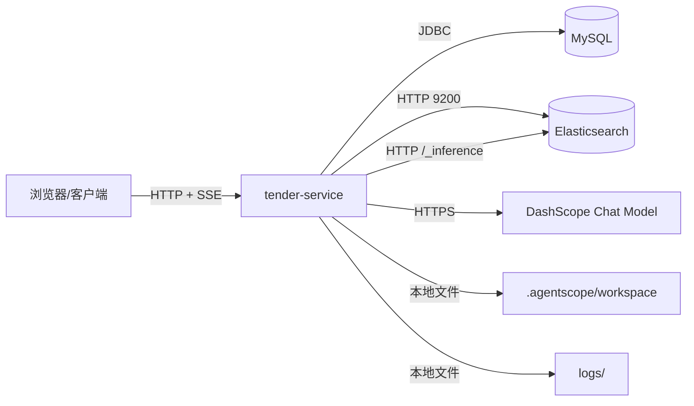
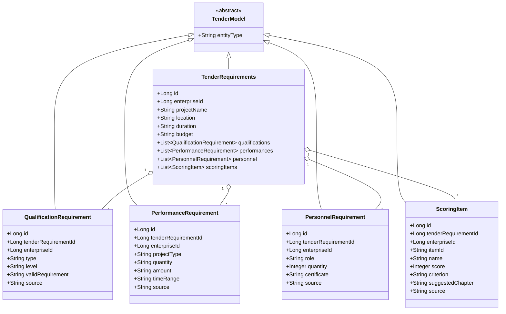
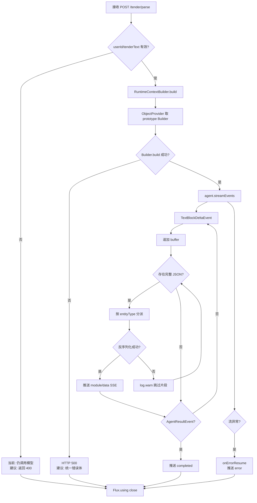
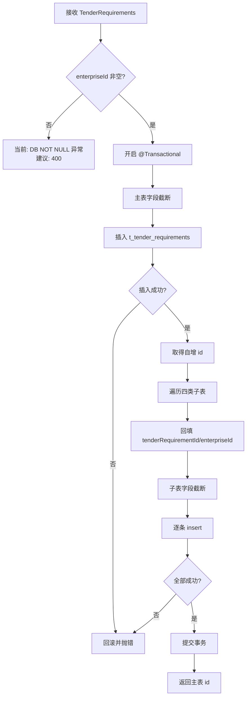
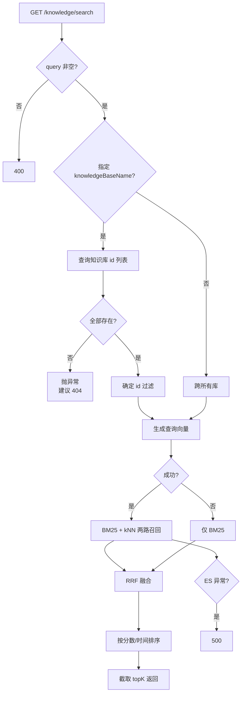
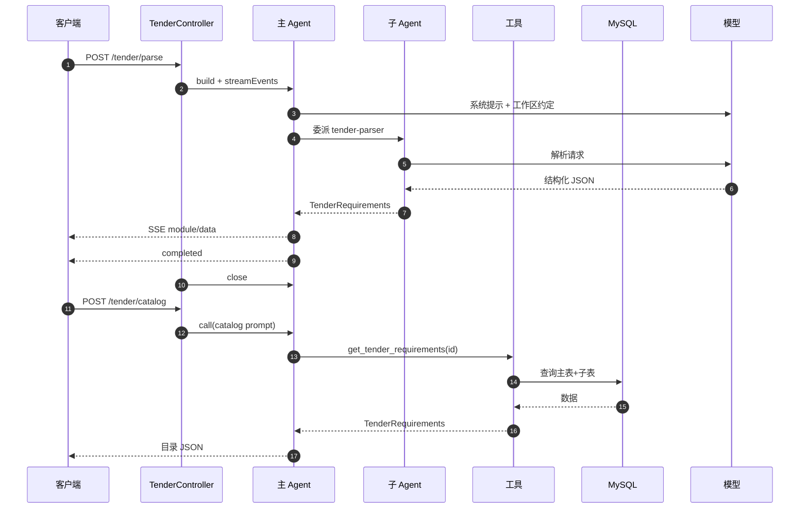
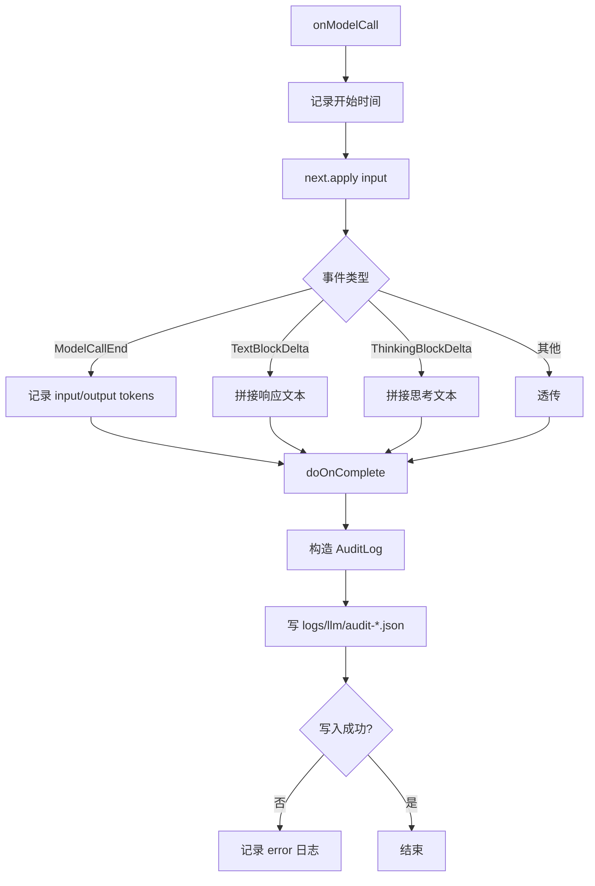
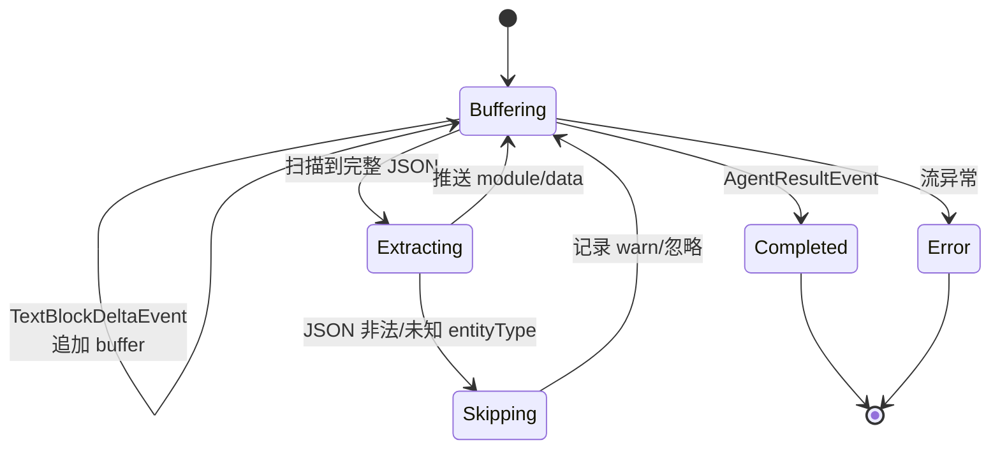
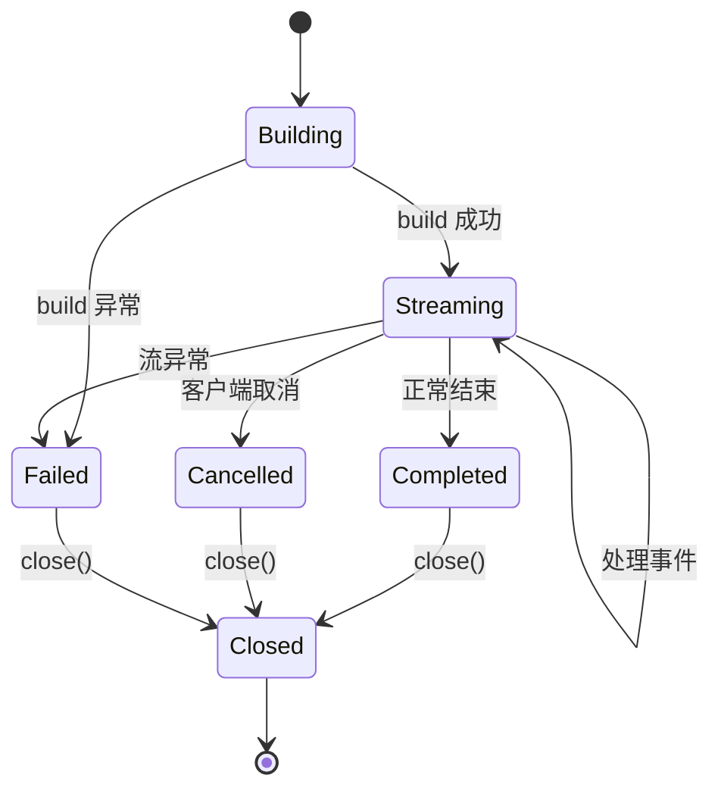
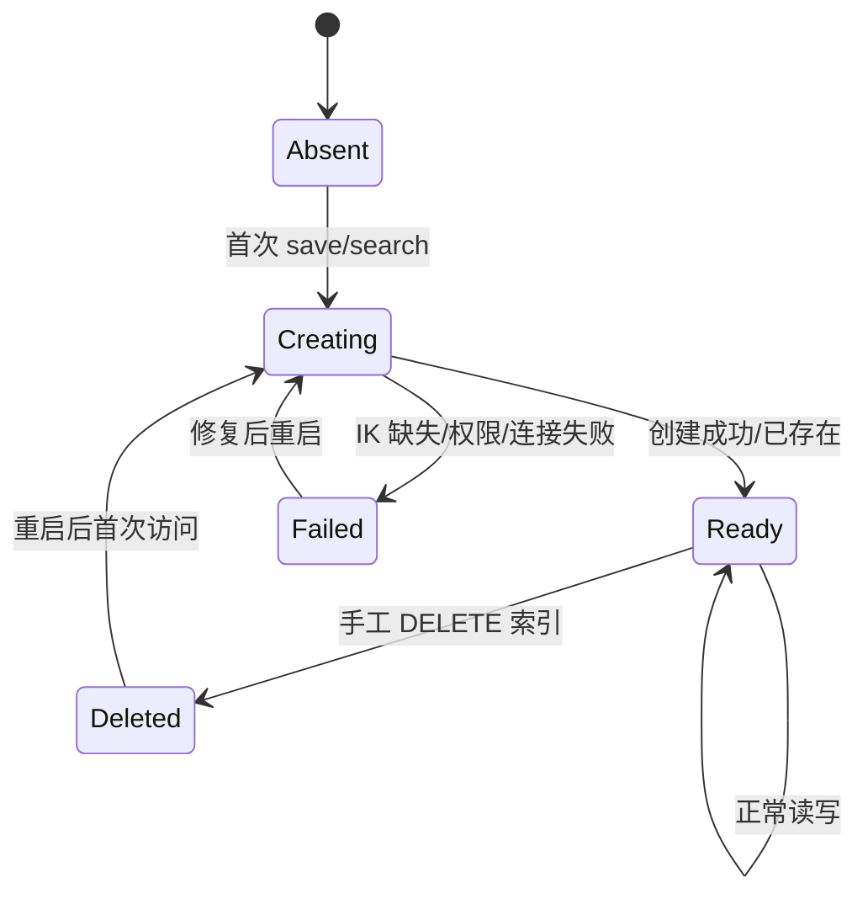

# tender-service 详细设计文档

| 项目 | 内容 |
|---|---|
| 项目名称 | tender-demo |
| 系统名称 | tender-service |
| 文档类型 | LLD 详细设计 |
| 目标受众 | 实现、联调、测试与维护本项目的开发者 |
| 文档版本 | v2.0（按 code-to-doc-generator 重新生成） |
| 编写日期 | 2026-10-28 |
| 代码基线 | 当前工作区源码快照（非 Git 仓库） |
| 技术栈 | Java 21、Spring Boot 4.1.1、WebFlux、AgentScope 2.0.4、MyBatis-Plus 3.5.17、MySQL、Elasticsearch 9.3.3 |

## 0. 文档说明

### 0.1 编写目的

本文档面向实现该系统的开发者，回答“具体怎么实现、接口是什么、数据结构是什么、异常如何处理”。文档以代码为唯一真相源，先描述已落地的实现，再给出必要的设计约束与改进建议。

### 0.2 范围与边界

覆盖以下模块：

| 编号 | 模块 | 说明 |
|---|---|---|
| M-01 | 招标解析 | 招标文本 → 结构化 SSE 事件 |
| M-02 | 招标要求持久化 | 解析结果确认、主表/子表入库 |
| M-03 | 投标编目与撰写 | 目录生成、章节撰写 |
| M-04 | Agent 运行时 | 主/子 Agent、工具、提示词、工作区 |
| M-05 | 知识库 | 文本写入、向量化、全文 + 向量混合检索 |
| M-06 | 审计与运维 | 模型调用审计、日志、配置、部署 |

不覆盖：PDF/Word 上传与 OCR、投标文件排版导出、完整用户/权限体系、电子签章。

### 0.3 标注约定

| 标注 | 含义 |
|---|---|
| `〔FACT｜文件:行号〕` | 可直接从代码验证的事实 |
| `〔INFER〕` | 基于框架行为、运行经验或架构判断的推断，需在目标环境复核 |
| “当前实现” | 代码已经具备的行为 |
| “建议” | 目标设计或改进项，不代表已实现 |

### 0.4 建议阅读顺序

1. 第 1 章了解系统位置与模块边界；
2. 第 2 章确认对外接口契约与错误码；
3. 第 3 章确认模型、表结构、枚举与配置；
4. 第 4 章按流程阅读实现逻辑与事务/并发注意点；
5. 第 5、6 章确认状态转换与异常路径；
6. 第 7 章确认性能边界，第 8 章确认已知问题。

---

## 1. 模块概述

### 1.1 系统定位

tender-service 是一个面向投标业务的后端服务：接收招标文件文本，调度大模型与专职子 Agent 完成结构化解析、目录生成和章节撰写，并将招标要求、知识库文档分别落到 MySQL 与 Elasticsearch。



证据：应用入口 `〔FACT｜src/main/java/org/example/TenderServiceApplication.java:7-12〕`；WebFlux/AgentScope/ES 依赖 `〔FACT｜pom.xml:32-99〕`。

### 1.2 职责边界

| 属于本服务 | 不属于本服务 |
|---|---|
| 招标文本结构化解析 | 招标文件上传、格式转换、OCR |
| 解析结果人工确认后入库 | 用户注册、登录、组织权限 |
| 投标目录生成 | 标书排版、页码、签章、加密 |
| 章节正文生成 | 企业资质/业绩数据的采集与审核 |
| 知识库写入与混合检索 | 知识库文档的审批流 |
| Agent 工具调用与审计 | 外部投标平台的递交接口 |

### 1.3 模块划分与代码位置

| 模块 | 代码位置 | 职责 | 关键类 |
|---|---|---|---|
| 接入层 | `controller` | HTTP 参数接收、SSE 返回、OpenAPI 注解 | `TenderController`、`KnowledgeBaseController` |
| 招标解析 | `service/TenderParseEventTransformer` | Agent 事件 → 结构化 SSE | `TenderParseEventTransformer` |
| 招标持久化 | `service`、`repo`、`mapper` | 主表 + 四张子表入库、查询、删除、字段归一化 | `TenderRequirementsService`、`TenderRequirementsRepository` |
| Agent 运行时 | `config`、`tools`、`middleware`、`prompts` | Agent 构建、工具注册、审计、提示词 | `TenderAgentConfig`、`TenderTools`、`EnterpriseDataTools`、`ModelCallAuditMiddleware` |
| 知识库 | `controller`、`service`、`repo`、`client` | 写入、向量化、BM25 + kNN + RRF | `KnowledgeBaseService`、`KnowledgeBaseRepository`、`EmbeddingClient` |
| 基础设施 | `config`、`resources` | ES 客户端、配置绑定、日志、工作区初始化 | `ElasticsearchConfig`、`KnowledgeBaseProperties`、`WorkspaceInitializer` |

证据：包结构与类职责见 `〔FACT｜src/main/java/org/example/controller/TenderController.java:29-137〕`、`〔FACT｜src/main/java/org/example/service/KnowledgeBaseService.java:23-160〕`、`〔FACT｜src/main/java/org/example/repo/KnowledgeBaseRepository.java:38-273〕`。

### 1.4 运行时依赖

| 依赖 | 用途 | 不可用影响 | 当前降级 |
|---|---|---|---|
| MySQL | 招标要求、知识库元数据 | 入库/目录工具/知识库元数据失败 | 无 |
| Elasticsearch | 知识库文档、全文/向量检索 | 知识库不可用 | 无；解析/目录/章节不受影响 |
| DashScope Chat Model | 解析、目录、章节 | LLM 相关接口失败 | SSE 推 `error` 或 HTTP 500 |
| ES Inference / DashScope Embedding | 文本向量化 | 写入失败；检索降级 | 查询降级为全文；写入不降级 |
| 本地磁盘 | Agent 工作区、日志、审计 | 启动或运行失败 | 无 |

### 1.5 关键设计决策

| 编号 | 决策 | 理由 | 代价 |
|---|---|---|---|
| D1 | WebFlux + SSE | 解析是单向流式输出，SSE 简单、易穿透代理 | 无双向通信；需处理代理超时 |
| D2 | AgentScope Harness + 工作区 Markdown | 行为约束与 Java 代码解耦，可版本化 | 工作区文件必须随制品发布 |
| D3 | Builder 声明为 prototype | 避免共享 hooks/middleware 状态 | 每请求构建开销 |
| D4 | 结构化数据存 MySQL，知识库存 ES | 事务/关联 vs 全文/向量各取所长 | 跨存储一致性需额外设计 |
| D5 | RRF 在应用侧融合 | ES 原生 RRF 需商业 License | 两次检索 + Java 合并 |
| D6 | 单 ES 索引 + `knowledgeBaseId` 过滤 | 降低多索引运维复杂度 | 维度/mapping 变更影响所有库 |
| D7 | `entityType` 判别异构 JSON | 模型可逐条输出，前端可逐条消费 | 依赖模型严格遵守格式 |

证据：Agent 装配 `〔FACT｜src/main/java/org/example/config/TenderAgentConfig.java:46-75〕`；RRF 实现 `〔FACT｜src/main/java/org/example/repo/KnowledgeBaseRepository.java:158-190〕`。

### 1.6 代码入口速查

| 入口 | 方法 | 证据 |
|---|---|---|
| 解析 | `TenderController#parseTender` | `〔FACT｜src/main/java/org/example/controller/TenderController.java:76-89〕` |
| 确认入库 | `TenderController#confirmTender` | `〔FACT｜src/main/java/org/example/controller/TenderController.java:94-99〕` |
| 目录生成 | `TenderController#generateCatalog` | `〔FACT｜src/main/java/org/example/controller/TenderController.java:101-116〕` |
| 章节撰写 | `TenderController#generateChapter` | `〔FACT｜src/main/java/org/example/controller/TenderController.java:118-137〕` |
| 知识库写入 | `KnowledgeBaseController#save` | `〔FACT｜src/main/java/org/example/controller/KnowledgeBaseController.java:49-56〕` |
| 知识库检索 | `KnowledgeBaseController#search` | `〔FACT｜src/main/java/org/example/controller/KnowledgeBaseController.java:72-87〕` |

---

## 2. 接口设计

### 2.1 接口总览

| 编号 | 方法 | 路径 | 用途 | 响应 |
|---|---|---|---|---|
| API-01 | POST | `/tender/parse` | 流式解析招标文件 | `text/event-stream` |
| API-02 | POST | `/tender/parse/confirm` | 确认解析结果并入库 | `Long` |
| API-03 | POST | `/tender/catalog` | 生成投标目录 | `String`（JSON 文本） |
| API-04 | POST | `/tender/chapter` | 撰写投标章节 | `String`（正文） |
| API-05 | POST | `/knowledge/{knowledgeBaseName}` | 批量写入知识库 | `Long` |
| API-06 | GET | `/knowledge/search` | 混合检索 | `List<KnowledgeSearchHit>` |

证据：`〔FACT｜src/main/java/org/example/controller/TenderController.java:26-28〕`、`〔FACT｜src/main/java/org/example/controller/KnowledgeBaseController.java:23-25〕`。

### 2.2 API-01 `POST /tender/parse`

**用途**：接收招标文件纯文本，返回结构化 SSE 事件流。

**输入参数**

| 参数 | 类型 | 必填 | 说明 | 约束 |
|---|---|---|---|---|
| `userId` | String | 否 | 用户 ID，用于工作区记忆隔离 | 可为空；为空时记忆归属不明确 |
| `tenderText` | String | 业务必填 | 招标文件原始文本 | 当前无 `@NotBlank`，为空仍会调用模型 |

**输出**

| 事件 | 数据结构 | 说明 |
|---|---|---|
| `project` | `TenderRequirements` | 项目概况 |
| `qualification` | `QualificationRequirement` | 资质要求，可多条 |
| `performance` | `PerformanceRequirement` | 业绩要求，可多条 |
| `personnel` | `PersonnelRequirement` | 人员要求，可多条 |
| `scoringItem` | `ScoringItem` | 评分点，可多条 |
| `error` | `{message}` | 解析失败，终止信号 |
| `completed` | `{}` | 正常结束，终止信号 |

**错误码**

| 错误码 | HTTP/通道 | 触发条件 | 调用方处理建议 |
|---|---|---|---|
| `PARAM_TENDER_TEXT_REQUIRED` | 400（建议） | `tenderText` 为空 | 提示用户输入文本 |
| `AGENT_MODEL_TIMEOUT` | SSE `error`（建议） | 模型超时 | 提示重试；保留已收到的事件 |
| `AGENT_STREAM_FAILED` | SSE `error` | Agent 流异常 | 记录 `message`，允许重试 |
| `PARSE_NO_STRUCTURED_OUTPUT` | SSE `error`（建议） | 流结束但无任何结构化对象 | 提示检查文本或重试 |

当前实现没有统一错误码，参数错误也不会返回 400；上表是建议契约。证据：`〔FACT｜src/main/java/org/example/controller/TenderController.java:76-89〕`、`〔FACT｜src/main/java/org/example/service/TenderParseEventTransformer.java:54-74〕`。

**关键实现**

1. `RuntimeContextBuilder.build(userId)` 生成上下文，`sessionId` 固定为 `session-<当前毫秒>`；请求中的会话信息不会被使用。`〔FACT｜src/main/java/org/example/service/RuntimeContextBuilder.java:10-15〕`
2. 每次请求通过 `ObjectProvider` 取 prototype Builder 并 `build()`。`〔FACT｜src/main/java/org/example/controller/TenderController.java:82-88〕`
3. `agent.streamEvents(prompt, ctx)` 产生 `Flux<AgentEvent>`，由 `TenderParseEventTransformer.toSse` 转换。`〔FACT｜src/main/java/org/example/service/TenderParseEventTransformer.java:54-74〕`
4. `Flux.using` 在终止/取消/异常时关闭 Agent。`〔FACT｜src/main/java/org/example/controller/TenderController.java:84-88〕`

**调用示例**

```http
POST /tender/parse
Content-Type: application/json
Accept: text/event-stream
```

```json
{
  "userId": "user-001",
  "tenderText": "项目名称：区域智慧交通大数据平台建设项目招标公告……"
}
```

> 调用方必须按 SSE 规范消费 `data:` 行，并把 `completed` 或 `error` 视为终止信号。当前映射未显式声明 `produces`，若不带 `Accept: text/event-stream`，WebFlux 可能按 JSON 流返回〔INFER〕。

### 2.3 API-02 `POST /tender/parse/confirm`

**用途**：将用户确认后的结构化要求写入数据库，返回主表自增 ID。

**输入参数**

| 参数 | 类型 | 必填 | 说明 | 约束 |
|---|---|---|---|---|
| `enterpriseId` | Long | 是（DDL 非空） | 企业 ID | 当前请求未强制校验 |
| `projectName` | String | 否 | 项目名称 | 最大 255，超长截断 |
| `location` | String | 否 | 建设地点 | 最大 255 |
| `duration` | String | 否 | 工期 | 最大 64 |
| `budget` | String | 否 | 预算/报价上限 | 最大 128 |
| `qualifications` | List | 否 | 资质要求 | 空则跳过 |
| `performances` | List | 否 | 业绩要求 | 空则跳过 |
| `personnel` | List | 否 | 人员要求 | 空则跳过 |
| `scoringItems` | List | 否 | 评分点 | 空则跳过 |

**输出**：`Long`，主表 `t_tender_requirements.id`。

**错误码**

| 错误码 | HTTP | 触发条件 | 调用方处理建议 |
|---|---|---|---|
| `PARAM_ENTERPRISE_ID_REQUIRED` | 400（建议） | `enterpriseId` 为空 | 从登录上下文补齐 |
| `PARAM_FIELD_TOO_LONG` | 400/200（建议告警） | 字段超长 | 当前自动截断，建议提示 |
| `TENDER_SAVE_FAILED` | 500 | 主表/子表写入失败 | 事务回滚；提示重试 |

**事务与并发**

- `TenderRequirementsService.save` 标注 `@Transactional`；主表 + 四张子表在同一事务内。`〔FACT｜src/main/java/org/example/service/TenderRequirementsService.java:20-24〕`
- 子表插入前统一回填 `tenderRequirementId` 和 `enterpriseId`；字段按列宽截断。`〔FACT｜src/main/java/org/example/repo/TenderRequirementsRepository.java:43-52〕`、`〔FACT｜src/main/java/org/example/repo/TenderRequirementsRepository.java:150-218〕`
- 当前只支持新增，不支持按 ID 更新；重复确认会产生新记录。

### 2.4 API-03 `POST /tender/catalog`

**用途**：根据招标要求 ID 生成投标目录。

**输入参数**

| 参数 | 类型 | 必填 | 说明 | 约束 |
|---|---|---|---|---|
| `userId` | String | 否 | 用户 ID | 用于工作区上下文 |
| `tenderRequirementId` | Long | 是（业务） | 招标要求主键 | 当前未校验存在性；为空时提示词中为 `null` |

**输出**：`String`，目录 JSON 文本。单套目录包含 `catalog[]`、`structure_decision`、`gaps[]`；商务/技术分列时使用 `business_catalog[]`、`technical_catalog[]`。

**错误码**

| 错误码 | HTTP | 触发条件 | 调用方处理建议 |
|---|---|---|---|
| `PARAM_TENDER_REQUIREMENT_ID_REQUIRED` | 400（建议） | ID 为空 | 先完成解析并入库 |
| `TENDER_REQUIREMENT_NOT_FOUND` | 404（建议） | ID 不存在 | 提示重新解析 |
| `AGENT_CATALOG_FAILED` | 500 | 模型调用失败 | 重试或降级人工编目 |
| `CATALOG_INVALID_JSON` | 200/422（建议） | 模型输出非合法 JSON | 前端做容错并提示重新生成 |

**关键实现**

1. `CatalogPromptProvider` 读取 `classpath:prompts/catalog-generation.md`，替换 `{{id}}`。`〔FACT｜src/main/java/org/example/prompts/CatalogPromptProvider.java:15-21〕`
2. `agent.call(new UserMessage(prompt), ctx)` 返回 `Mono<Msg>`，取 `getTextContent()`。`〔FACT｜src/main/java/org/example/controller/TenderController.java:101-116〕`
3. 目录规则要求每个评分点至少映射一个条目，`scoring_item_ids` 原样引用 `t_scoring_item.item_id`。证据：`〔FACT｜src/main/resources/prompts/catalog-generation.md:30-65〕`

**调用示例**

```json
{
  "userId": "user-001",
  "tenderRequirementId": 1
}
```

响应是字符串而非对象，客户端需要二次 `JSON.parse`。建议后续改为结构化 DTO。

---
### 2.5 API-04 `POST /tender/chapter`

**用途**：根据章节标题和关联评分点撰写章节正文。

**输入参数**

| 参数 | 类型 | 必填 | 说明 | 约束 |
|---|---|---|---|---|
| `userId` | String | 否 | 用户 ID | 用于工作区上下文 |
| `sessionId` | String | 否 | 会话 ID | **当前未使用**，服务端仍生成新会话 |
| `chapterTitle` | String | 是（业务） | 章节标题 | 当前未校验 |
| `scoringPointIds` | String | 否 | 评分点 ID 集合，逗号分隔 | 当前只做字符串拼接，不查询详情 |

**输出**：`String`，章节正文纯文本。

**错误码**

| 错误码 | HTTP | 触发条件 | 调用方处理建议 |
|---|---|---|---|
| `PARAM_CHAPTER_TITLE_REQUIRED` | 400（建议） | 标题为空 | 提示选择章节 |
| `AGENT_CHAPTER_FAILED` | 500 | 模型调用失败 | 重试；保留已生成草稿 |
| `CHAPTER_DATA_NOT_FOUND` | 200（建议标记） | 企业数据查询为空 | 提示“该数据暂未在系统中找到” |

**关键实现**

- 用户消息格式：`撰写章节“<chapterTitle>”，对应评分点：<scoringPointIds>`。`〔FACT｜src/main/java/org/example/controller/TenderController.java:121-136〕`
- `chapter-writer` 子 Agent 声明可用工具 `query_qualifications`、`query_performances`、`query_personnel`。`〔FACT｜src/main/resources/agentscope-workspace/subagents/chapter-writer.md:1-35〕`
- 章节结构约定：评分点解读 → 满足情况阐述 → 支撑材料引用。

### 2.6 API-05 `POST /knowledge/{knowledgeBaseName}`

**用途**：把一组文本写入指定知识库，写入时同步生成向量。

**输入参数**

| 参数 | 位置 | 类型 | 必填 | 说明 | 约束 |
|---|---|---|---|---|---|
| `knowledgeBaseName` | path | String | 是 | 知识库名称 | 空名称由 Service 抛异常 |
| `contents` | body | `List<String>` | 是 | 文本数组 | 空白项过滤；空数组只创建知识库 |

**输出**：`Long`，知识库主键 ID。

**错误码**

| 错误码 | HTTP | 触发条件 | 调用方处理建议 |
|---|---|---|---|
| `KB_NAME_REQUIRED` | 400（建议） | 路径名称为空 | 提示输入名称 |
| `KB_EMBEDDING_FAILED` | 500 | 向量化失败 | 可改为只存文本后补向量 |
| `KB_ES_WRITE_FAILED` | 500 | Bulk 写入失败 | 检查 ES；重试 |
| `KB_CREATE_CONFLICT` | 409（建议） | 并发创建同名库 | 重新查询后复用 |

**关键实现**

1. `saveAll` 过滤空白文本、`trim`，查询/创建 `t_knowledge_base`。`〔FACT｜src/main/java/org/example/service/KnowledgeBaseService.java:47-98〕`
2. 启用向量化时批量 `embedDocuments`，为每条文本生成 UUID 与 `KnowledgeDocument`。`〔FACT｜src/main/java/org/example/service/KnowledgeBaseService.java:69-86〕`
3. ES Bulk 每批 500 条，`Refresh.WaitFor` 保证写入后立即可查。`〔FACT｜src/main/java/org/example/repo/KnowledgeBaseRepository.java:62-72〕`、`〔FACT｜src/main/java/org/example/repo/KnowledgeBaseRepository.java:192-216〕`
4. 写入后更新 `document_count` 与 `updated_at`；计数为读改写，非原子。`〔FACT｜src/main/java/org/example/service/KnowledgeBaseService.java:90-93〕`

**请求示例**

```http
POST /knowledge/tender-docs
Content-Type: application/json
```

```json
[
  "投标人须具有独立法人资格，具备有效的营业执照。",
  "投标保证金金额为人民币五万元整。"
]
```

### 2.7 API-06 `GET /knowledge/search`

**用途**：全文检索 + 向量检索，RRF 融合后返回最相关文档。

**输入参数**

| 参数 | 位置 | 类型 | 必填 | 默认 | 说明 |
|---|---|---|---|---|---|
| `knowledgeBaseName` | query | String[] | 否 | 全部库 | 可重复传入多个 |
| `query` | query | String | 是 | - | 空白返回 400 |
| `topK` | query | int | 否 | 10 | `<=0` 用 10，最大 50 |

**输出**：`List<KnowledgeSearchHit>`，字段 `id`、`content`、`createdAt`、`score`。`score` 是 RRF 融合分，仅用于相对排序。

**错误码**

| 错误码 | HTTP | 触发条件 | 调用方处理建议 |
|---|---|---|---|
| `PARAM_QUERY_REQUIRED` | 400 | `query` 为空 | 提示输入查询 |
| `KB_NOT_FOUND` | 404（建议） | 指定名称不存在 | 检查名称或改为跨库 |
| `KB_ES_UNAVAILABLE` | 500 | ES 不可达 | 提示稍后重试；记录 traceId |

**关键实现**

- 名称列表先查 `t_knowledge_base`，得到 ID 列表；有任一名称不存在即抛异常。`〔FACT｜src/main/java/org/example/service/KnowledgeBaseService.java:105-122〕`
- 查询向量失败时捕获 `EmbeddingException`，降级为纯全文检索。`〔FACT｜src/main/java/org/example/service/KnowledgeBaseService.java:126-135〕`
- 两路候选数 `max(50, topK)`；RRF `1/(60+rank)`；按分数、创建时间降序截取。`〔FACT｜src/main/java/org/example/repo/KnowledgeBaseRepository.java:82-95〕`、`〔FACT｜src/main/java/org/example/repo/KnowledgeBaseRepository.java:158-190〕`

### 2.8 通用错误模型

当前没有统一错误响应。建议统一为：

```json
{
  "code": "KB_NOT_FOUND",
  "message": "知识库不存在: tender-docs",
  "traceId": "b7c2f0d1e4a94f7c",
  "timestamp": "2026-10-28T10:15:30+08:00"
}
```

建议错误码分类：

| 前缀 | 含义 | 示例 |
|---|---|---|
| `PARAM_` | 参数校验 | `PARAM_TENDER_TEXT_REQUIRED` |
| `TENDER_` | 招标业务 | `TENDER_REQUIREMENT_NOT_FOUND` |
| `AGENT_` | 智能体调用 | `AGENT_MODEL_TIMEOUT` |
| `KB_` | 知识库 | `KB_NOT_FOUND`、`KB_ES_UNAVAILABLE` |
| `SYS_` | 系统 | `SYS_INTERNAL_ERROR` |

> 当前实现中，`IllegalArgumentException`、ES 异常等多以 500 返回；`ResponseStatusException` 仅在空 `query` 时使用。证据：`〔FACT｜src/main/java/org/example/controller/KnowledgeBaseController.java:81-83〕`。

### 2.9 SSE 协议细节

| 项 | 当前实现 | 建议 |
|---|---|---|
| 媒体类型 | 依赖内容协商；未显式 `produces` | 固定 `text/event-stream` |
| 事件格式 | `data: <json>` + 空行 | 保持 |
| 终止信号 | `completed` / `error` | 保持，并定义客户端错误处理 |
| 心跳 | 无 | 周期性 `: ping` |
| 重连 | 无 `id` / `retry` | 增加事件 ID 与重试间隔 |
| 超时 | 服务端未设置 | 设置最大时长与取消策略 |
| 断线 | `Flux.using` 取消并关闭 Agent | 保持，记录日志 |

### 2.10 OpenAPI 与调试

- 依赖 `springdoc-openapi-starter-webflux-ui`，默认 `/v3/api-docs`、`/swagger-ui.html`。
- `TenderController`、`KnowledgeBaseController` 使用 `@Tag`、`@Operation`、`@Parameter`、`@Schema`。
- 注意：`/tender/parse` 的 `@Operation` 描述提到 `sessionId`，但 `TenderRequest` 没有该字段。`〔FACT｜src/main/java/org/example/controller/TenderController.java:49-75〕`、`〔FACT｜src/main/java/org/example/model/req/TenderRequest.java:7-15〕`

---

## 3. 数据结构

### 3.1 核心类图



证据：`〔FACT｜src/main/java/org/example/model/require/TenderModel.java:8-14〕`、`〔FACT｜src/main/java/org/example/model/require/TenderRequirements.java:19-57〕`、四个子类实体。

### 3.2 招标解析模型字段

**TenderRequirements（主表）**

| 字段 | 类型 | 数据库列 | 约束/说明 |
|---|---|---|---|
| `id` | Long | `id` | 自增主键 |
| `enterpriseId` | Long | `enterprise_id` | DDL `NOT NULL` |
| `projectName` | String | `project_name` | VARCHAR(255) |
| `location` | String | `location` | VARCHAR(255) |
| `duration` | String | `duration` | VARCHAR(64) |
| `budget` | String | `budget` | VARCHAR(128) |
| `qualifications` | List | - | `@TableField(exist=false)` |
| `performances` | List | - | `@TableField(exist=false)` |
| `personnel` | List | - | `@TableField(exist=false)` |
| `scoringItems` | List | - | `@TableField(exist=false)` |
| `entityType` | String | - | 判别字段，不落库 |

**子表模型**

| 模型 | 关键字段 |
|---|---|
| `QualificationRequirement` | `type`、`level`、`validRequirement`、`source`、`tenderRequirementId`、`enterpriseId` |
| `PerformanceRequirement` | `projectType`、`quantity`、`amount`、`timeRange`、`source`、`tenderRequirementId`、`enterpriseId` |
| `PersonnelRequirement` | `role`、`quantity`、`certificate`、`source`、`tenderRequirementId`、`enterpriseId` |
| `ScoringItem` | `itemId`、`name`、`score`、`criterion`、`suggestedChapter`、`source`、`tenderRequirementId`、`enterpriseId` |

### 3.3 知识库模型

| 模型 | 用途 | 关键字段 |
|---|---|---|
| `KnowledgeBase` | MySQL 元数据 | `id`、`name`、`documentCount`、`embeddingDimension`、`embeddingEnabled`、`embeddingModel`、`createdAt`、`updatedAt`、`deleted` |
| `KnowledgeDocument` | ES 文档 | `id`、`knowledgeBaseId`、`content`、`createdAt`、`embedding` |
| `KnowledgeSearchHit` | 检索结果 | `id`、`content`、`createdAt`、`score` |

### 3.4 枚举与常量

**ParseModule**

| 枚举 | 序列化值 | 含义 |
|---|---|---|
| `PROJECT` | `project` | 项目概况 |
| `QUALIFICATION` | `qualification` | 资质要求 |
| `PERFORMANCE` | `performance` | 业绩要求 |
| `PERSONNEL` | `personnel` | 人员要求 |
| `SCORING_ITEM` | `scoringItem` | 评分点 |
| `ERROR` | `error` | 错误 |
| `COMPLETED` | `completed` | 完成 |

**关键常量**

| 常量 | 值 | 位置/含义 |
|---|---|---|
| `DEFAULT_TOP_K` | 10 | 知识库默认返回条数 |
| `MAX_TOP_K` | 50 | 知识库最大返回条数 |
| `BULK_BATCH_SIZE` | 500 | ES Bulk 每批文档数 |
| `MIN_CANDIDATE_SIZE` | 50 | 每路召回候选下限 |
| `RRF_RANK_CONSTANT` | 60 | RRF 平滑常数 |
| `MAX_BATCH_SIZE` | 10 | DashScope embedding 单次上限 |

证据：`〔FACT｜src/main/java/org/example/model/resp/ParseModule.java:13-40〕`、`〔FACT｜src/main/java/org/example/service/KnowledgeBaseService.java:25-27〕`、`〔FACT｜src/main/java/org/example/repo/KnowledgeBaseRepository.java:41-47〕`、`〔FACT｜src/main/java/org/example/client/DashScopeEmbeddingClient.java:31-33〕`。

### 3.5 数据库表结构

| 表 | 用途 | 关键约束 |
|---|---|---|
| `t_tender_requirements` | 招标要求主表 | PK `id`；`enterprise_id NOT NULL`；索引 `enterprise_id` |
| `t_qualification_requirement` | 资质要求 | PK `id`；索引 `tender_requirement_id`；无物理外键 |
| `t_performance_requirement` | 业绩要求 | 同上 |
| `t_personnel_requirement` | 人员要求 | 同上 |
| `t_scoring_item` | 评分点 | 同上；`item_id` 无唯一约束 |
| `t_knowledge_base` | 知识库元数据 | PK `id`；唯一键 `(name, deleted)` |
| `t_qualification` | 企业资质 | 实体存在，**源码无 DDL** |
| `t_project_performance` | 企业业绩 | 实体存在，**源码无 DDL** |
| `t_personnel` | 企业人员 | 实体存在，**源码无 DDL** |

证据：`〔FACT｜src/main/db/tender_requirements.sql:1-66〕`、`〔FACT｜src/main/db/knowledge_base.sql:1-13〕`。

### 3.6 Elasticsearch 索引

索引名：`knowledge-base.index-name`，默认 `knowledge_base`。

| 字段 | 类型 | 参数 | 用途 |
|---|---|---|---|
| `id` | keyword | - | 文档 ID |
| `knowledgeBaseId` | long | - | 知识库过滤 |
| `content` | text | `ik_max_word` / `ik_smart` | 全文检索 |
| `createdAt` | date | `epoch_millis` | 排序 |
| `embedding` | dense_vector | `dims=配置维度`、`cosine` | 向量检索 |

证据：`〔FACT｜src/main/java/org/example/repo/KnowledgeBaseRepository.java:248-273〕`。

### 3.7 配置结构

| 配置前缀 | 绑定类 | 关键字段 |
|---|---|---|
| `knowledge-base` | `KnowledgeBaseProperties` | `indexName`、`es`、`embedding` |
| `agentscope` | `@Value` | `workspace-path`、`model`、`api-key` |
| `llm` | `@Value` | `log-path` |
| `spring.datasource` | Spring Boot | MySQL 连接 |

证据：`〔FACT｜src/main/java/org/example/config/KnowledgeBaseProperties.java:20-79〕`、`〔FACT｜src/main/resources/application.yml:20-49〕`。

---
## 4. 核心流程

### 4.1 招标文件解析流程



**关键步骤**

1. 构造上下文：`userId` 可为空，`sessionId` 每次新生成。`〔FACT｜src/main/java/org/example/service/RuntimeContextBuilder.java:10-15〕`
2. 每次请求独立构建 Agent，避免共享 Builder 状态。`〔FACT｜src/main/java/org/example/config/TenderAgentConfig.java:46-75〕`
3. 模型增量文本进入缓冲区，由 `takeFirstCompleteJson` 做字符串感知的大括号配对。`〔FACT｜src/main/java/org/example/service/TenderParseEventTransformer.java:111-151〕`
4. 每个完整对象按 `entityType` 查 `DISPATCH_MAP`，转成具体模型并推送。`〔FACT｜src/main/java/org/example/service/TenderParseEventTransformer.java:36-42〕`
5. `AgentResultEvent` 推送 `completed`；异常推送 `error`。`〔FACT｜src/main/java/org/example/service/TenderParseEventTransformer.java:59-72〕`

**并发与资源**

- 每个订阅独立缓冲区（`Flux.defer`），不会跨请求共享。`〔FACT｜src/main/java/org/example/service/TenderParseEventTransformer.java:55-57〕`
- `concatMap` 保证事件顺序，避免并发写 buffer。
- `Flux.using` 在完成、取消、异常时关闭 Agent，防止资源泄漏。`〔FACT｜src/main/java/org/example/controller/TenderController.java:84-88〕`

**异常路径**

| 场景 | 当前处理 | 风险 |
|---|---|---|
| JSON 不完整 | 留在 buffer，流结束丢弃 | 用户可能只收到 `completed` |
| JSON 非法 | `warn` 跳过 | 结构化结果缺失 |
| 未知 `entityType` | 忽略 | 新类型不会推送 |
| 未知字段 | `convertValue` 可能失败 | 整个对象被跳过〔INFER〕 |
| 模型超时 | 由 `onErrorResume` 转 `error` | 错误信息可能过于内部化 |
| 客户端断开 | 取消订阅并关闭 Agent | 无断点续传 |

### 4.2 确认入库流程



**关键步骤**

- 主表插入后拿到自增 ID，再写四张子表。`〔FACT｜src/main/java/org/example/repo/TenderRequirementsRepository.java:43-52〕`
- 截断常量与 DDL 列宽对齐，避免 `Data too long`。`〔FACT｜src/main/java/org/example/repo/TenderRequirementsRepository.java:150-218〕`
- 子表 `tenderRequirementId`、`enterpriseId` 由父对象覆盖，保证关联一致。`〔FACT｜src/main/java/org/example/repo/TenderRequirementsRepository.java:80-126〕`

**事务与并发**

| 入口 | 事务 | 说明 |
|---|---|---|
| `/tender/parse/confirm` | 有 | Service `@Transactional` |
| Agent `save_tender_requirements` | 无 | 直接调用 Repository，可能部分写入 |
| 删除 | 无 | `deleteById` 先删子表再删主表，工具调用无事务 |

> 建议：Agent 写操作改为调用带事务的 Service，或把 Repository 的 `save/delete` 标注事务边界。

### 4.3 目录生成流程

```mermaid
flowchart TD
    A[接收 CatalogRequest] --> B{tenderRequirementId 非空?}
    B -- 否 --> B1[当前: 提示词 id=null<br/>建议: 400]
    B -- 是 --> C[读取 catalog-generation.md]
    C --> D[替换 {{id}}]
    D --> E[构建 Agent]
    E --> F[agent.call]
    F --> G{模型调用成功?}
    G -- 否 --> G1[500 或重试]
    G -- 是 --> H{是否调用 get_tender_requirements?}
    H -- 是 --> I[查询主表+子表]
    H -- 否 --> J[模型直接生成<br/>可能缺数据]
    I --> K[生成目录 JSON]
    J --> K
    K --> L{JSON 合法?}
    L -- 是 --> M[返回文本]
    L -- 否 --> N[客户端解析失败<br/>建议: 服务端校验]
```

**关键规则**

| 规则 | 说明 |
|---|---|
| 评分点覆盖 | 每个评分点至少映射一个目录条目 |
| ID 原样引用 | `scoring_item_ids` 引用 `t_scoring_item.item_id`，不得重编号 |
| 结构判断 | 商务/技术分列或合并，需给出 `structure_decision` |
| 缺口 | 数据缺失写入 `gaps`，不得虚构 |
| 输出纯度 | 除 JSON 外不输出解释性文字 |

证据：`〔FACT｜src/main/resources/prompts/catalog-generation.md:21-95〕`。

**已知风险**

- 目录提示词要求调用 `get_tender_requirements`，但 `catalog-builder` 子 Agent 的工具声明只有 `read_file`、`grep_files`；实际能否调用取决于主 Agent 调度。`〔FACT｜.agentscope/workspace/subagents/catalog-builder.md:1-23〕`（运行时工作区文件，未随 classpath 发布）
- `CatalogPromptProvider` 用 `resource.getFile()`，JAR 部署会失败。`〔FACT｜src/main/java/org/example/prompts/CatalogPromptProvider.java:15-17〕`
- 解析提示词未要求输出 `scoringItem.itemId`，目录映射可能得到 `[null]`。`〔FACT｜src/main/resources/agentscope-workspace/subagents/tender-parser.md:34-40〕`

### 4.4 章节撰写流程

```mermaid
flowchart TD
    A[接收 ChapterRequest] --> B{chapterTitle 非空?}
    B -- 否 --> B1[当前: 生成 "null" 章节<br/>建议: 400]
    B -- 是 --> C[构建上下文/Agent]
    C --> D[拼接章节与评分点提示]
    D --> E[agent.call]
    E --> F{需要企业数据?}
    F -- 是 --> G[query_qualifications/performances/personnel]
    G --> H{查询有结果?}
    H -- 是 --> I[引用结果撰写]
    H -- 否 --> J[写明"暂未在系统中找到"]
    F -- 否 --> K[直接撰写]
    I --> L[返回章节正文]
    J --> L
    K --> L
    E --> M{模型异常?}
    M -- 是 --> M1[500 或提示重试]
```

**关键约束**

| 约束 | 落地方式 |
|---|---|
| 章节结构 | 评分点解读 → 满足情况 → 支撑材料 |
| 企业数据 | 必须通过工具查询，禁止编造 |
| 空结果 | 如实说明，不推测 |
| 关键数字 | 必须能追溯到原文或工具结果 |
| 自查 | 覆盖评分点、数据来源、数字出处 |

证据：`〔FACT｜src/main/resources/agentscope-workspace/subagents/chapter-writer.md:11-35〕`、`〔FACT｜src/main/java/org/example/controller/TenderController.java:121-136〕`。

### 4.5 知识库写入流程

```mermaid
flowchart TD
    A[POST /knowledge/{name}] --> B[过滤空白/trim]
    B --> C[查询知识库]
    C --> D{存在?}
    D -- 否 --> E[插入 t_knowledge_base]
    D -- 是 --> F[复用记录]
    E --> G[批量生成向量]
    F --> G
    G --> H{向量化成功?}
    H -- 否 --> H1[抛错<br/>MySQL 事务回滚]
    H -- 是 --> I[组装 KnowledgeDocument]
    I --> J[按 500 条 Bulk 写 ES]
    J --> K{写入成功?}
    K -- 否 --> K1[抛错<br/>ES 已写入部分无法回滚]
    K -- 是 --> L[更新 document_count/updated_at]
    L --> M[返回知识库 id]
```

**关键步骤**

- 空白文本过滤，空列表只创建/返回知识库。`〔FACT｜src/main/java/org/example/service/KnowledgeBaseService.java:48-67〕`
- 向量生成在 ES 写入前，失败则不会写 ES。`〔FACT｜src/main/java/org/example/service/KnowledgeBaseService.java:69-86〕`
- Bulk 使用 `Refresh.WaitFor`，保证写入后立即可查。`〔FACT｜src/main/java/org/example/repo/KnowledgeBaseRepository.java:192-216〕`
- `documentCount` 为读改写，不是原子自增。`〔FACT｜src/main/java/org/example/service/KnowledgeBaseService.java:90-93〕`

**事务与一致性**

| 操作 | 事务范围 | 风险 |
|---|---|---|
| MySQL 元数据 | `@Transactional` | 可回滚 |
| ES 文档 | 外部系统 | 不可随 MySQL 回滚 |
| 计数更新 | 同一 MySQL 事务 | 并发丢失更新 |
| 知识库创建 | 先查后插 | 并发唯一键冲突 |

### 4.6 知识库检索流程



**关键参数**

| 参数 | 值 |
|---|---|
| 候选数 | `max(50, topK)` |
| 向量 k | `candidateSize` |
| numCandidates | `max(candidateSize*2, 100)` |
| RRF k | 60 |
| topK 上限 | 50 |

证据：`〔FACT｜src/main/java/org/example/repo/KnowledgeBaseRepository.java:82-95〕`、`〔FACT｜src/main/java/org/example/repo/KnowledgeBaseRepository.java:97-190〕`。

### 4.7 Agent 调度流程



**调度规则**

| 规则 | 来源 |
|---|---|
| 第一步永远是 `tender-parser` | `AGENTS.md` |
| 解析结果不完整让解析 Agent 补全 | `AGENTS.md` |
| 用户确认后才入库 | `AGENTS.md`、`tender-parser.md` |
| 目录生成委派 `catalog-builder` | `AGENTS.md` |
| 逐章委派 `chapter-writer` | `AGENTS.md` |
| 每章对照评分点自查 | `AGENTS.md` |

证据：`〔FACT｜src/main/resources/agentscope-workspace/AGENTS.md:1-25〕`。

### 4.8 模型调用审计流程



**审计字段**

| 字段 | 说明 |
|---|---|
| `timestamp` | 东八区时间 |
| `model` | 模型名 |
| `prompt` | 消息列表（SYSTEM/USER/TOOL） |
| `thinkingText` | 思考文本 |
| `responseText` | 响应文本 |
| `inputTokens` / `outputTokens` | Token 用量 |
| `durationMs` | 耗时 |

证据：`〔FACT｜src/main/java/org/example/middleware/ModelCallAuditMiddleware.java:68-113〕`、`〔FACT｜src/main/java/org/example/middleware/ModelCallAuditMiddleware.java:183-203〕`。

---
## 5. 状态机

### 5.1 SSE 解析流状态机



| 状态 | 进入条件 | 行为 | 退出条件 |
|---|---|---|---|
| `Buffering` | 订阅开始 | 累积文本，持续扫描 | 发现完整 JSON / 完成 / 异常 |
| `Extracting` | 找到配对的大括号 | 反序列化、分派、推送 | 成功后回到 Buffering |
| `Skipping` | JSON 非法或 `entityType` 未知 | 记录日志并丢弃片段 | 回到 Buffering |
| `Completed` | 收到 `AgentResultEvent` | 推送 `completed` | 流结束 |
| `Error` | 上游异常 | 推送 `error` | 流结束 |

**转换触发条件**

1. `TextBlockDeltaEvent` 追加到 buffer；`takeFirstCompleteJson` 返回非空时进入 `Extracting`。`〔FACT｜src/main/java/org/example/service/TenderParseEventTransformer.java:59-62〕`
2. `mapper.readTree` 或 `convertValue` 失败时进入 `Skipping`；`catch` 后继续循环。`〔FACT｜src/main/java/org/example/service/TenderParseEventTransformer.java:79-93〕`
3. `AgentResultEvent` 触发 `completed`。`〔FACT｜src/main/java/org/example/service/TenderParseEventTransformer.java:63-66〕`
4. 任意异常触发 `onErrorResume`，推送 `error`。`〔FACT｜src/main/java/org/example/service/TenderParseEventTransformer.java:69-72〕`

**边界**：流结束时 buffer 中未闭合的 JSON 不会进入任何状态，也不会产生事件；这是当前状态机的缺口。

### 5.2 Agent 请求生命周期



| 状态 | 说明 | 资源 |
|---|---|---|
| `Building` | `ObjectProvider.getObject()` + `build()` | 新 Builder/Agent |
| `Streaming` | `streamEvents` 或 `call` | 模型连接、工具调用 |
| `Completed` | 正常完成 | 等待关闭 |
| `Cancelled` | 客户端断开 | Reactor 取消 |
| `Failed` | 构建/模型/工具异常 | 记录日志 |
| `Closed` | `Flux.using`/`Mono.using` 触发 `close()` | 释放 Agent |

证据：`〔FACT｜src/main/java/org/example/controller/TenderController.java:84-88〕`、`〔FACT｜src/main/java/org/example/controller/TenderController.java:111-115〕`、`〔FACT｜src/main/java/org/example/controller/TenderController.java:126-135〕`。

> 注意：`Flux.using` 的资源工厂异常不会经过 `TenderParseEventTransformer`，因此不会转成 SSE `error`，而是 HTTP 500〔INFER〕。建议在 Controller 外层增加统一异常转换。

### 5.3 知识库索引生命周期



| 状态 | 判定 | 行为 |
|---|---|---|
| `Absent` | `indexReady=false` 且索引不存在 | 调用 `createIndex` |
| `Creating` | 进入 `synchronized` 块 | 创建 1 分片、0 副本、mapping |
| `Ready` | `indexReady=true` | 直接读写 |
| `Deleted` | 运行期索引被删除 | 当前不会自动重建，直到重启 |
| `Failed` | 创建异常 | 抛 `IllegalStateException` |

证据：`〔FACT｜src/main/java/org/example/repo/KnowledgeBaseRepository.java:226-246〕`、`〔FACT｜src/main/java/org/example/repo/KnowledgeBaseRepository.java:248-273〕`。

**限制**：

- 索引存在但维度不一致时不会校验，写入/检索会失败。`〔INFER〕`
- `indexReady` 是进程内标志，多实例各自判断；索引被删除后不会自动恢复。
- 创建索引依赖 IK 插件；插件缺失会在首次访问时报错。

### 5.4 会话状态

| 项 | 当前状态 | 说明 |
|---|---|---|
| `AgentStateStore` | 进程内 `InMemoryAgentStateStore` | 重启丢失，多实例不共享 |
| `sessionId` | `session-<当前毫秒>` | 每次请求新会话 |
| 请求 `sessionId` | 未使用 | `ChapterRequest` 有字段但未参与上下文 |
| 用户记忆 | `.agentscope/workspace/<userId>/MEMORY.md` | 本地磁盘持久化 |

证据：`〔FACT｜src/main/java/org/example/config/TenderAgentConfig.java:33-37〕`、`〔FACT｜src/main/java/org/example/service/RuntimeContextBuilder.java:10-15〕`、`〔FACT｜src/main/java/org/example/model/req/ChapterRequest.java:10-21〕`。

> 若需要多轮对话或跨请求续写，必须改为客户端传入稳定 `sessionId`，并引入 Redis/数据库版 StateStore。

---

## 6. 异常处理策略

### 6.1 异常分类

| 类型 | 定义 | 示例 | 处理原则 |
|---|---|---|---|
| 可恢复 | 调用方修正输入或重试可成功 | 参数为空、知识库名称不存在 | 返回 4xx，提示具体字段 |
| 可降级 | 主路径可退化为较弱能力 | 查询向量生成失败 | 记录 warn，降级为全文检索 |
| 不可恢复 | 依赖不可用或数据损坏 | ES/MySQL 不可达、索引维度不匹配 | 返回 5xx，记录 traceId，告警 |
| 静默跳过 | 单条数据非法但不影响整体 | 单个 JSON 片段非法 | 记录 warn，继续处理后续 |

### 6.2 按模块的异常路径

| 模块 | 场景 | 当前行为 | 建议 |
|---|---|---|---|
| 解析 | `tenderText` 为空 | 仍调用模型 | 400 `PARAM_TENDER_TEXT_REQUIRED` |
| 解析 | JSON 片段非法 | `warn` 跳过 | 统计跳过数量，必要时返回 `error` |
| 解析 | 未知字段 | 反序列化失败，跳过整个对象〔INFER〕 | 配置忽略未知字段 |
| 解析 | 流结束未闭合 | 静默丢弃 | 推送 `incomplete` 或 `error` |
| 解析 | 模型超时 | `error` 事件 | 增加超时配置与重试 |
| 解析 | 客户端断开 | 取消并 close | 记录日志，不告警 |
| 入库 | `enterpriseId` 为空 | DB 异常 500 | 400 参数校验 |
| 入库 | 子表插入失败 | `/confirm` 回滚 | 保持 |
| 入库 | Agent 工具写入失败 | 无事务，可能部分写入 | 改为事务 Service |
| 目录 | ID 不存在 | 模型工具返回 null | 先查存在性，404 |
| 目录 | 输出非 JSON | 客户端解析失败 | 服务端校验并返回 422 |
| 章节 | 标题为空 | 生成 `"null"` 章节 | 400 |
| 知识库 | 名称不存在 | `IllegalArgumentException` 500 | 404 `KB_NOT_FOUND` |
| 知识库 | 名称为空 | `IllegalArgumentException` 500 | 400 |
| 知识库 | 向量化失败（查询） | 降级全文 | 保持，记录指标 |
| 知识库 | 向量化失败（写入） | 整体失败 | 可选只存文本 + 补向量任务 |
| 知识库 | ES Bulk 部分失败 | 抛 `IllegalStateException` | 记录失败文档，重试 |
| 知识库 | 并发创建同名库 | 唯一键冲突 500 | 捕获后重查 |
| 知识库 | 并发更新计数 | 丢失更新 | 原子自增 |
| 搜索 | `query` 为空 | 400 | 保持 |
| 搜索 | 指定库不存在 | `IllegalArgumentException` 500 | 404 |
| 索引 | IK 缺失 | 创建索引失败 | 启动预检，文档化依赖 |
| 索引 | 维度不一致 | 写入/检索失败 | 启动校验，提示重建 |
| 审计 | 文件写入失败 | 记录 error，不中断 | 保持，增加告警 |
| 工作区 | 目录不可写 | 启动失败 | 启动预检与明确提示 |

### 6.3 错误码定义（建议）

| 错误码 | HTTP | 含义 | 调用方处理 |
|---|---|---|---|
| `PARAM_TENDER_TEXT_REQUIRED` | 400 | 招标文本为空 | 提示输入 |
| `PARAM_ENTERPRISE_ID_REQUIRED` | 400 | 企业 ID 为空 | 从登录上下文补齐 |
| `PARAM_TENDER_REQUIREMENT_ID_REQUIRED` | 400 | 招标要求 ID 为空 | 先解析入库 |
| `PARAM_CHAPTER_TITLE_REQUIRED` | 400 | 章节标题为空 | 选择章节 |
| `PARAM_QUERY_REQUIRED` | 400 | 查询为空 | 输入查询 |
| `TENDER_REQUIREMENT_NOT_FOUND` | 404 | 招标要求不存在 | 重新解析 |
| `KB_NOT_FOUND` | 404 | 知识库不存在 | 检查名称 |
| `KB_NAME_REQUIRED` | 400 | 知识库名称为空 | 输入名称 |
| `KB_ES_UNAVAILABLE` | 503 | ES 不可达 | 稍后重试 |
| `AGENT_MODEL_TIMEOUT` | 504 | 模型超时 | 重试 |
| `AGENT_STREAM_FAILED` | 502 | Agent 流异常 | 重试并保留部分结果 |
| `CATALOG_INVALID_JSON` | 422 | 目录输出非 JSON | 重新生成 |
| `SYS_INTERNAL_ERROR` | 500 | 未分类异常 | 提供 traceId |

> 这些错误码是建议契约，当前代码尚未实现统一错误体；实现时应增加 `@RestControllerAdvice`。

### 6.4 事务与补偿

| 场景 | 事务边界 | 补偿建议 |
|---|---|---|
| 招标要求入库 | 主表 + 四子表 | 失败整体回滚 |
| Agent 工具写入 | 无事务 | 改为 Service 事务 |
| 知识库元数据 | MySQL 事务 | ES 写入失败时不更新计数 |
| 知识库 ES 写入 | 外部系统 | 记录失败文档，后台重试 |
| 文档计数 | 同一 MySQL 事务 | `document_count = document_count + ?` |
| 知识库创建 | 先查后插 | 捕获唯一键冲突后重查 |

### 6.5 日志与告警建议

| 事件 | 级别 | 内容 |
|---|---|---|
| 参数校验失败 | WARN | 字段名、请求 ID，不记录敏感值 |
| JSON 片段跳过 | WARN | 片段长度、原因；不打印完整原文 |
| 模型调用失败 | ERROR | traceId、模型、耗时、错误类型 |
| ES/MySQL 不可用 | ERROR | 依赖、端点、重试次数 |
| 知识库部分写入失败 | ERROR | 失败文档 ID 列表 |
| 审计写失败 | ERROR | 文件路径、异常 |
| 解析完成 | INFO | 事件数量、耗时、跳过数量 |

---
## 7. 性能与限制

### 7.1 并发模型与线程边界

服务基于 WebFlux（Netty），但内部同时存在阻塞式 JDBC、同步 HTTP 与磁盘 IO，线程边界并不统一。

| 路径 | 执行线程 | 阻塞点 | 结论 |
|---|---|---|---|
| `POST /tender/parse` | Reactor 事件循环 | 事件转换中的 JSON 解析为 CPU 操作 | 模型调用异步，转换本身较轻 |
| `POST /tender/parse/confirm` | Reactor 事件循环 | MyBatis-Plus JDBC 写入 | **阻塞事件循环**，高并发下会拖慢其他请求 |
| `POST /tender/catalog` | Reactor 事件循环 | 模型调用为异步；提示词读取在启动期完成 | 主要受模型时延影响 |
| `POST /tender/chapter` | Reactor 事件循环 | 模型与工具调用 | 主要受模型时延影响 |
| `POST /knowledge/{name}` | `boundedElastic` | 向量化 HTTP、ES Bulk、MySQL | 已切到弹性线程池 |
| `GET /knowledge/search` | `boundedElastic` | 查询向量 HTTP、ES 检索、MySQL | 已切到弹性线程池 |

证据：`/confirm` 使用 `Mono.fromCallable` 但未指定调度器 `〔FACT｜src/main/java/org/example/controller/TenderController.java:97-99〕`；知识库两个接口显式 `subscribeOn(Schedulers.boundedElastic())` `〔FACT｜src/main/java/org/example/controller/KnowledgeBaseController.java:54-55〕`、`〔FACT｜src/main/java/org/example/controller/KnowledgeBaseController.java:85-86〕`。

> 建议：把 `/tender/parse/confirm` 也切到 `boundedElastic`，或将 JDBC 访问统一封装为阻塞适配层；否则单个慢 SQL 会占住事件循环。

### 7.2 关键容量参数

| 参数 | 当前值 | 位置 | 影响 |
|---|---|---|---|
| ES Bulk 每批文档数 | 500 | `BULK_BATCH_SIZE` | 单批过大时请求体与内存上升 |
| 每路召回候选数 | `max(50, topK)` | `MIN_CANDIDATE_SIZE` | 两路各召回至少 50 条 |
| kNN `numCandidates` | `max(size*2, 100)` | `vectorSearch` | 候选越多，召回越稳、延迟越高 |
| RRF 平滑常数 | 60 | `RRF_RANK_CONSTANT` | 经验值，影响头部集中度 |
| 返回条数上限 | 50 | `MAX_TOP_K` | 超过按 50 截断 |
| 默认返回条数 | 10 | `DEFAULT_TOP_K` | `topK <= 0` 时生效 |
| ES embedding 批大小 | 100 | `batch-size` | 每批一次 `/_inference` 请求 |
| DashScope embedding 批大小 | 10 | `MAX_BATCH_SIZE` | 配置大于 10 也会被压到 10 |
| 向量维度 | 384 | `dimension` | 必须与索引 `dims` 一致 |
| 索引分片/副本 | 1 / 0 | `createIndex` | 无副本，节点故障不可恢复 |
| 日志单文件 | 50MB | `logback.xml` | 按大小与时间滚动 |
| 日志保留 | 30 天 / 2GB | `logback.xml` | 超出后自动清理 |

证据：`〔FACT｜src/main/java/org/example/repo/KnowledgeBaseRepository.java:41-47〕`、`〔FACT｜src/main/java/org/example/repo/KnowledgeBaseRepository.java:88-94〕`、`〔FACT｜src/main/java/org/example/repo/KnowledgeBaseRepository.java:114-135〕`、`〔FACT｜src/main/java/org/example/service/KnowledgeBaseService.java:25-27〕`、`〔FACT｜src/main/java/org/example/client/DashScopeEmbeddingClient.java:32-33〕`、`〔FACT｜src/main/java/org/example/client/DashScopeEmbeddingClient.java:69-74〕`、`〔FACT｜src/main/resources/logback.xml:26-31〕`。

### 7.3 超时与重试

| 调用 | 连接超时 | 请求超时 | 重试 | 证据 |
|---|---|---|---|---|
| DashScope embedding | 10s | 60s | 无 | `〔FACT｜src/main/java/org/example/client/DashScopeEmbeddingClient.java:37-39〕`、`〔FACT｜src/main/java/org/example/client/DashScopeEmbeddingClient.java:97-102〕` |
| ES inference embedding | 10s | 120s | 无 | `〔FACT｜src/main/java/org/example/client/EsInferenceEmbeddingClient.java:32-34〕`、`〔FACT｜src/main/java/org/example/client/EsInferenceEmbeddingClient.java:96-100〕` |
| Chat Model（AgentScope） | 由 SDK 决定 | 由 SDK 决定 | 由 SDK 决定 | 代码未显式配置〔INFER〕 |
| MySQL | 由驱动/连接池决定 | 由驱动决定 | 无 | `application.yml` 未配置超时 `〔FACT｜src/main/resources/application.yml:8-12〕` |
| SSE 客户端测试 | - | 300s | 无 | `〔FACT｜src/test/java/org/example/controller/TenderParseIntegrationTest.java:48-51〕` |

> 风险：模型调用没有显式超时与重试策略，长尾请求可能长期占用连接；embedding 失败在写入路径直接抛错，不重试。建议为 LLM 设置总时长、首 token 超时与有限重试，为 embedding 增加指数退避。

### 7.4 资源消耗

| 资源 | 消耗方式 | 证据/说明 |
|---|---|---|
| Agent 实例 | 每个请求新建 Builder + Agent | `〔FACT｜src/main/java/org/example/config/TenderAgentConfig.java:46-75〕`、`〔FACT｜src/main/java/org/example/controller/TenderController.java:82-88〕` |
| 解析缓冲区 | 每订阅一个 `StringBuilder`，随输出增长且不设上限 | `〔FACT｜src/main/java/org/example/service/TenderParseEventTransformer.java:55-62〕` |
| 会话状态 | 进程内 `InMemoryAgentStateStore` | `〔FACT｜src/main/java/org/example/config/TenderAgentConfig.java:33-37〕` |
| 会话文件 | 每次会话在 workspace 下生成 JSONL | `〔FACT｜.agentscope/workspace/integration-test-user/agents/TenderAssistant/sessions/sessions.json:1-52〕`（运行产物） |
| 审计文件 | 每次模型调用生成一个 JSON 文件，包含完整输入输出 | `〔FACT｜src/main/java/org/example/middleware/ModelCallAuditMiddleware.java:191-199〕` |
| ES 文档 | 每条文本一份原文 + 一份 384 维向量 | `〔FACT｜src/main/java/org/example/model/knowledge/KnowledgeDocument.java:19-32〕` |

### 7.5 性能瓶颈与风险

| 编号 | 瓶颈 | 说明 | 影响 | 建议 |
|---|---|---|---|---|
| PF-01 | 解析缓冲重复扫描 | 每个增量都从头扫描 buffer 找完整 JSON，最坏 O(n²)〔INFER〕 | 长文本解析时 CPU 升高 | 记录扫描游标，只扫描新增部分 |
| PF-02 | 缓冲无上限 | 模型输出异常时 buffer 持续增长 | 内存压力 | 设置最大缓冲与最大 JSON 尺寸 |
| PF-03 | 确认入库阻塞事件循环 | JDBC 在 Netty 线程执行 | 并发下吞吐下降 | 切 `boundedElastic` 或异步驱动 |
| PF-04 | 每批 Bulk 后 `WaitFor` | 每 500 条等待 refresh | 大批量写入延迟上升 | 调大按批大小，或在末尾统一 refresh |
| PF-05 | 写入同步向量化 | 先算完全部向量再写 ES | 大批量请求长时间占用线程 | 分批流水线化；失败可补偿 |
| PF-06 | 每次模型调用写一个审计文件 | 同步 `FileWriter`，文件数量随调用增长 | 磁盘 IO、inode 压力 | 改为异步追加或集中日志，定期归档 |
| PF-07 | 单分片零副本 | 索引创建参数固定 | 无高可用，重建成本高 | 生产改为多分片 + 至少 1 副本 |
| PF-08 | 请求体默认上限 | WebFlux 默认 `max-in-memory-size` 约 256KB〔INFER〕 | 长招标文本可能 413/超限 | 显式配置 `spring.codec.max-in-memory-size` 并做分段 |
| PF-09 | 无速率限制 | 所有接口均可被高频调用 | 模型费用与依赖压力 | 网关限流 + 按用户配额 |
| PF-10 | 无分页查询接口 | 仅 Agent 工具可按 ID 查单条 | 无法支撑列表页 | 增加分页查询 API |

### 7.6 容量建议

当前代码未声明容量目标。以下为单实例部署的规划假设，需在目标环境压测后校准〔INFER〕：

| 维度 | 规划假设 | 依据 |
|---|---|---|
| 单份招标文本 | 50KB–2MB | 常见招标文件正文规模 |
| 招标要求记录 | 1 万–10 万条 | 按企业 × 项目累计 |
| 知识库文档 | 10 万–100 万条 | 资质、业绩、制度、模板等 |
| 单次解析输出 | 5–50 个结构化对象 | 评分点与要求条目数量 |
| 解析并发 | 5–10 路 | 受模型配额与单请求内存限制 |
| 章节并发 | 10–20 路 | 单次输出较短，可高于解析 |
| 知识库写入 | 每批 500–2000 条，串行分批 | 与 Bulk 批次、refresh 策略配合 |
| 知识库检索 | 20–50 QPS | 两次 ES 检索 + 一次 embedding |
| MySQL 连接池 | 10–20 | 当前只有单库、低并发写入 |
| ES 堆内存 | ≥ 4GB | dense_vector + 全文索引 |
| 审计保留 | 7–30 天 | 与合规要求对齐，避免无限增长 |

### 7.7 设计边界

| 边界 | 当前限制 | 超出后的表现 | 处理建议 |
|---|---|---|---|
| 请求体大小 | WebFlux 默认约 256KB〔INFER〕 | 请求被拒或 `DataBufferLimitException` | 显式配置上限；超长文本分段解析 |
| 解析输出长度 | 缓冲区无上限 | 内存持续增长 | 设置最大缓冲与最大对象尺寸 |
| 单次 ES Bulk | 500 条/批 | 批越大，单请求内存与超时风险越高 | 保持 500–2000 条并监控 |
| 返回条数 | `topK <= 50` | 超过 50 被截断 | 需要更多结果时增加分页 |
| 检索候选 | 每路至少 50 条 | 候选不足时召回下降 | 增大 `MIN_CANDIDATE_SIZE` 并压测 |
| 向量维度 | 与索引 `dims` 强绑定 | 修改配置后写入/检索失败 | 变更维度必须重建索引 |
| 索引副本 | 0 | 节点故障后数据不可用 | 生产至少 1 副本 |
| 会话 | 进程内、每次新会话 | 重启丢失、无法续写 | 外部化 StateStore 与稳定 sessionId |
| 模型上下文 | 由模型决定〔INFER〕 | 超长招标文本被截断或报错 | 分段解析 + 摘要 + 结构化合并 |

---

## 8. 实现约束与已知问题

### 8.1 问题清单

| 编号 | 级别 | 问题 | 代码证据 | 影响 | 建议 |
|---|---|---|---|---|---|
| I-01 | P0 | `application.yml` 明文保存模型 API Key 与数据库口令 | `〔FACT｜src/main/resources/application.yml:10-11〕`、`〔FACT｜src/main/resources/application.yml:23〕` | 凭据泄露；无法安全分发制品 | 立即轮换；改为环境变量/密钥管理；从仓库历史清除 |
| I-02 | P0 | Maven 编译被跳过，且未声明 Spring Boot 打包插件 | `〔FACT｜pom.xml:112-116〕`、`〔FACT｜pom.xml:106-118〕` | 命令行 `package` 不编译、不产出可执行 JAR | 删除 `<skip>true</skip>`，加入 `spring-boot-maven-plugin` 的 `repackage` |
| I-03 | P0 | 全部接口无认证、无租户隔离；企业数据查询不按 `enterpriseId` 过滤 | `〔FACT｜src/main/java/org/example/repo/EnterpriseRepository.java:30-54〕`、`〔FACT｜src/main/java/org/example/controller/TenderController.java:76-137〕` | 任意调用方可读写任意企业数据 | 接入认证；所有查询强制带企业条件；增加越权测试 |
| I-04 | P1 | classpath 缺少 `catalog-builder.md`，仅运行时工作区存在 | 源码目录 `src/main/resources/agentscope-workspace/subagents/` 仅有 `chapter-writer.md`、`tender-parser.md`（目录观察）；`〔FACT｜src/main/java/org/example/service/WorkspaceInitializer.java:76-79〕` | 干净环境部署后目录子 Agent 不可用 | 将 `catalog-builder.md` 纳入 `src/main/resources` 并随包发布 |
| I-05 | P1 | 目录提示词用 `resource.getFile()` 读取 | `〔FACT｜src/main/java/org/example/prompts/CatalogPromptProvider.java:15-17〕` | JAR 部署时抛 `FileNotFoundException` | 改用 `InputStream` + `StreamUtils.copyToString` |
| I-06 | P1 | 解析提示词未要求输出 `scoringItem.itemId`，但目录规则依赖 `item_id` | `〔FACT｜src/main/resources/agentscope-workspace/subagents/tender-parser.md:34-40〕`、`〔FACT｜src/main/resources/prompts/catalog-generation.md:30-36〕` | 目录映射得到 `[null]`，评分点无法追溯 | 提示词补充 `itemId`；解析后生成稳定 ID；入库前校验 |
| I-07 | P1 | Agent 写工具直接调用 Repository，无事务 | `〔FACT｜src/main/java/org/example/tools/TenderTools.java:17-39〕`、`〔FACT｜src/main/java/org/example/repo/TenderRequirementsRepository.java:43-52〕` | 主表成功、子表失败时产生半成品数据 | 工具改为调用带 `@Transactional` 的 Service |
| I-08 | P1 | SSE 契约不完整：未显式 `produces`、无心跳、未闭合 JSON 静默丢弃、无统一错误码 | `〔FACT｜src/main/java/org/example/controller/TenderController.java:76-89〕`、`〔FACT｜src/main/java/org/example/service/TenderParseEventTransformer.java:69-72〕` | 代理/客户端行为不一致，失败时用户可能只看到 `completed` | 固定媒体类型；增加心跳与 `incomplete` 事件；统一错误体 |
| I-09 | P1 | 请求 `sessionId` 未使用，会话状态仅存内存 | `〔FACT｜src/main/java/org/example/service/RuntimeContextBuilder.java:10-15〕`、`〔FACT｜src/main/java/org/example/config/TenderAgentConfig.java:33-37〕` | 无法多轮续写；重启丢失；多实例不共享 | 使用稳定会话 ID；引入 Redis/DB StateStore |
| I-10 | P1 | 知识库跨 ES/MySQL 无补偿；`document_count` 读改写非原子 | `〔FACT｜src/main/java/org/example/service/KnowledgeBaseService.java:88-93〕` | ES 已写入但计数失败；并发丢更新 | 失败补偿/对账；计数改原子自增 |
| I-11 | P1 | ES inference 客户端未携带 ES 认证头 | `〔FACT｜src/main/java/org/example/client/EsInferenceEmbeddingClient.java:96-100〕`、`〔FACT｜src/main/java/org/example/config/ElasticsearchConfig.java:45-56〕` | 开启安全认证的 ES 上向量化 401 | 复用 ES 客户端或注入认证头 |
| I-12 | P1 | 企业资质/业绩/人员表有实体与 Mapper，但源码无 DDL | 实体 `〔FACT｜src/main/java/org/example/model/Qualification.java:1-30〕`、`〔FACT｜src/main/java/org/example/model/ProjectPerformance.java:1-32〕`、`〔FACT｜src/main/java/org/example/model/Personnel.java:1-29〕`；`src/main/db` 仅两份 SQL | 干净部署后 `/chapter` 工具查询报表不存在 | 补齐 DDL 与初始化脚本 |
| I-13 | P2 | 解析 JSON 容错弱：未知字段或类型不匹配会跳过整个对象〔INFER〕 | `〔FACT｜src/main/java/org/example/service/TenderParseEventTransformer.java:90-92〕`、`〔FACT｜src/main/java/org/example/model/require/TenderModel.java:9-14〕` | 模型多输出一个字段就丢结果 | 配置忽略未知字段；记录跳过统计 |
| I-14 | P2 | 请求参数无校验注解，空值进入业务 | `〔FACT｜src/main/java/org/example/model/req/TenderRequest.java:10-15〕`、`〔FACT｜src/main/java/org/example/model/req/CatalogRequest.java:10-15〕`、`〔FACT｜src/main/java/org/example/model/req/ChapterRequest.java:10-21〕` | 产生 `"null"` 章节、空文本调用模型 | 增加 `@Valid`/`@NotBlank`/`@NotNull` |
| I-15 | P2 | 无统一异常处理；业务异常多为 500 | `〔FACT｜src/main/java/org/example/service/KnowledgeBaseService.java:49-51〕`、`〔FACT｜src/main/java/org/example/service/KnowledgeBaseService.java:111-120〕` | 调用方无法区分参数错误与系统错误 | 增加 `@RestControllerAdvice` 与错误码 |
| I-16 | P2 | 审计同步写文件，且记录完整提示词与响应 | `〔FACT｜src/main/java/org/example/middleware/ModelCallAuditMiddleware.java:103-114〕`、`〔FACT｜src/main/java/org/example/middleware/ModelCallAuditMiddleware.java:183-203〕` | 阻塞线程；可能落盘敏感信息 | 异步化、脱敏、加密与保留策略 |
| I-17 | P2 | 集成测试未启用 Spring 上下文，且硬编码 `localhost:8080` | `〔FACT｜src/test/java/org/example/controller/TenderParseIntegrationTest.java:37-52〕` | 测试依赖外部已启动服务，无法在 CI 独立运行 | 加 `@SpringBootTest(webEnvironment=RANDOM_PORT)` 与 Testcontainers |
| I-18 | P2 | 文档与实现漂移 | `knowledge-base.md` 历史章节仍保留 `POST /knowledge` 示例，早期分词描述为 `standard + cjk_bigram`；代码为 `POST /knowledge/{name}`、`ik_max_word` `〔FACT｜src/main/java/org/example/repo/KnowledgeBaseRepository.java:248-273〕` | 联调按旧示例会失败 | 以本文为准；旧文已加阅读提示，逐步替换历史示例 |
| I-19 | P2 | 索引单分片零副本；`indexReady` 进程内缓存；维度不校验 | `〔FACT｜src/main/java/org/example/repo/KnowledgeBaseRepository.java:226-246〕`、`〔FACT｜src/main/java/org/example/repo/KnowledgeBaseRepository.java:248-273〕` | 无高可用；索引被删后不自动恢复；维度变更报错 | 参数化分片/副本；启动校验维度；监听索引状态 |
| I-20 | P2 | 无招标要求分页/列表 API | 仅 `TenderTools#getTenderRequirements` 单条查询 `〔FACT｜src/main/java/org/example/tools/TenderTools.java:25-31〕` | 前端无法展示历史记录 | 增加分页查询与删除接口 |

### 8.2 安全与合规约束

| 项 | 当前状态 | 必须动作 |
|---|---|---|
| 模型密钥 | 明文在 `application.yml` | 轮换并迁移到环境变量/密钥管理 |
| 数据库口令 | 明文在 `application.yml` | 轮换；最小权限账号 |
| 传输安全 | HTTP（默认 8080） | 生产启用 TLS，SSE 注意代理缓冲 |
| 认证授权 | 无 | 接入统一认证；实现企业级数据隔离 |
| 输入可信度 | 招标文本直接拼入提示词 | 增加提示词注入防护与长度限制 |
| 输出可信度 | 模型输出直接返回 | 目录/章节增加结构校验与敏感内容过滤 |
| 审计数据 | 完整提示词与响应落盘 | 脱敏、访问控制、保留期限 |
| 密钥日志 | 未发现打印密钥 | 禁止在异常信息中输出配置对象 |

### 8.3 问题修复顺序建议

1. **先止血**：轮换密钥（I-01）、恢复构建（I-02）、加认证与租户过滤（I-03）。
2. **保核心链路**：补齐 `catalog-builder.md`（I-04）、修复 `getFile()`（I-05）、补 `itemId`（I-06）、工具事务（I-07）。
3. **保可运维**：SSE 契约（I-08）、会话（I-09）、知识库一致性（I-10）、ES 认证（I-11）。
4. **再优化**：参数校验、统一错误、测试、索引参数、分页。

---

## 9. 测试要点

### 9.1 现有测试覆盖

| 测试 | 覆盖点 | 局限 |
|---|---|---|
| `shouldParseTenderViaRealHttp` | 真实 HTTP 调用 `/tender/parse`，按 `module` 反序列化为具体实体，断言最后事件为 `completed`/`error` | 依赖 `localhost:8080` 已启动；无模型替身；耗时可达 300s |
| `shouldConfirmParsedTender` | `/tender/parse/confirm` 返回主键 | 数据在代码中硬编码；依赖真实数据库 |
| `shouldGenerateCatalog` | `/tender/catalog` 返回非空文本 | 固定 `tenderRequirementId=1`；依赖真实模型与数据库 |

证据：`〔FACT｜src/test/java/org/example/controller/TenderParseIntegrationTest.java:54-126〕`、`〔FACT｜src/test/java/org/example/controller/TenderParseIntegrationTest.java:128-160〕`、`〔FACT｜src/test/java/org/example/controller/TenderParseIntegrationTest.java:163-181〕`。

> 该测试类导入了 `@SpringBootTest` 但类上未标注，实际不会启动 Spring 上下文 `〔FACT｜src/test/java/org/example/controller/TenderParseIntegrationTest.java:17-38〕`。

### 9.2 单元测试清单

| 编号 | 对象 | 用例 | 断言 |
|---|---|---|---|
| UT-01 | `takeFirstCompleteJson` | 单个完整对象 | 返回原文并清空缓冲 |
| UT-02 | `takeFirstCompleteJson` | 对象被拆成多个增量 | 最后一段到达后才返回 |
| UT-03 | `takeFirstCompleteJson` | 字符串内含 `{}` | 不误判括号 |
| UT-04 | `takeFirstCompleteJson` | 字符串内含转义引号 | 正确识别字符串边界 |
| UT-05 | `takeFirstCompleteJson` | 一个增量含多个对象 | 连续取出多个 |
| UT-06 | `toSse` | 非 JSON 前缀文本 | 忽略前缀，只推结构化对象 |
| UT-07 | `toSse` | 非法 JSON 后跟合法 JSON | 非法片段跳过，合法对象仍推送 |
| UT-08 | `toSse` | 未知 `entityType` | 不推送、不抛错 |
| UT-09 | `toSse` | `AgentResultEvent` | 推送 `completed` |
| UT-10 | `toSse` | 上游异常 | 推送 `error`，流正常结束 |
| UT-11 | RRF 融合 | 同一文档命中两路 | 分数相加，排名提升 |
| UT-12 | RRF 融合 | 分数相同 | 按 `createdAt` 降序 |
| UT-13 | RRF 融合 | `topK` 小于候选数 | 精确截断 |
| UT-14 | `KnowledgeBaseService.saveAll` | 空白文本混合 | 只写入非空白且 trim |
| UT-15 | `KnowledgeBaseService.saveAll` | 空数组 | 只创建/返回知识库 |
| UT-16 | `KnowledgeBaseService.search` | 名称部分不存在 | 抛异常并列出缺失名称 |
| UT-17 | `KnowledgeBaseService.search` | 向量化异常 | 降级为全文检索 |
| UT-18 | `KnowledgeBaseService.search` | `topK=0/100` | 分别取 10/50 |
| UT-19 | `CatalogPromptProvider.render` | `id=null` | 输出 `null` 文本（现状），应改为校验 |
| UT-20 | 字段截断 | 超长字段 | 截断到列宽，不抛异常 |

### 9.3 集成测试矩阵

| 场景 | 依赖 | 步骤 | 期望 |
|---|---|---|---|
| 解析正常流 | Mock Agent 或录制事件 | 触发若干 delta + result | 收到 project/qualification/... 与 completed |
| 解析中断 | Mock Agent 抛错 | 流异常 | 收到 error，连接关闭 |
| 确认入库 | MySQL Testcontainer | 提交完整对象 | 主表与四子表各一条，返回 ID |
| 入库回滚 | MySQL Testcontainer | 子表制造约束冲突 | 主表不残留 |
| 目录生成 | Mock 模型输出 | 给定 ID | 返回合法 JSON，评分点全覆盖 |
| 章节生成 | Mock 工具结果 | 给定标题与评分点 | 正文包含评分点解读与数据引用 |
| 知识库写入 | ES Testcontainer + mock embedding | 写入 3 条 | 返回 kbId，ES 可查到 3 条 |
| 知识库检索 | ES Testcontainer | 关键词查询 | 命中并按 RRF 排序 |
| 知识库降级 | embedding 抛错 | 查询 | 仍返回全文结果 |
| 知识库鉴权 | 带安全配置的 ES | 写入/检索 | 认证头生效，不返回 401 |
| 空参数 | 无 | 各接口空值 | 返回 4xx 与错误码（目标态） |
| 跨租户 | 两个企业数据 | 企业 A 查询 | 只能看到 A 的数据（目标态） |

> ES 测试容器必须安装 IK 插件，否则索引创建会因 `ik_max_word` 不存在而失败；或者把 analyzer 做成配置项，在测试中使用 `standard`。

### 9.4 非功能测试

| 类型 | 方法 | 关注指标 |
|---|---|---|
| 性能 | 1MB 招标文本、10 并发解析 | 首事件时延、总时长、内存峰值 |
| 性能 | 1 万条知识库写入 | 写入吞吐、refresh 次数、失败率 |
| 性能 | topK=50 混合检索 | P95 延迟、ES CPU |
| 稳定性 | 客户端中途断开 | Agent 是否关闭、线程是否泄漏 |
| 稳定性 | ES/MySQL 短时不可用 | 错误码、恢复后是否自愈 |
| 安全 | 提示词注入文本 | 是否越权调用工具、是否泄露系统提示 |
| 安全 | 未认证访问 | 是否被拒绝（目标态） |
| 兼容 | SSE 经 Nginx 代理 | 是否被缓冲、是否超时 |

### 9.5 测试数据与夹具

| 数据 | 用途 | 注意 |
|---|---|---|
| 含多评分点的招标文本 | 解析与目录 | 覆盖资质、业绩、人员、报价、技术方案 |
| 括号/引号/转义样本 | 转换器单测 | 必须包含 `{}`、`\"`、换行 |
| 超长字段样本 | 截断测试 | 超过 255/512 字符 |
| 空白与重复文本 | 知识库写入 | 验证过滤与幂等 |
| 两套企业数据 | 租户隔离 | 企业 A/B 各一组资质、业绩、人员 |

### 9.6 CI 门禁建议

1. 单元测试覆盖率不低于 60%，转换器与 RRF 不低于 80%。
2. 集成测试使用 Testcontainers，禁止依赖本地已启动服务。
3. 构建必须产出可执行 JAR，并执行一次 `java -jar` 冒烟。
4. 增加密钥扫描（禁止 `sk-`、明文口令入库）。
5. 增加 OpenAPI 契约校验与 SSE 事件 schema 校验。

---

## 10. 部署与运行

### 10.1 环境前提

| 组件 | 版本/要求 | 说明 |
|---|---|---|
| JDK | 21 | `maven.compiler.source/target=21` `〔FACT｜pom.xml:22-23〕` |
| Maven | 3.9+ | 当前构建配置有缺陷，见 10.2 |
| MySQL | 8.x | 库名 `tender_demo`，需手工执行 DDL |
| Elasticsearch | 9.3.3 | 需安装 IK 分词插件（代码使用 `ik_max_word`/`ik_smart`） |
| 模型服务 | DashScope 兼容接口 | 模型名 `glm-5.2`，需有效 API Key |
| 磁盘 | 可写 | `.agentscope/workspace`、`logs/` |

### 10.2 构建现状与修复

当前 `pom.xml` 将编译器 `skip` 设为 `true`，且未声明 `spring-boot-maven-plugin`：

- `〔FACT｜pom.xml:112-116〕`：`<skip>true</skip>`，命令行 Maven 不会编译源码。
- `〔FACT｜pom.xml:106-118〕`：`build/plugins` 中只有 `maven-compiler-plugin`。
- `target/` 下没有可执行 JAR，仅有 IDE 产出的 `classes`。

**修复建议（目标态）**：

```xml
<plugin>
    <groupId>org.apache.maven.plugins</groupId>
    <artifactId>maven-compiler-plugin</artifactId>
    <version>3.13.0</version>
    <configuration>
        <release>21</release>
    </configuration>
</plugin>
<plugin>
    <groupId>org.springframework.boot</groupId>
    <artifactId>spring-boot-maven-plugin</artifactId>
</plugin>
```

修复后构建：

```bash
mvn clean package
java -jar target/tender-demo-1.0-SNAPSHOT.jar
```

> 在修复前，只能通过 IDE 运行 `org.example.TenderServiceApplication`，或临时移除 `skip` 后执行 `mvn spring-boot:run`。

### 10.3 初始化数据库

```bash
mysql -h 127.0.0.1 -u <user> -p -e "CREATE DATABASE IF NOT EXISTS tender_demo DEFAULT CHARSET utf8mb4;"
mysql -h 127.0.0.1 -u <user> -p tender_demo < src/main/db/tender_requirements.sql
mysql -h 127.0.0.1 -u <user> -p tender_demo < src/main/db/knowledge_base.sql
```

还需手工创建三张企业数据表（`t_qualification`、`t_project_performance`、`t_personnel`），字段与实体一致；当前源码未提供 DDL（见 I-12）。

### 10.4 配置项

| 配置 | 当前值/占位 | 是否敏感 | 说明 |
|---|---|---|---|
| `server.port` | `8080` | 否 | HTTP 端口 |
| `spring.datasource.url` | `jdbc:mysql://127.0.0.1:3306/tender_demo...` | 否 | 建议外部化 |
| `spring.datasource.username` | `<已脱敏>` | 是 | 建议密钥管理 |
| `spring.datasource.password` | `<已脱敏>` | 是 | 必须轮换 |
| `agentscope.workspace-path` | `.agentscope/workspace` | 否 | 需可写 |
| `agentscope.model` | `glm-5.2` | 否 | 模型名 |
| `agentscope.api-key` | `<已脱敏>` | 是 | 当前未走环境变量 |
| `llm.log-path` | `./logs/llm` | 否 | 审计目录 |
| `knowledge-base.index-name` | `knowledge_base` | 否 | 单索引 |
| `knowledge-base.es.uris` | `${ES_URIS:http://127.0.0.1:9200}` | 否 | 支持多节点 |
| `knowledge-base.es.username` | `${ES_USERNAME:}` | 是 | Basic Auth |
| `knowledge-base.es.password` | `${ES_PASSWORD:}` | 是 | Basic Auth |
| `knowledge-base.es.api-key` | `${ES_API_KEY:}` | 是 | 优先级最高 |
| `knowledge-base.embedding.provider` | `es` | 否 | `es`/`dashscope` |
| `knowledge-base.embedding.es-endpoint-id` | `.multilingual-e5-small-elasticsearch` | 否 | ES 9.x 内置 |
| `knowledge-base.embedding.dimension` | `384` | 否 | 必须与索引一致 |
| `knowledge-base.embedding.batch-size` | `100` | 否 | DashScope 会被压到 10 |
| `knowledge-base.embedding.base-url` | `https://dashscope.aliyuncs.com` | 否 | DashScope |
| `knowledge-base.embedding.path` | `/api/v1/services/embeddings/text-embedding/text-embedding` | 否 | DashScope |
| `knowledge-base.embedding.api-key` | `${DASHSCOPE_API_KEY:}` | 是 | DashScope |
| `knowledge-base.embedding.model` | `text-embedding-v3` | 否 | DashScope |
| `LOG_PATH` | `logs` | 否 | 日志目录 |
| `LOG_LEVEL_ROOT` | `INFO` | 否 | 根日志级别 |
| `LOG_LEVEL_APP` | `DEBUG` | 否 | 业务包级别 |

证据：`〔FACT｜src/main/resources/application.yml:1-49〕`、`〔FACT｜src/main/resources/logback.xml:14-31〕`、`〔FACT｜src/main/java/org/example/config/KnowledgeBaseProperties.java:20-79〕`。

> 安全要求：`agentscope.api-key` 与数据库口令必须改为环境变量（如 `${AGENTSCOPE_API_KEY:}`），且不得把真实值写入文档、日志或镜像。

### 10.5 Elasticsearch 准备

```bash
# 1. 检查节点
curl -s http://127.0.0.1:9200

# 2. 检查 IK 插件（必须存在 analysis-ik）
curl -s http://127.0.0.1:9200/_cat/plugins

# 3. 检查内置 inference 端点
curl -s http://127.0.0.1:9200/_inference/.multilingual-e5-small-elasticsearch
```

| 检查项 | 不满足时 | 处理 |
|---|---|---|
| IK 插件 | 建索引失败：analyzer `ik_max_word` 不存在 | 安装与 ES 版本匹配的 IK |
| inference 端点 | 向量化 404 | 使用 ES 9.x 或改用 `dashscope` |
| 认证 | 401/403 | 配置 `ES_USERNAME`/`ES_PASSWORD` 或 `ES_API_KEY` |
| 磁盘水位 | 写入被拒 | 清理或扩容，检查 watermark |

### 10.6 启动与验证

```bash
# IDE：运行 org.example.TenderServiceApplication
# 或修复构建后：
java -jar target/tender-demo-1.0-SNAPSHOT.jar

# 健康检查
curl -s http://127.0.0.1:8080/actuator/health

# OpenAPI
curl -s http://127.0.0.1:8080/v3/api-docs | head

# SSE 冒烟（使用短文本）
curl -N -X POST http://127.0.0.1:8080/tender/parse \
  -H 'Content-Type: application/json' \
  -H 'Accept: text/event-stream' \
  -d '{"userId":"smoke","tenderText":"项目名称：测试项目。工期：30 日历天。"}'

# 知识库写入
curl -X POST http://127.0.0.1:8080/knowledge/smoke \
  -H 'Content-Type: application/json' \
  -d '["测试文档一","测试文档二"]'

# 知识库检索
curl -G http://127.0.0.1:8080/knowledge/search \
  --data-urlencode 'knowledgeBaseName=smoke' \
  --data-urlencode 'query=测试' \
  --data-urlencode 'topK=5'
```

启动后应检查：

| 检查项 | 期望 |
|---|---|
| 启动日志 | `WorkspaceInitializer` 释放资源数量 > 0 |
| workspace | `AGENTS.md` 与 `subagents/` 已生成 |
| 审计目录 | `logs/llm/` 已创建 |
| 解析 | 收到 `module=project` 等事件与 `completed` |
| 知识库 | 首次写入自动创建索引并返回 kbId |
| 检索 | 返回 `score` 降序结果 |

### 10.7 生产部署检查表

| 类别 | 检查项 | 必须 |
|---|---|---|
| 安全 | 轮换模型与数据库凭据 | 是 |
| 安全 | 启用 HTTPS 与认证 | 是 |
| 安全 | 企业级数据隔离 | 是 |
| 配置 | 外部化全部敏感配置 | 是 |
| 构建 | 产出可执行 JAR 并通过冒烟 | 是 |
| 数据 | MySQL 备份与恢复演练 | 是 |
| 数据 | ES 快照仓库与恢复演练 | 是 |
| 高可用 | 多实例部署 + 共享 StateStore | 建议 |
| 高可用 | ES 多分片 + 副本 | 建议 |
| 可观测 | 指标、日志、追踪、告警 | 是 |
| 限流 | 网关按用户/接口限流 | 是 |
| 合规 | 审计脱敏与保留策略 | 是 |
| 容量 | 压测并按结果扩容 | 是 |

---

## 11. 附录

### 11.1 类清单

| 层 | 类 | 职责 | 关键证据 |
|---|---|---|---|
| 入口 | `TenderServiceApplication` | Spring Boot 启动 | `〔FACT｜src/main/java/org/example/TenderServiceApplication.java:7-12〕` |
| 接入 | `TenderController` | 解析、确认、目录、章节 | `〔FACT｜src/main/java/org/example/controller/TenderController.java:26-137〕` |
| 接入 | `KnowledgeBaseController` | 知识库写入、检索 | `〔FACT｜src/main/java/org/example/controller/KnowledgeBaseController.java:23-87〕` |
| 服务 | `TenderParseEventTransformer` | Agent 事件 → SSE | `〔FACT｜src/main/java/org/example/service/TenderParseEventTransformer.java:29-151〕` |
| 服务 | `RuntimeContextBuilder` | 构造运行时上下文 | `〔FACT｜src/main/java/org/example/service/RuntimeContextBuilder.java:9-15〕` |
| 服务 | `TenderRequirementsService` | 入库事务边界 | `〔FACT｜src/main/java/org/example/service/TenderRequirementsService.java:8-24〕` |
| 服务 | `KnowledgeBaseService` | 知识库编排、降级 | `〔FACT｜src/main/java/org/example/service/KnowledgeBaseService.java:23-160〕` |
| 服务 | `WorkspaceInitializer` | 启动释放工作区资源 | `〔FACT｜src/main/java/org/example/service/WorkspaceInitializer.java:26-79〕` |
| 仓储 | `TenderRequirementsRepository` | 主表 + 四子表 CRUD、截断 | `〔FACT｜src/main/java/org/example/repo/TenderRequirementsRepository.java:20-79〕` |
| 仓储 | `KnowledgeBaseRepository` | 索引、Bulk、双路检索、RRF | `〔FACT｜src/main/java/org/example/repo/KnowledgeBaseRepository.java:38-273〕` |
| 仓储 | `EnterpriseRepository` | 企业资质/业绩/人员查询 | `〔FACT｜src/main/java/org/example/repo/EnterpriseRepository.java:15-54〕` |
| 工具 | `TenderTools` | 招标要求保存/查询/删除 | `〔FACT｜src/main/java/org/example/tools/TenderTools.java:9-39〕` |
| 工具 | `EnterpriseDataTools` | 企业数据查询 | `〔FACT｜src/main/java/org/example/tools/EnterpriseDataTools.java:14-44〕` |
| 配置 | `TenderAgentConfig` | Agent、Toolkit、StateStore | `〔FACT｜src/main/java/org/example/config/TenderAgentConfig.java:22-75〕` |
| 配置 | `ElasticsearchConfig` | ES 客户端与认证 | `〔FACT｜src/main/java/org/example/config/ElasticsearchConfig.java:27-64〕` |
| 配置 | `KnowledgeBaseProperties` | 知识库配置绑定 | `〔FACT｜src/main/java/org/example/config/KnowledgeBaseProperties.java:17-79〕` |
| 提示词 | `CatalogPromptProvider` | 读取并渲染目录提示词 | `〔FACT｜src/main/java/org/example/prompts/CatalogPromptProvider.java:11-21〕` |
| 中间件 | `ModelCallAuditMiddleware` | 模型调用审计 | `〔FACT｜src/main/java/org/example/middleware/ModelCallAuditMiddleware.java:34-203〕` |
| 客户端 | `EmbeddingClient` | 向量化抽象 | `〔FACT｜src/main/java/org/example/client/EmbeddingClient.java:11-27〕` |
| 客户端 | `DashScopeEmbeddingClient` | DashScope 向量化 | `〔FACT｜src/main/java/org/example/client/DashScopeEmbeddingClient.java:30-171〕` |
| 客户端 | `EsInferenceEmbeddingClient` | ES inference 向量化 | `〔FACT｜src/main/java/org/example/client/EsInferenceEmbeddingClient.java:26-146〕` |

### 11.2 SSE 事件样例

```text
data: {"module":"project","data":{"entityType":"tenderRequirements","projectName":"区域智慧交通大数据平台建设项目","location":"未明确（原文未提供）","duration":"合同签订后180日历天","budget":"未明确（原文未提供）"}}

data: {"module":"qualification","data":{"entityType":"qualification","type":"建筑智能化系统设计专项甲级或电子与智能化工程专业承包壹级","level":"甲级或壹级","validRequirement":"未明确（原文未提供）","source":"一、投标人资格要求：1. ..."}}

data: {"module":"scoringItem","data":{"entityType":"scoringItem","itemId":"S1","name":"技术方案","score":40,"criterion":"总体架构设计、数据处理与算法模型","suggestedChapter":"技术方案","source":"三、评标办法：1. 技术方案（40分）..."}}

data: {"module":"completed"}
```

### 11.3 HTTP 调用速查

| 操作 | 方法与路径 | 请求体 | 响应 |
|---|---|---|---|
| 解析 | `POST /tender/parse` | `{userId,tenderText}` | SSE |
| 确认 | `POST /tender/parse/confirm` | `TenderRequirements` | `Long` |
| 目录 | `POST /tender/catalog` | `{userId,tenderRequirementId}` | JSON 文本 |
| 章节 | `POST /tender/chapter` | `{userId,chapterTitle,scoringPointIds}` | 正文文本 |
| 写入知识库 | `POST /knowledge/{name}` | `["文本1","文本2"]` | `Long` |
| 检索 | `GET /knowledge/search?query=...&topK=10` | - | `KnowledgeSearchHit[]` |
| 健康 | `GET /actuator/health` | - | 健康状态 |
| OpenAPI | `GET /v3/api-docs` | - | JSON |

### 11.4 证据索引

| 主题 | 文件 | 行号 |
|---|---|---|
| 依赖与版本 | `pom.xml` | 32-99 |
| 构建缺陷 | `pom.xml` | 106-118 |
| 应用配置（含敏感项） | `src/main/resources/application.yml` | 1-49 |
| 日志配置 | `src/main/resources/logback.xml` | 14-31 |
| 解析接口 | `TenderController.java` | 76-89 |
| 确认接口 | `TenderController.java` | 94-99 |
| 目录接口 | `TenderController.java` | 101-116 |
| 章节接口 | `TenderController.java` | 118-137 |
| SSE 转换 | `TenderParseEventTransformer.java` | 54-74 |
| JSON 提取 | `TenderParseEventTransformer.java` | 111-151 |
| 事件模型 | `TenderParseEvent.java` | 25-58 |
| 模块枚举 | `ParseModule.java` | 13-43 |
| Agent 装配 | `TenderAgentConfig.java` | 33-75 |
| 上下文 | `RuntimeContextBuilder.java` | 10-15 |
| 审计 | `ModelCallAuditMiddleware.java` | 67-114 |
| 审计落盘 | `ModelCallAuditMiddleware.java` | 183-203 |
| 招标入库 | `TenderRequirementsRepository.java` | 43-52 |
| 字段截断 | `TenderRequirementsRepository.java` | 150-218 |
| 知识库写入 | `KnowledgeBaseService.java` | 47-98 |
| 知识库检索 | `KnowledgeBaseService.java` | 100-136 |
| RRF | `KnowledgeBaseRepository.java` | 158-190 |
| Bulk | `KnowledgeBaseRepository.java` | 192-216 |
| 索引创建 | `KnowledgeBaseRepository.java` | 226-273 |
| 企业查询 | `EnterpriseRepository.java` | 30-54 |
| 目录提示词 | `src/main/resources/prompts/catalog-generation.md` | 19-95 |
| 解析子 Agent | `src/main/resources/agentscope-workspace/subagents/tender-parser.md` | 24-63 |
| 章节子 Agent | `src/main/resources/agentscope-workspace/subagents/chapter-writer.md` | 19-35 |
| 主 Agent 规则 | `src/main/resources/agentscope-workspace/AGENTS.md` | 5-25 |
| 表结构 | `src/main/db/tender_requirements.sql` | 1-66 |
| 知识库表 | `src/main/db/knowledge_base.sql` | 1-13 |

### 11.5 术语表

| 术语 | 含义 |
|---|---|
| LLD | Low-Level Design，详细设计 |
| SSE | Server-Sent Events，服务器单向事件流 |
| Agent | 由模型、提示词、工具、状态组成的智能体 |
| 子 Agent | 由主 Agent 委派的专职智能体 |
| RRF | Reciprocal Rank Fusion，倒数排名融合 |
| kNN | k-Nearest Neighbors，向量近邻检索 |
| BM25 | 全文检索相关性评分算法 |
| Bulk | Elasticsearch 批量写入 API |
| Refresh | 让写入对搜索可见的刷新动作 |
| 工作区 | AgentScope 用于存放提示词、记忆与会话的目录 |

### 11.6 文档维护

| 项 | 约定 |
|---|---|
| 事实标注 | 代码事实必须带文件与行号；行号变化时同步更新 |
| 推断标注 | 未经运行验证的判断统一标 `〔INFER〕` |
| 目标态 | “建议”章节不代表已实现，实施后需回落为事实 |
| 敏感信息 | 文档中不得出现真实密钥、口令、Token |
| 变更同步 | 接口、表结构、配置变更必须同时更新第 2、3、10 章 |
| 基线 | 本文基于 2026-10-28 工作区源码快照 |

---

> **文档结束**。本文按 `code-to-doc-generator` 的 LLD 结构生成，共 11 章：模块概述、接口设计、数据结构、核心流程、状态机、异常处理、性能与限制、实现约束与已知问题、测试要点、部署与运行、附录。
